# Forgeline

[](LICENSE)
[](https://github.com/junaaid96/swe-forge/actions/workflows/ci.yml)
[](CONTRIBUTING.md)
[](https://swe-forge.vercel.app/)

> Learn it. Drill it. Track it. A free, open-source study hub for software engineers: role-based roadmaps, in-depth guides, interview Q&A, flashcards, mock interviews and a Practice Lab that runs your code in the browser.

**Live:** [swe-forge.vercel.app](https://swe-forge.vercel.app/)

**Forgeline** is a fast, static study hub for software engineering. It covers the whole loop: **learn** (24 role-based roadmaps, 48 topics, 213 guides), **practise** (a Practice Lab running JavaScript/TypeScript, Python and SQL in the browser, system design prompts, mock coding rounds), **review** (3,000+ spaced-repetition flashcards, quizzes, a Quiz Arena) and **track** (skill map, badges, study plan, daily challenge). It all runs in the browser. Progress lives in `localStorage`, and there is no account or backend to run.

> Forgeline merges two earlier projects: **SWE Forge** (this repository) and **PrepShelf** (static Markdown guides plus interview MCQs). All PrepShelf content now lives under `content/`, in one taxonomy.

## Screenshots

| | |
|---|---|
| 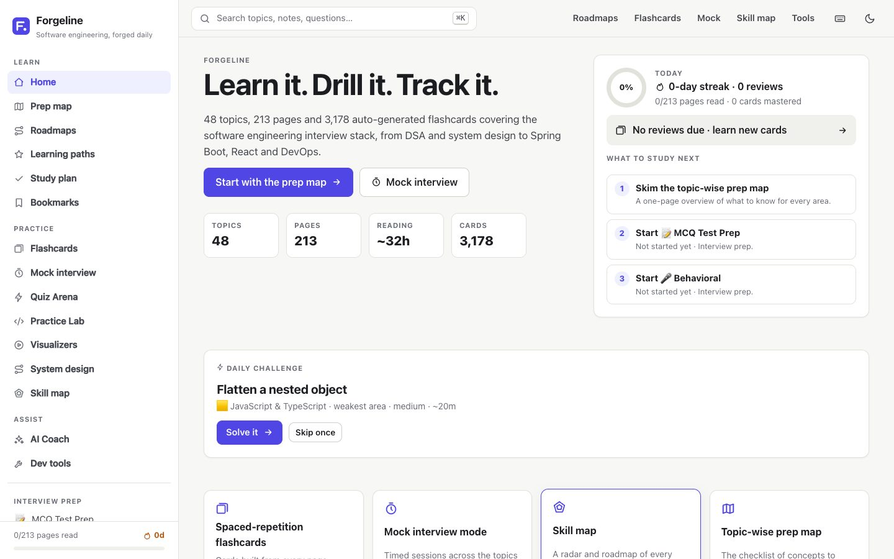 | 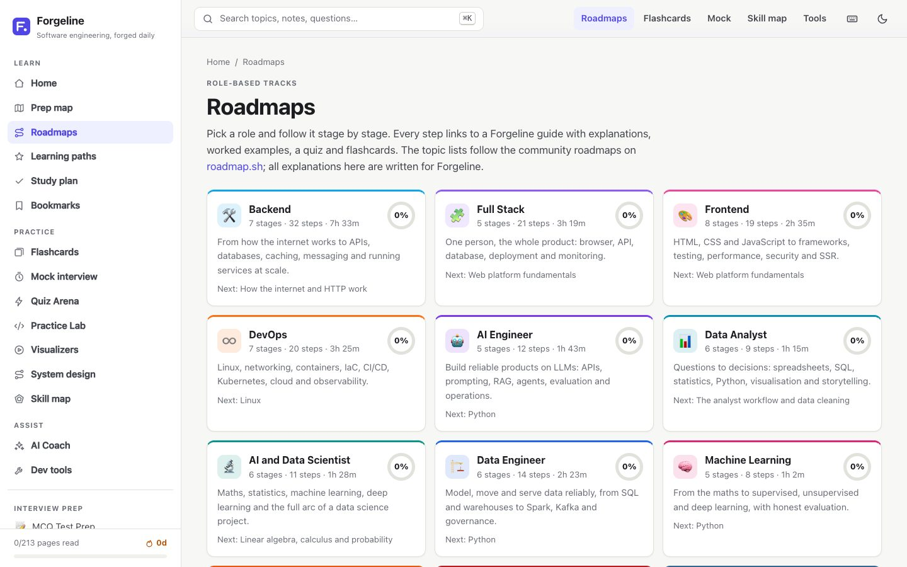 |
| **Home**: daily challenge, review queue, what to study next | **Roadmaps**: 24 role-based tracks with progress rings |
| 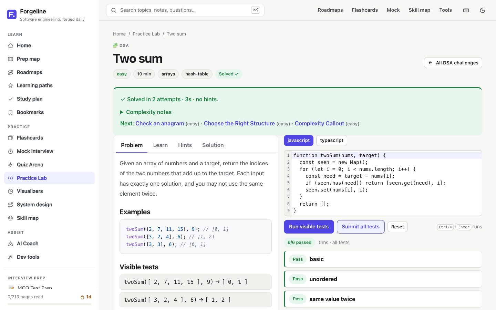 | 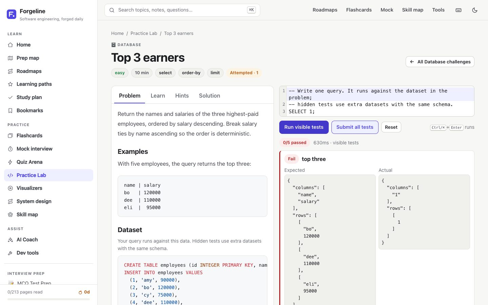 |
| **Practice Lab**: JS/TS challenges tested in your browser | **SQL and Python** in sandboxed Web Workers |
| 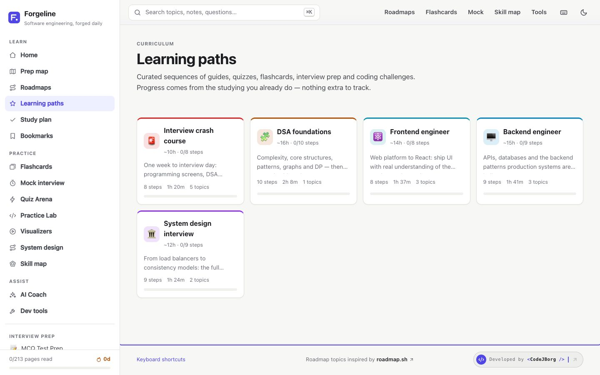 | 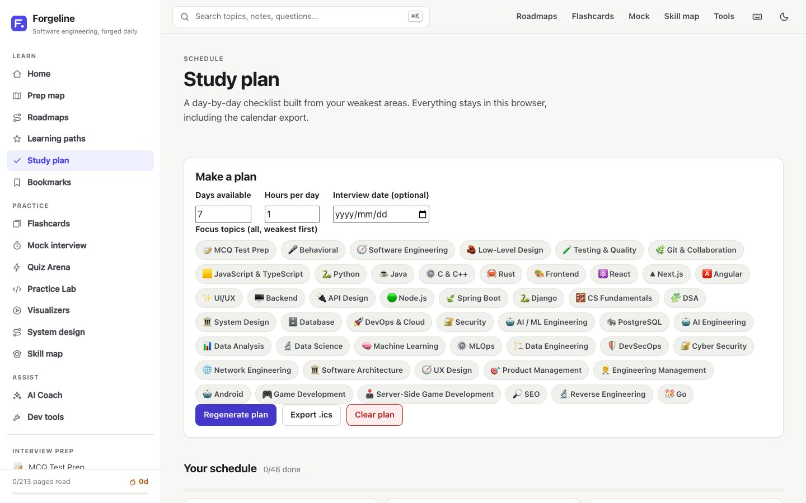 |
| **Learning paths**: guides, quizzes, practice and interviews in sequence | **Study plan**: a day-by-day checklist with `.ics` export |
| 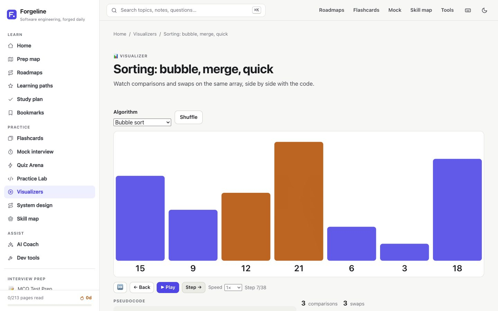 | 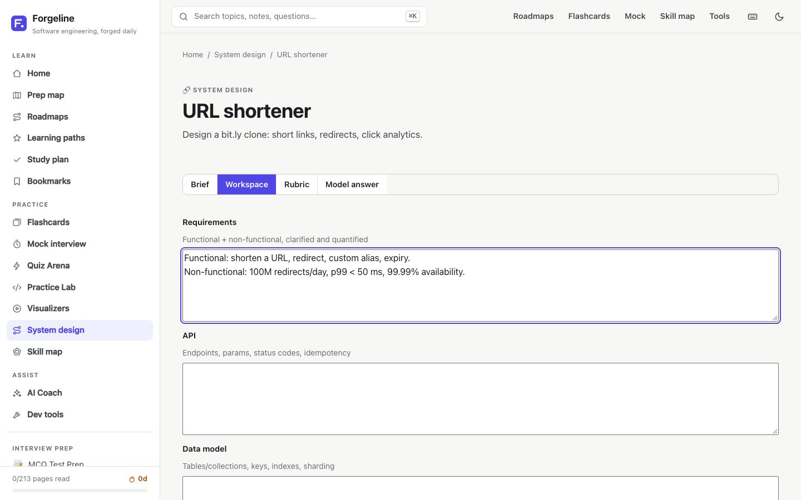 |
| **Visualizers**: step through sorting, graphs, the event loop and more | **System design**: structured answers, live Mermaid and a rubric |
| 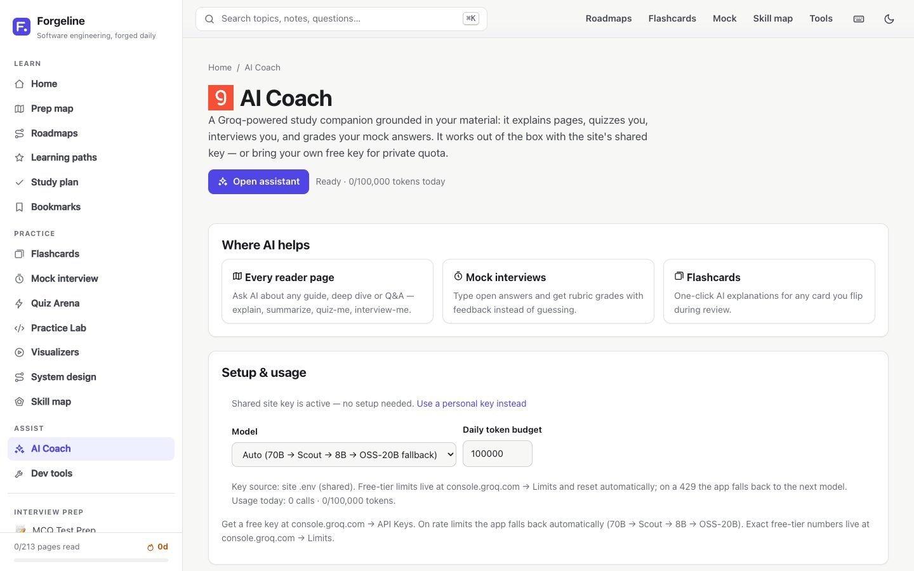 | 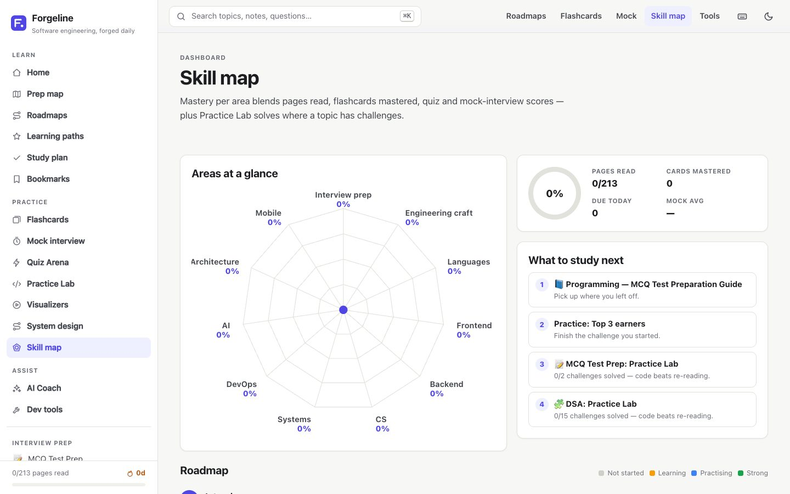 |
| **AI Coach** (bring your own Groq key) | **Skill map**: radar chart, study-next list and badges |
| 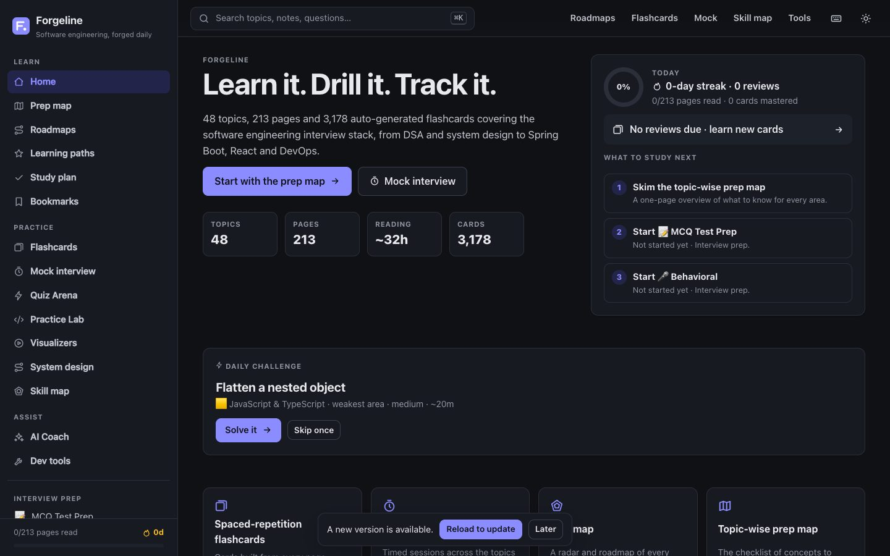 | 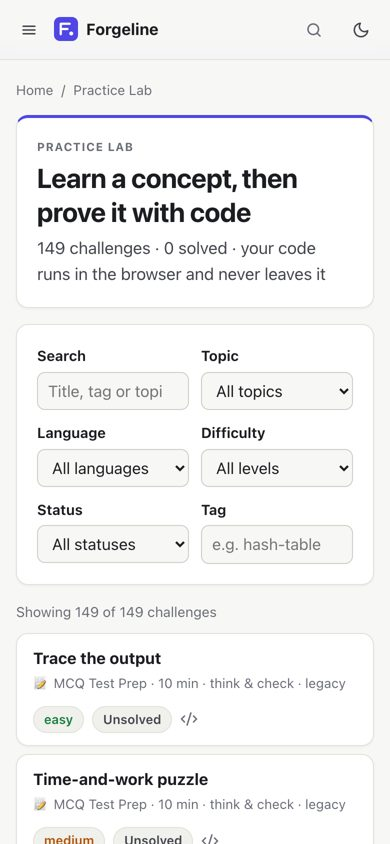 |
| **Dark theme** with no flash on load | **Responsive**: works on phones |

## Tech stack

- **Frontend:** React 19, TypeScript, Vite, React Router 7
- **Content:** Markdown compiled to static JSON at build time (`gray-matter`, `react-markdown`, `rehype-highlight`, Mermaid)
- **Practice Lab:** Web Workers, Pyodide (Python), SQLite WASM via `sql.js`, CodeMirror 6, Sucrase for TypeScript
- **AI coach:** Groq, bring your own key, with model fallback and a daily token budget guard
- **Platform:** hand-rolled PWA service worker, prerendered SEO shells, per-page Open Graph images (resvg)
- **Quality:** oxlint, Playwright smoke tests, GitHub Actions CI, a content validator
- **Hosting:** Vercel (static build)

## Features

- **24 role-based roadmaps** (`/roadmaps`): Backend, Full Stack, Frontend, AI Engineer, Software Architect, DevOps, DevSecOps, Android, SEO, Data Analyst, AI & Data Scientist, Data Engineer, PostgreSQL, Machine Learning, API Design, QA, Cyber Security, UX Design, Game Developer, Server Side Game Developer, Product Manager, MLOps, Engineering Manager and Network Engineer. Each stage links to original guides, and every track has a progress ring and a checkpoint quiz. Topic checklists are inspired by [roadmap.sh](https://roadmap.sh/); all explanations are original.
- **48 topics in 11 groups:** Interview prep, Engineering craft, Languages (JS/TS, Python, Java, C/C++, Rust, Go), Frontend, Backend & frameworks, CS & algorithms, Systems & data, DevOps/cloud/security (incl. Reverse Engineering), AI & data, Architecture/product/leadership, Mobile/games/growth. 213 Markdown pages in all.
- **Quizzes and practice on every topic:** 392 MCQs and 125 practice problems across all topics, defined in each topic's `meta.json`, plus 24 executable Practice Lab challenges (8 JS/TS, 8 Python, 8 SQL) under `content/<topic>/practice/`.
- **Readers for every kind of page:** guides (`notes`), six deep-dive tracks, and interview Q&A in four levels. Each has a table of contents with scroll spy, syntax highlighting, copyable code blocks, heading anchors, a reading progress bar and prev/next navigation.
- **Prep map** (`/prep-map`): a topic-wise interview checklist that links every area to where it is covered.
- **Command palette search** (`Ctrl/⌘ K` or `/`): section-level full-text search across all content.
- **Spaced-repetition flashcards** (`/flashcards`): cards are generated automatically from interview Q&A, guide sections, prep-map definitions and topic MCQs. A daily review queue is scheduled with SM-2 intervals (Again / Hard / Good / Easy). You can pick decks per topic and card type and set a new-cards-per-day limit. A card counts as mastered once its interval reaches 21 days.
- **Mock interview mode** (`/mock`): a timed session of random questions across the topics you choose. You answer MCQs directly and self-grade open questions (or let the AI coach grade typed answers). At the end you get a score summary with per-topic results, weak areas linked to study material, a list of missed questions with "add to flashcards", and your session history.
- **Quiz Arena** (`/arena`): a rapid-fire MCQ game — 15 seconds per question, 3 lives, streak combos, time bonuses and local bests, with missed questions linked back to study material.
- **Practice Lab** (`/practice`): learn a concept, then prove it with code. A filterable catalog and a split-view workspace (Problem | Learn | Hints | Solution tabs, editor, results panel) with JS/TS, Python and SQL challenges executed in the browser against visible and hidden tests. Legacy topic problems appear as think-&-check challenges. See *Practice Lab sandbox* below for the guarantees.
- **Learning paths** (`/paths`): 5 curated curricula (including an interview crash course) with per-step status derived from existing progress, a "next step" button, and path progress on the skill map and home.
- **Daily challenge** (home): deterministic per day, biased toward your weakest topic, counting toward the streak with one skip allowed.
- **Study plan** (`/plan`): enter days/hours (and an optional interview date) to generate a day-by-day checklist from skill-map gaps and path steps; it re-plans when you fall behind and exports `.ics`.
- **Badges + share card** (skill map): declarative badge rules (streaks, mastery, mock scores, groups) and a locally rendered PNG share card (radar, streak, counts). Nothing is uploaded.
- **Notes & highlights** (`/notes`): select text in any reader to highlight, annotate or make a flashcard. Anchors use heading id + text-quote with re-anchor fallback; broken anchors are flagged as orphaned, never deleted. Markdown export included.
- **AI-generated cards:** a "Generate cards" button on readers uses the existing Groq client + token guard with strict validated JSON; accept/edit/delete in a preview before items join the SM-2 queue (labelled AI-generated, MCQ opt-in for mock/arena, deduped).
- **Visualizers** (`/visualize`, embeddable via `::visualizer{id="…"}` in guides): sorting, graph traversal (editable graph), event loop, B-tree lookup and hash-table collisions — lazy SVG, play/pause/step/back/speed, pseudocode + counters, step-only under reduced motion.
- **System design practice** (`/design`): 6 prompts (URL shortener, rate limiter, chat, news feed, notifications, file storage) with structured sections, lazy Mermaid preview, rubric checklist, model answers and optional AI review. Attempts saved locally.
- **Coding round in mocks** (`/mock` setup): optionally blend up to 3 timed (5 min) runnable coding challenges into a mock interview, with blended scoring, AI approach feedback and final code in results.
- **SEO + OG:** build-time prerendered route shells (title, description, canonical, Article JSON-LD, sitemap, robots) and a per-page OG image (`/og/<slug>.png`).
- **PWA:** installable manifest + icons, hand-rolled service worker (network-first navigations, cache-first hashed/vendor assets, SWR data/OG), offline fallback page, update toast and offline indicator. AI features disable gracefully offline.
- **Optional sync** (off by default, skill map): merge local progress with a GitHub Gist backup via per-record merge (union reads/bookmarks, last-write-wins SRS cards). AI keys are never synced.
- **AI study coach (Groq, BYOK):** page-grounded chat (explain / summarize / quiz-me / interview-me) on every reader page, AI grading in mock interviews, and one-click explanations on flashcards. Keys live in the browser or optional `.env` (`VITE_GROQ_API_KEY`, see `.env.example`); model chain falls back automatically on rate limits with a daily token budget guard.
- **Skill map dashboard** (`/skills`): a radar chart of every topic group plus a roadmap of all topics. Each tile shows pages read, cards mastered and quiz/mock scores, along with a ranked "what to study next" list. You can also export, import or reset your progress.
- **Developer tools** (`/tools`): 22 client-side utilities (JSON, SQL, JWT, regex, cron, curl, diff, git, Docker, LLM tokens, mock data, subnet, QR, Unicode…) with search, favorites and recent history. No data leaves the browser.
- **Progress tracking:** read/bookmark state, quiz scores, solved practice problems and a daily streak.
- **Footer credit:** a "Developed by `<CodeJBorg />`" pill linking to [junaidul.pro.bd/codejborg](https://junaidul.pro.bd/codejborg).
- **Brand marks:** language/framework logos vendored from [thesvg.org](https://thesvg.org/) under `public/logos/` (trademarks belong to their owners).
- **UX:** light/dark theme with no flash on load, responsive layout with a mobile drawer, keyboard shortcuts (`?` lists them), a skip link, ARIA-labelled navigation and dialogs, reduced-motion support and print styles.

## Quick start

```bash
npm install
npm run dev        # compiles content, then starts Vite on http://localhost:5173
npm run build      # compiles content, type-checks, builds to dist/
npm run preview    # serves dist/
npm run lint       # oxlint
```

Requires Node 20+ (tested on Node 22).

| Script | What it does |
|---|---|
| `npm run content` | compile `content/` into static JSON in `public/data/` (runs automatically via `predev` / `prebuild`) |
| `npm run vendor` | vendor Pyodide + sql.js into `public/vendor/` (runs automatically via `predev` / `prebuild`) |
| `npm run validate` | content validator + practice validator (runs automatically via `prebuild`, fails on errors; warns only via `predev`) |
| `npm run validate:content` | check meta.json schema, manifest refs, interview format, links, leaked markup, placeholders, fences, duplicate slugs |
| `npm run validate:practice` | run every Practice Lab reference solution against its tests (run it manually while authoring) |
| `npm run lint` | oxlint |
| `npm run prerender` | write SEO route shells + sitemap/robots and stamp the service worker (runs automatically after `vite build`) |
| `npm run og` | generate per-page OG images into `dist/og/` (runs automatically after `prerender`) |
| `npm run icons` | generate PWA icons into `dist/icons/` (runs automatically after `vite build`) |
| `npm run dev` | Vite dev server |
| `npm run preview` | Serves the production build locally |
| `npm run e2e` | Playwright smoke suite (29 tests) against `preview` on port 4173, no external network |

CI (`.github/workflows/ci.yml`) runs on push and PR: Node 22, `npm ci`, validate, lint, build, plus a bundle-size summary.

## Content quality

The content was reviewed after the merge: leaked citation markup (e.g. `<cite index=…>`) was stripped, placeholder interview answers were replaced with complete ones, wrong quiz answer keys and explanations were fixed, personal references were neutralised, internal links were repaired, and version facts (e.g. Spring Boot 4) were brought up to date. When editing content, keep it plain Markdown with no tool-generated markup.

## Content model

```
content/
  manifest.json               groups + topic order
  prep-map.md                 topic-wise prep map
  paths/<slug>.json           learning paths: title, blurb, estimatedHours, steps[{type, ref}]
  design/<slug>.md            system-design prompts: frontmatter (title, blurb, emoji) + Brief/Model answer
  <topic>/
    meta.json                 title, emoji, group, blurb, quiz[], problems[], relatedTopics[]
    notes/*.md                guides (most came from PrepShelf)
    deep/<track>.md           theory | internals | best-practices | real-world-projects | performance | pitfalls
    interview/<level>.md      basics | medium | advanced | company-specific
    practice/<slug>.md        Practice Lab challenges (see below)
```

- **Interview files** use `## Q1. Question` headings with `**Answer:**`, `**Example:**`, `**Key takeaway:**` and `**Interview tip:**` sections. These headings feed the practice mode, flashcards and mock interviews.
- **Guides** are plain Markdown. `> **Asked as:** …` blockquotes render as interview callouts. Relative `.md` links are rewritten to site routes.
- **Topic quizzes** in `meta.json` appear on topic pages and become MCQ flashcards and mock questions.
- To **add a topic**, create `content/<slug>/meta.json` plus Markdown files, then add the slug to a group in `content/manifest.json`. `scripts/build-content.mjs` does the rest.
- **Learning paths** (`content/paths/*.json`) reference existing catalog entries only (`guide`, `quiz`, `flashcards`, `interview`, `practice` + `ref`); they compile into `catalog.json` `paths` and derive status from the progress/practice stores. **Design prompts** (`content/design/*.md`) carry YAML frontmatter plus a brief and a model answer.
- **Visualizer embeds:** a `::visualizer{id="<id>"}` line in any guide renders the matching lazy visualizer (`src/visualizers/registry.ts`).
- **Practice challenges** live in `content/<topic>/practice/<slug>.md`: frontmatter (`id`, `title`, `difficulty`, `tags`, `languages`, `runner`, `estimatedMinutes`, `learnLinks` to `topic/kind/id` pages), a statement preamble plus `## Examples`, `## Learn`, `## Hints` (3 bullets), `## Solution`, `## Complexity`, `## Common mistakes`, and fenced blocks (```starter:<lang>, ```solution:<lang>, ```visible-tests / ```hidden-tests JSON, ```seed-sql for SQL). The compiler emits `practice.json` plus one lazy JSON per challenge, and adapts legacy `meta.json` `problems[]` into think-&-check challenges (no schema change). `npm run validate:practice` executes every reference solution against its tests and fails the build on any mismatch.

The compiler writes `catalog.json`, `search.json`, `cards.json`, per-topic extras and one JSON file per page. Pages load lazily, so the first load stays small. `public/data/` is generated and git-ignored.

## Progress storage

Everything is stored in your browser's `localStorage`:

| Key | Contents |
|---|---|
| `forgeline:progress:v1` | pages read, bookmarks, quiz scores, problems, SRS card state, mock history, streak |
| `forgeline:practice:v1` | Practice Lab attempts, hints used, solve times, drafts, last challenge (legacy solved problems migrate here on first load) |
| `forgeline:daily:v1` | daily challenge state (date, skip used, done) |
| `forgeline:plan:v1` | study plan inputs, generated days, manual checks |
| `forgeline:notes:v1` | highlights + notes with text-quote anchors |
| `forgeline:custom-cards:v1` | AI-generated cards + MCQ-in-sessions opt-in |
| `forgeline:design:v1` | design attempts per prompt |
| `forgeline:sync:v1` | sync provider, remote id, last result (**token stays in `forgeline:sync:token`, never exported or synced**) |
| `forgeline:theme` | `light` / `dark` |
| `forgeline:tools:*` | tool favorites + recents |
| `forgeline:arena:v1` | quiz arena bests |
| `forgeline:groq:*` | AI key, model, daily usage, token budget (key never leaves the browser except for Groq API calls) |

Progress saved by the old SWE Forge app (`swe-forge-progress-v2`) is migrated automatically on first load. Use **Skill map → Export** to back up or move progress between browsers (the file holds both progress keys; old progress-only files still import).

## Practice Lab sandbox

User code never leaves the browser: the only network calls the app makes are the existing opt-in Groq calls, and only when the user triggers them. Runtimes (editor, Pyodide, sql.js) are vendored same-origin static files under `public/vendor/`, loaded lazily only on `/practice` routes — the initial bundle holds none of them.

What is actually guaranteed:

- **Isolation:** JS/TS, Python and SQL user code runs in a Web Worker with no DOM, `document` or `localStorage` access. Each SQL run gets a fresh in-memory database; each Python run a fresh namespace.
- **No network:** network-capable worker globals (`fetch`, `XMLHttpRequest`, `WebSocket`, …) are neutralized, and Python blocks `js`/`pyodide_js`/`micropip` imports. SQLite has no I/O at all.
- **Bounds:** stdout is capped (~20KB), and a run timeout is enforced by terminating and respawning the worker (5s JS, 15s Python incl. runtime load, 10s SQL). No COOP/COEP headers required.

Honest limits: this stops accidents, not a determined attacker running their own code — the threat model is the user's own mistakes, since the code being run is theirs. A user who deliberately unhooks the Python import block or smuggles `fetch` back via the `Function` constructor can only exfiltrate their own session. The AI coach never receives reference solutions or hidden tests (only the statement, visible tests, the user's code and run output), and AI hint usage is tracked in AI settings rather than the challenge hint count. `VITE_RUNNER_URL` is recognized as a future hook for a self-hosted runner for compiled languages (Java/C/C++/Rust/Go stay think-&-check for now) but remote execution is not implemented.

## Deployment

The frontend is a static Vite build deployed on **Vercel**. Vercel runs `npm run build`, which compiles the content first, and serves `dist/`. `vercel.json` rewrites client routes such as `/topics/java` to `index.html`, so deep links and refreshes work — except prerendered SEO shells (`/topics/*`, `/prep-map`), which are served as static HTML with canonical + OG tags.

Build pipeline order: `prebuild` (content → data, vendor runtimes, validate) → `tsc` → `vite build` → `icons` → `prerender` (262 route shells, sitemap, robots, SW version stamp) → `og` (262 PNGs, ~85–95s cold with worker threads, faster warm via `node_modules/.cache`). OG generation uses system fonts (resolved via `fc-match`) with Twemoji-rendered emoji, plus the `@resvg/resvg-js` native dep (no browser needed). `dist/og/*.png` and shells add output size — watch Vercel build minutes.

The service worker (`public/sw.js`, version-stamped per build) uses network-first navigations so a deploy is never shadowed by stale HTML; hashed assets/vendor are cache-first, data/OG are stale-while-revalidate. Approve the "update available" toast to activate a new SW. `/sw.js`, `/og/*`, `/data/*` and `/icons/*` bypass the SPA rewrite (see `vercel.json`).

## Project layout

```
src/
  lib/          content loading, progress + practice stores, runners, SM-2 scheduler, stats, theme, hotkeys, AI client
  workers/      JS/TS, Python (Pyodide) and SQL (SQLite) sandbox workers
  components/   layout, sidebar, command palette, markdown renderer, charts, quiz/practice panels, AI panel, code editor
  pages/        home, topic, reader, flashcards, mock, arena, skill map, bookmarks, tools, practice lab,
                paths, study plan, notes, visualize hub, design, sync panel
  styles/       global.css, prose.css, tools.css, ai.css, arena.css, practice.css
  tools/        22 client-side developer utilities
  visualizers/  lazy SVG visualizers (sorting, graph, event loop, btree, hash table) + shared player
scripts/build-content.mjs      compiles content/ + paths + design index into public/data/
scripts/validate-content.mjs   content quality gate (schema, links, placeholders, fences, slugs)
scripts/validate-practice.mts  runs every reference solution against its tests (build gate)
scripts/vendor-runtimes.mjs    vendors Pyodide + sql.js to public/vendor/
scripts/prerender.mjs          SEO route shells + sitemap/robots + SW stamp (post-build)
scripts/og.mjs + og-worker.mjs per-page OG images via resvg worker threads (post-build)
scripts/seo-lib.mjs            shared route/title/description helpers for prerender + OG
scripts/icons.mjs              PWA icons from public/icons/icon.svg (post-build)
scripts/fonts.mjs              shared font buffers for OG rendering
public/sw.js                   hand-rolled service worker (network-first navigations, versioned caches)
public/offline.html            offline fallback page
content/        48 topics + prep map + roadmap tracks + 5 learning paths + 6 design prompts
```

## Roadmap credit

The topic checklists behind the 24 roadmaps are **inspired by [roadmap.sh](https://roadmap.sh/)**. Forgeline is not affiliated with roadmap.sh. All guides, diagrams, examples, quizzes and flashcards in this repository were written from scratch and fact-checked against current (2026) versions.

## Contributing

Contributions are welcome. Read [CONTRIBUTING.md](CONTRIBUTING.md) first, and please follow the [Code of Conduct](CODE_OF_CONDUCT.md). To report a vulnerability, see [SECURITY.md](SECURITY.md).

## License

Forgeline is released under the [MIT License](LICENSE). Brand marks under `public/logos/` belong to their respective owners.

## Credits

Developed by **[`<CodeJBorg />`](https://junaidul.pro.bd/codejborg)**, a software studio from Bangladesh founded in 2025. See more work at [junaidul.pro.bd/projects](https://junaidul.pro.bd/projects).
