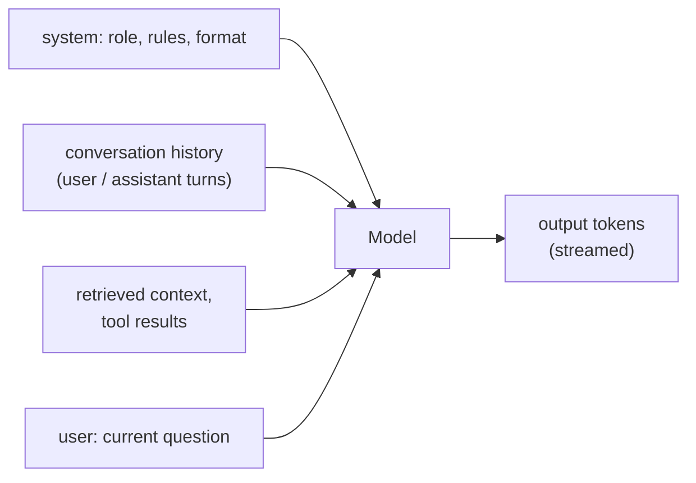

# LLM APIs, Prompting and Structured Output

An AI engineer builds products on top of large language models. You rarely train the models. Your job is to call them reliably, give them the right context, get output your code can trust, and keep cost and latency under control. This guide covers how LLM APIs work, how to write prompts that behave consistently, and how to get validated, structured data back instead of free text.

## 1. What an LLM call actually is

A model predicts the next **token** (a word piece, about ¾ of an English word on average) again and again, conditioned on everything before it. An API call sends a list of **messages** and returns generated tokens.



Things that follow from this:

- **The model is stateless.** "Memory" in a chat is just you re-sending the history on every call, which costs tokens every time.
- **The context window is a budget.** Everything (instructions, history, documents and the answer) must fit inside it, and you pay for input *and* output tokens.
- **Output is probabilistic.** `temperature` controls randomness. Use low values (0–0.3) for extraction and classification, and higher values for creative writing.

## 2. A production-grade API call

Most providers expose a similar chat API. Here is a provider-neutral pattern in TypeScript, using an OpenAI-compatible SDK:

```ts
import OpenAI from 'openai';

const client = new OpenAI({ apiKey: process.env.LLM_API_KEY, timeout: 30_000, maxRetries: 2 });

export async function summariseTicket(ticket: string) {
  const res = await client.chat.completions.create({
    model: process.env.LLM_MODEL!,           // configurable: swap models without code changes
    temperature: 0.2,
    max_tokens: 300,                          // cap output cost and latency
    messages: [
      { role: 'system', content: 'You summarise customer support tickets for agents. Be factual. Never invent order numbers.' },
      { role: 'user', content: ticket },
    ],
  });
  const usage = res.usage;                   // log tokens for cost tracking
  logger.info({ inTok: usage?.prompt_tokens, outTok: usage?.completion_tokens }, 'llm.summarise');
  return res.choices[0].message.content ?? '';
}
```

Production essentials: **timeouts and bounded retries** (providers return 429 and 5xx under load), **model name in config**, **token usage logged** per feature, and the API key kept server-side, never in a browser bundle.

### Streaming

Users perceive speed by **time to first token (TTFT)**, not total time. Stream tokens to the UI:

```ts
const stream = await client.chat.completions.create({ model, messages, stream: true });
for await (const chunk of stream) {
  const delta = chunk.choices[0]?.delta?.content;
  if (delta) res.write(`data: ${JSON.stringify(delta)}\n\n`);   // SSE to the browser
}
res.end();
```

## 3. Prompting that works consistently

Prompting is specification writing. A reliable prompt states:

1. **Role and audience:** "You are a support assistant for QuickFood customers."
2. **Task:** exactly what to produce.
3. **Constraints:** what never to do ("If the answer isn't in the provided context, say you don't know").
4. **Output format:** a schema or template.
5. **Examples (few-shot):** two or three input-to-output pairs covering tricky cases.

```text
SYSTEM:
You classify restaurant reviews for a food delivery app.
Return JSON only, matching the schema. Categories: food_quality, delivery_time,
rider_behaviour, packaging, price, other. A review can have several categories.
sentiment is one of: positive, neutral, negative.

Example
Review: "Biryani was amazing but arrived 40 minutes late and cold."
Output: {"categories":["food_quality","delivery_time"],"sentiment":"neutral"}

USER:
Review: "Rider was rude and the box was leaking."
```

Techniques that help:

- **Put long documents first and the question last.** Models attend well to the end of the prompt.
- **Delimit untrusted input** with clear markers (`<review>...</review>`) so instructions and data don't blur.
- **Ask for reasoning before the answer** on multi-step problems ("think step by step, then give the final answer in `<answer>` tags"). Reasoning models do this internally, so check provider guidance.
- **Version prompts like code.** Keep them in the repo, review changes, and evaluate them (see the evaluation guide) before shipping.

## 4. Structured output: stop parsing free text

Asking for "JSON please" works most of the time, and "most of the time" breaks production. Use the provider's **structured output / JSON schema mode** or **tool calling**, and always **validate** what you receive:

```python
from pydantic import BaseModel, Field
from typing import Literal
from openai import OpenAI

class ReviewLabel(BaseModel):
    categories: list[Literal["food_quality", "delivery_time", "rider_behaviour", "packaging", "price", "other"]] = Field(min_length=1)
    sentiment: Literal["positive", "neutral", "negative"]

client = OpenAI()

def classify(review: str) -> ReviewLabel:
    res = client.beta.chat.completions.parse(
        model=MODEL,
        temperature=0,
        messages=[{"role": "system", "content": SYSTEM_PROMPT},
                  {"role": "user", "content": f"<review>{review}</review>"}],
        response_format=ReviewLabel,         # the SDK sends a JSON schema and parses the reply
    )
    return res.choices[0].message.parsed     # a validated ReviewLabel, or an exception
```

If your provider lacks native schema enforcement, use a library like **Instructor** (Python/TS) that validates with Pydantic or Zod and automatically re-asks the model with the validation error.

## 5. Tool (function) calling

Tool calling lets the model ask *your code* to do something, such as looking up an order. The model never executes anything itself. It returns a structured request, your code runs the function, and you send the result back.

```ts
const tools = [{
  type: 'function',
  function: {
    name: 'get_order_status',
    description: 'Look up the live status of a customer order by id',
    parameters: { type: 'object', properties: { orderId: { type: 'string' } }, required: ['orderId'] },
  },
}];

let messages = [{ role: 'system', content: SYSTEM }, { role: 'user', content: 'Where is my order o_42?' }];
const first = await client.chat.completions.create({ model, messages, tools });
const call = first.choices[0].message.tool_calls?.[0];

if (call?.function.name === 'get_order_status') {
  const { orderId } = JSON.parse(call.function.arguments);
  const status = await orders.getStatusForUser(orderId, currentUser.id);   // authorise as the USER
  messages = [...messages, first.choices[0].message, { role: 'tool', tool_call_id: call.id, content: JSON.stringify(status) }];
  const final = await client.chat.completions.create({ model, messages, tools });
  return final.choices[0].message.content;
}
```

The critical security rule: **tools run with the end user's permissions**, never with an all-powerful service account. Otherwise "show me order o_99" leaks someone else's data. The Model Context Protocol (MCP) standardises how tools are described and exposed to models, but the same authorisation rules apply.

## 6. Cost and latency control

| Lever | Effect |
|---|---|
| Route easy tasks to a smaller, cheaper model | Often 10–30× cheaper for classification and extraction |
| Prompt caching (provider feature) | Large repeated prefixes (system prompt, docs) billed at a discount, with faster TTFT |
| Trim history and context | Fewer input tokens on every call |
| Cap `max_tokens` | Bounds output cost and time |
| Cache final answers for identical inputs | Zero cost on repeats |
| Batch APIs for offline jobs | Significant discounts when results can wait hours |

Estimate before you build. At 50,000 requests a day with 2,000 input and 300 output tokens each, multiply by your model's per-token prices. Then decide whether a smaller model plus retrieval can hit the quality bar.

## 7. Real-world case: a review classifier in production

A delivery company labels 80,000 reviews a day. Version 1 used a large model with "reply in JSON" and failed about 2% of the time on malformed output, which crashed the pipeline. Version 2:

- moved to schema-enforced structured output plus Pydantic validation,
- moved to a small model at temperature 0 after an evaluation set of 500 hand-labelled reviews showed equal accuracy,
- used the batch API for the overnight backlog,
- logged token usage per request into the metrics dashboard.

Parsing failures dropped to zero and cost fell by about 90%.

## 8. Hands-on exercise

1. Call any LLM API from a script with a timeout, retries and token logging.
2. Write a classification prompt with three few-shot examples. Run it on 30 inputs and count errors.
3. Switch to structured output with a Pydantic or Zod schema and compare failure rates.
4. Add a tool that reads from a fake orders table with a per-user permission check.
5. Stream the response to a small web page over SSE.

## 9. Checklist

- [ ] I understand tokens, context windows, statelessness and temperature.
- [ ] My LLM calls have timeouts, retries, configurable models and usage logging.
- [ ] I write prompts with role, task, constraints, format and examples, and version them.
- [ ] I use schema-enforced structured output and validate it.
- [ ] I implement tool calling with user-scoped authorisation and control cost and latency.

## 10. Interview angle

> **Asked as:** "How do you get reliable JSON out of an LLM?"

Use the provider's JSON-schema or structured-output mode or tool calling, validate with Pydantic or Zod, re-ask on validation failure, use a low temperature, and evaluate on a labelled set.

> **Asked as:** "How would you reduce the cost of an LLM feature?"

Measure tokens per request, route simple tasks to smaller models, cache prompts and answers, trim context, cap output, use batch APIs for offline work, and confirm quality with evaluations after every change.
