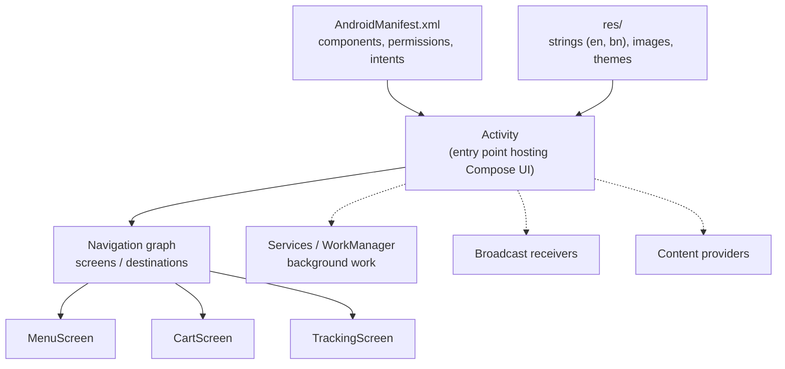

# Kotlin and Android Fundamentals with Jetpack Compose

Android runs on billions of devices, from flagship phones to the budget handsets most people in Bangladesh use. Modern Android development means **Kotlin**, **Jetpack Compose** for UI, and the Jetpack libraries for architecture, data and background work. This guide covers the Kotlin you need, how an Android app is structured, the lifecycle, and building UIs with Compose, through a small food-ordering example.

## 1. The 2026 landscape

- **Kotlin** is the recommended language (Kotlin 2.x with the K2 compiler). Java still works, and you'll meet it in older codebases.
- **Jetpack Compose** is the recommended UI toolkit for new apps. XML Views remain in legacy code.
- **Android 17 (API 37)** became stable in June 2026. Google Play requires new apps and updates to target at least **API 36 (Android 16)** from 31 August 2026, and the requirement rises every year, so plan the upgrade annually.
- **Android Studio** with Gradle (Kotlin DSL and version catalogs) is the standard toolchain.
- Design for **diverse devices**: small and large screens, foldables, tablets, low RAM, slow networks and battery-saver modes.

## 2. Kotlin essentials for Android

```kotlin
// Null safety: the compiler makes you handle "might be null"
val name: String = "Rahima"
val phone: String? = null
val display = phone ?: "No phone"            // Elvis operator: default when null
phone?.let { sendSms(it) }                    // run only if not null

// Data classes: equals/hashCode/toString/copy for free
data class MenuItem(val id: String, val name: String, val priceBdt: Int, val available: Boolean = true)
val biryani = MenuItem("m1", "Kacchi Biryani", 380)
val discounted = biryani.copy(priceBdt = 340)

// Sealed interfaces: exhaustive "one of these states"
sealed interface UiState<out T> {
    data object Loading : UiState<Nothing>
    data class Success<T>(val data: T) : UiState<T>
    data class Error(val message: String) : UiState<Nothing>
}

fun render(state: UiState<List<MenuItem>>) = when (state) {   // compiler checks every case
    UiState.Loading -> "Loading…"
    is UiState.Success -> "${state.data.size} items"
    is UiState.Error -> "Oops: ${state.message}"
}

// Extension functions and collection operations
fun Int.asTaka() = "৳%,d".format(this)
val total = cart.filter { it.available }.sumOf { it.priceBdt * it.qty }
```

### Coroutines and Flow

Android's main thread draws the UI, and blocking it for about 5 seconds triggers an "Application Not Responding" dialog. **Coroutines** make asynchronous code look sequential, and **Flow** models streams of values over time:

```kotlin
suspend fun loadMenu(restaurantId: String): List<MenuItem> =
    withContext(Dispatchers.IO) {                 // run network/disk work off the main thread
        api.getMenu(restaurantId)
    }

// A Flow of order status updates, e.g. from a WebSocket or polling
fun orderStatus(orderId: String): Flow<OrderStatus> = flow {
    while (true) {
        emit(api.getStatus(orderId))
        delay(5_000)
    }
}.distinctUntilChanged()
```

**Structured concurrency:** coroutines launched in a scope (`viewModelScope`, `lifecycleScope`) are cancelled automatically when that scope ends, so you don't leak work after the user leaves a screen.

## 3. Anatomy of an Android app



- **Activity:** a screen entry point. Modern apps often use a **single activity** with Compose navigation between screens.
- **Intents** start activities, deep links and other apps (share, open maps, dial).
- **Resources:** `strings.xml` per language (`values-bn/strings.xml` for Bangla), densities for images, and themes. Never hard-code user-visible text.
- **Permissions:** declared in the manifest, and dangerous ones (location, camera, notifications) requested at runtime with an explanation of why.

## 4. The lifecycle

Android can destroy and recreate your screen at any time: on rotation, theme or language changes, when moving to the background, or when the process is killed to free memory.

| State | Meaning |
|---|---|
| `onCreate` | Set up the UI (`setContent { … }`) |
| `onStart` / `onStop` | Becoming visible or invisible |
| `onResume` / `onPause` | Gaining or losing focus |
| `onDestroy` | Being destroyed (a configuration change or finishing) |

Rules that prevent most lifecycle bugs:

- Keep screen state in a **ViewModel**, which survives configuration changes, and use **`SavedStateHandle`** or `rememberSaveable` for small state that must survive process death (the selected tab, form input).
- Collect flows in a lifecycle-aware way (`collectAsStateWithLifecycle()`), so work stops when the screen isn't visible.
- **Never hold an Activity or Context reference in a ViewModel or a long-lived object.** That causes memory leaks.

## 5. Building UI with Jetpack Compose

Compose is **declarative**: you describe the UI for the current state, and Compose re-runs (**recomposes**) the affected functions when the state changes.

```kotlin
@Composable
fun MenuScreen(viewModel: MenuViewModel = hiltViewModel()) {
    val state by viewModel.uiState.collectAsStateWithLifecycle()
    MenuContent(state = state, onAdd = viewModel::addToCart, onRetry = viewModel::refresh)
}

@Composable
fun MenuContent(state: UiState<List<MenuItem>>, onAdd: (MenuItem) -> Unit, onRetry: () -> Unit) {
    when (state) {
        UiState.Loading -> Box(Modifier.fillMaxSize(), contentAlignment = Alignment.Center) { CircularProgressIndicator() }
        is UiState.Error -> ErrorView(message = state.message, onRetry = onRetry)
        is UiState.Success -> LazyColumn(contentPadding = PaddingValues(16.dp), verticalArrangement = Arrangement.spacedBy(12.dp)) {
            items(state.data, key = { it.id }) { item ->            // stable keys = efficient updates
                MenuRow(item = item, onAdd = { onAdd(item) })
            }
        }
    }
}

@Composable
fun MenuRow(item: MenuItem, onAdd: () -> Unit) {
    Card(Modifier.fillMaxWidth()) {
        Row(Modifier.padding(16.dp), verticalAlignment = Alignment.CenterVertically) {
            Column(Modifier.weight(1f)) {
                Text(item.name, style = MaterialTheme.typography.titleMedium)
                Text(item.priceBdt.asTaka(), style = MaterialTheme.typography.bodyMedium)
            }
            Button(onClick = onAdd, enabled = item.available) {
                Text(stringResource(R.string.add))                   // localised
            }
        }
    }
}

@Preview(showBackground = true, locale = "bn")
@Composable
fun MenuRowPreview() = AppTheme { MenuRow(MenuItem("m1", "কাচ্চি বিরিয়ানি", 380), onAdd = {}) }
```

Key Compose ideas:

- **State hoisting:** stateless composables receive state and callbacks (`MenuContent`), which makes them reusable, previewable and testable. A screen-level composable connects them to the ViewModel.
- **`remember`** keeps a value across recompositions. **`rememberSaveable`** also survives configuration changes and process death.
- **Modifiers** chain layout, drawing and behaviour (`padding`, `clickable`, `semantics`). Order matters.
- **Lazy lists** (`LazyColumn`, `LazyVerticalGrid`) only compose visible items. Always provide stable `key`s.
- **Material 3** components and theming (dynamic colour, typography, shapes) give consistent, accessible defaults.
- **Adaptive layouts:** use window size classes to show a list-detail layout on tablets and foldables instead of a stretched phone UI.

### Navigation

```kotlin
@Serializable data object Menu
@Serializable data class Tracking(val orderId: String)

NavHost(navController, startDestination = Menu) {
    composable<Menu> { MenuScreen(onCheckout = { id -> navController.navigate(Tracking(id)) }) }
    composable<Tracking>(deepLinks = listOf(navDeepLink<Tracking>(basePath = "https://quickfood.example/track"))) {
        TrackingScreen()
    }
}
```

Type-safe routes (Kotlin serialization) prevent the "wrong argument name" bugs of string-based routes, and deep links let notifications open the right screen.

## 6. Accessibility and localisation

- Give every meaningful icon a `contentDescription`, and set it to `null` for decorative ones.
- Touch targets of at least 48 dp (Material components do this by default).
- Support font scaling: use `sp` for text and test at 200% font size.
- Use `semantics { }` to merge or describe complex elements for TalkBack.
- Provide **Bangla and English strings**, test long translations, and format currency, dates and numbers with locale-aware APIs.

## 7. Real-world case: the disappearing cart

Users complained that their cart emptied "randomly." It happened when they switched to the bKash app to pay and came back: on low-RAM phones, Android had killed the QuickFood process in the background. The cart lived only in a ViewModel, which survives rotation but not process death. The fix was to persist the cart in Room (the local database) as the single source of truth, keep the in-progress checkout step in `SavedStateHandle`, and test with "Don't keep activities" enabled in developer options and with `adb shell am kill`. Complaints stopped, and the team added process-death testing to its release checklist.

## 8. Hands-on exercise

1. Create a new Compose project in Android Studio (Empty Activity template).
2. Build a menu list screen with Loading, Error and Success states from a fake repository using `UiState`.
3. Add a cart screen with navigation and a type-safe route argument.
4. Add Bangla string resources and preview both locales.
5. Rotate the device, enable "Don't keep activities", and fix any state that is lost.

## 9. Checklist

- [ ] I'm comfortable with Kotlin null safety, data and sealed classes, extension functions, coroutines and Flow.
- [ ] I understand activities, intents, resources, permissions and the manifest.
- [ ] I handle the lifecycle, configuration changes and process death correctly.
- [ ] I build Compose UIs with state hoisting, lazy lists with keys, Material 3 and type-safe navigation.
- [ ] I make apps accessible and localised, and I know the current platform and Play target requirements.

## 10. Interview angle

> **Asked as:** "What's the difference between a ViewModel surviving configuration changes and process death?"

A ViewModel survives configuration changes like rotation because it's retained while the activity is recreated, but it's destroyed when the process is killed. Persist important data in a database or DataStore, and keep small UI state in `SavedStateHandle` or `rememberSaveable`.

> **Asked as:** "What is recomposition, and how do you avoid unnecessary work?"

Compose re-runs composables whose read state changed. Keep composables small and stateless, pass stable or immutable data, use `key`s in lazy lists, use `remember` and `derivedStateOf` for expensive calculations, and defer state reads to the lowest possible level.
