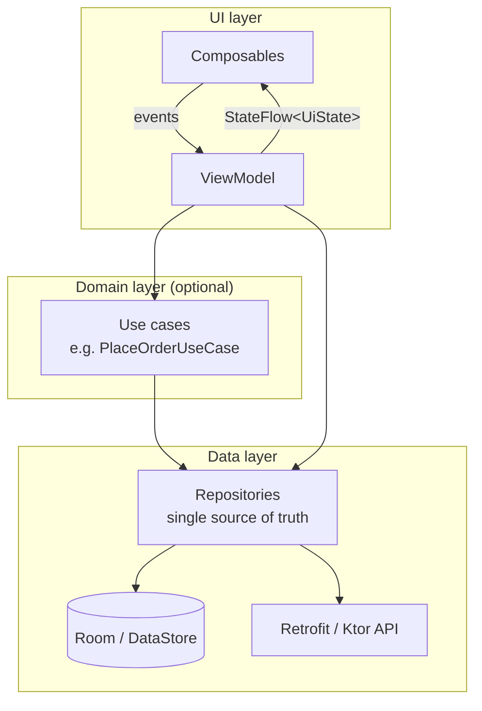

# Android App Architecture: MVVM, Data Layer, DI and Background Work

A screen that fetches data directly in a composable works in a demo and falls apart in a real app: duplicated logic, untestable code, lost state, and network calls repeated on every rotation. Google's recommended architecture separates the **UI layer**, an optional **domain layer** and the **data layer**, with unidirectional data flow. This guide builds that architecture with ViewModel, StateFlow, Room, Retrofit, Hilt, DataStore and WorkManager, including offline-first sync.

## 1. The layers



**Unidirectional data flow:** state flows *down* (ViewModel → UI) and events flow *up* (UI → ViewModel). The UI never mutates data directly, which makes behaviour predictable and testable.

## 2. The data layer

### Network with Retrofit

```kotlin
@Serializable data class MenuItemDto(val id: String, val name: String, val price: Int, val available: Boolean)

interface QuickFoodApi {
    @GET("v1/restaurants/{id}/menu")
    suspend fun getMenu(@Path("id") restaurantId: String): List<MenuItemDto>

    @POST("v1/orders")
    suspend fun placeOrder(@Header("Idempotency-Key") key: String, @Body body: PlaceOrderRequest): OrderDto
}

val okHttp = OkHttpClient.Builder()
    .addInterceptor(AuthInterceptor(tokenStore))                 // attach the access token
    .authenticator(TokenRefreshAuthenticator(tokenStore, authApi)) // refresh on 401
    .callTimeout(20, TimeUnit.SECONDS)
    .build()

val api = Retrofit.Builder()
    .baseUrl(BuildConfig.API_URL)
    .client(okHttp)
    .addConverterFactory(Json { ignoreUnknownKeys = true }.asConverterFactory("application/json".toMediaType()))
    .build()
    .create<QuickFoodApi>()
```

`ignoreUnknownKeys = true` lets older app versions survive when the server adds fields, which matters because you can't force every user to update.

### Local storage with Room

```kotlin
@Entity(tableName = "menu_items")
data class MenuItemEntity(
    @PrimaryKey val id: String, val restaurantId: String,
    val name: String, val priceBdt: Int, val available: Boolean, val updatedAt: Long,
)

@Dao
interface MenuDao {
    @Query("SELECT * FROM menu_items WHERE restaurantId = :rid ORDER BY name")
    fun observe(rid: String): Flow<List<MenuItemEntity>>           // emits on every change

    @Upsert suspend fun upsertAll(items: List<MenuItemEntity>)
    @Query("DELETE FROM menu_items WHERE restaurantId = :rid AND updatedAt < :before")
    suspend fun deleteStale(rid: String, before: Long)
}
```

**DataStore** (Preferences or Proto) replaces SharedPreferences for small key-value settings such as the selected city, language and onboarding flags, with an asynchronous, Flow-based API. Store tokens encrypted (for example with keys from the Android Keystore).

### Repository: an offline-first single source of truth

```kotlin
class MenuRepository @Inject constructor(
    private val api: QuickFoodApi,
    private val dao: MenuDao,
    @IoDispatcher private val io: CoroutineDispatcher,
) {
    // UI always reads from the database...
    fun menu(restaurantId: String): Flow<List<MenuItem>> =
        dao.observe(restaurantId).map { list -> list.map { it.toDomain() } }

    // ...and refresh writes network results into it
    suspend fun refresh(restaurantId: String): Result<Unit> = withContext(io) {
        runCatching {
            val now = System.currentTimeMillis()
            dao.upsertAll(api.getMenu(restaurantId).map { it.toEntity(restaurantId, now) })
            dao.deleteStale(restaurantId, before = now)
        }
    }
}
```

The UI shows cached data instantly (even offline, on a bus with patchy 4G), and refreshed data flows in automatically when the network returns.

## 3. The UI layer: ViewModel and state

```kotlin
data class MenuUiState(
    val items: List<MenuItem> = emptyList(),
    val isRefreshing: Boolean = false,
    val error: String? = null,
    val cartCount: Int = 0,
)

@HiltViewModel
class MenuViewModel @Inject constructor(
    savedState: SavedStateHandle,
    private val menuRepo: MenuRepository,
    private val cartRepo: CartRepository,
) : ViewModel() {
    private val restaurantId: String = savedState.toRoute<RestaurantRoute>().id
    private val refreshing = MutableStateFlow(false)
    private val error = MutableStateFlow<String?>(null)

    val uiState: StateFlow<MenuUiState> =
        combine(menuRepo.menu(restaurantId), cartRepo.count(), refreshing, error) { items, count, r, e ->
            MenuUiState(items = items, cartCount = count, isRefreshing = r, error = e)
        }.stateIn(viewModelScope, SharingStarted.WhileSubscribed(5_000), MenuUiState(isRefreshing = true))

    init { refresh() }

    fun refresh() = viewModelScope.launch {
        refreshing.value = true
        menuRepo.refresh(restaurantId).onFailure { error.value = "Couldn't update the menu. Showing saved items." }
        refreshing.value = false
    }

    fun addToCart(item: MenuItem) = viewModelScope.launch { cartRepo.add(item) }
}
```

`SharingStarted.WhileSubscribed(5_000)` keeps the upstream flows alive through a quick rotation but stops them 5 seconds after the screen goes away, which saves battery and data.

## 4. Dependency injection with Hilt

DI provides dependencies (API clients, DAOs, repositories) instead of having classes construct them, which makes them replaceable in tests:

```kotlin
@HiltAndroidApp class QuickFoodApp : Application()

@Module @InstallIn(SingletonComponent::class)
object DataModule {
    @Provides @Singleton fun db(@ApplicationContext ctx: Context) =
        Room.databaseBuilder(ctx, AppDatabase::class.java, "quickfood.db").build()
    @Provides fun menuDao(db: AppDatabase) = db.menuDao()
    @Provides @Singleton fun api(): QuickFoodApi = buildApi()
}

@AndroidEntryPoint class MainActivity : ComponentActivity() { /* hiltViewModel() works in composables */ }
```

In tests, replace modules with fakes (`@TestInstallIn`) so ViewModels and repositories can be tested without a network.

## 5. Background work

| Need | Tool |
|---|---|
| Work tied to a screen (load the menu) | Coroutines in `viewModelScope` |
| Deferrable, guaranteed work, even after app restart (upload a delivery photo, sync the cart, send analytics) | **WorkManager** |
| Ongoing user-visible work (navigation, live rider location sharing) | **Foreground service** with a notification and the correct foreground service type |
| Exact-time alarms | AlarmManager (restricted, so justify it) |

```kotlin
class UploadProofWorker(ctx: Context, params: WorkerParameters, private val api: RiderApi) : CoroutineWorker(ctx, params) {
    override suspend fun doWork(): Result {
        val deliveryId = inputData.getString("deliveryId") ?: return Result.failure()
        val path = inputData.getString("photoPath") ?: return Result.failure()
        return try {
            api.uploadProof(deliveryId, File(path).asRequestBody("image/jpeg".toMediaType()))
            Result.success()
        } catch (e: IOException) {
            if (runAttemptCount < 5) Result.retry() else Result.failure()   // backoff handled by WorkManager
        }
    }
}

val request = OneTimeWorkRequestBuilder<UploadProofWorker>()
    .setInputData(workDataOf("deliveryId" to id, "photoPath" to path))
    .setConstraints(Constraints(requiredNetworkType = NetworkType.CONNECTED))
    .setBackoffCriteria(BackoffPolicy.EXPONENTIAL, 30, TimeUnit.SECONDS)
    .build()
WorkManager.getInstance(context).enqueueUniqueWork("proof-$id", ExistingWorkPolicy.KEEP, request)
```

Modern Android restricts background execution heavily to save battery (Doze, app standby buckets, limits on starting services from the background). Fighting these restrictions leads to killed work and Play policy problems, so WorkManager is the right default for deferrable work.

## 6. Push notifications and real-time updates

- **Firebase Cloud Messaging (FCM)** delivers push messages. Use **data messages** to update local state, and request the `POST_NOTIFICATIONS` runtime permission (Android 13+) at a meaningful moment, not on first launch.
- For live order tracking while the screen is open, use a WebSocket, Server-Sent Events or a realtime service (such as Ably) in a ViewModel, and fall back to polling. Stop the connection when the screen isn't visible.

## 7. Real-world case: rider app photo uploads

Riders photograph deliveries as proof, often in buildings with no signal. Version 1 uploaded the photo directly from the screen, and 9% of proofs were lost when riders moved on or the app was killed. Version 2 saved the compressed photo to app storage, recorded a pending row in Room, and enqueued a unique WorkManager job with a network constraint and exponential backoff. The UI showed "Uploading… / Uploaded" from the Room row. Lost proofs dropped to under 0.1%, and disputes about undelivered orders fell sharply.

## 8. Hands-on exercise

1. Build an offline-first menu screen: Room DAO with a Flow, a Retrofit API, a repository that writes the network results into Room, and a ViewModel exposing `StateFlow<UiState>`.
2. Wire it up with Hilt.
3. Turn on airplane mode and confirm that cached data still shows, with a clear "offline" message.
4. Add a WorkManager job that syncs a pending cart or uploads a file with retry and a network constraint.
5. Write unit tests for the ViewModel using a fake repository and `kotlinx-coroutines-test`.

## 9. Checklist

- [ ] I structure apps into UI, domain and data layers with unidirectional data flow.
- [ ] I build repositories as a single source of truth, offline-first with Room and Flow.
- [ ] I expose UI state from ViewModels with StateFlow and handle loading and error states.
- [ ] I use Hilt for dependency injection and replace modules with fakes in tests.
- [ ] I choose the right background mechanism (coroutines, WorkManager, foreground services) and handle push permissions properly.

## 10. Interview angle

> **Asked as:** "How would you design an offline-first screen?"

Make the local database (Room) the single source of truth that the UI observes as a Flow. The repository fetches from the network and writes into the database. Show cached data immediately, with refresh state and errors in the UI state, queue writes for sync with WorkManager, and handle conflicts on the server.

> **Asked as:** "WorkManager vs coroutines vs foreground service?"

Coroutines suit work tied to a lifecycle scope. WorkManager suits deferrable work that must be guaranteed even after app restarts, with constraints and retries. A foreground service suits ongoing user-visible work, such as navigation or location sharing, and needs a notification and the declared service type.
