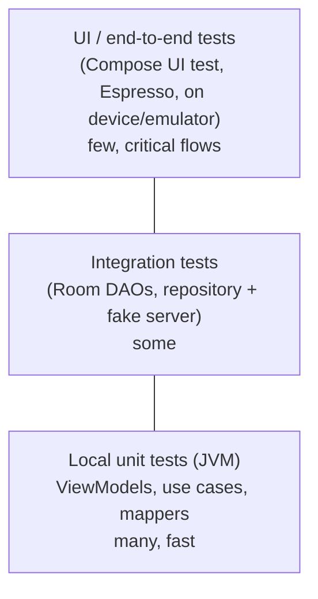
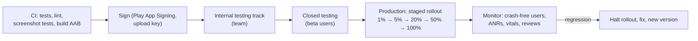

# Android Testing, Performance, Security and Publishing

Shipping an Android app means supporting thousands of device models, unreliable networks, many OS versions and users who uninstall at the first crash. This guide covers testing at every level, finding and fixing performance problems (startup, jank, memory, app size), securing the app and its data, and releasing through Google Play with staged rollouts and monitoring.

## 1. Testing pyramid on Android



### Unit testing a ViewModel

```kotlin
class MenuViewModelTest {
    @get:Rule val mainDispatcher = MainDispatcherRule()          // replaces Dispatchers.Main with a test dispatcher

    @Test fun `shows cached items and an error when refresh fails`() = runTest {
        val repo = FakeMenuRepository(cached = listOf(MenuItem("m1", "Biryani", 380)), refreshFails = true)
        val vm = MenuViewModel(SavedStateHandle(mapOf("id" to "r1")), repo, FakeCartRepository())

        vm.uiState.test {                                          // Turbine for Flow assertions
            val state = expectMostRecentItem()
            assertThat(state.items).hasSize(1)
            assertThat(state.error).contains("Showing saved items")
        }
    }
}
```

Use **fakes** (simple in-memory implementations of your interfaces) rather than heavy mocking for repositories. Tests become clearer and survive refactoring.

### Compose UI tests

```kotlin
class CheckoutScreenTest {
    @get:Rule val compose = createComposeRule()

    @Test fun placeOrderButtonShowsTotalAndIsDisabledWhenCartEmpty() {
        compose.setContent { AppTheme { CheckoutContent(state = CheckoutUiState(items = emptyList()), onPlace = {}) } }
        compose.onNodeWithText("Place order", substring = true).assertIsNotEnabled()
    }

    @Test fun showsPaymentErrorWithRetry() {
        var retried = false
        compose.setContent { CheckoutContent(state = CheckoutUiState(paymentError = "bKash payment didn't go through"), onRetry = { retried = true }) }
        compose.onNodeWithText("bKash payment didn't go through").assertIsDisplayed()
        compose.onNodeWithText("Try again").performClick()
        assertTrue(retried)
    }
}
```

Test the stateless `…Content` composables with explicit state, so tests are fast and deterministic. Use **screenshot tests** (Roborazzi, Paparazzi, or Compose Preview screenshot testing) to catch visual regressions across themes, locales and font sizes, and run a few end-to-end flows on real devices in a device farm (Firebase Test Lab) to cover manufacturer quirks.

## 2. Performance

Users notice slow startup, janky scrolling and battery drain, and Android vitals in Play Console track them, which affects store visibility.

### App startup

- Measure **time to initial display** and **time to full display** (report it with `reportFullyDrawn()`).
- Keep `Application.onCreate` light: defer SDK initialisation, use App Startup or lazy initialisation, and avoid disk and network work on the main thread.
- Ship **Baseline Profiles**, which precompile critical code paths and often improve startup and first-scroll performance by 20–30% or more:

```kotlin
// macrobenchmark module: generate a Baseline Profile by exercising critical journeys
@RunWith(AndroidJUnit4::class)
class BaselineProfileGenerator {
    @get:Rule val rule = BaselineProfileRule()
    @Test fun generate() = rule.collect(packageName = "com.quickfood.app") {
        pressHome(); startActivityAndWait()
        device.findObject(By.text("Kacchi Bhai")).click()
        device.waitForIdle()
        device.findObject(By.res("menu_list")).fling(Direction.DOWN)
    }
}
```

### Smooth UI (avoiding jank)

At 60 Hz each frame has about 16 ms (8 ms at 120 Hz). Common causes of dropped frames:

- Heavy work in composition (sorting or formatting large lists on every recomposition). Precompute in the ViewModel, or use `remember` and `derivedStateOf`.
- Unstable parameters causing unnecessary recomposition. Use immutable data, stable keys and the Compose compiler reports.
- Large images. Load them with **Coil** at the displayed size, with caching.
- Main-thread disk or network I/O. Enable **StrictMode** in debug builds to catch it.

Profile with Android Studio's profilers, **Perfetto** system traces and **Macrobenchmark** in CI to catch regressions.

### Memory, battery and network

- Leaks: **LeakCanary** in debug builds finds leaked activities and ViewModels holding views.
- Battery: batch network calls, use WorkManager constraints (unmetered, charging) for heavy sync, and avoid wake locks and continuous high-accuracy location unless the user needs them (a rider in an active delivery does, a browsing customer doesn't).
- Network: compress and cache responses (OkHttp cache, ETags), paginate lists, and use WebP or AVIF images.

### App size

Smaller apps get more installs, especially on budget phones and metered data. Use **Android App Bundles** (Play generates optimised APKs per device), R8 shrinking and obfuscation, resource shrinking, vector drawables, and feature or asset delivery for rarely used large parts.

```kotlin
// build.gradle.kts (app)
android {
    buildTypes {
        release {
            isMinifyEnabled = true            // R8: shrink, optimise, obfuscate
            isShrinkResources = true
            proguardFiles(getDefaultProguardFile("proguard-android-optimize.txt"), "proguard-rules.pro")
        }
    }
}
```

## 3. Security

| Risk | Mitigation |
|---|---|
| Secrets in the APK (API keys for your backend's privileged operations) | Never ship them. Anything in the app can be extracted. Keep privileged keys on the server and use per-user auth tokens. |
| Insecure local storage | Keep sensitive data in app-private storage, encrypt tokens with Android Keystore-backed keys, and exclude sensitive files from backups |
| Insecure network | HTTPS only (cleartext traffic disabled by default), consider certificate pinning carefully (with backup pins and a rotation plan) |
| Exported components | Set `android:exported="false"` unless they're needed, and validate all intent data and deep-link parameters |
| WebView risks | Disable JavaScript unless required, never expose `addJavascriptInterface` to untrusted content, and allow-list URLs |
| Tampered or fake clients | **Play Integrity API** attestation verified on your server for sensitive actions (payments, promos) |
| Weak authentication | OAuth 2.0 / OpenID Connect with PKCE, **Credential Manager** for passkeys and Google sign-in, biometric prompts for sensitive actions |

The **OWASP Mobile Application Security** project (the MASVS standard and the MASTG testing guide) is the reference checklist for mobile app security.

## 4. Release and publishing



- **Versioning:** increment `versionCode` for every upload, and use a meaningful `versionName`.
- **Play App Signing:** Google holds the app signing key, and you sign uploads with an upload key, which can be reset if it's lost.
- **Testing tracks:** internal (instant, up to 100 testers), closed (beta groups) and open testing.
- **Staged rollouts:** release to a small percentage first, watch **crash-free users** (aim for at least 99.5%), the **ANR rate** and **Android vitals** thresholds, then increase. Halt immediately if something regresses.
- **Store listing:** localised screenshots and descriptions (English and Bangla), a privacy policy, and an accurate **Data safety** form.
- **Policies:** target API level requirements (rising each year), permission declarations (background location, foreground service types), and the content and payments policies.
- **Crash and performance reporting:** Firebase Crashlytics or Sentry, plus Play Console vitals.
- **In-app updates** (flexible or immediate) prompt users to update when a critical fix ships.

```yaml
# CI excerpt: build and upload to the internal track (Gradle Play Publisher or fastlane)
- run: ./gradlew testReleaseUnitTest lintRelease bundleRelease
- run: ./gradlew publishReleaseBundle --track internal
  env:
    ANDROID_PUBLISHER_CREDENTIALS: ${{ secrets.PLAY_SERVICE_ACCOUNT_JSON }}
```

## 5. Real-world case: the crash that only hit one brand

A new release passed all tests and the Pixel emulators, but 2 hours into a 5% staged rollout, crash-free users dropped from 99.7% to 97.9%. Crashlytics showed that every crash was on one manufacturer's Android 13 devices, inside a camera library used for proof-of-delivery photos. The team **halted the rollout** (only 5% of users were affected), added a fallback to the system camera intent for that device family, added two of those devices to the Firebase Test Lab matrix, and resumed the rollout the next day. Without a staged rollout, the bug would have hit every rider at once.

## 6. Hands-on exercise

1. Write ViewModel unit tests with fakes and Turbine, and Compose UI tests for loading, error and success states.
2. Add LeakCanary and StrictMode to a debug build and fix whatever they report.
3. Create a Macrobenchmark module, measure cold startup, generate a Baseline Profile and measure again.
4. Enable R8 and resource shrinking, and compare AAB and APK sizes with the APK Analyzer.
5. Set up a CI workflow that runs tests and builds a signed AAB, and practise a staged rollout plan with halt criteria.

## 7. Checklist

- [ ] I test ViewModels and logic with fast unit tests and fakes, UIs with Compose tests and screenshot tests, and critical flows on real devices.
- [ ] I measure and improve startup (Baseline Profiles), jank, memory, battery and app size.
- [ ] I keep secrets off the device, store data securely, lock down exported components, and use Play Integrity and modern authentication.
- [ ] I release through testing tracks and staged rollouts while monitoring crash-free users, ANRs and vitals.
- [ ] I meet Play policy requirements (target API, Data safety, permissions) and localise the store listing.

## 8. Interview angle

> **Asked as:** "How do you improve app startup time?"

Measure first (Macrobenchmark, time to initial and full display), keep Application and first-activity work minimal by deferring SDKs and avoiding main-thread I/O, ship Baseline Profiles, simplify the first screen and show cached content, then track startup in CI and Play vitals.

> **Asked as:** "Where do you store an API key in an Android app?"

Secrets that grant privileged access shouldn't be in the app at all, because APKs can be decompiled. Keep them on your server, authenticate users with short-lived tokens, and verify app integrity server-side. Client-side keys that must exist (like a restricted maps key) should be restricted by package name and signing certificate, and treated as public.
