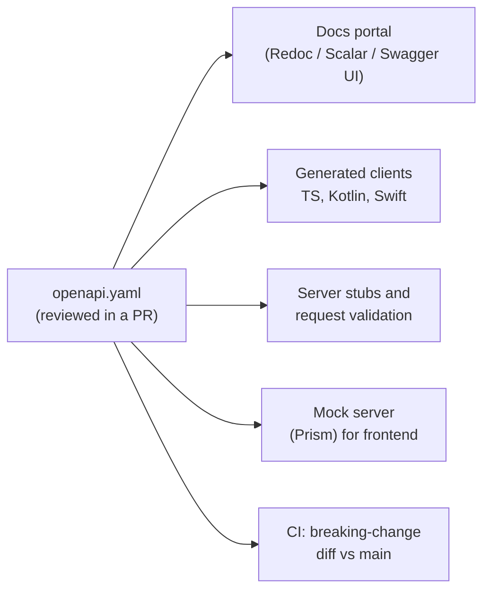

# OpenAPI, Documentation and Contract-First APIs

An API is only as good as other people's ability to use it correctly. Teams lose weeks to undocumented fields, surprise breaking changes and "what does this error mean?" Slack threads. **OpenAPI** is a machine-readable description of an HTTP API. From one file you get documentation, client SDKs, server stubs, request validation, mock servers and automated breaking-change checks.

## 1. Code-first vs contract-first

| Approach | How | Best for |
|---|---|---|
| **Code-first** | Annotate controllers, and the framework generates the spec (springdoc, drf-spectacular, FastAPI) | Small teams, one consumer, fast iteration |
| **Contract-first** | Write `openapi.yaml` first, review it, then generate stubs and clients | Public APIs, multiple teams, mobile and partner consumers |



With contract-first, frontend and mobile teams can build against a mock server while the backend is still being written, because both sides agreed on the contract.

## 2. Anatomy of an OpenAPI 3.1 document

OpenAPI 3.1 aligned schemas with JSON Schema 2020-12 and is what most tooling supports today. OpenAPI 3.2 (September 2025) adds things like streaming media types and a `QUERY` method, and tool support for it is catching up. Everything below is valid in both.

```yaml
openapi: 3.1.0
info:
  title: QuickFood Orders API
  version: 1.4.0
  description: Create and track food orders.
servers:
  - url: https://api.quickfood.example/v1
security:
  - bearerAuth: []

paths:
  /orders:
    post:
      operationId: createOrder
      summary: Place an order
      parameters:
        - in: header
          name: Idempotency-Key
          required: true
          schema: { type: string, format: uuid }
          description: Retries with the same key return the original order instead of creating a duplicate.
      requestBody:
        required: true
        content:
          application/json:
            schema: { $ref: '#/components/schemas/CreateOrder' }
            example:
              restaurantId: "r_123"
              items: [{ menuItemId: "m_9", quantity: 2 }]
      responses:
        '201':
          description: Created
          headers:
            Location: { schema: { type: string }, description: URL of the new order }
          content:
            application/json:
              schema: { $ref: '#/components/schemas/Order' }
        '422': { $ref: '#/components/responses/ValidationError' }

  /orders/{orderId}:
    get:
      operationId: getOrder
      parameters:
        - { in: path, name: orderId, required: true, schema: { type: string } }
      responses:
        '200':
          content:
            application/json:
              schema: { $ref: '#/components/schemas/Order' }
        '404': { $ref: '#/components/responses/NotFound' }

components:
  securitySchemes:
    bearerAuth: { type: http, scheme: bearer, bearerFormat: JWT }
  schemas:
    CreateOrder:
      type: object
      required: [restaurantId, items]
      properties:
        restaurantId: { type: string }
        items:
          type: array
          minItems: 1
          items:
            type: object
            required: [menuItemId, quantity]
            properties:
              menuItemId: { type: string }
              quantity: { type: integer, minimum: 1, maximum: 50 }
    Order:
      type: object
      required: [id, status, total]
      properties:
        id: { type: string, examples: ["o_42"] }
        status: { type: string, enum: [PLACED, PREPARING, OUT_FOR_DELIVERY, DELIVERED, CANCELLED] }
        total: { type: integer, description: Amount in the smallest currency unit (poisha) }
  responses:
    ValidationError:
      description: The request body failed validation
      content:
        application/problem+json:
          schema: { $ref: '#/components/schemas/Problem' }
    NotFound:
      description: Resource not found
      content:
        application/problem+json:
          schema: { $ref: '#/components/schemas/Problem' }
```

Good habits visible here:

- **`operationId`** on every operation. Generated SDK method names come from it, as in `api.createOrder()`.
- **Examples** on requests and responses. Documentation without examples is half-written.
- **Money as integers** in the smallest unit, documented, never floats.
- **Reusable `components`**, so the same error shape isn't defined 40 times.

## 3. A consistent error format (RFC 9457 Problem Details)

Pick one error shape and use it everywhere. The standard is `application/problem+json`:

```json
{
  "type": "https://api.quickfood.example/problems/validation",
  "title": "Validation failed",
  "status": 422,
  "detail": "One or more fields are invalid.",
  "instance": "/v1/orders",
  "errors": [
    { "field": "items[0].quantity", "message": "must be between 1 and 50" }
  ],
  "traceId": "4bf92f3577b34da6"
}
```

Clients can branch on `type`, show `errors` next to form fields, and quote `traceId` to support. That shortens debugging enormously.

## 4. Generating the spec from code

When you work code-first, keep the generated spec accurate with annotations.

```python
# Django REST Framework + drf-spectacular
from drf_spectacular.utils import extend_schema, OpenApiExample

class OrderViewSet(viewsets.ModelViewSet):
    @extend_schema(
        request=CreateOrderSerializer,
        responses={201: OrderSerializer, 422: ProblemSerializer},
        examples=[OpenApiExample("Two biryanis", value={"restaurantId": "r_123", "items": [{"menuItemId": "m_9", "quantity": 2}]})],
    )
    def create(self, request):
        ...
```

```java
// Spring Boot + springdoc-openapi
@Operation(summary = "Place an order", operationId = "createOrder")
@ApiResponse(responseCode = "201", description = "Created")
@ApiResponse(responseCode = "422", content = @Content(schema = @Schema(implementation = ProblemDetail.class)))
@PostMapping("/orders")
ResponseEntity<OrderDto> create(@Valid @RequestBody CreateOrderDto body,
                                @RequestHeader("Idempotency-Key") UUID key) { ... }
```

Export the spec in CI (`./manage.py spectacular --file openapi.yaml`, or call `/v3/api-docs`) and commit it, so changes show up in pull requests.

## 5. Generated clients

```bash
# TypeScript types and a typed fetch client from the spec
npx openapi-typescript openapi.yaml -o src/api/schema.d.ts
```

```ts
import createClient from 'openapi-fetch';
import type { paths } from './api/schema';

const api = createClient<paths>({ baseUrl: 'https://api.quickfood.example/v1' });

const { data, error } = await api.POST('/orders', {
  params: { header: { 'Idempotency-Key': crypto.randomUUID() } },
  body: { restaurantId: 'r_123', items: [{ menuItemId: 'm_9', quantity: 2 }] },
});
// data is typed as Order; a typo in a field name is a compile error
```

When the backend renames a field, the frontend build fails in CI instead of in production.

## 6. Catching breaking changes automatically

These changes break existing clients:

- removing or renaming a field, endpoint or enum value,
- making an optional request field required,
- changing a type (`string` → `integer`),
- narrowing a response (removing a status code clients handle).

These are safe: adding optional request fields, adding response fields, adding endpoints. Clients should ignore unknown fields.

```yaml
# .github/workflows/api-contract.yml
- name: Check for breaking API changes
  run: |
    git show origin/main:openapi.yaml > base.yaml
    npx @useoptic/optic diff base.yaml openapi.yaml --check   # or: oasdiff breaking base.yaml openapi.yaml
```

If you must break a contract, ship a new version (`/v2`, or a dated version header), keep the old one running, announce a deprecation date with `Deprecation` and `Sunset` headers, and watch traffic to the old version before removing it.

## 7. Documentation people actually read

A spec renders reference docs, but good API docs also include:

1. **A quick start:** get a key, make the first call with a copy-paste `curl`, see the response.
2. **Authentication guide:** how to get tokens, scopes and token expiry.
3. **Concepts:** pagination style, idempotency, rate limits, webhooks, error format.
4. **Recipes:** "place an order and track it until delivery."
5. **Changelog:** dated and explicit about breaking changes.

Tools such as Redoc, Scalar, Stoplight and Mintlify render the spec, and a "Try it" console turns the docs into a playground.

## 8. Real-world case: mobile app crashes after a "small" backend change

A backend developer renames `deliveryEta` to `etaMinutes` in a response. The web app is redeployed the same day, but Android users on older app versions start crashing, because mobile clients can't be force-upgraded. The team then:

1. adds `oasdiff breaking` to CI, so the rename would have failed the PR,
2. adopts "expand and contract": add the new field, keep the old one, migrate clients, and remove the old field only after analytics show old app versions below 1%,
3. generates the Kotlin and Swift models from the spec.

## 9. Hands-on exercise

1. Write an OpenAPI 3.1 spec for a small API (orders or books) with at least 4 operations, shared schemas and Problem Details errors.
2. Lint it with Spectral (`npx @stoplight/spectral-cli lint openapi.yaml`).
3. Run a mock server with Prism (`npx @stoplight/prism-cli mock openapi.yaml`) and call it with curl.
4. Generate TypeScript types and write a typed client call.
5. Make a breaking change and confirm `oasdiff` flags it.

## 10. Checklist

- [ ] I can explain code-first vs contract-first and choose between them.
- [ ] I can write paths, parameters, schemas, examples and reusable components.
- [ ] I use one error format (Problem Details) across the API.
- [ ] I generate typed clients and check for breaking changes in CI.
- [ ] I can version and deprecate safely with expand and contract.

## 11. Interview angle

> **Asked as:** "How do you prevent breaking API consumers?"

Commit the OpenAPI spec, diff it in CI to block breaking changes, make only additive changes within a version, use expand and contract for renames, version when unavoidable, and announce deprecations with Sunset headers while monitoring old-version traffic.

> **Asked as:** "What makes API documentation good?"

An accurate generated reference, a quick start that works in two minutes, examples for every request, a documented error format, and a changelog.
