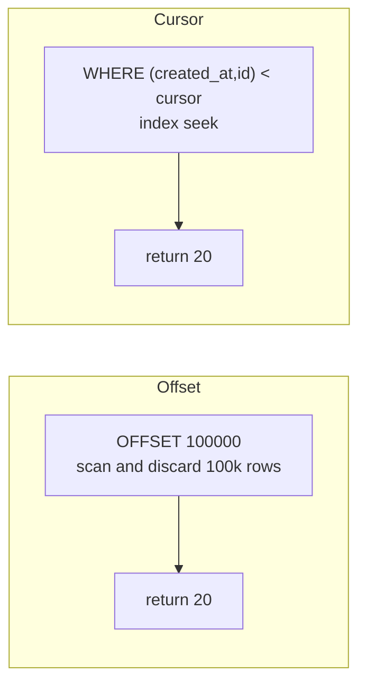

# Pagination, Filtering, Rate Limiting and Versioning

Most API pain shows up after launch. A list endpoint gets slow at 2 million rows, one client hammers you with 500 requests a second, or a field has to change while thousands of installed mobile apps still expect the old one. This guide covers the patterns that keep an API fast, fair and evolvable: pagination, filtering and sorting, rate limiting, caching headers, and versioning.

## 1. Pagination: offset vs cursor

### Offset pagination

```http
GET /orders?limit=20&offset=40
```

```sql
SELECT * FROM orders ORDER BY created_at DESC LIMIT 20 OFFSET 40;
```

It's simple and supports "jump to page 7." It has two real problems:

1. **It gets slower with depth.** `OFFSET 100000` makes the database read and discard 100,000 rows.
2. **It is unstable under writes.** If a new order arrives while the user is on page 2, every row shifts by one. Page 3 then repeats an item, and deletions make items get skipped.

### Cursor (keyset) pagination

Instead of "skip N rows," say "give me rows after the last one I saw":

```http
GET /orders?limit=20
→ { "data": [...], "nextCursor": "eyJjIjoiMjAyNi0xMC0xMVQxNDozMDowMFoiLCJpIjo5ODd9" }

GET /orders?limit=20&cursor=eyJjIjoiMjAyNi0xMC0xMVQxNDozMDowMFoiLCJpIjo5ODd9
```

```sql
-- Cursor decodes to (created_at, id) of the last row seen. The id breaks ties.
SELECT * FROM orders
WHERE (created_at, id) < ('2026-10-11T14:30:00Z', 987)
ORDER BY created_at DESC, id DESC
LIMIT 21;              -- fetch one extra to know whether there's a next page
```

With an index on `(created_at DESC, id DESC)`, every page is an index seek, so page 5,000 is as fast as page 1, and inserts don't cause duplicates or gaps.



Make the cursor **opaque**: base64-encode it, or sign it, so clients don't build cursors themselves and you can change the format later.

```python
import base64, json

def encode_cursor(row):
    return base64.urlsafe_b64encode(json.dumps({"c": row.created_at.isoformat(), "i": row.id}).encode()).decode()

def list_orders(user_id, limit=20, cursor=None):
    q = Order.objects.filter(user_id=user_id).order_by("-created_at", "-id")
    if cursor:
        c = json.loads(base64.urlsafe_b64decode(cursor))
        q = q.filter(Q(created_at__lt=c["c"]) | Q(created_at=c["c"], id__lt=c["i"]))
    rows = list(q[: limit + 1])
    has_more = len(rows) > limit
    rows = rows[:limit]
    return {"data": rows, "nextCursor": encode_cursor(rows[-1]) if has_more else None}
```

**Rule of thumb:** use cursors for feeds, timelines, logs and any large or fast-changing list. Offset is acceptable for small admin tables where users really want page numbers.

## 2. Filtering, sorting and sparse fields

Keep the conventions predictable and documented:

```http
GET /orders?status=PREPARING,OUT_FOR_DELIVERY&createdAfter=2026-10-01&sort=-createdAt,total&fields=id,status,total
```

- **Filters** are plain query parameters, with comma-separated values meaning "any of."
- **Sort** is a field list where `-` means descending. **Allow-list** sortable fields, because sorting by an unindexed column on a big table is a self-inflicted denial of service.
- **Sparse fieldsets** (`fields=`) let mobile clients fetch less data.
- **Validate everything.** An unknown filter or sort field should return 400 with a helpful message, not be silently ignored.

## 3. Rate limiting: fairness and protection

Rate limits protect your service from abuse and from bugs (a client stuck in a retry loop), and keep one tenant from starving the others.

### Algorithms

| Algorithm | Behaviour | Notes |
|---|---|---|
| Fixed window | N requests per calendar minute | Simple. Allows a 2× burst at window edges. |
| Sliding window | N requests in any rolling 60 s | Smoother, slightly more state |
| **Token bucket** | Bucket refills at R tokens/s, holds up to B | Allows short bursts and enforces an average. The most common choice. |
| Leaky bucket | Requests drain at a constant rate | Smooths output, good in front of fragile downstreams |

A token bucket in Redis, executed atomically with a Lua script so it works across many API instances:

```lua
-- KEYS[1] = bucket key, ARGV = capacity, refill_per_sec, now_ms
local cap, rate, now = tonumber(ARGV[1]), tonumber(ARGV[2]), tonumber(ARGV[3])
local b = redis.call('HMGET', KEYS[1], 'tokens', 'ts')
local tokens = tonumber(b[1]) or cap
local ts = tonumber(b[2]) or now
tokens = math.min(cap, tokens + (now - ts) / 1000 * rate)
local allowed = tokens >= 1
if allowed then tokens = tokens - 1 end
redis.call('HSET', KEYS[1], 'tokens', tokens, 'ts', now)
redis.call('PEXPIRE', KEYS[1], math.ceil(cap / rate * 1000))
return { allowed and 1 or 0, math.floor(tokens) }
```

### Tell clients what's happening

```http
HTTP/1.1 429 Too Many Requests
Retry-After: 12
RateLimit-Limit: 100
RateLimit-Remaining: 0
RateLimit-Reset: 12
Content-Type: application/problem+json

{"type":"https://api.example/problems/rate-limited","title":"Too many requests","status":429}
```

Well-behaved clients read `Retry-After` and back off **exponentially with jitter**, so thousands of clients don't retry in sync.

```ts
async function withBackoff<T>(fn: () => Promise<Response>, max = 5): Promise<Response> {
  for (let attempt = 0; ; attempt++) {
    const res = await fn();
    if (res.status !== 429 && res.status < 500) return res;
    if (attempt === max) return res;
    const retryAfter = Number(res.headers.get('Retry-After')) * 1000;
    const backoff = Math.min(30_000, 2 ** attempt * 500) * (0.5 + Math.random()); // jitter
    await new Promise((r) => setTimeout(r, retryAfter || backoff));
  }
}
```

**Where to limit:** per API key or user for fairness, per IP at the edge for anonymous abuse, and per expensive endpoint (login, search, export) separately. Login endpoints in particular need strict limits to slow credential stuffing.

## 4. Caching and conditional requests

Many responses don't change between requests. Let clients and CDNs reuse them:

```http
GET /restaurants/r_123/menu
→ 200 OK
  Cache-Control: public, max-age=60, stale-while-revalidate=300
  ETag: "menu-v57"

GET /restaurants/r_123/menu
If-None-Match: "menu-v57"
→ 304 Not Modified          (no body: saves bandwidth and server work)
```

ETags also prevent **lost updates** when two people edit the same resource:

```http
PUT /menu-items/m_9
If-Match: "v12"
→ 412 Precondition Failed    (someone else saved v13 first; reload and merge)
```

## 5. Versioning strategies

| Strategy | Example | Pros | Cons |
|---|---|---|---|
| URL path | `/v1/orders` | Obvious, easy to route and cache | Version applies to the whole API |
| Header | `Accept: application/vnd.shop.v2+json` or `API-Version: 2` | Clean URLs | Less visible, easy to forget |
| Date-based | `Stripe-Version: 2026-09-30` | Small, frequent, per-account changes | More machinery on the server |

Whichever you pick, the bigger win is **avoiding breaking changes** in the first place:

- Add fields, never rename or remove them within a version.
- Tolerant readers: clients ignore unknown fields, and servers accept and ignore unknown optional input.
- Make enums extensible. Document that new values may appear and clients must handle "unknown."
- For unavoidable changes, use **expand and contract**: add the new shape, migrate clients, then remove the old shape after a deprecation window announced with `Deprecation` and `Sunset` headers.

## 6. Real-world case: an export endpoint that took down the database

A B2B customer's script calls `GET /transactions?page=N` for N = 1…40,000 to export history. Offset pagination makes later pages scan millions of rows, database CPU sits at 100%, and every other customer's requests time out. The fixes:

1. Switch to cursor pagination on `(created_at, id)` with a matching index.
2. Add a per-key token bucket (10 requests/s, burst 20) with proper 429 responses.
3. Offer an asynchronous export: `POST /exports` returns `202 Accepted` with a job URL, and a worker writes a CSV to object storage and sends a webhook when it's ready.
4. Put the export queries on a read replica.

## 7. Hands-on exercise

1. Seed a table with 1 million rows. Compare `EXPLAIN ANALYZE` for `OFFSET 900000` against a keyset query.
2. Implement cursor pagination with an opaque cursor and `hasMore`.
3. Implement a Redis token bucket and return `429` with `Retry-After`. Load-test with `k6` or `hey`.
4. Add ETag support to one GET endpoint and verify `304` with `curl -H 'If-None-Match: ...'`.

## 8. Checklist

- [ ] I can explain why offset pagination degrades and implement keyset pagination.
- [ ] I design filters and sorts with allow-lists and validation.
- [ ] I can implement a token bucket across instances and return proper 429 headers.
- [ ] I use Cache-Control, ETag, If-None-Match and If-Match correctly.
- [ ] I can choose a versioning strategy and evolve APIs without breaking clients.

## 9. Interview angle

> **Asked as:** "How would you paginate a large, frequently updated table?"

Use cursor pagination on a unique, indexed sort key such as `(created_at, id)`, with an opaque cursor and fetching limit + 1 to compute `hasMore`. Explain why offset pagination scans and discards rows and duplicates or skips items under concurrent writes.

> **Asked as:** "Design rate limiting for a public API."

Token bucket per API key in Redis with an atomic script, separate stricter limits for expensive and auth endpoints, 429 with `Retry-After` and RateLimit headers, edge limits per IP, and clients retrying with exponential backoff and jitter.
