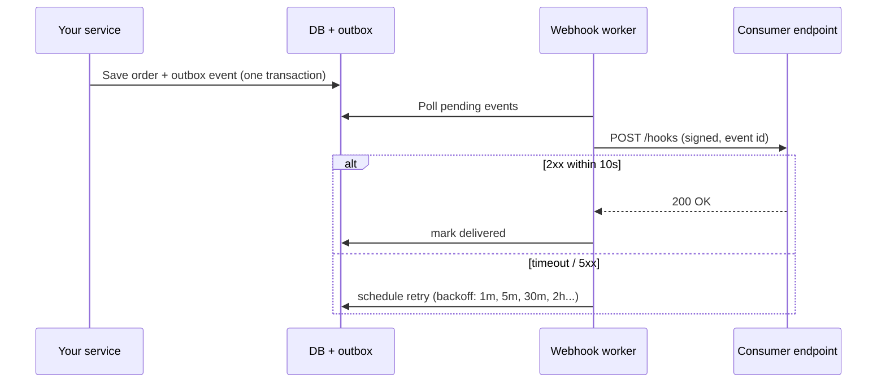

# Webhooks and Asynchronous APIs

Not everything fits in a single request/response. A payment confirms seconds later, a video takes minutes to transcode, and an order's status changes over 40 minutes. Clients shouldn't poll every second to find out. This guide covers the patterns for **asynchronous APIs**: `202 Accepted` with job resources, **webhooks** that push events to other systems, and real-time channels (SSE and WebSockets), along with the reliability and security details that separate a toy from a production system.

## 1. Choosing a pattern

| Need | Pattern |
|---|---|
| Long-running task the caller started | `202 Accepted` + job resource (+ optional webhook on completion) |
| Notify *another system* (server to server) that something happened | Webhooks |
| Update a *user's screen* live | Server-Sent Events or WebSockets |
| High-volume internal event streams | A message broker (Kafka, RabbitMQ), not HTTP |

## 2. Long-running work: 202 Accepted

```http
POST /v1/reports
{"type":"monthly-sales","month":"2026-09"}

HTTP/1.1 202 Accepted
Location: /v1/jobs/job_81f2
{"id":"job_81f2","status":"QUEUED"}
```

```http
GET /v1/jobs/job_81f2
{"id":"job_81f2","status":"SUCCEEDED","result":{"url":"https://files.example/r/81f2.csv"},"finishedAt":"2026-10-11T14:31:09Z"}
```

The request returns in milliseconds, and the work runs in a queue worker. The client can poll the job (with backoff), or register a webhook to be told when it's done.

## 3. Webhooks: how they work

A webhook is an HTTP POST *you* send to a URL the *consumer* registered, whenever an event occurs.



### The event payload

```json
{
  "id": "evt_01JAB3K9",
  "type": "order.status_changed",
  "createdAt": "2026-10-11T14:30:00Z",
  "apiVersion": "2026-09-30",
  "data": {
    "orderId": "o_42",
    "previousStatus": "PREPARING",
    "status": "OUT_FOR_DELIVERY"
  }
}
```

Design rules:

- A **unique event id**, so consumers can deduplicate.
- A **type** in `resource.action` form, so consumers subscribe to what they need.
- **Versioned** payloads, with the same compatibility rules as the API.
- Keep payloads small, or "thin": send ids and let the consumer fetch the latest state with the API if it needs more. That avoids leaking data and avoids stale snapshots.

## 4. Reliability: at-least-once delivery

Networks fail, so webhooks are delivered **at least once**. Consumers will sometimes receive duplicates, and occasionally events out of order. On the sending side:

1. **Use the outbox pattern.** Write the event in the same database transaction as the state change. "Save order, then call the webhook" loses events when the process crashes between the two steps.
2. **Retry with exponential backoff** for hours or days (for example 1 m, 5 m, 30 m, 2 h, 6 h, 24 h), and then mark the endpoint as failing and alert the owner.
3. **Time out quickly** (5–10 s). A slow consumer must not tie up your workers.
4. **Provide a replay or event log API** (`GET /events?after=evt_...`) so consumers can recover anything they missed.

On the receiving side:

```python
# Flask consumer: verify, dedupe, acknowledge fast, process async
@app.post("/hooks/quickfood")
def quickfood_hook():
    raw = request.get_data()                       # raw bytes: needed for the signature check
    verify_signature(raw, request.headers)         # 401 if invalid (see below)
    event = json.loads(raw)

    # Idempotency: the unique constraint makes duplicates a no-op
    inserted = db.execute(
        "INSERT INTO processed_events (id) VALUES (%s) ON CONFLICT DO NOTHING", [event["id"]]
    ).rowcount
    if inserted:
        queue.enqueue(handle_event, event)          # heavy work off the request path
    return "", 200                                  # acknowledge within milliseconds
```

For **ordering**, don't rely on arrival order. Include a timestamp or version per resource, and ignore an update older than what you already have.

## 5. Security: signing and verification

Anyone can POST to a public URL, so consumers must verify that a webhook really came from you and wasn't tampered with or replayed. The standard approach is an **HMAC signature** over a timestamp plus the raw body, using a per-endpoint secret:

```ts
// Sender
import crypto from 'node:crypto';

function sign(secret: string, body: string) {
  const ts = Math.floor(Date.now() / 1000);
  const sig = crypto.createHmac('sha256', secret).update(`${ts}.${body}`).digest('hex');
  return { 'Webhook-Timestamp': String(ts), 'Webhook-Signature': `v1=${sig}` };
}
```

```python
# Receiver
import hmac, hashlib, time

def verify_signature(raw: bytes, headers, secret: bytes, tolerance=300):
    ts = int(headers["Webhook-Timestamp"])
    if abs(time.time() - ts) > tolerance:
        abort(401)                                   # stale: possible replay
    expected = hmac.new(secret, f"{ts}.".encode() + raw, hashlib.sha256).hexdigest()
    given = headers["Webhook-Signature"].removeprefix("v1=")
    if not hmac.compare_digest(expected, given):    # constant-time comparison
        abort(401)
```

Other safeguards:

- Show the secret once, and let consumers **rotate** it. Accept two signatures during rotation.
- **SSRF protection on the sender:** consumers choose the URL, so block private IP ranges and cloud metadata addresses (`169.254.169.254`) to stop someone pointing your webhook worker at your own internal network.
- Require HTTPS endpoints.

## 6. Real-time to browsers: SSE vs WebSockets

| | Server-Sent Events | WebSockets |
|---|---|---|
| Direction | Server → client | Both ways |
| Protocol | Plain HTTP, auto-reconnect built in | Upgrade to `ws://`, custom framing |
| Good for | Live order status, notifications, dashboards, streaming AI responses | Chat, multiplayer, collaborative editing |
| Proxies and CDNs | Usually work (disable buffering) | Need explicit upgrade support |

An SSE endpoint is just a long-lived response:

```ts
// Express: stream order status updates
app.get('/orders/:id/events', (req, res) => {
  res.set({ 'Content-Type': 'text/event-stream', 'Cache-Control': 'no-cache', Connection: 'keep-alive' });
  res.flushHeaders();
  const unsubscribe = bus.subscribe(`order:${req.params.id}`, (status) => {
    res.write(`id: ${status.version}\nevent: status\ndata: ${JSON.stringify(status)}\n\n`);
  });
  const ping = setInterval(() => res.write(': keep-alive\n\n'), 25_000);
  req.on('close', () => { clearInterval(ping); unsubscribe(); });
});
```

```js
// Browser: reconnects automatically and sends Last-Event-ID to resume
const es = new EventSource('/orders/o_42/events');
es.addEventListener('status', (e) => render(JSON.parse(e.data)));
```

With many server instances, connections are spread across machines. Publish updates through Redis pub/sub or a managed real-time service (Ably, Pusher) so the instance holding a user's connection receives the event.

## 7. Real-world case: double-shipping from duplicate webhooks

A store's fulfilment service shipped some orders twice. The payment provider retried a `payment.succeeded` webhook because the store's endpoint took 15 s, as it was generating invoices synchronously. Both deliveries created a shipment. The fixes:

1. Acknowledge immediately and do the work in a background job.
2. Deduplicate on the event id with a unique constraint.
3. Make "create shipment" itself idempotent per order id.

## 8. Hands-on exercise

1. Build a sender: an outbox table plus a worker that POSTs signed events with retries and backoff.
2. Build a receiver that verifies the HMAC, rejects stale timestamps and deduplicates by event id.
3. Simulate failures: make the receiver return 500 three times, then 200, and confirm exactly one effect.
4. Add an SSE endpoint for live status and watch it update in the browser.

## 9. Checklist

- [ ] I can choose between 202 + jobs, webhooks, SSE, WebSockets and a broker.
- [ ] I design webhook payloads with ids, types and versions.
- [ ] I deliver with an outbox, retries with backoff, timeouts and a replay API.
- [ ] I sign and verify webhooks with HMAC, timestamps and constant-time comparison, and protect against SSRF.
- [ ] My consumers acknowledge fast, deduplicate and tolerate out-of-order events.

## 10. Interview angle

> **Asked as:** "How do you make webhooks reliable?"

Use an outbox for guaranteed emission, at-least-once delivery with exponential backoff, short timeouts, a dead-letter state with alerts, and a replay endpoint. Consumers must be idempotent on the event id and acknowledge quickly.

> **Asked as:** "SSE or WebSockets for live order tracking?"

SSE. Updates flow one way, it runs over plain HTTP with automatic reconnection and resume, and it's simpler to operate. Use WebSockets only when the client must also send a stream of messages.
