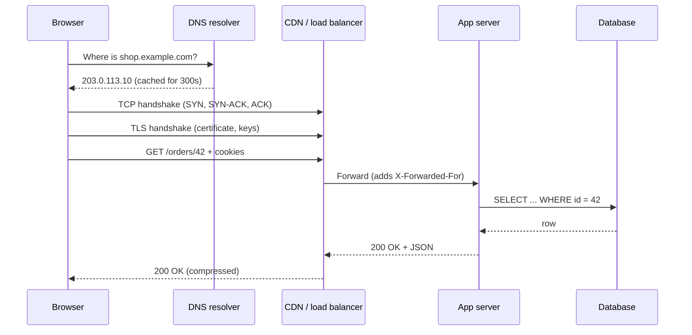

# How the Internet and HTTP Actually Work

Every backend request crosses a dozen systems before your code runs. When a request is slow, fails intermittently, or works with `curl` but not in a browser, the cause is usually in one of those layers. This guide follows one real request from start to finish so that, later, you know where to look.

## 1. A request's journey, end to end

Picture a customer in Dhaka opening `https://shop.example.com/orders/42` on their phone. Here is what happens before your controller sees anything:



Each arrow can fail, and each one adds latency. A typical breakdown on a mobile network looks like this: DNS 20–100 ms (zero if cached), TCP 1 round trip, TLS 1 round trip with TLS 1.3, then the request itself. On a 150 ms round-trip connection, a cold first request spends roughly 450 ms on setup before your server does any work. That is why connection reuse, CDNs and HTTP/2 or HTTP/3 matter so much.

## 2. IP addresses, packets and routing

The internet is a network of networks. Each device has an **IP address**, and data is chopped into **packets** that routers forward hop by hop toward the destination. No single router knows the full path; each only knows the next best hop, which it learns from routing protocols like BGP between large networks.

- **IPv4** addresses look like `203.0.113.10` (about 4.3 billion addresses, long since exhausted).
- **IPv6** addresses look like `2001:db8::10` and are now common on mobile networks.
- **Private ranges** (`10.0.0.0/8`, `172.16.0.0/12`, `192.168.0.0/16`) are not routable on the public internet. Your laptop and your cloud VPC use them, and **NAT** translates them to a public address at the edge.

You can watch routing happen:

```bash
# Every hop between you and the server, with latency per hop
traceroute shop.example.com        # macOS/Linux
mtr --report shop.example.com      # better: combines ping + traceroute over time
```

If latency jumps at hop 7 and stays high, the slowness is in the network, not your code.

## 3. TCP and UDP: reliable vs fast

IP only delivers packets on a best-effort basis: they can be lost, duplicated or arrive out of order. Two transport protocols sit on top of it:

| | TCP | UDP |
|---|---|---|
| Connection | Handshake first | None, just send |
| Delivery | Guaranteed, in order, retransmits | Best effort |
| Overhead | Higher | Minimal |
| Used by | HTTP/1.1, HTTP/2, databases, SSH | DNS, video calls, games, QUIC (HTTP/3) |

A **port** identifies which program on a machine should get the data: 443 for HTTPS, 5432 for PostgreSQL, 6379 for Redis. A connection is uniquely identified by the 4-tuple *(source IP, source port, destination IP, destination port)*, which is why one server can hold tens of thousands of client connections on port 443.

A practical consequence: opening a TCP connection is expensive, so production clients use **connection pools**. A Node.js service that creates a new database connection per request will collapse under load long before the database CPU is busy.

## 4. DNS: the internet's phone book

DNS translates names into addresses. Resolution is hierarchical and heavily cached:

1. The browser and OS check their caches.
2. The configured **recursive resolver** (your ISP, `1.1.1.1` or `8.8.8.8`) checks its cache.
3. On a miss, it asks a root server, then the `.com` servers, then the domain's **authoritative** name server.
4. The answer comes back with a **TTL** that says how long everyone may cache it.

The record types you will meet constantly:

| Record | Purpose | Example |
|---|---|---|
| A / AAAA | Name → IPv4 / IPv6 | `shop.example.com → 203.0.113.10` |
| CNAME | Alias to another name | `www → shop.example.com` |
| MX | Mail servers | `example.com → mail.example.com` |
| TXT | Verification, SPF, DKIM | `v=spf1 include:_spf.google.com` |
| NS | Who is authoritative | `example.com → ns1.provider.net` |

```bash
dig shop.example.com +short          # just the answer
dig shop.example.com +trace          # watch the full resolution path
dig TXT example.com                   # check SPF / domain verification records
```

**Real-world trap:** you move your API to a new server and update the A record, but half your users still hit the old one for an hour. The old record had a TTL of 3600 seconds. The fix is to lower the TTL to 60 a day *before* a migration, then raise it again afterwards.

## 5. HTTP: the language of the web

HTTP is a request/response protocol. A request has a method, a path, headers and an optional body. A response has a status code, headers and an optional body. You can see the raw exchange with curl:

```bash
curl -v https://api.example.com/orders/42 -H "Authorization: Bearer $TOKEN"
```

```http
> GET /orders/42 HTTP/2
> Host: api.example.com
> Authorization: Bearer eyJhbGciOi...
> Accept: */*
>
< HTTP/2 200
< content-type: application/json
< cache-control: private, max-age=0
< etag: "a1b2c3"
<
{"id":42,"status":"PREPARING","total":1250}
```

### Methods and their guarantees

| Method | Meaning | Safe | Idempotent |
|---|---|---|---|
| GET | Read | Yes | Yes |
| POST | Create / trigger an action | No | No |
| PUT | Replace entirely | No | Yes |
| PATCH | Partial update | No | Not necessarily |
| DELETE | Remove | No | Yes |

**Idempotent** means doing it twice has the same effect as doing it once. This matters because networks retry: a load balancer or mobile client may resend a request after a timeout. A retried `PUT /orders/42 {status: "CANCELLED"}` is harmless. A retried `POST /payments` charges the customer twice unless you add an idempotency key.

### Status codes that carry real meaning

- **2xx success:** 200 OK, 201 Created (with a `Location` header), 204 No Content.
- **3xx redirect:** 301 permanent, 302/307 temporary, 304 Not Modified (cache still valid).
- **4xx client error:** 400 bad input, 401 not authenticated, 403 authenticated but not allowed, 404 not found, 409 conflict, 422 validation failed, 429 rate limited.
- **5xx server error:** 500 bug, 502 bad gateway (upstream returned garbage), 503 unavailable (overloaded or deploying), 504 gateway timeout (upstream too slow).

When you are debugging, 502 and 504 point at the proxy-to-app hop, not the client-to-proxy hop. That alone saves hours.

### Headers that do the heavy lifting

- `Content-Type` / `Accept`: what format is sent and wanted.
- `Authorization`: credentials, usually `Bearer <token>`.
- `Cache-Control`, `ETag`, `If-None-Match`: caching and revalidation.
- `Cookie` / `Set-Cookie`: session state. Use `HttpOnly; Secure; SameSite=Lax` by default.
- `X-Forwarded-For`, `X-Forwarded-Proto`: the original client IP and scheme when behind a proxy.

## 6. HTTPS and TLS

TLS encrypts traffic and proves the server is who it claims to be. During the handshake the server presents a **certificate** signed by a trusted certificate authority. The client checks the signature chain and that the certificate's name matches the host, then both sides agree on session keys.

TLS 1.3 needs just one round trip. Certificates from Let's Encrypt are free and renew automatically every 90 days. The most common production outage in this area is still an expired certificate, so monitor expiry dates.

```bash
# See the certificate chain and expiry date for any host
openssl s_client -connect api.example.com:443 -servername api.example.com </dev/null 2>/dev/null \
  | openssl x509 -noout -subject -issuer -enddate
```

## 7. HTTP/1.1, HTTP/2 and HTTP/3

- **HTTP/1.1** sends one request at a time per connection. Browsers open about six connections per host to work around this.
- **HTTP/2** multiplexes many requests over one TCP connection, using binary framing and header compression. One lost TCP packet still stalls every stream on that connection (head-of-line blocking).
- **HTTP/3** runs over **QUIC** on UDP. Streams are independent, so a lost packet only stalls its own stream, and connections survive a network switch (Wi-Fi to mobile data).

You usually get HTTP/2 and HTTP/3 "for free" by putting a CDN or a modern proxy in front of your app. Your application code keeps speaking HTTP/1.1 to the proxy.

## 8. Worked example: a tiny HTTP server with no framework

Seeing the protocol without a framework makes it concrete. This Node.js server handles routing, status codes and JSON by hand:

```js
import http from 'node:http';

const orders = new Map([[42, { id: 42, status: 'PREPARING' }]]);

const server = http.createServer(async (req, res) => {
  const url = new URL(req.url, `http://${req.headers.host}`);
  const match = url.pathname.match(/^\/orders\/(\d+)$/);

  if (req.method === 'GET' && match) {
    const order = orders.get(Number(match[1]));
    if (!order) {
      res.writeHead(404, { 'Content-Type': 'application/json' });
      return res.end(JSON.stringify({ error: 'Order not found' }));
    }
    res.writeHead(200, { 'Content-Type': 'application/json', 'Cache-Control': 'private, max-age=5' });
    return res.end(JSON.stringify(order));
  }

  res.writeHead(405, { Allow: 'GET' });
  res.end();
});

server.listen(3000, () => console.log('http://localhost:3000/orders/42'));
```

Try `curl -i localhost:3000/orders/42`, then `/orders/7` and `curl -X DELETE ...`. You will see 200, 404 and 405, with exactly the headers you wrote. A framework like Express or Spring does the same thing with more convenience.

## 9. Real-world case: "it works in curl but not in the browser"

A team ships a new API. `curl` works, but the React app gets errors. The usual culprits, in order:

1. **CORS.** The browser sends an `OPTIONS` preflight, and the server doesn't answer with `Access-Control-Allow-Origin`. curl never enforces CORS.
2. **Mixed content.** An HTTPS page calls an `http://` API, and the browser blocks it.
3. **Cookies not sent.** The cookie lacks `SameSite=None; Secure` for a cross-site call, or `credentials: 'include'` is missing on `fetch`.
4. **Cached redirect.** An old 301 is stuck in the browser cache.

Check the Network tab first. It shows the preflight, the status code and the response headers, which nearly always point straight at the cause.

## 10. Hands-on exercise

1. Run `dig +trace` against a site you use and identify the root, TLD and authoritative servers.
2. Use `curl -v` to fetch a page and label each phase: DNS, connect, TLS, request, response.
3. Time each phase with `curl -w "dns:%{time_namelookup} connect:%{time_connect} tls:%{time_appconnect} ttfb:%{time_starttransfer}\n" -o /dev/null -s https://example.com`.
4. Extend the Node server above with `POST /orders` that returns `201 Created` and a `Location` header.

## 11. Checklist

- [ ] I can describe each step from typing a URL to rendering the response.
- [ ] I know when to use TCP vs UDP and what a port is.
- [ ] I can read DNS records and explain why TTLs matter in migrations.
- [ ] I can pick the right HTTP method and status code and explain idempotency.
- [ ] I can explain what TLS proves and how HTTP/2 and HTTP/3 differ.

## 12. Interview angle

> **Asked as:** "What happens when you type a URL into the browser and press Enter?"

Walk through DNS (with caching), TCP, TLS, the HTTP request, load balancer, app server, database and the response, then mention rendering. Strong candidates add latency numbers and say where caching happens at each layer.

> **Asked as:** "What's the difference between 401 and 403, and between 502 and 504?"

401 means "I don't know who you are," and 403 means "I know who you are, and you're not allowed." 502 means the upstream sent an invalid response, and 504 means the upstream didn't respond in time.
