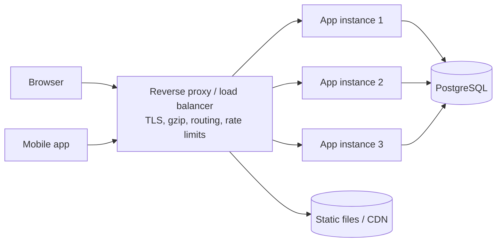

# Web Servers, Reverse Proxies and Load Balancers

Your application almost never faces the internet directly. In production a **reverse proxy** such as Nginx, Caddy, HAProxy, Traefik or a cloud load balancer sits in front of it. The proxy terminates TLS, serves static files, compresses responses, spreads load across instances and protects the app from slow or abusive clients. Knowing what this layer does explains a whole class of production bugs.

## 1. Forward proxy vs reverse proxy

- A **forward proxy** acts for *clients*. A corporate proxy that all employee traffic goes through is one example.
- A **reverse proxy** acts for *servers*. Clients think they are talking to the origin, but the proxy decides which backend handles each request.



## 2. What the proxy layer is responsible for

| Job | Why it belongs in the proxy |
|---|---|
| TLS termination | One place to manage certificates. Apps speak plain HTTP on a private network. |
| Static files | Nginx serves files from disk far faster than your app framework does. |
| Compression | gzip/brotli once, at the edge, for every service. |
| Load balancing | Spread requests across instances and skip unhealthy ones. |
| Buffering | Absorb slow clients so app workers aren't tied up waiting on a 3G upload. |
| Rate limiting and size limits | Reject abuse before it reaches application code. |
| Routing | `/api` → backend, `/` → frontend, `/ws` → WebSocket service. |

The buffering row is the least obvious and one of the most important. A Gunicorn or Puma server has a fixed number of workers. If ten clients on slow connections each trickle a request body over 20 seconds, ten workers sit idle and blocked. Nginx reads the whole request first, then hands it to the app in milliseconds.

## 3. A production Nginx configuration, line by line

```nginx
upstream api {
    least_conn;                       # send to the instance with fewest active connections
    server 10.0.1.11:8000 max_fails=3 fail_timeout=30s;
    server 10.0.1.12:8000 max_fails=3 fail_timeout=30s;
    keepalive 32;                     # reuse connections to the app (saves a TCP handshake per request)
}

server {
    listen 80;
    server_name shop.example.com;
    return 301 https://$host$request_uri;          # force HTTPS
}

server {
    listen 443 ssl;
    http2 on;
    server_name shop.example.com;

    ssl_certificate     /etc/letsencrypt/live/shop.example.com/fullchain.pem;
    ssl_certificate_key /etc/letsencrypt/live/shop.example.com/privkey.pem;
    add_header Strict-Transport-Security "max-age=31536000; includeSubDomains" always;

    client_max_body_size 10m;          # reject huge uploads early with 413
    gzip on;
    gzip_types application/json text/css application/javascript;

    # Single-page app: serve files, fall back to index.html for client-side routes
    root /var/www/shop/dist;
    location / {
        try_files $uri $uri/ /index.html;
    }

    # Long-lived caching for fingerprinted assets (app.3f9a2c.js)
    location /assets/ {
        expires 1y;
        add_header Cache-Control "public, immutable";
    }

    location /api/ {
        proxy_pass http://api;
        proxy_http_version 1.1;
        proxy_set_header Connection "";
        proxy_set_header Host $host;
        proxy_set_header X-Real-IP $remote_addr;
        proxy_set_header X-Forwarded-For $proxy_add_x_forwarded_for;
        proxy_set_header X-Forwarded-Proto $scheme;
        proxy_read_timeout 30s;
    }

    location /ws/ {
        proxy_pass http://api;
        proxy_http_version 1.1;
        proxy_set_header Upgrade $http_upgrade;     # required for WebSockets
        proxy_set_header Connection "upgrade";
        proxy_read_timeout 1h;
    }
}
```

Things to notice:

- **`X-Forwarded-*` headers.** Without them, your app logs every request as coming from the proxy's IP, and it thinks the scheme is `http`, so generated links and secure cookies break. Configure your framework to trust them *only from the proxy*. Examples are Express `app.set('trust proxy', 1)`, Django `SECURE_PROXY_SSL_HEADER` and Spring `server.forward-headers-strategy=framework`.
- **WebSockets need the `Upgrade` headers** and a long read timeout. Otherwise connections drop after 60 seconds, which is the classic "chat disconnects every minute" bug.
- **`try_files ... /index.html`** is what makes deep links like `/orders/42` work in a React or Angular app instead of returning 404.

## 4. Load-balancing algorithms

| Algorithm | How it picks | Good for |
|---|---|---|
| Round robin | Next in the list | Identical, stateless instances |
| Least connections | Fewest open connections | Requests with very different durations |
| IP hash / consistent hash | Same client → same server | Local caches, sticky sessions (use sparingly) |
| Weighted | Proportional to weight | Mixed instance sizes, canary releases |

**Health checks** let the balancer stop sending traffic to a broken instance. A good health endpoint is cheap and honest: it returns 200 only when the instance can actually serve traffic, which includes reaching its database.

```python
# Django: a readiness endpoint the load balancer polls every few seconds
from django.db import connection
from django.http import JsonResponse

def ready(request):
    try:
        with connection.cursor() as c:
            c.execute("SELECT 1")
        return JsonResponse({"status": "ok"})
    except Exception:
        return JsonResponse({"status": "db-unreachable"}, status=503)
```

Keep **liveness** ("the process is not deadlocked") separate from **readiness** ("I can take traffic now"). If liveness checks the database, a brief database blip makes the orchestrator restart every instance at once and turns a small incident into an outage.

## 5. Layer 4 vs layer 7 load balancing

- **Layer 4 (TCP/UDP)** balancers, such as AWS NLB and HAProxy in TCP mode, forward bytes without reading HTTP. They are extremely fast and work for any protocol, including databases and gRPC.
- **Layer 7 (HTTP)** balancers, such as Nginx, AWS ALB and Envoy, read the request. That lets them route on path or header, rewrite, retry, add headers and terminate TLS.

Most web stacks use a cloud L7 balancer at the edge and keep everything else simple.

## 6. Application servers: the piece behind the proxy

Interpreted languages need a process manager that runs several copies of your app:

| Stack | App server | Concurrency model |
|---|---|---|
| Python (Django/Flask) | Gunicorn, uWSGI | Pre-forked worker processes |
| Python (FastAPI, Django async) | Uvicorn | Event loop, often under Gunicorn |
| Ruby | Puma | Processes × threads |
| Node.js | Node itself, PM2 or the cluster module | Single-threaded event loop per process |
| Java (Spring) | Embedded Tomcat, Jetty or Netty | Thread pool or virtual threads |

A common sizing rule for Gunicorn sync workers is `2 × CPU cores + 1`. For I/O-heavy apps, use async workers or threads instead of adding more processes.

```bash
gunicorn shop.wsgi:application --workers 5 --bind 0.0.0.0:8000 \
  --timeout 30 --graceful-timeout 20 --access-logfile -
```

`--graceful-timeout` matters during deploys. When the process gets SIGTERM, it stops taking new requests and finishes in-flight ones, so users don't see 502s on every release.

## 7. Caddy: the zero-config alternative

For small services, Caddy gets HTTPS certificates automatically:

```caddy
shop.example.com {
    encode zstd gzip
    handle /api/* {
        reverse_proxy 10.0.1.11:8000 10.0.1.12:8000 {
            lb_policy least_conn
            health_uri /ready
        }
    }
    handle {
        root * /var/www/shop/dist
        try_files {path} /index.html
        file_server
    }
}
```

That is a complete, HTTPS-enabled, load-balanced setup in 14 lines. The trade-off is less ecosystem tooling than Nginx at very large scale.

## 8. Real-world case: random 502s after every deploy

A team deploys a Node API behind an AWS ALB. On every release, roughly 1% of requests fail with 502 for about 30 seconds. The causes are typical:

1. The old process was killed immediately on SIGTERM, dropping in-flight requests. **Fix:** handle SIGTERM, stop accepting connections, then exit after in-flight work completes.
2. Node's default `keepAliveTimeout` (5 s) was *shorter* than the ALB's idle timeout (60 s). The ALB reused a connection that Node had just closed. **Fix:** set `server.keepAliveTimeout = 65000` and `headersTimeout = 66000`.
3. The new instance received traffic before it had warmed up. **Fix:** use a readiness check plus a slow-start period on the target group.

```js
const server = app.listen(8000);
server.keepAliveTimeout = 65_000;
server.headersTimeout = 66_000;
process.on('SIGTERM', () => {
  server.close(() => process.exit(0));        // finish in-flight requests
  setTimeout(() => process.exit(1), 20_000);  // hard stop if something hangs
});
```

## 9. Hands-on exercise

Using Docker Compose, run two copies of a small API (any language) behind Nginx:

1. Configure `upstream` with both containers and `least_conn`.
2. Add an endpoint that returns the container hostname, then call it 10 times and confirm both instances answer.
3. Stop one container and confirm Nginx routes around it.
4. Add `client_max_body_size 1m` and verify a 2 MB upload gets a `413`.
5. Log the real client IP in the app using `X-Forwarded-For`.

## 10. Checklist

- [ ] I can explain why apps sit behind a reverse proxy and list what it handles.
- [ ] I can write an Nginx config for an SPA plus an API plus WebSockets.
- [ ] I know the main load-balancing algorithms and when to use each.
- [ ] I can separate liveness and readiness checks correctly.
- [ ] I can make deploys drain gracefully without 502s.

## 11. Interview angle

> **Asked as:** "Why put Nginx in front of Gunicorn or Node?"

It terminates TLS, serves static files, buffers slow clients so expensive workers aren't blocked, compresses responses, enforces limits and balances across instances. The app server is optimised for running your code, not for handling the open internet.

> **Asked as:** "Users see 502 errors during deployments. How do you fix it?"

Graceful shutdown on SIGTERM, a readiness probe before receiving traffic, connection draining on the load balancer, and app keep-alive timeouts longer than the balancer's idle timeout.
