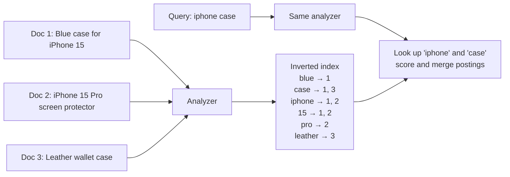

# Search Engines and Full-Text Search

"Add a search box" sounds simple until users type `iphone 15 pro case` and expect results for "Case for iPhone 15 Pro (blue)", typos included, ranked by relevance, in under 100 ms. `LIKE '%term%'` cannot do that. This guide explains how search engines work, when PostgreSQL's built-in search is enough, and when to reach for Elasticsearch, OpenSearch, Meilisearch or Typesense.

## 1. Why `LIKE` doesn't scale

```sql
SELECT * FROM products WHERE name ILIKE '%phone case%';
```

This query has three problems:

1. **Performance.** A leading wildcard can't use a B-tree index, so every row is scanned. That is fine at 10,000 rows and painful at 10 million.
2. **Matching.** It finds the exact substring only. "case phone", "phones", "iPhone-case" and "cases" all miss.
3. **Ranking.** Every match is equal. There is no notion of "this result is more relevant."

Search engines solve all three with one data structure: the **inverted index**.

## 2. The inverted index

A book's index maps words to page numbers. An inverted index maps each **term** to the list of documents containing it, its **postings list**.



Lookups become dictionary reads instead of scanning text, so a query over 100 million documents can return in milliseconds.

## 3. Analysis: turning text into terms

Before indexing, and again at query time, text passes through an **analyzer**:

1. **Character filters** strip HTML and normalise characters (`é` → `e`).
2. A **tokenizer** splits text into words: "iPhone-15 Pro" → `iPhone`, `15`, `Pro`.
3. **Token filters**:
   - lowercase: `iPhone` → `iphone`
   - stop words: drop "the", "for", "a"
   - **stemming**: `cases`, `cased` → `case`; `running` → `run`
   - **synonyms**: `tv` ↔ `television`, `phone` ↔ `mobile`

The golden rule is that **the query must use the same analysis as the index.** If you stem at index time but not at query time, "cases" never matches.

## 4. Relevance: BM25 in plain language

Most engines rank with **BM25**, which rewards three things:

- **Term frequency (TF).** A document mentioning "case" several times is probably more about cases, with diminishing returns so keyword stuffing doesn't win.
- **Inverse document frequency (IDF).** Rare terms matter more. Matching "leather" says more than matching "the".
- **Field length normalisation.** A match in a 5-word title beats a match buried in a 2,000-word description.

On top of that you add **business signals**: boost matches in `title` over `description`, boost in-stock items and popular products, and penalise discontinued ones.

## 5. PostgreSQL full-text search: often enough

If you already run PostgreSQL and have fewer than a few million documents, start here. You get no new infrastructure and no sync pipeline.

```sql
-- A generated column keeps the search document up to date automatically
ALTER TABLE products ADD COLUMN search tsvector
  GENERATED ALWAYS AS (
    setweight(to_tsvector('english', coalesce(name, '')), 'A') ||
    setweight(to_tsvector('english', coalesce(description, '')), 'B')
  ) STORED;

CREATE INDEX products_search_idx ON products USING GIN (search);

-- websearch_to_tsquery understands quotes, OR and -exclusions like a search box
SELECT id, name, ts_rank(search, q) AS rank
FROM products, websearch_to_tsquery('english', 'iphone cases -leather') AS q
WHERE search @@ q
ORDER BY rank DESC
LIMIT 20;
```

For **typo tolerance and autocomplete**, add trigram matching:

```sql
CREATE EXTENSION IF NOT EXISTS pg_trgm;
CREATE INDEX products_name_trgm ON products USING GIN (name gin_trgm_ops);

-- "iphnoe" still finds "iPhone"
SELECT name, similarity(name, 'iphnoe') AS score
FROM products
WHERE name % 'iphnoe'
ORDER BY score DESC
LIMIT 10;
```

**Where PostgreSQL stops being enough:** complex relevance tuning, faceted search over huge catalogues, many languages, heavy query volume competing with transactional load, or "search as you type" across tens of millions of rows.

## 6. Dedicated search engines

| Engine | Strengths | Typical use |
|---|---|---|
| Elasticsearch / OpenSearch | Extremely flexible, aggregations, logs and analytics | Large catalogues, log search, complex relevance |
| Meilisearch | Instant typo-tolerant search with almost no configuration | Product and site search for small and medium apps |
| Typesense | Fast, simple, good faceting | E-commerce, docs search |
| Algolia (SaaS) | Hosted, great UX tooling | Teams that don't want to run search infrastructure |

An Elasticsearch query that combines relevance, typo tolerance, filters and boosts:

```json
POST /products/_search
{
  "query": {
    "bool": {
      "must": {
        "multi_match": {
          "query": "iphnoe case",
          "fields": ["name^3", "brand^2", "description"],
          "fuzziness": "AUTO"
        }
      },
      "filter": [
        { "term": { "in_stock": true } },
        { "range": { "price": { "lte": 50 } } }
      ],
      "should": [{ "range": { "rating": { "gte": 4.5, "boost": 2 } } }]
    }
  },
  "aggs": { "brands": { "terms": { "field": "brand.keyword" } } }
}
```

`filter` clauses don't affect the score and are cached, so always put yes/no conditions there. `aggs` produce the facet counts, such as "Apple (120), Spigen (45)", shown in a sidebar.

## 7. Keeping the index in sync

The database stays the **source of truth**, and the search index is a derived copy. There are three common sync strategies:

1. **Dual write in the app:** save to the DB, then index. It is simple, but if the second write fails, the two silently drift apart.
2. **Outbox plus a worker:** write the change and an outbox row in the same transaction, and a worker indexes it. This is reliable and the usual choice.
3. **Change data capture (CDC):** Debezium reads the database's write-ahead log and streams changes to the indexer. It needs no app changes and is the most robust, at the cost of more infrastructure.

```python
# Outbox worker (simplified): runs every second, indexes pending changes
def sync_search():
    rows = Outbox.objects.filter(processed=False, kind="product")[:500]
    actions = [
        {"_op_type": "index", "_index": "products", "_id": r.entity_id, "_source": r.payload}
        for r in rows
    ]
    helpers.bulk(es, actions)           # one round trip for 500 documents
    Outbox.objects.filter(id__in=[r.id for r in rows]).update(processed=True)
```

Also plan for **full reindexing**. Build a new index alongside the old one, then switch an **alias** atomically, so changing mappings never causes downtime.

## 8. Real-world case: search for a food delivery app

A delivery app needs users to type "chiken biriyani" and see nearby restaurants that serve it:

- Index menu items with restaurant id, name, cuisine, price and the restaurant's location as a `geo_point`.
- Query with `fuzziness: AUTO` to fix the typos, a synonyms filter (`biriyani` ↔ `biryani`), and a `geo_distance` filter within 5 km.
- Rank with a `function_score` that blends text relevance with distance decay and the restaurant's rating.
- Exclude closed restaurants with a filter that is updated through the outbox whenever opening status changes.

## 9. Hands-on exercise

1. Create a `products` table with 10,000 rows (use `generate_series` and a word list).
2. Compare `EXPLAIN ANALYZE` for `ILIKE '%term%'` against a GIN-indexed `tsvector` search.
3. Add `pg_trgm` and make a misspelled query return the right product.
4. Bonus: run Meilisearch in Docker, index the same rows, and compare relevance on five queries.

## 10. Checklist

- [ ] I can explain an inverted index and analysis (tokenize, lowercase, stem, synonyms).
- [ ] I can explain BM25's three ideas and how to add business boosts.
- [ ] I can build PostgreSQL full-text search with weights, a GIN index and trigram typo tolerance.
- [ ] I know when to move to a dedicated engine and how to keep it in sync.
- [ ] I can reindex with zero downtime using aliases.

## 11. Interview angle

> **Asked as:** "How would you add search to an e-commerce site?"

Start with requirements: data size, typo tolerance, facets and latency. Begin with PostgreSQL full-text search if it fits. Otherwise use a search engine fed through an outbox or CDC, with an analyzer that handles stemming and synonyms, BM25 plus business boosts for ranking, and filters for facets. The database remains the source of truth.

> **Asked as:** "Why not just use `LIKE`?"

A leading wildcard can't use an index, and `LIKE` has no stemming, typo tolerance or relevance ranking.
