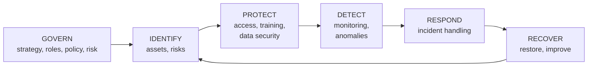

# Cyber Security Fundamentals and the Threat Landscape

Cyber security protects systems, networks and data from attack, misuse and disruption. Whether you end up as a SOC analyst, penetration tester, security engineer or a developer who takes security seriously, the same fundamentals apply: what you're protecting, who attacks and how, and the frameworks defenders use to organise their work. This guide covers the core concepts, the common attack types with concrete examples, and the frameworks (NIST CSF, MITRE ATT&CK, the kill chain) that give security work its shared vocabulary.

## 1. The CIA triad and friends

| Goal | Meaning | Attack example | Control example |
|---|---|---|---|
| **Confidentiality** | Only authorised people can read data | Stolen database dump | Encryption, access control |
| **Integrity** | Data and systems aren't altered without authorisation | Tampered payment amount | Hashes, signatures, audit logs |
| **Availability** | Systems work when needed | DDoS, ransomware | Redundancy, backups, rate limiting |

Plus **authentication** (who are you?), **authorisation** (what may you do?), **non-repudiation** (you can't deny doing it) and **privacy** (appropriate use of personal data).

**Risk = likelihood × impact.** Security is risk management. You can't remove all risk, so you decide what to **mitigate**, **transfer** (insurance), **avoid** (don't build the feature) or **accept**, based on what matters most to the business.

## 2. Core principles

- **Defence in depth:** layered controls, so one failure isn't a breach.
- **Least privilege:** every user, service and key gets the minimum access needed, for the minimum time.
- **Zero trust:** never trust based on network location. Verify identity, device and context on every request.
- **Secure by default:** the safe configuration is the default one.
- **Minimise attack surface:** fewer open ports, services, dependencies and admin accounts.
- **Assume breach:** design for detection and containment, not just prevention.

## 3. Who attacks and why

| Threat actor | Motivation | Typical methods |
|---|---|---|
| Cybercriminals / ransomware groups | Money | Phishing, stolen credentials, exploited VPNs, ransomware-as-a-service |
| Nation-state groups | Espionage, sabotage | Zero-days, supply-chain compromise, long stealthy intrusions |
| Hacktivists | Ideology, publicity | DDoS, defacement, data leaks |
| Insiders | Money, grievance, mistakes | Abusing legitimate access, accidental exposure |
| Opportunists | Curiosity, easy wins | Automated scanning for known vulnerabilities |

Most incidents aren't sophisticated. They exploit **stolen or weak credentials, phishing, unpatched internet-facing systems and misconfigurations**.

## 4. Common attacks, concretely

### Phishing and social engineering
An email "from IT" asks staff to re-enter their Microsoft 365 password on a lookalike page. Modern kits proxy the real login page (adversary-in-the-middle) to steal session cookies, which bypasses SMS and app-based codes. **Defences:** phishing-resistant MFA (FIDO2 security keys or passkeys), email authentication (SPF, DKIM, DMARC at `p=reject`), link and attachment sandboxing, user training plus an easy "report phish" button.

### Credential attacks
- **Credential stuffing:** reusing passwords leaked from other sites against yours.
- **Password spraying:** one common password tried against many accounts, to avoid lockouts.

**Defences:** MFA, breached-password checks, rate limiting and bot detection, monitoring for impossible travel.

### Malware and ransomware
Modern ransomware is **double extortion**: steal the data, *then* encrypt it, and threaten to leak it. Typical chain: phishing or an exposed VPN → credential theft → lateral movement → disable backups → mass encryption. **Defences:** patch internet-facing systems fast, EDR on endpoints, segmented networks, **immutable or offline backups that are tested**, and least-privilege admin accounts.

### Web application attacks
Injection (SQL, command), broken access control (IDOR), XSS, SSRF and authentication flaws. See the OWASP Top 10 guide.

```text
GET /api/orders/10452         → your order
GET /api/orders/10453         → someone else's order   ← IDOR: broken access control (OWASP A01)
```

### Network attacks
Man-in-the-middle on untrusted networks, DNS spoofing, DDoS (volumetric floods, protocol abuse, application-layer floods). **Defences:** TLS everywhere with HSTS, DNSSEC where applicable, DDoS protection through CDN and cloud services, and rate limiting.

### Supply-chain attacks
Compromising a vendor, library or build system to reach many victims at once. **Defences:** SBOMs, signed artefacts, dependency vetting, vendor risk management.

## 5. Frameworks that organise the work

### NIST Cybersecurity Framework 2.0

Six functions that structure a whole security programme:



CSF 2.0 (2024) added **Govern** as the function that sits over everything else: security as a leadership and risk-management responsibility, not just an IT task.

### The Cyber Kill Chain

Lockheed Martin's model of an intrusion: reconnaissance → weaponisation → delivery → exploitation → installation → command and control → actions on objectives. The defender's insight is that breaking *any* link stops the attack, so you want controls at every stage.

### MITRE ATT&CK

A detailed, constantly updated knowledge base of real attacker **tactics** (the why: initial access, persistence, privilege escalation, lateral movement, exfiltration…) and **techniques** (the how, such as T1566 Phishing or T1078 Valid Accounts). Defenders use it to:

- map detection coverage ("which techniques can we see?"),
- describe incidents in a common language,
- plan red-team exercises and threat hunts.

```text
Incident summary in ATT&CK terms:
Initial Access   T1566.002 Spearphishing Link
Credential Access T1557    Adversary-in-the-Middle (session cookie theft)
Persistence      T1098     Account Manipulation (added mail forwarding rule)
Collection       T1114.003 Email Forwarding Rule
Exfiltration     T1567     Exfiltration Over Web Service
```

### Other references you'll meet

**CIS Critical Security Controls** (a prioritised list of safeguards), **ISO/IEC 27001** (information security management systems), the **OWASP Top 10** (web applications), and regulations such as GDPR and PCI DSS.

## 6. Career paths in brief

| Role | Focus |
|---|---|
| SOC analyst | Monitor alerts, triage, investigate, escalate |
| Incident responder / DFIR | Contain and investigate breaches, forensics |
| Penetration tester / red team | Ethically attack systems to find weaknesses |
| Security engineer | Build and run defences: IAM, network, cloud, detection |
| AppSec engineer | Secure the SDLC, code review, threat modelling |
| GRC analyst | Governance, risk, compliance, policies, audits |

Useful foundations for all of them: networking, Linux and Windows administration, scripting (Python, PowerShell, Bash), and cloud basics. Entry certifications such as CompTIA Security+ are common, followed by role-specific ones. Hands-on practice platforms (TryHackMe, Hack The Box, CTFs) matter as much as certificates.

## 7. Real-world case: a business email compromise

A finance employee received an email that appeared to come from a supplier ("we've changed banks, please update our account"). The supplier's mailbox had been compromised weeks earlier through a phishing page that stole a session token. The attacker read the thread history and replied in context. The payment of ৳1.2 crore went to the attacker's account.

What would have helped: phishing-resistant MFA at the supplier, a DMARC-aware banner for external email, and above all a **process control**: any change of bank details must be verified by calling a known phone number, never one from the email. Many of the most effective security controls are business processes, not technology.

## 8. Hands-on exercise

1. Pick one public breach report (for example a ransomware case study from a national CERT) and map its steps to MITRE ATT&CK techniques and kill-chain stages.
2. Check your own domain's email security with `dig TXT _dmarc.yourdomain.com` and an SPF record lookup.
3. List the assets of a small app (data, services, accounts) and write a simple risk register: threat, likelihood, impact, control.
4. Complete an introductory room or lab on a hands-on platform covering phishing analysis or web vulnerabilities.

## 9. Checklist

- [ ] I can explain the CIA triad, risk, and the core principles (defence in depth, least privilege, zero trust).
- [ ] I can describe common attacks (phishing, credential attacks, ransomware, web, network, supply chain) and their defences.
- [ ] I know the six functions of NIST CSF 2.0, the kill chain, and how MITRE ATT&CK is used.
- [ ] I understand why phishing-resistant MFA, patching, backups and process controls matter most.
- [ ] I know the main career paths and the foundational skills they share.

## 10. Interview angle

> **Asked as:** "What is defence in depth? Give an example."

Layered, independent controls. For example, against ransomware: email filtering, phishing-resistant MFA, patching, EDR, network segmentation, least-privilege admin accounts and immutable tested backups. Any single layer can fail without causing a full breach.

> **Asked as:** "What is MITRE ATT&CK used for?"

It's a shared catalogue of real attacker tactics and techniques, used to describe incidents, measure detection coverage, prioritise defences and plan red-team and threat-hunting work.
