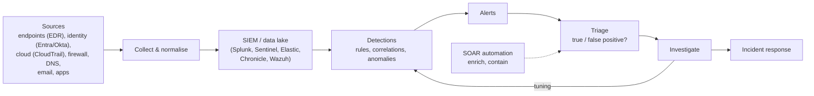
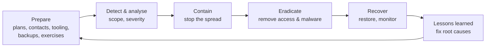

# Security Operations: Logging, Detection and Incident Response

Prevention eventually fails. What separates a minor incident from a headline breach is how quickly you **detect** the intrusion and how well you **respond**. Industry reports consistently show attackers spending days to weeks inside networks before discovery. This guide covers how security operations centres (SOCs) collect logs, write detections, triage alerts and run incident response, with real queries and a step-by-step playbook.

## 1. The detection pipeline



## 2. What to log (and keep)

You can't detect what you don't record. High-value sources, roughly in priority order:

| Source | Why |
|---|---|
| **Identity provider** logins, MFA events, admin changes | Most intrusions use valid accounts |
| **EDR** on endpoints and servers (process, network, file events) | Malware, hands-on-keyboard activity |
| **Cloud control-plane logs** (AWS CloudTrail, Azure Activity, GCP Audit) | Who changed what in the cloud |
| Email security logs | Phishing delivery and clicks |
| DNS and proxy logs | Command-and-control, exfiltration |
| Firewall, VPN and load-balancer logs | Perimeter access, scanning |
| Application audit logs (logins, permission changes, data exports) | Business-logic abuse |

Use consistent timestamps (UTC, NTP-synced), protect logs from tampering (separate account, immutable storage), and keep them long enough to investigate. Many regulations and insurers expect 90 days hot and 1 year or more total.

## 3. Writing detections

Good detections target **attacker behaviour**, not just known-bad indicators (hashes and IPs change constantly). They're mapped to ATT&CK, tested, and tuned for an acceptable false-positive rate.

### Example: password spraying (KQL, Microsoft Sentinel)

```kusto
SigninLogs
| where TimeGenerated > ago(1h)
| where ResultType in ("50126", "50053")              // invalid password / locked out
| summarize FailedUsers = dcount(UserPrincipalName), Attempts = count(),
            Users = make_set(UserPrincipalName, 20) by IPAddress, bin(TimeGenerated, 10m)
| where FailedUsers >= 15                              // one IP, many different accounts
| extend Technique = "T1110.003 Password Spraying"
```

### Example: suspicious inbox forwarding rule (Splunk SPL)

```spl
index=o365 Operation IN ("New-InboxRule","Set-InboxRule")
| search Parameters{}.Name IN ("ForwardTo","RedirectTo","ForwardAsAttachmentTo")
| eval target=mvindex('Parameters{}.Value', mvfind('Parameters{}.Name', "Forward|Redirect"))
| where NOT like(target, "%@acme.com.bd")
| table _time UserId ClientIP target
```

### Portable detections with Sigma

**Sigma** is a vendor-neutral rule format that converts to KQL, SPL, Elastic and others:

```yaml
title: Encoded PowerShell Command Line
id: 1b0e6c4e-0b6f-4b2e-9a51-6c7a7f2f0001
status: stable
logsource: { category: process_creation, product: windows }
detection:
  selection:
    Image|endswith: '\powershell.exe'
    CommandLine|contains: [' -enc ', ' -EncodedCommand ']
  condition: selection
falsepositives: [Some legitimate admin and deployment scripts]
level: medium
tags: [attack.execution, attack.t1059.001]
```

### Detection engineering practices

- Keep detections **as code** in Git, with tests (sample logs that must and must not trigger).
- Track an **ATT&CK coverage map** and prioritise the techniques attackers actually use against organisations like yours.
- Measure **precision** (what fraction of alerts are real) and **mean time to detect**. Retire or tune rules that only produce noise, because alert fatigue is how real attacks get missed.

## 4. Triage and investigation

A SOC analyst's loop for each alert:

1. **Understand the alert:** which rule, which entity (user, host, IP), and what behaviour.
2. **Enrich:** IP reputation, geolocation, user role and normal behaviour, asset criticality, related alerts.
3. **Scope:** what else did this user, host or IP do before and after? Build a timeline.
4. **Decide:** a benign true positive (authorised admin activity), a false positive (tune the rule), or a true positive (escalate to an incident).
5. **Document** findings and evidence, whatever the outcome.

**SOAR** (security orchestration, automation and response) playbooks automate repeatable steps: enrichment, ticket creation, and containment such as disabling an account or isolating a host after analyst approval or for high-confidence detections.

## 5. Incident response lifecycle

NIST SP 800-61 Revision 3 (2025) aligns incident response with the CSF 2.0 functions. The classic phases are still the practical way to run an incident:



### Playbook: compromised Microsoft 365 / Google Workspace account

| Phase | Actions |
|---|---|
| Detect | Alert on impossible travel, new inbox forwarding rule, or a phishing report from the user |
| Analyse | Review sign-in logs (IPs, devices, session tokens), mailbox audit (rules, sent items, file access), OAuth app consents |
| **Contain** | Reset the password, **revoke all sessions and refresh tokens**, block the attacker IPs, disable malicious inbox rules and OAuth apps |
| Eradicate | Re-register MFA with a phishing-resistant method, remove persistence (app passwords, delegates, forwarding) |
| Recover | Restore normal access, watch the account closely for 30 days, warn contacts if phishing was sent from it |
| Lessons | Why did MFA not stop it? Roll out phishing-resistant MFA and conditional access, add the detection that would have fired earlier |

Key response principles:

- **Preserve evidence before wiping:** memory and disk images and logs, with a chain of custody if legal action is possible.
- **Contain in coordination.** Tipping off an attacker too early can trigger destructive actions, so plan containment steps together when the attacker is active.
- **Communicate deliberately:** an incident commander, regular updates, legal and PR involvement, and regulatory notification deadlines (GDPR requires notifying the authority within 72 hours of becoming aware of a reportable breach, and many other laws and contracts have their own deadlines).
- **Blameless post-incident reviews** that produce owned, dated action items.

## 6. Threat hunting

Hunting is proactive: assume a compromise you haven't detected, form a hypothesis and search for it.

> *Hypothesis:* "An attacker with valid credentials is using remote management tools for persistence."
> *Hunt:* list all hosts running remote-access software (AnyDesk, ScreenConnect…) that isn't on the approved list, plus first-seen dates.

Successful hunts become new detections.

## 7. Real-world case: catching ransomware before encryption

At 02:14, an EDR alert fired on a file server: a process was running `vssadmin delete shadows` (deleting backup snapshots, ATT&CK T1490). The on-call analyst correlated it with:

- a VPN login at 23:50 from an unusual country for a service account with no MFA,
- remote-desktop sessions from the VPN host to three servers,
- a tool commonly used for credential dumping on one of them.

Containment by 02:40: the service account was disabled, the VPN session killed, the four hosts network-isolated through EDR, and firewall rules blocked the attacker's infrastructure. Encryption had started on one share, and that was restored from immutable backups by noon. Root causes and fixes: MFA on all VPN accounts with service accounts denied VPN access, an alert on shadow-copy deletion upgraded to auto-isolate, and a review of privileged accounts.

## 8. Hands-on exercise

1. Spin up a free SIEM lab (Wazuh, Elastic or a Sentinel trial) and ingest Windows or Linux logs from a VM.
2. Simulate attacks safely with Atomic Red Team (for example T1059.001 encoded PowerShell, T1110 brute force) and write detections that catch them.
3. Convert one Sigma rule into your SIEM's query language.
4. Write a one-page incident response playbook for "lost laptop with company data" and run a 30-minute tabletop exercise with a friend.

## 9. Checklist

- [ ] I know the highest-value log sources and why log integrity and retention matter.
- [ ] I can write behaviour-based detections in KQL, SPL or Sigma, mapped to ATT&CK.
- [ ] I can triage an alert: enrich, scope, build a timeline, decide and document.
- [ ] I can run the incident response lifecycle, including containment, evidence preservation and communication.
- [ ] I understand detection engineering metrics, SOAR and threat hunting.

## 10. Interview angle

> **Asked as:** "You get an alert for impossible travel on the CFO's account. Walk me through it."

Validate it (VPN, travel or real?), check the sign-in details, devices, MFA method and session tokens, and review mailbox rules, OAuth consents, file access and sent mail. If it's malicious: revoke sessions, reset credentials, remove persistence and block the IPs. Then scope other affected accounts, notify the right people, and follow up with phishing-resistant MFA and conditional access.

> **Asked as:** "How do you reduce alert fatigue?"

Measure precision per rule, tune or retire noisy rules, add context-based suppressions, prioritise by asset criticality, automate enrichment and the safe responses, and focus detections on high-value ATT&CK techniques.
