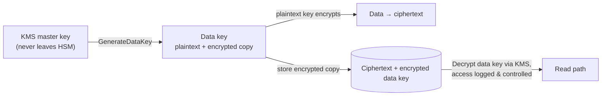
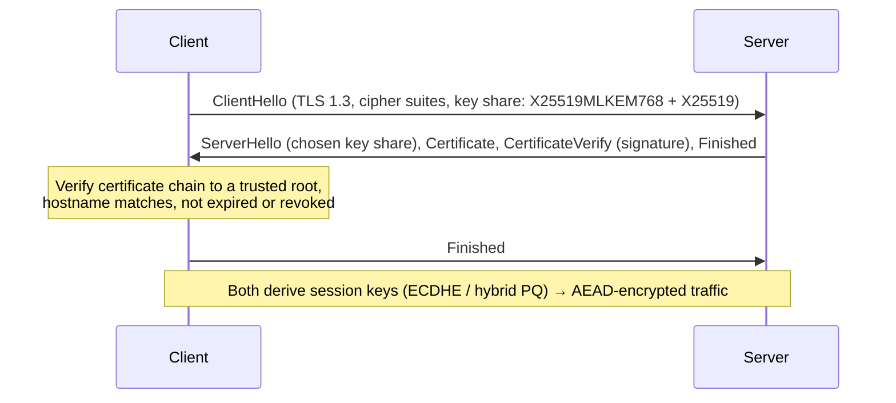

# Cryptography and PKI in Practice

Cryptography protects data in transit (HTTPS, VPNs), at rest (disk and database encryption), and proves identity and integrity (signatures, certificates). You should almost never *implement* cryptography yourself, but you must know which primitive to use, how to use well-tested libraries correctly, how certificates and PKI work, and what's changing with post-quantum cryptography. This guide covers all of that with practical code.

## 1. The building blocks

| Primitive | Purpose | Use today | Avoid |
|---|---|---|---|
| **Symmetric encryption** | Confidentiality with a shared key | AES-256-GCM, ChaCha20-Poly1305 (authenticated encryption) | DES, 3DES, RC4, AES-ECB, unauthenticated CBC |
| **Hash** | Fingerprint, integrity | SHA-256, SHA-3, BLAKE2/3 | MD5, SHA-1 for security |
| **MAC** | Integrity and authenticity with a shared key | HMAC-SHA-256 | Homemade `hash(key + message)` |
| **Password hashing** | Store passwords safely | Argon2id, scrypt, bcrypt | Fast hashes (SHA-256) or unsalted hashes |
| **Asymmetric encryption / key exchange** | Agree on keys without sharing a secret | ECDHE (X25519), now hybrid with ML-KEM | RSA key exchange (no forward secrecy) |
| **Digital signatures** | Prove who signed, detect tampering | Ed25519, ECDSA P-256, RSA-PSS ≥ 3072, ML-DSA (post-quantum) | RSA-1024, DSA |
| **CSPRNG** | Unpredictable random numbers | `secrets` (Python), `crypto.randomBytes` (Node), `/dev/urandom` | `Math.random()`, `random` |

**Authenticated encryption** (AEAD) like AES-GCM gives confidentiality *and* detects tampering. Never use encryption without integrity.

## 2. Using crypto correctly in code

### Encrypting data at the application level

```python
from cryptography.hazmat.primitives.ciphers.aead import AESGCM
import os

key = AESGCM.generate_key(bit_length=256)          # store in a KMS / secrets manager, never in code

def encrypt(plaintext: bytes, associated: bytes) -> bytes:
    nonce = os.urandom(12)                         # unique per message with the same key: NEVER reuse
    return nonce + AESGCM(key).encrypt(nonce, plaintext, associated)

def decrypt(blob: bytes, associated: bytes) -> bytes:
    nonce, ct = blob[:12], blob[12:]
    return AESGCM(key).decrypt(nonce, ct, associated)   # raises if tampered

token = encrypt(b"NID: 1990123456789", associated=b"customer:881")   # binds ciphertext to the record
```

Reusing a nonce with the same GCM key is catastrophic, because it can expose plaintext and allow forgeries. Libraries and KMS services that manage nonces for you (or misuse-resistant modes like AES-GCM-SIV) reduce that risk.

### Envelope encryption with a KMS

Don't encrypt large data directly with a master key. Generate a **data key**, encrypt the data with it, and store the data key encrypted by the KMS master key:



This gives centralised key control, audit logs of every decrypt, easy rotation and per-tenant keys.

### Passwords

```python
from argon2 import PasswordHasher
ph = PasswordHasher()                 # Argon2id with sensible defaults, salt included automatically
stored = ph.hash("correct horse battery staple")
ph.verify(stored, attempt)            # raises on mismatch
if ph.check_needs_rehash(stored):     # upgrade parameters over time
    stored = ph.hash(attempt)
```

### Comparing secrets

```python
import hmac
hmac.compare_digest(received_signature, expected_signature)   # constant time, prevents timing attacks
```

## 3. TLS: how HTTPS actually protects you



- **TLS 1.3** (and 1.2 with modern ciphers) only. Disable TLS 1.0/1.1, SSLv3 and RC4/3DES suites.
- **Forward secrecy:** ephemeral key exchange means a stolen server key can't decrypt past recorded traffic.
- **HSTS** forces HTTPS and prevents downgrade attacks: `Strict-Transport-Security: max-age=63072000; includeSubDomains; preload`.
- **Certificate validation** is the whole point. Code that sets `verify=False` or `rejectUnauthorized: false` makes TLS useless against man-in-the-middle attacks.

```bash
openssl s_client -connect quickfood.example:443 -servername quickfood.example -tls1_3 </dev/null 2>/dev/null \
  | openssl x509 -noout -subject -issuer -dates -ext subjectAltName
```

## 4. PKI and certificates

A certificate binds a public key to an identity (a domain name), signed by a **certificate authority (CA)**. Browsers trust a set of root CAs, and roots sign intermediates, which sign your leaf certificate.

Operational essentials:

- **Automate issuance and renewal** with ACME (Let's Encrypt, cert-manager in Kubernetes, cloud certificate managers). Certificate lifetimes are shrinking: the CA/Browser Forum has approved a phased reduction of public TLS certificate validity from 398 days down to 47 days by 2029, so manual renewal won't be viable.
- **Monitor expiry**, because expired certificates are still a leading cause of outages.
- **Certificate Transparency** logs record every public certificate. Monitor them for certificates issued for your domains that you didn't request.
- **Internal PKI** for service-to-service **mTLS** (service mesh, SPIFFE/SPIRE, a private CA) with short-lived certificates issued automatically.
- **Protect private keys:** HSMs or KMS for CA keys, restricted file permissions, and never commit them to Git.

## 5. Post-quantum cryptography (PQC)

A large enough quantum computer would break RSA and elliptic-curve cryptography (via Shor's algorithm). It doesn't exist yet, but **"harvest now, decrypt later"** is a real threat: adversaries record encrypted traffic today to decrypt in the future. Status in 2026:

- NIST standardised **ML-KEM** (FIPS 203, key encapsulation, from Kyber), **ML-DSA** (FIPS 204, signatures, from Dilithium) and **SLH-DSA** (FIPS 205, hash-based signatures) in August 2024, with more algorithms following.
- **Hybrid key exchange** (classical X25519 + ML-KEM-768) is already enabled by default in major browsers, Cloudflare, and recent OpenSSL, OpenSSH and Java releases. A large share of web TLS traffic is now post-quantum protected.
- Symmetric crypto (AES-256) and hashes (SHA-256/384) remain fine with adequate key sizes.

What engineers should do now: **build a crypto inventory** (where you use RSA and ECC, and in which libraries and protocols), keep TLS libraries current so hybrid PQ key exchange is on by default, prefer **crypto agility** (algorithms configurable rather than hard-coded), and track government and vendor migration timelines for signatures and PKI.

## 6. Common mistakes

| Mistake | Consequence | Fix |
|---|---|---|
| Rolling your own crypto or protocol | Subtle, exploitable flaws | Vetted libraries (libsodium, the `cryptography` package, Tink) and standard protocols |
| Hard-coded keys | Anyone with the code has the data | KMS or secrets manager, rotation |
| ECB mode / no authentication | Patterns leak, tampering is undetected | AEAD (AES-GCM, ChaCha20-Poly1305) |
| Disabled certificate verification | MITM-able | Fix the trust store and never skip verification |
| Fast hashes for passwords | Offline cracking at billions per second | Argon2id, scrypt or bcrypt |
| `Math.random()` for tokens | Predictable tokens | CSPRNG |
| JWT `alg: none` or algorithm confusion | Forged tokens | Pin the expected algorithm and validate `iss`, `aud` and `exp` |

## 7. Real-world case: the backup that wasn't encrypted

A company encrypted its production database with KMS, but nightly logical backups were written as plain `pg_dump` files to an S3 bucket shared with an analytics vendor. When the vendor's credentials leaked, three years of customer records were exposed. The fixes: bucket-level SSE-KMS with a dedicated key whose key policy excludes the vendor, client-side envelope encryption for backups, separate accounts for backups, a KMS audit alert on unusual decrypt volume, and a data inventory so every copy of sensitive data is known. Encryption at rest only protects you if *every* copy uses keys with tight access control.

## 8. Hands-on exercise

1. Encrypt and decrypt records with AES-GCM using associated data, and show that tampering with the ciphertext or associated data fails decryption.
2. Implement envelope encryption with a local KMS emulator (LocalStack) or a cloud KMS free tier.
3. Hash passwords with Argon2id and implement rehash-on-login.
4. Inspect a website's TLS with `openssl s_client` and an online TLS checker. Note the TLS version, cipher, chain and key exchange group (look for X25519MLKEM768).
5. Set up cert-manager with Let's Encrypt staging on a test cluster.

## 9. Checklist

- [ ] I can choose the right primitive (AEAD, hash, MAC, password hash, signatures, CSPRNG) and avoid deprecated ones.
- [ ] I use vetted libraries correctly: unique nonces, constant-time comparison, no hard-coded keys.
- [ ] I understand envelope encryption with a KMS.
- [ ] I can explain the TLS 1.3 handshake, forward secrecy, HSTS and certificate validation, and automate certificate management.
- [ ] I understand the post-quantum timeline, hybrid ML-KEM key exchange and crypto agility.

## 10. Interview angle

> **Asked as:** "How should passwords be stored?"

With a slow, salted, memory-hard password hash (Argon2id, or scrypt or bcrypt) through a vetted library, with parameters tuned to about 100 ms or more, rehashing on login when parameters change, never encrypted or with fast hashes, plus MFA and breached-password checks.

> **Asked as:** "What is 'harvest now, decrypt later' and what do we do about it?"

Attackers record encrypted traffic today and wait for quantum computers to break the key exchange. The mitigations are hybrid post-quantum key exchange (ML-KEM with X25519) in TLS and VPNs, a crypto inventory, current libraries and crypto agility.
