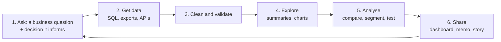

# The Analyst Workflow, Spreadsheets and Data Cleaning

A data analyst turns raw data into decisions. The tools vary (Excel or Google Sheets, SQL, Python, a BI tool), but the workflow doesn't, and most of the time goes into a step beginners underestimate: **cleaning**. This guide covers the end-to-end workflow, the spreadsheet skills every analyst still uses daily, and a systematic approach to cleaning data you can trust.

## 1. The workflow



The most important step is the first one. "Show me the sales data" is not a question. "Why did repeat orders in Dhaka fall 12% in September, and which customer segment drove it?" is. A clear question tells you what data to pull, which metric matters and when you're done.

### Define metrics precisely

"Active customers" sounds obvious until two teams report different numbers. Write definitions down:

| Metric | Definition |
|---|---|
| Active customer (monthly) | Placed ≥ 1 *completed* (not cancelled) order in the calendar month, Asia/Dhaka time |
| Repeat rate | Share of the month's active customers who also ordered in the previous month |
| Average order value (AOV) | Sum of completed order totals ÷ number of completed orders, excluding delivery fees |

Most "the dashboard is wrong" arguments are really metric-definition arguments.

## 2. Spreadsheet skills that still matter

Spreadsheets are the universal language of business. The essentials:

- **Lookups:** `XLOOKUP` (or `INDEX`/`MATCH`) to join tables.
- **Conditional aggregation:** `SUMIFS`, `COUNTIFS`, `AVERAGEIFS`.
- **Pivot tables:** summarise millions of rows by any dimension in seconds.
- **Data validation and conditional formatting:** catch bad entries and highlight outliers.
- **Tables (Ctrl+T) and named ranges:** formulas that don't break when rows are added.

```text
# Revenue for completed orders in Dhaka in September
=SUMIFS(Orders[total], Orders[status], "DELIVERED", Orders[city], "Dhaka",
        Orders[order_date], ">="&DATE(2026,9,1), Orders[order_date], "<"&DATE(2026,10,1))

# Bring the customer's signup channel onto each order row
=XLOOKUP([@customer_id], Customers[id], Customers[signup_channel], "unknown")

# Month-over-month change, safe against division by zero
=IFERROR((C3-B3)/B3, "")
```

Know the limits of spreadsheets. They become fragile beyond a few hundred thousand rows, have no version history of logic, and make manual copy-paste errors easy. Move repeatable work to SQL or Python.

## 3. Data quality: the six dimensions

Before analysing, check:

1. **Completeness:** are values missing? Which rows, and is the missingness random?
2. **Validity:** do values follow the rules (dates are dates, ages 0–120, valid statuses)?
3. **Accuracy:** do they reflect reality (spot-check against the source system)?
4. **Consistency:** the same thing recorded the same way ("Dhaka", "dhaka", "DHK")?
5. **Uniqueness:** are there duplicate records?
6. **Timeliness:** how fresh is the data? Is yesterday's load complete?

## 4. A systematic cleaning process in SQL

```sql
-- 1. Profile first: counts, nulls, distinct values, ranges
SELECT count(*) AS rows,
       count(*) FILTER (WHERE customer_id IS NULL) AS null_customer,
       count(DISTINCT order_id) AS distinct_orders,          -- < rows means duplicates
       min(order_date), max(order_date),
       min(total), max(total)
FROM raw_orders;

SELECT city, count(*) FROM raw_orders GROUP BY city ORDER BY 2 DESC;   -- spot spelling variants

-- 2. Clean into a new table, never overwriting the raw data
CREATE TABLE clean_orders AS
WITH dedup AS (
  SELECT *, row_number() OVER (PARTITION BY order_id ORDER BY loaded_at DESC) AS rn
  FROM raw_orders
)
SELECT order_id,
       customer_id,
       (order_ts AT TIME ZONE 'UTC' AT TIME ZONE 'Asia/Dhaka')::date AS order_date,   -- business timezone
       CASE lower(trim(city))
         WHEN 'dhaka' THEN 'Dhaka' WHEN 'dhk' THEN 'Dhaka'
         WHEN 'chattogram' THEN 'Chattogram' WHEN 'chittagong' THEN 'Chattogram'
         ELSE initcap(trim(city)) END AS city,
       upper(status) AS status,
       total
FROM dedup
WHERE rn = 1                                   -- keep the latest version of each order
  AND total >= 0                               -- negative totals are refunds, which live in another table
  AND customer_id IS NOT NULL;

-- 3. Validate the result: row counts reconcile, no duplicates remain
SELECT count(*), count(DISTINCT order_id) FROM clean_orders;
```

Principles:

- **Never edit raw data.** Keep raw → clean → analysis layers, so every step is reproducible.
- **Document every rule** ("removed 312 test orders with emails ending in @quickfood.test").
- **Reconcile totals** against a trusted source (the finance report) before presenting anything.
- **Watch time zones.** A UTC timestamp at 20:00 on 30 September is already 1 October in Dhaka, and month-end totals shift.

## 5. Missing values and outliers

Missing data is information. Ask *why* it's missing before choosing what to do:

| Situation | Reasonable handling |
|---|---|
| Few rows, missing at random | Drop them and note it |
| A column mostly empty | Exclude it or flag it as unreliable |
| Meaningful absence (no coupon used) | Fill with an explicit value (`'none'`, 0) |
| Numeric gaps in a time series | Interpolate carefully, or show the gaps honestly |

Outliers are either errors (a ৳1,000,000 burger) or the most interesting rows in the dataset (a corporate bulk order). Investigate before deleting. A common robust rule flags values beyond **Q3 + 1.5 × IQR**, then a human decides.

## 6. Real-world case: the "revenue drop" that wasn't

A manager panics: September revenue is down 18% on the dashboard. The analyst checks data quality first and finds:

1. The September 30 load had failed. The last day was missing (timeliness).
2. A new app version logged city as "DHK" and the dashboard filtered on "Dhaka" (consistency).
3. Revenue was summed in UTC, which shifted 4 hours of evening orders to the wrong month.

After fixing these, revenue was *up* 3%. The real lesson was the check that was added next: automated tests on daily loads for row counts, allowed values and freshness.

## 7. Hands-on exercise

1. Download any public messy dataset (city open data, Kaggle).
2. Profile it: rows, nulls per column, distinct values, ranges and duplicates.
3. Write a cleaning script (SQL or spreadsheet steps) that never modifies the raw table, with every rule documented.
4. Build a pivot table answering one specific business question, and write a three-sentence finding.

## 8. Checklist

- [ ] I start with a specific question and the decision it informs.
- [ ] I write precise metric definitions.
- [ ] I can use XLOOKUP, SUMIFS and pivot tables fluently.
- [ ] I profile data across the six quality dimensions before analysing.
- [ ] I clean reproducibly (raw → clean), handle missing values and outliers deliberately, and reconcile totals.

## 9. Interview angle

> **Asked as:** "Walk me through how you'd analyse a drop in a key metric."

Confirm it's real (data quality, freshness, definition changes, time zones), then segment by city, platform, customer type and channel to localise it. Check what changed (releases, pricing, competitors, seasonality), quantify each factor, and recommend actions with the confidence level.

> **Asked as:** "How do you handle missing data?"

First understand why it's missing (random, systematic or meaningful), then drop, flag, fill or impute accordingly, and document the impact on the results.
