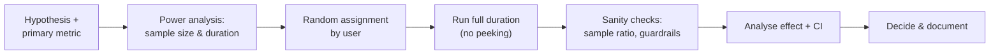

# Statistics for Analysts: Distributions, Inference and A/B Tests

Statistics lets you tell signal from noise. Without it, every 3% wiggle in a chart becomes a story, and every A/B test "wins." This guide covers the statistics analysts use daily: describing data honestly, sampling and confidence intervals, hypothesis tests, A/B testing done right, and correlation vs causation, with Python examples you can run.

## 1. Describing data

| Measure | What it tells you | Watch out |
|---|---|---|
| Mean | Arithmetic average | Pulled by outliers and skew |
| **Median** | The middle value | Robust. Prefer it for income, order values and latency. |
| Percentiles (p90, p95, p99) | Tail behaviour | Essential for latency and delivery times |
| Standard deviation | Typical spread around the mean | Misleading for skewed data |
| IQR (Q3 − Q1) | Spread of the middle 50% | Robust spread measure |

Delivery times are **right-skewed**: most orders arrive in 25–35 minutes, and a few take 90. The mean (38 min) overstates the typical experience, the median (31 min) describes it, and p90 (55 min) describes the pain. Report all three.

```python
import pandas as pd
d = pd.read_csv("deliveries.csv")
print(d["minutes"].describe(percentiles=[.5, .9, .95]))
print(d.groupby("city")["minutes"].median())
```

## 2. Distributions you should recognise

- **Normal:** symmetric bell curve (measurement error, heights). Many tests assume it for *means*.
- **Log-normal / skewed:** order values, incomes, session lengths. Log-transform or use medians.
- **Binomial:** count of successes in n trials (conversions out of visitors).
- **Poisson:** count of events in an interval (orders per minute).

The **Central Limit Theorem** is why inference works. Even when the data is skewed, the *average* of a large enough sample is approximately normally distributed. That lets us compute confidence intervals for means and proportions.

## 3. Samples, uncertainty and confidence intervals

You almost never measure everyone, so every metric is an estimate. A **95% confidence interval** is a range built by a method that captures the true value 95% of the time.

```python
import numpy as np
from statsmodels.stats.proportion import proportion_confint

# 420 conversions out of 5,000 visitors
low, high = proportion_confint(count=420, nobs=5000, alpha=0.05, method="wilson")
print(f"conversion = 8.4%, 95% CI [{low:.1%}, {high:.1%}]")    # about [7.7%, 9.2%]

# Bootstrap CI for the median delivery time (no normality assumption)
mins = d["minutes"].to_numpy()
boot = [np.median(np.random.choice(mins, size=len(mins), replace=True)) for _ in range(5000)]
print(np.percentile(boot, [2.5, 97.5]))
```

If two segments' intervals overlap heavily, don't claim a difference. Bigger samples shrink intervals roughly with √n, so four times the data halves the width.

## 4. Hypothesis testing in plain language

1. **Null hypothesis (H₀):** no difference (the new checkout converts the same as the old one).
2. Collect data and compute how surprising it would be **if H₀ were true**. That's the **p-value**.
3. If p < α (commonly 0.05), reject H₀.

What a p-value is **not**: the probability that H₀ is true, or the size or importance of an effect. A tiny, useless effect can be "significant" with enough data, so always report the **effect size with a confidence interval**.

| Comparing | Test |
|---|---|
| Two proportions (conversion A vs B) | Two-proportion z-test or chi-square |
| Two means, roughly normal | Welch's t-test |
| Two skewed distributions | Mann-Whitney U, or bootstrap the difference |
| More than two groups | ANOVA or chi-square, then corrected pairwise comparisons |

```python
from statsmodels.stats.proportion import proportions_ztest
from scipy import stats

# A: 420/5000, B: 480/5000
z, p = proportions_ztest(count=[480, 420], nobs=[5000, 5000])
print(f"lift = {480/5000 - 420/5000:.2%} points, p = {p:.3f}")

# Delivery minutes, old vs new routing (skewed, so non-parametric)
u, p = stats.mannwhitneyu(new_routing, old_routing, alternative="less")
```

### Errors and power

- **Type I error (false positive):** declaring a winner that isn't one. Controlled by α.
- **Type II error (false negative):** missing a real effect.
- **Power** (usually a target of 80%) is the chance of detecting an effect *if it exists*. It depends on sample size, effect size and variance.

## 5. A/B testing done right



**Size the test before it starts:**

```python
from statsmodels.stats.power import NormalIndPower
from statsmodels.stats.proportion import proportion_effectsize

effect = proportion_effectsize(0.084, 0.092)      # detect 8.4% → 9.2% (+0.8 pp)
n = NormalIndPower().solve_power(effect_size=effect, alpha=0.05, power=0.8)
print(round(n))                                    # roughly 9,800 users per group
```

Rules that prevent the most common mistakes:

- **One primary metric**, chosen in advance, plus **guardrail metrics** that must not get worse (cancellation rate, delivery time, refunds).
- **Randomise by user**, not by session, so one person sees one experience.
- **Don't peek and stop early** when p dips below 0.05. Repeated checking inflates false positives dramatically. Run the planned duration, ideally whole weeks to cover weekday effects, or use sequential testing methods designed for peeking.
- **Check the sample ratio.** A 50/50 split that comes out 52/48 at scale signals a bug in assignment or logging (a sample ratio mismatch), and the results can't be trusted.
- **Correct for multiple comparisons** when you test many metrics or segments (Bonferroni, Benjamini-Hochberg), or a "winner" will appear by chance.
- Watch for **novelty effects**. Users click new things at first, so check whether the effect holds in week 2.

## 6. Correlation is not causation

Cities with more riders have longer delivery times. That doesn't mean riders slow deliveries. Bigger cities have both more riders and more traffic, which is a **confounder**. Other traps:

- **Reverse causation:** do engaged users use feature X, or does X make them engaged?
- **Selection bias:** survey respondents aren't typical users.
- **Simpson's paradox:** a trend in every segment reverses in the aggregate because the segment mix changed.

Randomised experiments establish causation. When you can't randomise, use careful designs such as **difference-in-differences** (compare a city that got a change with similar cities that didn't, before and after) and state the assumptions clearly.

## 7. Real-world case: the coupon that "worked"

Users who received a ৳100 coupon ordered 40% more the following month, and marketing wanted to roll it out to everyone. The coupon had been sent to users who opened the app recently, which made them already more active (selection bias). A proper A/B test randomised coupons among *all* lapsed users. The true lift was 9%, and after subtracting the coupon cost and the orders that would have happened anyway, the campaign was barely profitable. The analysis redirected the budget to a targeted segment where the lift was 21%.

## 8. Hands-on exercise

1. Compute the mean, median, p90 and IQR for a skewed dataset, and explain which to report.
2. Build a 95% confidence interval for a conversion rate with Wilson and with bootstrap.
3. Run a power analysis for detecting a 5% relative lift on a 10% baseline.
4. Simulate peeking: run 1,000 A/A tests (no real difference), check p every day and stop at p < 0.05. Count the false positives against checking only at the end.

## 9. Checklist

- [ ] I choose robust summaries (median, percentiles) for skewed data.
- [ ] I report estimates with confidence intervals and effect sizes, not just p-values.
- [ ] I can pick the right test for proportions, means and skewed data.
- [ ] I design A/B tests with power analysis, one primary metric, guardrails, no peeking and sample-ratio checks.
- [ ] I recognise confounding, selection bias and Simpson's paradox.

## 10. Interview angle

> **Asked as:** "What does a p-value of 0.03 mean?"

If there were truly no difference, data at least this extreme would occur about 3% of the time. It says nothing about the effect's size or importance, or the probability that the hypothesis is true.

> **Asked as:** "Your A/B test shows a 2% lift with p = 0.04 after 3 days. Ship it?"

Not yet. Check that the planned sample size and duration were reached (no peeking), check the sample ratio and the guardrail metrics, look at the confidence interval, consider novelty effects and multiple comparisons, then decide.
