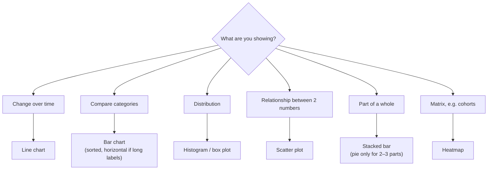

# Python for Analysis, Visualisation, BI and Data Storytelling

SQL gets the data and spreadsheets explore it, but repeatable, larger analyses live in **Python with pandas**. And no analysis matters until someone acts on it. That depends on clear charts, good dashboards and a story that leads to a decision. This guide covers pandas for everyday analysis, choosing the right chart, BI tools, and structuring findings so stakeholders act on them.

## 1. pandas essentials, by example

```python
import pandas as pd

orders = pd.read_parquet("clean_orders.parquet")         # Parquet: typed, compressed, fast
customers = pd.read_csv("customers.csv", parse_dates=["signup_date"])

# Inspect
orders.info()
orders.head()
orders["status"].value_counts(dropna=False)

# Filter, derive, join
done = orders[orders["status"] == "DELIVERED"].copy()
done["month"] = done["order_date"].dt.to_period("M")
df = done.merge(customers[["id", "signup_channel"]], left_on="customer_id", right_on="id", how="left")

# Group and aggregate with named outputs
monthly = (df.groupby(["month", "signup_channel"])
             .agg(orders=("order_id", "count"),
                  revenue=("total", "sum"),
                  customers=("customer_id", "nunique"))
             .reset_index())
monthly["aov"] = monthly["revenue"] / monthly["orders"]

# Pivot for a readable table
table = monthly.pivot(index="month", columns="signup_channel", values="revenue").fillna(0)
```

Habits that save time and prevent bugs:

- After every `merge`, check row counts. An unexpected many-to-many join silently multiplies rows. `validate="many_to_one"` makes pandas raise instead.
- Use **vectorised operations**, not row loops. `df["total"] * 1.05` is hundreds of times faster than `.apply` over rows.
- Use `.copy()` when you take a filtered subset you'll modify, which avoids `SettingWithCopyWarning` bugs.
- For data bigger than memory or for speed, **Polars** or **DuckDB** (SQL directly over Parquet files) are excellent modern options.

```python
import duckdb
duckdb.sql("""
  SELECT date_trunc('month', order_date) AS month, city, sum(total) AS revenue
  FROM 'orders/*.parquet' WHERE status = 'DELIVERED'
  GROUP BY 1, 2 ORDER BY 1
""").df()
```

## 2. Cohort retention: a classic analysis

```python
df["cohort"] = df.groupby("customer_id")["order_date"].transform("min").dt.to_period("M")
df["age"] = (df["month"] - df["cohort"]).apply(lambda p: p.n)       # months since first order

cohorts = (df.groupby(["cohort", "age"])["customer_id"].nunique().unstack(fill_value=0))
retention = cohorts.div(cohorts[0], axis=0).round(3)                  # share of each cohort still ordering
```

The resulting triangle shows, for each signup month, what fraction of customers still order 1, 2, 3… months later. It's the standard way to tell whether the product is getting stickier or whether growth is just new users replacing lost ones.

## 3. Choosing the right chart



Principles of honest, readable charts:

- **Bar charts start at zero.** Truncated axes exaggerate differences.
- **One message per chart**, stated in the title: "Repeat rate fell in Dhaka after the fee change," not "Repeat rate by city."
- **Highlight what matters** and grey out the rest.
- **Label directly** instead of relying on a legend where possible, and remove gridline clutter.
- Use **colour-blind-safe palettes**, and never encode meaning in colour alone.

```python
import matplotlib.pyplot as plt

fig, ax = plt.subplots(figsize=(8, 4))
for city, s in repeat_rate.items():
    ax.plot(s.index.astype(str), s.values, color="#d1d5db" if city != "Dhaka" else "#f97316", lw=2.5 if city == "Dhaka" else 1.5)
ax.annotate("Delivery fee raised", xy=("2026-09", repeat_rate["Dhaka"]["2026-09"]), xytext=(10, 20),
            textcoords="offset points", arrowprops=dict(arrowstyle="->"))
ax.set_title("Repeat rate fell in Dhaka after the September fee change", loc="left", fontweight="bold")
ax.spines[["top", "right"]].set_visible(False)
ax.set_ylabel("Repeat rate")
plt.tight_layout()
plt.savefig("repeat_rate.png", dpi=200)
```

## 4. BI tools and dashboards

Power BI, Tableau, Looker, Metabase and Superset turn modelled data into interactive dashboards for non-technical users.

- **Model first.** Build clean fact tables (orders, deliveries) and dimension tables (customers, restaurants, dates) in the warehouse, then point the BI tool at them. Complex logic hidden inside dashboard formulas becomes unmaintainable.
- **Define metrics once,** in a semantic layer (LookML, dbt metrics, Power BI measures), so "revenue" means the same thing everywhere.
- **Design for the decision.** Put the 3–5 KPIs that matter at the top, with comparisons (vs last period, vs target), then drill-downs. A dashboard with 40 charts helps no one.
- **Performance:** pre-aggregate large tables, limit default date ranges, and schedule refreshes that match how fresh decisions need the data to be.

A simple DAX measure in Power BI, as an example of defining a metric once:

```text
Repeat Rate =
VAR Active = DISTINCTCOUNT(Orders[customer_id])
VAR Repeat = CALCULATE(DISTINCTCOUNT(Orders[customer_id]),
                       FILTER(Orders, Orders[is_repeat_customer] = TRUE()))
RETURN DIVIDE(Repeat, Active)
```

## 5. Data storytelling: from analysis to action

Stakeholders don't need your process. They need the answer, the evidence and the recommendation. Use a **pyramid structure**:

1. **Headline:** "Raising the Dhaka delivery fee by ৳20 cut repeat orders 12%, costing about ৳3.1M a month. That's more than the fee earns."
2. **Supporting evidence:** two or three charts, each proving one point (the timing matches the change, the drop is concentrated in price-sensitive segments, and other cities didn't change).
3. **Recommendation and confidence:** "Revert the fee for orders under ৳400. Confidence is high (difference-in-differences against Chattogram). Expected recovery is about 70% within 6 weeks."
4. **Appendix:** methodology, definitions and caveats.

Write for a reader who has 60 seconds. If they read only the headline, they should know what to do.

## 6. Real-world case: a dashboard nobody used

An analytics team shipped a 6-page operations dashboard with 52 charts. Usage after a month was near zero. Interviews showed that restaurant managers wanted to know three things each morning: yesterday's orders against normal, the slowest prep times, and the items that sold out. The rebuild had 3 KPI tiles with comparisons, a table of the 5 slowest dishes, a stockout list and an automated 8 a.m. email. Daily active viewers went from 4 to 160.

## 7. Hands-on exercise

1. Load an orders dataset into pandas. Compute monthly revenue, AOV and customers by segment, with merge validation.
2. Build a cohort retention heatmap.
3. Make one "message chart" with a stated headline, highlighting and annotation.
4. Build a three-KPI dashboard in Metabase or Power BI on top of a clean table.
5. Write a one-page memo using the pyramid structure.

## 8. Checklist

- [ ] I can filter, join (with validation), group and pivot fluently in pandas, and know when to use DuckDB or Polars.
- [ ] I can build cohort retention analyses.
- [ ] I choose chart types by message and design them honestly and accessibly.
- [ ] I model data before building BI dashboards and define metrics once.
- [ ] I present findings headline-first with evidence, a recommendation and a confidence level.

## 9. Interview angle

> **Asked as:** "How would you measure whether our product is getting stickier?"

Cohort retention by signup month, compared across cohorts at the same age. Separate new-user growth from retained-user behaviour and segment by acquisition channel.

> **Asked as:** "Tell me about an analysis that changed a decision."

Use STAR, but lead with the business question and the decision. Show the key chart, quantify the impact, and explain how you established confidence.
