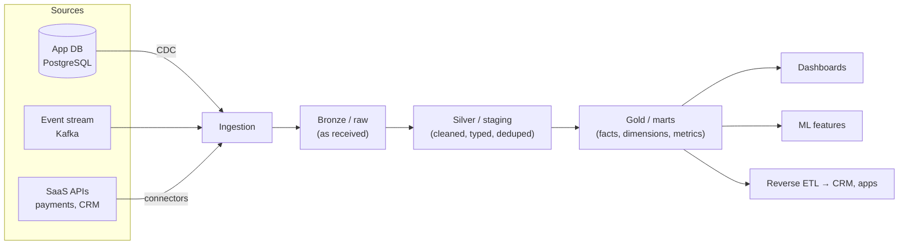
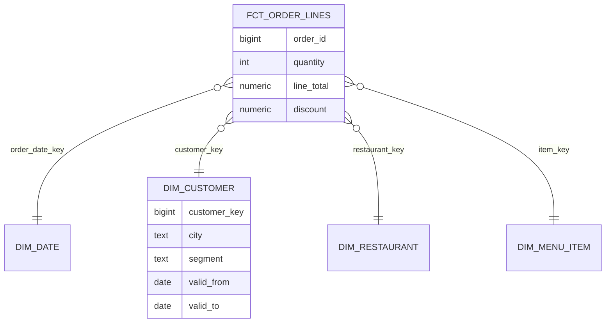

# Data Modelling, Warehouses and Lakehouses

Data engineers build the systems that move data from where it is produced (apps, databases, events, third-party APIs) to where it is used (dashboards, ML models, data products), reliably and in a shape that's easy to query. This guide covers OLTP vs OLAP, dimensional modelling, warehouses, data lakes and the lakehouse, and the file and table formats underneath them.

## 1. OLTP vs OLAP

| | OLTP (operational) | OLAP (analytical) |
|---|---|---|
| Purpose | Run the business: place an order | Understand the business: revenue by city by week |
| Queries | Many small reads and writes by key | Few huge scans and aggregations |
| Schema | Normalised (3NF) to avoid update anomalies | Denormalised (star schema) for fast reads |
| Storage | Row-oriented (PostgreSQL, MySQL) | **Columnar** (BigQuery, Snowflake, Redshift, ClickHouse, Parquet) |
| Example | `UPDATE orders SET status='DELIVERED' WHERE id=42` | `SELECT city, sum(total) FROM orders GROUP BY city` over 2 billion rows |

Running heavy analytics on the production database slows down the app for customers. That's the original reason warehouses exist.

**Why columnar is fast for analytics:** a query that sums `total` over a billion orders reads only the `total` column, compressed heavily because similar values sit together, instead of every column of every row.

## 2. The modern data platform



The **medallion** (bronze/silver/gold) or raw/staging/marts layering keeps raw data untouched for reprocessing, centralises cleaning, and gives consumers stable, documented tables.

## 3. ETL vs ELT

- **ETL** (extract, transform, load) transforms data *before* loading it into the warehouse. That made sense when warehouse compute was scarce and expensive.
- **ELT** loads raw data first and transforms it *inside* the warehouse with SQL (commonly with dbt). This is today's default: raw data is preserved, transformations are version-controlled SQL, and warehouses scale compute on demand.

## 4. Dimensional modelling: the star schema

Kimball-style dimensional modelling organises analytics data around business processes:

- **Fact tables** record measurable events at a declared **grain** ("one row per order line"). They hold foreign keys and numeric measures.
- **Dimension tables** describe the who, what, where and when: customers, restaurants, menu items, dates. They hold descriptive attributes used to filter and group.



```sql
-- "Revenue by restaurant cuisine and customer segment, last 90 days" stays simple and fast
SELECT r.cuisine, c.segment, sum(f.line_total) AS revenue
FROM fct_order_lines f
JOIN dim_restaurant r USING (restaurant_key)
JOIN dim_customer  c USING (customer_key)
JOIN dim_date      d ON d.date_key = f.order_date_key
WHERE d.date >= current_date - 90
GROUP BY 1, 2;
```

**Declare the grain first.** Mixing order-level and line-level measures in one fact table is the classic cause of double-counted revenue.

### Slowly changing dimensions (SCD)

When a customer moves from Dhaka to Sylhet, should last year's orders count toward Dhaka or Sylhet?

- **Type 1:** overwrite. History is restated, which is simple but loses the past.
- **Type 2:** add a new row with `valid_from` / `valid_to` and a new surrogate key. Each fact points to the version that was true at the time. This is the most common choice for attributes that matter historically.

```sql
-- Type 2: close the old version, insert the new one
UPDATE dim_customer SET valid_to = '2026-10-10', is_current = false
WHERE customer_id = 881 AND is_current;
INSERT INTO dim_customer (customer_id, city, segment, valid_from, valid_to, is_current)
VALUES (881, 'Sylhet', 'regular', '2026-10-11', '9999-12-31', true);
```

Other modelling approaches exist (Data Vault for auditable enterprise integration, and **one big table** wide denormalised marts for BI tools), but star schemas remain the common language.

## 5. Warehouses, lakes and lakehouses

| | Data warehouse | Data lake | Lakehouse |
|---|---|---|---|
| Storage | Managed, proprietary | Files in object storage (S3, GCS, ADLS) | Files in object storage + an open **table format** |
| Data | Structured | Anything (logs, images, JSON, Parquet) | Structured and semi-structured |
| Strengths | Fast SQL, governance, easy to run | Cheap, flexible, ML-friendly | Warehouse features (ACID, schema, time travel) on cheap open storage |
| Examples | Snowflake, BigQuery, Redshift | S3 plus Parquet files | Delta Lake, Apache Iceberg, Apache Hudi on Spark, Trino, Databricks, Snowflake |

A raw data lake tends to become a "data swamp": no transactions, no schema enforcement, and readers seeing half-written files. **Open table formats** fix this by adding a metadata layer over Parquet files:

- **ACID transactions:** readers never see partial writes.
- **Schema enforcement and evolution.**
- **Time travel:** query the table as of yesterday, roll back bad writes.
- **Partition evolution and efficient upserts and deletes (MERGE)**, important for GDPR deletion and CDC.

```sql
-- Apache Iceberg (Spark SQL / Trino)
CREATE TABLE lake.orders (order_id bigint, city string, total decimal(12,2), placed_at timestamp)
USING iceberg PARTITIONED BY (days(placed_at));

MERGE INTO lake.orders t USING staging.order_updates s ON t.order_id = s.order_id
WHEN MATCHED THEN UPDATE SET *
WHEN NOT MATCHED THEN INSERT *;

SELECT count(*) FROM lake.orders FOR TIMESTAMP AS OF '2026-10-10 00:00:00';   -- time travel
```

**Iceberg** has become the most widely adopted interoperable table format, readable by Spark, Trino, Flink, Snowflake, BigQuery and others, so one copy of the data can serve many engines.

## 6. File formats and partitioning

- **Parquet** (columnar, compressed, typed) is the default for analytics. Avoid CSV for anything big.
- **Partition** by how data is queried, usually date. Partitions that are too fine-grained create the **small files problem** (millions of tiny files slow every query), so compact regularly.
- Cluster or sort within partitions on common filter columns (city, restaurant) so engines can skip whole files.

## 7. Real-world case: double-counted revenue

A growth dashboard showed revenue 30% above finance's numbers. The cause was a single fact table at **order grain** that had been joined to `order_lines` to add item categories, so every order's total was repeated once per line. The fix was a proper line-grain fact table (`fct_order_lines` with `line_total`) plus an order-grain fact table (`fct_orders` with delivery fees and order totals), each with documented grain, and dbt tests reconciling daily totals against the finance ledger.

## 8. Hands-on exercise

1. Take an OLTP-style schema (orders, order_items, customers, restaurants) and design a star schema. Write down the grain of each fact table.
2. Implement it in DuckDB or PostgreSQL with a `dim_date` table and a Type 2 `dim_customer`.
3. Write three business queries against it.
4. Bonus: write Parquet files partitioned by date and query them with DuckDB. Compare speed and size against CSV.

## 9. Checklist

- [ ] I can explain OLTP vs OLAP and why columnar storage is fast for analytics.
- [ ] I can describe a layered (bronze/silver/gold) platform and ELT vs ETL.
- [ ] I can design star schemas with an explicit grain and handle SCD Type 2.
- [ ] I can compare warehouses, lakes and lakehouses, and explain what Iceberg or Delta add.
- [ ] I choose Parquet, sensible partitioning and compaction.

## 10. Interview angle

> **Asked as:** "Design the analytics model for a food delivery app."

Identify the business processes (orders, deliveries, payments, ratings), declare grains, build fact tables (order lines, deliveries) and conformed dimensions (date, customer SCD2, restaurant, rider, zone), add metric definitions, and explain the layering and tests.

> **Asked as:** "What problem do table formats like Iceberg solve?"

They bring ACID transactions, schema evolution, time travel, efficient MERGE and deletes, and multi-engine interoperability to files in object storage, turning a data lake into a reliable lakehouse.
