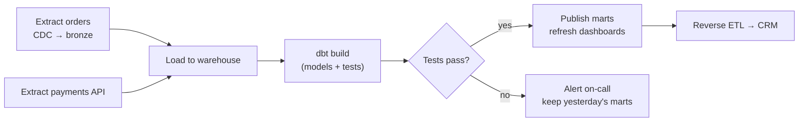

# Batch Pipelines: Ingestion, dbt Transformations and Orchestration

A data pipeline is production software. It runs every night (or every five minutes), touches money and customer data, and fails in a dozen creative ways. This guide covers getting data in (batch extraction and change data capture), transforming it with dbt, orchestrating everything with Airflow or a similar tool, and the engineering principles (idempotency, incremental loads, backfills) that make pipelines boring and reliable.

## 1. Ingestion patterns

| Pattern | How | Good for | Watch out |
|---|---|---|---|
| Full extract | Copy the whole table each run | Small reference tables | Doesn't scale |
| **Incremental (watermark)** | `WHERE updated_at > last_run` | Append-mostly tables with a reliable timestamp | Misses hard deletes, clock skew, late-arriving rows |
| **Change data capture (CDC)** | Read the database's transaction log (Debezium, cloud DMS, Fivetran) | Exact inserts, updates and deletes with low source load | More infrastructure, schema changes need handling |
| API connectors | Paginate SaaS APIs (Stripe, CRM) | Third-party data | Rate limits, API changes |
| Event streams | Consume Kafka topics | Clickstream, app events | Duplicates, ordering |

Managed connectors (Fivetran, Airbyte, cloud-native services) save huge amounts of time for standard sources. Write custom extraction only where you must.

```python
# Incremental extract with a safety overlap for late-arriving rows (idempotent downstream via MERGE)
def extract_orders(conn, last_watermark):
    since = last_watermark - timedelta(minutes=30)       # re-read a small window: duplicates are OK, gaps are not
    rows = conn.execute(
        "SELECT * FROM orders WHERE updated_at > %s ORDER BY updated_at", [since]
    ).fetchall()
    write_parquet(rows, f"s3://lake/bronze/orders/extracted_at={now_iso()}/part.parquet")
    return max((r.updated_at for r in rows), default=last_watermark)
```

## 2. Pipeline principles

1. **Idempotent:** running the same job twice for the same period gives the same result. Use `MERGE` (upsert) or overwrite a whole partition, never blind `INSERT`.
2. **Incremental where it matters:** process only new or changed data, but be able to rebuild from scratch.
3. **Backfillable:** parameterise by date (`run_date`) so you can reprocess any historical period.
4. **Raw preserved:** keep bronze/raw data so a logic bug can be fixed by reprocessing, without re-extracting.
5. **Tested and observable:** data tests, freshness checks, row-count anomaly alerts, lineage.
6. **Atomic publishes:** consumers see the old version or the new one, never a half-written table (write to staging and swap, or use table-format transactions).

## 3. Transformations with dbt

**dbt** turns SQL `SELECT` statements into tested, documented, dependency-ordered models in your warehouse. It is the standard tool for ELT transformations.

```text
models/
├── staging/                 # 1:1 with sources: rename, cast, dedupe
│   ├── _sources.yml
│   ├── stg_orders.sql
│   └── stg_customers.sql
├── intermediate/
│   └── int_order_lines_enriched.sql
└── marts/
    ├── fct_orders.sql
    ├── dim_customers.sql
    └── _marts.yml           # tests and docs
```

```sql
-- models/staging/stg_orders.sql
with src as (
    select * from {{ source('app', 'orders') }}
),
dedup as (
    select *, row_number() over (partition by id order by updated_at desc) as rn
    from src
)
select
    id                                   as order_id,
    customer_id,
    restaurant_id,
    upper(status)                        as status,
    total_poisha / 100.0                 as total_bdt,
    convert_timezone('UTC', 'Asia/Dhaka', created_at) as created_at_local,
    updated_at
from dedup
where rn = 1
```

```sql
-- models/marts/fct_orders.sql : incremental, only processes new/changed orders
{{ config(materialized='incremental', unique_key='order_id', on_schema_change='append_new_columns') }}

select o.order_id, o.customer_id, o.restaurant_id, o.status, o.total_bdt,
       o.created_at_local::date as order_date, o.updated_at
from {{ ref('stg_orders') }} o

where o.updated_at > (select coalesce(max(updated_at), '1900-01-01') from {{ this }})

```

```yaml
# models/marts/_marts.yml : tests that run on every build
models:
  - name: fct_orders
    description: One row per order (grain = order). Totals in BDT.
    columns:
      - name: order_id
        tests: [unique, not_null]
      - name: status
        tests:
          - accepted_values:
              values: [PLACED, PREPARING, OUT_FOR_DELIVERY, DELIVERED, CANCELLED]
      - name: customer_id
        tests:
          - relationships: { to: ref('dim_customers'), field: customer_id }
sources:
  - name: app
    freshness:
      warn_after: { count: 2, period: hour }
      error_after: { count: 6, period: hour }
    loaded_at_field: updated_at
    tables: [{ name: orders }, { name: customers }]
```

`ref()` builds the dependency graph automatically. `dbt build` runs models and tests in order, and `dbt docs generate` publishes a searchable catalogue with lineage. Every model change goes through a pull request, with CI running `dbt build` against a development schema, usually limited to modified models and their children (`--select state:modified+`).

## 4. Orchestration

An orchestrator schedules jobs, runs them in dependency order, retries failures, handles backfills and alerts humans.



```python
# Apache Airflow DAG (TaskFlow API)
from airflow.sdk import dag, task
from pendulum import datetime

@dag(schedule="0 2 * * *", start_date=datetime(2026, 1, 1, tz="Asia/Dhaka"), catchup=False,
     default_args={"retries": 2, "retry_delay": 300}, tags=["core"])
def daily_marts():

    @task
    def extract_payments(data_interval_start=None, data_interval_end=None):
        return payments_api.export(start=data_interval_start, end=data_interval_end)   # parameterised by interval

    @task
    def load(path):
        warehouse.copy_into("raw.payments", path)

    @task.bash
    def dbt_build():
        return "dbt build --target prod --select +marts"

    load(extract_payments()) >> dbt_build()

daily_marts()
```

Key ideas:

- **Data intervals:** each run processes a specific time window (`data_interval_start`/`_end`), which is what makes backfills like `airflow dags backfill -s 2026-09-01 -e 2026-09-30` correct.
- **Retries with backoff** for transient failures, and **alerts** (Slack, PagerDuty) for persistent ones.
- **Don't do heavy compute in the orchestrator.** It should *trigger* work in the warehouse, Spark or containers.
- Alternatives: **Dagster** (asset-centred, strong lineage and typing), **Prefect** (Pythonic, dynamic), and cloud-native tools (AWS Step Functions, Azure Data Factory, Google Cloud Composer, which is managed Airflow).

## 5. Data quality and contracts

- **Tests at every layer:** uniqueness, not-null, accepted values, referential integrity, freshness, and custom business rules ("daily revenue within ±40% of the trailing 4-week average").
- **Data contracts:** the producing team (for example the app backend) commits to a schema and semantics for the data it emits, checked in CI. A renamed column then fails *their* PR instead of breaking your pipeline at 2 a.m.
- **Circuit breakers:** if critical tests fail, don't publish. Dashboards keep yesterday's correct numbers rather than showing today's wrong ones.

## 6. Real-world case: the backfill that doubled revenue

After a bug fix, an engineer re-ran a September pipeline. The load step used `INSERT`, so every September order was now in the warehouse twice, and the finance dashboard showed double revenue for a month before anyone noticed. The team then:

1. made every load idempotent (`MERGE` on `order_id`, or `INSERT OVERWRITE` of the date partition),
2. added a dbt `unique` test on `order_id` that blocks publishing,
3. added a reconciliation test comparing daily totals to the payments ledger,
4. documented backfill procedures in a runbook.

## 7. Hands-on exercise

1. Set up a dbt project on DuckDB or PostgreSQL with sources, staging models and one incremental fact table.
2. Add unique, not_null, accepted_values, relationships and source-freshness tests. Break the data on purpose and watch them fail.
3. Write an Airflow (or Dagster) DAG: extract → load → `dbt build`, parameterised by data interval.
4. Run a backfill for a past week twice and prove the results are identical (idempotency).

## 8. Checklist

- [ ] I can choose between full, incremental, CDC and API ingestion.
- [ ] I build idempotent, backfillable, incremental pipelines with atomic publishes.
- [ ] I can structure a dbt project with staging, intermediate and marts layers, tests, freshness and docs.
- [ ] I can orchestrate with Airflow or Dagster using data intervals, retries and alerts.
- [ ] I use data tests, contracts and circuit breakers to stop bad data from reaching consumers.

## 9. Interview angle

> **Asked as:** "What does idempotent mean for a pipeline, and how do you achieve it?"

Re-running for the same interval gives the same result. Achieve it with MERGE on keys or partition overwrites, deterministic logic parameterised by the data interval, and no reliance on "now()".

> **Asked as:** "CDC vs incremental timestamps?"

Timestamps are simple but miss hard deletes and depend on reliable `updated_at` values. CDC reads the transaction log, so it captures every insert, update and delete in order with low source load, at the cost of more infrastructure.
