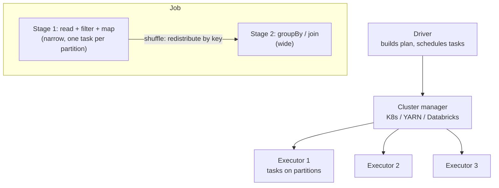

# Distributed Processing with Apache Spark

When data outgrows one machine, with billions of rows, terabytes of logs or joins that don't fit in memory, you split the work across a cluster. **Apache Spark** is the most widely used engine for this, for batch ETL, large joins and aggregations, ML feature computation and (with Structured Streaming) near-real-time pipelines. This guide explains how Spark executes work, how to write efficient PySpark, and how to diagnose the performance problems everyone hits.

## 1. Do you actually need Spark?

Single-node tools have become very powerful. **DuckDB** and **Polars** process hundreds of millions of rows on a laptop, and cloud warehouses run SQL over petabytes. Reach for Spark when:

- data is too big for one machine's memory or disk, even with a streaming engine,
- you're on a lakehouse (Delta or Iceberg) with heavy transformations outside the warehouse,
- you need complex Python logic or ML at scale, or unified batch and streaming.

## 2. How Spark executes a job



- Data is split into **partitions**, and each **task** processes one partition on an executor core.
- **Transformations** (`filter`, `select`, `join`) are **lazy**. Spark only builds a plan. **Actions** (`count`, `write`, `collect`) trigger execution.
- The **Catalyst optimiser** rewrites your plan (pushing filters down to the files, pruning columns, choosing join strategies), and **Adaptive Query Execution (AQE)** re-optimises at runtime using real statistics.
- **Narrow** transformations (filter, map) work within partitions. **Wide** transformations (groupBy, join, distinct) need a **shuffle**, which writes data across the network to regroup it by key. Shuffles are the main cost in most Spark jobs.

## 3. Writing PySpark with DataFrames

Use the **DataFrame / SQL API**, never raw RDDs, so the optimiser can help.

```python
from pyspark.sql import SparkSession, functions as F, Window

spark = (SparkSession.builder.appName("daily-rider-metrics")
         .config("spark.sql.adaptive.enabled", "true")
         .getOrCreate())

pings = spark.read.table("lake.rider_pings")              # Iceberg/Delta table, billions of GPS pings
deliveries = spark.read.table("lake.deliveries")

day = "2026-10-10"
p = (pings
     .where(F.col("event_date") == day)                    # partition pruning: reads one day's files only
     .select("rider_id", "delivery_id", "ts", "lat", "lng", "speed_kmh"))

# Per-delivery stats from GPS pings
w = Window.partitionBy("delivery_id").orderBy("ts")
p = p.withColumn("gap_s", F.col("ts").cast("long") - F.lag("ts").over(w).cast("long"))

stats = (p.groupBy("delivery_id", "rider_id")
          .agg(F.count("*").alias("pings"),
               F.avg("speed_kmh").alias("avg_speed"),
               F.max("gap_s").alias("max_gap_s"),                      # GPS dropouts
               F.expr("percentile_approx(speed_kmh, 0.95)").alias("p95_speed")))

result = (stats.join(deliveries.where(F.col("delivery_date") == day), "delivery_id")
               .withColumn("suspicious", (F.col("max_gap_s") > 600) | (F.col("p95_speed") > 90)))

(result.writeTo("lake.delivery_gps_quality")
       .overwritePartitions())                                          # idempotent per-day rewrite
```

Things to notice:

- **Filter early on partition columns** so Spark reads only the files it needs.
- **Use built-in functions** (`F.*`, SQL expressions) instead of Python UDFs. Built-ins run in the JVM and are optimised, while row-by-row Python UDFs serialise data back and forth and are often 10–100 times slower. When you need Python, prefer **pandas UDFs** (vectorised with Arrow).
- **Never `collect()` big data** to the driver. It will run out of memory.

## 4. Joins

| Strategy | When | Cost |
|---|---|---|
| **Broadcast hash join** | One side is small (up to tens or hundreds of MB) | Small table copied to every executor, no shuffle of the big side. Fastest. |
| Sort-merge join | Both sides large | Both sides shuffled and sorted by key |
| Shuffle hash join | Medium sizes, chosen by the optimiser or AQE | Shuffle without a full sort |

```python
from pyspark.sql.functions import broadcast
enriched = big_orders.join(broadcast(dim_restaurants), "restaurant_id")   # hint when you know it's small
```

## 5. The usual performance problems

### Data skew

One key holds a huge share of the rows (one mega-restaurant, or a `null` customer id), so one task runs for an hour while 199 finish in a minute. Symptoms in the Spark UI: one straggler task with far more input than the others.

Fixes: enable AQE skew-join handling (`spark.sql.adaptive.skewJoin.enabled`), filter or handle `null` keys separately, or **salt** the hot key:

```python
SALT = 16
hot = big.withColumn("salt", (F.rand() * SALT).cast("int"))
small_salted = small.crossJoin(spark.range(SALT).withColumnRenamed("id", "salt"))
joined = hot.join(small_salted, ["restaurant_id", "salt"])
```

### Too many or too few partitions

- Too few: little parallelism, spills to disk, out-of-memory errors.
- Too many: scheduling overhead and thousands of tiny output files.
- Aim for roughly **100–200 MB per partition** of processed data. AQE coalesces shuffle partitions automatically, and `repartition(n)` or `coalesce(n)` before writing controls the output file count.

### Small files

Thousands of tiny files make every read slow. Compact them regularly (Delta `OPTIMIZE`, Iceberg `rewrite_data_files`) and write sensibly sized files.

### Caching

`df.cache()` helps only when the same DataFrame is reused several times in a job. Otherwise it wastes memory. Unpersist when done.

## 6. Reading the Spark UI

When a job is slow, the Spark UI tells you why:

- **Jobs → Stages:** which stage takes the time, and how much shuffle read and write it does.
- **Tasks in a stage:** compare max to median duration and input size. A big gap means **skew**.
- **"Spill (memory/disk)":** partitions too large for executor memory, so add partitions or memory.
- **SQL tab:** the physical plan. Check that filters are pushed to the scan, look for `BroadcastHashJoin` vs `SortMergeJoin`, and see the AQE changes.

## 7. Structured Streaming in one example

The same DataFrame API works on unbounded streams:

```python
events = (spark.readStream.format("kafka")
          .option("kafka.bootstrap.servers", "kafka:9092")
          .option("subscribe", "order-events").load()
          .select(F.from_json(F.col("value").cast("string"), ORDER_SCHEMA).alias("e")).select("e.*"))

per_zone = (events.withWatermark("event_time", "10 minutes")            # tolerate late events up to 10 min
                  .groupBy(F.window("event_time", "5 minutes"), "zone_id")
                  .agg(F.count("*").alias("orders")))

(per_zone.writeStream.format("iceberg").outputMode("append")
         .option("checkpointLocation", "s3://lake/checkpoints/orders_per_zone")   # exactly-once state recovery
         .toTable("lake.orders_per_zone_5m"))
```

## 8. Real-world case: a 4-hour job down to 18 minutes

A nightly job joining 6 billion GPS pings to deliveries took four hours and often failed with out-of-memory errors. The Spark UI showed three problems: a full table scan, because the filter was applied after a UDF instead of on the partition column; one task processing 40% of the data, because pings with `delivery_id = null` (riders idle between jobs) all went to a single key; and 80,000 output files. The fixes were filtering on `event_date` first, handling null ids separately, replacing a Python UDF with built-in functions, enabling AQE, and compacting the output. The job dropped to 18 minutes on half the cluster.

## 9. Hands-on exercise

1. Run Spark locally (`pip install pyspark`) and generate 50 million synthetic rows with one heavily skewed key.
2. Do a groupBy and a join. Open the Spark UI at `localhost:4040` and find the straggler task.
3. Fix the skew with AQE and with salting. Compare the stage times.
4. Replace a Python UDF with built-in functions and measure the speed-up.
5. Write the output partitioned by date with sensible file sizes.

## 10. Checklist

- [ ] I know when Spark is warranted and when DuckDB, Polars or the warehouse is enough.
- [ ] I can explain the driver, executors, partitions, lazy evaluation, stages and shuffles.
- [ ] I write DataFrame code that prunes partitions, uses built-ins and avoids collect.
- [ ] I can choose join strategies and fix skew, partition sizing and small files.
- [ ] I can diagnose a slow job from the Spark UI and write a basic Structured Streaming job.

## 11. Interview angle

> **Asked as:** "A Spark job has one task that runs far longer than the rest. What's happening?"

Data skew: one key or partition holds a disproportionate share of the data. Confirm it in the Spark UI task metrics, then fix it with AQE skew handling, separate handling for null or hot keys, salting, or broadcasting the smaller side.

> **Asked as:** "Why avoid Python UDFs?"

They process rows one at a time in a Python worker, serialising data between the JVM and Python, and the optimiser can't see inside them. Built-in functions or vectorised pandas UDFs are much faster.
