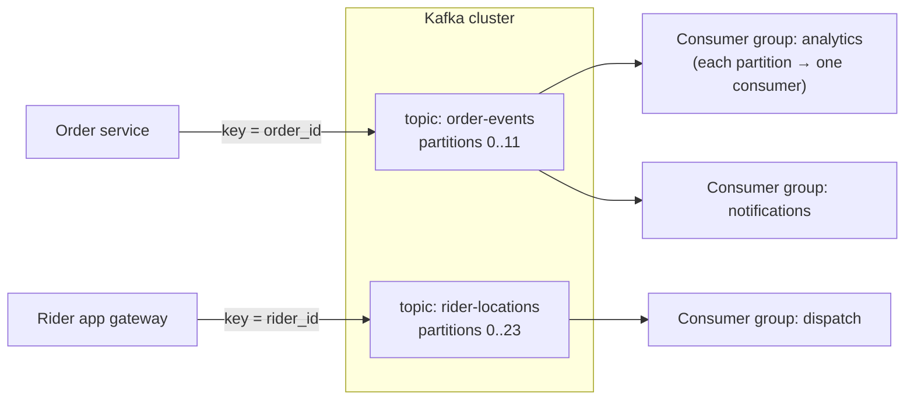
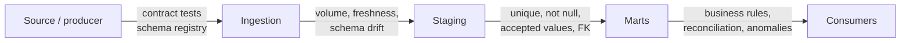

# Streaming Pipelines, Data Quality and Governance

Batch pipelines answer "what happened yesterday." Streaming pipelines answer "what is happening now": live order counts per zone, fraud signals within seconds, rider supply versus demand, or keeping a search index in sync with the database. This guide covers streaming fundamentals with Kafka and stream processors, then the quality, observability and governance practices that make any data platform trustworthy.

## 1. When streaming is worth it

Streaming adds operational complexity, so use it when **freshness changes the decision**:

| Use case | Needed latency |
|---|---|
| Fraud check before a payment completes | Under 1 s |
| Surge pricing and rider dispatch by zone | Seconds |
| Live operations dashboard | Seconds to a minute |
| Search index and cache sync from the database (CDC) | Seconds |
| Daily finance report | Hours. Use batch. |

Many teams run **micro-batches** every 1–5 minutes, which is good enough for most dashboards and much simpler to operate.

## 2. Kafka fundamentals



- A **topic** is an append-only log split into **partitions**. Order is guaranteed **within a partition**, so choose the **message key** to group what must stay ordered (all events for one order go to one partition).
- Messages are retained for a configured time (or forever with compaction). Consumers track their position (**offset**) and can replay history.
- A **consumer group** shares the partitions among its members. More partitions mean more parallelism, and different groups read independently.
- **Replication** (factor 3, `min.insync.replicas=2`, producer `acks=all`) keeps data safe when a broker fails.
- Modern Kafka runs in **KRaft** mode, with built-in consensus and no ZooKeeper.

```python
# Producer: idempotent, durable, keyed
from confluent_kafka import Producer
producer = Producer({"bootstrap.servers": "kafka:9092", "enable.idempotence": True, "acks": "all",
                     "compression.type": "zstd", "linger.ms": 10})

def publish(evt):
    producer.produce("order-events", key=evt["order_id"], value=json.dumps(evt).encode())
    producer.poll(0)
```

```python
# Consumer: commit offsets only after processing succeeds (at-least-once)
from confluent_kafka import Consumer
c = Consumer({"bootstrap.servers": "kafka:9092", "group.id": "zone-metrics",
              "enable.auto.commit": False, "auto.offset.reset": "earliest"})
c.subscribe(["order-events"])
while True:
    msg = c.poll(1.0)
    if msg is None or msg.error():
        continue
    evt = json.loads(msg.value())
    upsert_zone_counter(evt)                  # idempotent write keyed by event id
    c.commit(msg, asynchronous=False)
```

### Delivery semantics

- **At most once:** commit before processing, so a crash loses the message.
- **At least once:** commit after processing, so a crash causes a reprocess. This is the common default, and it requires **idempotent consumers** (dedupe on event id, upserts).
- **Exactly once:** Kafka transactions plus a transactional sink, or a stream processor's checkpoints with transactional or idempotent sinks. It's powerful, but only end to end if every hop participates.

## 3. Stream processing

For anything beyond simple consume-and-write, use a **stream processor**:

| Engine | Notes |
|---|---|
| **Apache Flink** | True streaming, sophisticated state and event-time handling, exactly-once. The standard for serious real-time work. |
| Spark Structured Streaming | Micro-batch (or continuous) with the same API as batch Spark |
| Kafka Streams | A library inside your Java/Kotlin service, no separate cluster |
| Managed (Kinesis, Dataflow, Confluent Flink) | Less operations work |

Core concepts:

- **Event time vs processing time.** An order placed at 19:59:58 that arrives at 20:00:03 belongs to the 19:55–20:00 window, so group by when it *happened*.
- **Windows:** tumbling (fixed, non-overlapping), sliding, and session windows.
- **Watermarks:** "I've probably seen everything up to time T," which decides when a window can close and how late events are handled.
- **State and checkpoints:** counters and joins are kept in fault-tolerant state, snapshotted so the job can recover without double-counting.

```sql
-- Flink SQL: orders per zone in 5-minute event-time windows, tolerating 30 s of lateness
CREATE TABLE order_events (
  order_id STRING, zone_id STRING, status STRING, event_time TIMESTAMP(3),
  WATERMARK FOR event_time AS event_time - INTERVAL '30' SECOND
) WITH ('connector' = 'kafka', 'topic' = 'order-events', 'format' = 'json',
        'properties.bootstrap.servers' = 'kafka:9092');

SELECT window_start, zone_id, COUNT(*) AS placed
FROM TABLE(TUMBLE(TABLE order_events, DESCRIPTOR(event_time), INTERVAL '5' MINUTES))
WHERE status = 'PLACED'
GROUP BY window_start, window_end, zone_id;
```

### Schemas for events

Use a **schema registry** with Avro, Protobuf or JSON Schema and enforce **compatibility rules** (for example backward-compatible: only add optional fields). Then a producer can't ship a breaking change that crashes every consumer.

## 4. Data quality in depth

Quality is checked at every boundary, not once at the end.



| Check type | Example |
|---|---|
| Schema | Expected columns and types, no surprise changes |
| Volume | Today's rows within ±30% of the same weekday last week |
| Freshness | `max(updated_at)` less than 2 hours old |
| Validity | Status in the allowed set, totals ≥ 0, valid coordinates |
| Uniqueness / integrity | No duplicate order ids, every order has a customer |
| Reconciliation | Warehouse revenue equals the payments ledger to within 0.1% |
| Distribution anomalies | The cancelled-order share suddenly doubles |

Tools: dbt tests, Great Expectations or Soda for rule-based checks, and **data observability** platforms (Monte Carlo, Elementary, open-source anomaly monitors) that learn normal patterns and alert on deviations.

## 5. Governance: making data trustworthy and safe

- **Catalog and lineage:** a searchable inventory of datasets with owners, descriptions and column-level lineage from source to dashboard (DataHub, OpenMetadata, Unity Catalog, cloud catalogs). Lineage answers "if I change this column, what breaks?" and "where did this number come from?"
- **Ownership:** every dataset has an owning team and an on-call path. **Data mesh** takes this further, treating domain teams' datasets as products with SLAs.
- **Access control:** role-based access, **column masking** for PII (phone numbers visible only to support), **row-level security** (regional managers see their region), and audit logs of who queried what.
- **Privacy and compliance:** classify PII, minimise collection, set retention periods, and support deletion requests. Table formats with efficient deletes (Iceberg, Delta) make "delete this customer everywhere" possible.
- **Semantic layer and metrics:** one governed definition of "active customer" and "net revenue" shared by all BI tools and notebooks.

## 6. Real-world case: live zone dashboard

A delivery company wanted operations staff to see, every 30 seconds, how orders compared with available riders in each zone, so they could trigger incentives. The design:

- CDC from the orders database and rider location events into Kafka, keyed by zone,
- Flink jobs computing 1-minute tumbling counts with a 20-second watermark, joined with rider availability state,
- results written to a low-latency store (Redis plus ClickHouse) powering the dashboard and an alerting rule for a "demand/supply ratio above 2.5 for 3 minutes,"
- schema registry compatibility checks in the producers' CI, and lag and freshness monitors on every topic.

Late-delivery complaints during dinner peaks fell 18% because incentives fired before shortages hit, instead of 20 minutes after.

## 7. Hands-on exercise

1. Run Kafka in KRaft mode with Docker Compose and create a 6-partition topic.
2. Write a keyed, idempotent producer and an at-least-once consumer with manual commits and deduplication.
3. Run a Flink SQL (or Spark Structured Streaming) job computing 5-minute event-time windows with a watermark. Send late events and observe how they're handled.
4. Add volume, freshness and uniqueness checks to a batch table and wire up an alert.

## 8. Checklist

- [ ] I can decide between streaming, micro-batch and batch based on how freshness affects decisions.
- [ ] I understand topics, partitions, keys, consumer groups, replication and KRaft.
- [ ] I can explain delivery semantics and build idempotent consumers.
- [ ] I understand event time, windows, watermarks and checkpointed state, and I use a schema registry.
- [ ] I implement layered data-quality checks and governance (catalog, lineage, ownership, access control, privacy).

## 9. Interview angle

> **Asked as:** "How do you guarantee ordering in Kafka?"

Ordering is only per partition. Key messages by the entity that needs ordering (order_id) so all its events land in one partition, use idempotent producers, and keep consumers per partition sequential.

> **Asked as:** "What's a watermark?"

It's the stream processor's estimate of event-time progress: events up to T have probably arrived. It lets windows close and results emit while bounding how late an event can be and still count. Later events are dropped or sent to a side output.
