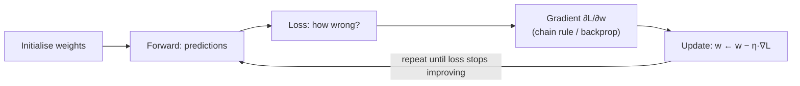

# Mathematics for Data Science: Linear Algebra, Calculus and Probability

You can call `model.fit()` without any maths. But when a model won't converge, overfits, gives nonsense probabilities or needs explaining to a sceptical stakeholder, the maths is what lets you reason about it instead of guessing. This guide covers the three areas data scientists use most, each tied to code and to the machine-learning ideas it explains.

## 1. Linear algebra: data is matrices

A dataset with n rows and d features is a matrix **X** (n × d). Almost every model is built from a few operations on it.

| Concept | Meaning | Where you see it |
|---|---|---|
| Vector | A list of numbers, a point or direction in space | One customer's features, a word embedding |
| Dot product a·b | Sum of element-wise products, which measures alignment | Linear model scores, attention, cosine similarity |
| Matrix multiply | Many dot products at once | A neural-network layer `X @ W` |
| Norm ‖a‖ | Length of a vector | Regularisation (L1, L2), normalising embeddings |
| Eigenvectors / SVD | Directions a matrix stretches the most | PCA, recommendations, compression |

```python
import numpy as np

X = np.array([[2.1, 3, 1], [5.4, 1, 0], [0.8, 4, 1]])   # 3 orders × (distance, items, rain)
w = np.array([4.0, 1.5, 6.0])                             # learned weights (minutes per unit)
b = 12.0
eta = X @ w + b          # linear regression prediction for all rows at once
print(eta)               # [30.9 35.1 27.2]

# Cosine similarity between two embeddings
a, c = np.random.randn(384), np.random.randn(384)
cos = a @ c / (np.linalg.norm(a) * np.linalg.norm(c))
```

### PCA through SVD

PCA finds the orthogonal directions of greatest variance. Computing it with the singular value decomposition shows how much information each direction holds:

```python
Xc = X_big - X_big.mean(axis=0)                  # centre the data
U, S, Vt = np.linalg.svd(Xc, full_matrices=False)
explained = S**2 / np.sum(S**2)
print(explained[:5].cumsum())                    # e.g. 5 components keep 91% of the variance
X_reduced = Xc @ Vt[:5].T                        # project onto the top 5 directions
```

## 2. Calculus: how models learn

Training means **minimising a loss function**. The derivative tells you how the loss changes when you nudge a parameter. The **gradient** is the vector of all those partial derivatives, and it points uphill. Gradient descent steps downhill:



For linear regression with mean squared error, L(w) = (1/n)‖Xw − y‖², and the gradient is (2/n)Xᵀ(Xw − y). Implementing it by hand makes the idea concrete:

```python
def gradient_descent(X, y, lr=0.01, steps=2000):
    n, d = X.shape
    w = np.zeros(d)
    for t in range(steps):
        err = X @ w - y
        grad = (2 / n) * X.T @ err
        w -= lr * grad
        if t % 500 == 0:
            print(t, np.mean(err**2))
    return w
```

What this explains in practice:

- **The learning rate (η):** too big and the loss bounces or explodes, too small and training crawls.
- **Feature scaling:** if one feature ranges 0–1 and another 0–100,000, the loss surface is a long narrow valley and gradient descent zig-zags. Standardising makes it rounder and convergence faster.
- **The chain rule** is backpropagation. A deep network is nested functions, and the gradient of the outer loss with respect to an inner weight is the product of local derivatives along the path.
- **Regularisation** adds λ‖w‖² to the loss, so the gradient includes 2λw, which constantly pulls weights toward zero (weight decay).

## 3. Probability: reasoning under uncertainty

### Core rules

- Conditional probability: P(A | B) = P(A and B) / P(B).
- **Bayes' theorem:** P(A | B) = P(B | A) · P(A) / P(B). Update a prior belief with evidence.
- Independence: P(A and B) = P(A) · P(B). Assuming it wrongly is a common modelling error.
- Expectation: the probability-weighted average outcome, which is the basis of expected-value decisions.

### Bayes in practice: the base-rate trap

A fraud model catches 95% of fraud (recall) and wrongly flags 2% of legitimate orders. Fraud is 0.5% of orders. If an order is flagged, how likely is it to be fraud?

```python
p_fraud = 0.005
p_flag_given_fraud = 0.95
p_flag_given_ok = 0.02
p_flag = p_flag_given_fraud * p_fraud + p_flag_given_ok * (1 - p_fraud)
print(p_flag_given_fraud * p_fraud / p_flag)     # ≈ 0.193: only about 19% of flagged orders are fraud
```

That's why precision collapses on rare events, and why review teams drown in false positives unless thresholds account for the base rate.

### Distributions and likelihood

Models are often probability distributions in disguise:

- Linear regression with MSE ⇔ assuming Gaussian noise around the prediction.
- Logistic regression with cross-entropy ⇔ a Bernoulli likelihood for a yes/no outcome.
- Poisson regression ⇔ count data (orders per hour).

**Maximum likelihood estimation** picks parameters that make the observed data most probable. Minimising cross-entropy *is* maximising the likelihood. Seeing models this way tells you which loss fits which kind of target.

### Expected value for decisions

Should we send a ৳50 coupon to a user with a 30% predicted churn risk, if the coupon cuts churn risk by a third and a retained customer is worth ৳600 over the next quarter?

```python
p_churn, reduction, value, cost = 0.30, 1/3, 600, 50
gain = p_churn * reduction * value      # 0.30 × 0.333 × 600 = 60
print(gain - cost)                       # +10 per user: send it, as long as these estimates hold
```

## 4. Statistics links

Inference (confidence intervals, hypothesis tests, A/B tests) builds directly on these foundations. See the analyst statistics guide for the practical toolkit. Two connections worth remembering:

- **Law of large numbers:** sample averages converge to the true mean, which is why more data helps.
- **Central limit theorem:** averages are approximately normal, which is why we can put confidence intervals on metrics even when the raw data is skewed.

## 5. Real-world case: the model that wouldn't train

A data scientist's neural network for demand forecasting produced NaN loss after a few hundred steps. Applying the fundamentals: the order-count target ranged up to 40,000 (huge gradients), features weren't standardised (an ill-conditioned problem), and the learning rate was 0.1. Log-transforming the target (counts are skewed and roughly multiplicative), standardising the features and lowering the learning rate with warmup gave stable training. Switching the loss to Poisson deviance, which matches count data, improved accuracy by a further 8%.

## 6. Hands-on exercise

1. Implement linear regression with gradient descent in NumPy. Compare the weights with `np.linalg.lstsq` and with scikit-learn.
2. Train with and without feature scaling and plot the loss curves.
3. Implement PCA through SVD on a real dataset and plot the cumulative explained variance.
4. Recompute the base-rate example for fraud rates of 0.1%, 1% and 10%, and explain the trend.

## 7. Checklist

- [ ] I can express data and models with vectors, dot products and matrix multiplication.
- [ ] I can explain gradients, gradient descent, learning rates, scaling and backprop as the chain rule.
- [ ] I can apply Bayes' theorem and recognise base-rate effects.
- [ ] I can connect losses to likelihoods (MSE to Gaussian, cross-entropy to Bernoulli, Poisson for counts).
- [ ] I can use expected value to turn predictions into decisions.

## 8. Interview angle

> **Asked as:** "Why do we scale features before gradient descent?"

Unscaled features make the loss surface elongated, so gradients point poorly toward the minimum and you need a tiny learning rate. Scaling makes the problem well-conditioned and convergence fast and stable.

> **Asked as:** "A test is 99% accurate for a disease affecting 1 in 1,000 people. You test positive. What's the chance you have it?"

About 9%, by Bayes' theorem. Most positives are false positives from the large healthy population, which is the base-rate effect.
