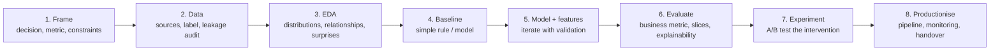

# End-to-End Data Science Project: From Question to Deployed Insight

Courses teach techniques in isolation. Real data science is the whole arc: framing a fuzzy business problem, finding and understanding data, exploring, modelling, evaluating honestly, and getting the result *used*. This guide walks through a complete project, predicting and reducing customer churn for a food delivery app, so you can see how the pieces connect and what separates a notebook from impact.

## 1. The arc



## 2. Frame the problem

The first request is usually vague: "Can you build a churn model?" Push for:

- **The decision:** "Each week, choose which customers get a retention offer (৳50–100 coupon) within a ৳400,000 budget."
- **Definition of churn:** "An active customer (≥ 2 orders in the last 60 days) who places no order in the next 30 days." Write it down precisely.
- **Success metric:** not AUC, but *incremental retained revenue minus coupon cost*, measured in an A/B test.
- **Constraints:** scores refreshed weekly, explainable reasons for the CRM team, no use of sensitive attributes.

Notice that the right model ranks customers by how much the **offer changes** their behaviour (uplift), not just by churn risk. Some high-risk customers leave regardless, and some low-risk customers would stay anyway. We'll start with risk and revisit this.

## 3. Build the dataset and audit for leakage

For every customer and each historical **snapshot date** (say every Monday for a year): compute features using only data **before** the snapshot, and the label from the **30 days after** it.

```sql
-- One row per (customer, snapshot); features strictly before the snapshot, label after it
WITH snapshots AS (
  SELECT generate_series('2025-10-06'::date, '2026-08-31', interval '7 days')::date AS snap
),
active AS (
  SELECT s.snap, o.customer_id
  FROM snapshots s JOIN orders o
    ON o.order_date >= s.snap - 60 AND o.order_date < s.snap AND o.status = 'DELIVERED'
  GROUP BY 1, 2 HAVING count(*) >= 2
)
SELECT a.snap, a.customer_id,
  -- features (past only)
  (SELECT count(*) FROM orders o WHERE o.customer_id = a.customer_id AND o.order_date BETWEEN a.snap - 90 AND a.snap - 1) AS orders_90d,
  (SELECT a.snap - max(order_date) FROM orders o WHERE o.customer_id = a.customer_id AND o.order_date < a.snap) AS days_since_last,
  (SELECT avg(rating) FROM ratings r WHERE r.customer_id = a.customer_id AND r.created_at < a.snap) AS avg_rating_given,
  (SELECT count(*) FROM complaints c WHERE c.customer_id = a.customer_id AND c.created_at BETWEEN a.snap - 30 AND a.snap - 1) AS complaints_30d,
  -- label (future)
  NOT EXISTS (SELECT 1 FROM orders o WHERE o.customer_id = a.customer_id AND o.order_date BETWEEN a.snap AND a.snap + 29) AS churned
FROM active a;
```

Leakage audit questions: Would this feature be known on the snapshot date? Is any field updated after the fact (account status "closed")? Do the same customers appear in train and test at overlapping times? Split **by time**: train on snapshots up to May, validate June–July, test August.

## 4. Exploratory data analysis

EDA is about finding what will matter and what's broken:

```python
import pandas as pd, seaborn as sns
df = pd.read_parquet("churn_snapshots.parquet")

print(df["churned"].mean())                                   # base rate, e.g. 0.22
print(df.isna().mean().sort_values(ascending=False).head())  # missingness
df.groupby(pd.qcut(df["days_since_last"], 10))["churned"].mean().plot(kind="bar")   # strong monotonic signal?
df.groupby("complaints_30d")["churned"].agg(["mean", "size"])
sns.histplot(data=df, x="avg_order_value", hue="churned", log_scale=True, element="step", stat="density")
```

Typical findings that shape the project:

- Recency and frequency dominate. Unsurprising, but they set the bar any model must clear.
- Customers with a late delivery *and* a complaint in the last 30 days churn at twice the base rate, which is actionable for operations, not just marketing.
- `avg_rating_given` is missing for 40% of customers, and missingness itself predicts churn.
- A spike in churn labels in one week coincided with an app outage. Exclude it or flag it.

## 5. Baseline, then model

```python
from sklearn.metrics import roc_auc_score, average_precision_score
from lightgbm import LGBMClassifier

# Baseline: a business rule anyone understands
base_score = df_test["days_since_last"]
print("rule AUC", roc_auc_score(y_test, base_score))          # e.g. 0.71

model = LGBMClassifier(n_estimators=500, learning_rate=0.03, num_leaves=31, min_child_samples=100)
model.fit(X_train, y_train, eval_set=[(X_val, y_val)])
p = model.predict_proba(X_test)[:, 1]
print("model AUC", roc_auc_score(y_test, p), "PR AUC", average_precision_score(y_test, p))   # e.g. 0.81 / 0.55
```

If the model barely beats the rule, ship the rule. Here it's a clear improvement, so continue.

## 6. Evaluate for the decision

- **Top-k precision:** with the budget covering about 6,000 customers a week, what share of the top 6,000 scores actually churn? That matters more than AUC.
- **Slices:** check performance for new vs long-term customers and by city. A model that's great in Dhaka and useless in Sylhet needs work or separate thresholds.
- **Calibration:** are 0.4 scores really 40%? Expected-value calculations depend on it.
- **Explainability:** SHAP reasons per customer ("no order in 21 days; 2 late deliveries"), which the CRM team can use to tailor the message.

## 7. Prove impact with an experiment

A good churn score doesn't prove that coupons work. Run an A/B test:

- Take the top-scored customers each week and randomise: **50% get the offer, 50% don't.**
- Primary metric: net revenue per customer over 30 days (revenue minus coupon cost).
- Guardrails: unsubscribe rate, complaint rate.

Result in our example: the offer cut churn among the top-risk decile from 61% to 54%. That is real, but the coupon cost ate most of the gain at that decile. In deciles 2–4, the offer cut churn from 38% to 27% and was strongly profitable. The insight changed the targeting: the people most likely to leave weren't the most *persuadable*. The next iteration builds an **uplift model** trained on the experiment data to target persuadable customers directly.

## 8. Productionise and hand over

- A weekly pipeline: snapshot features → score → write `ml.churn_scores` with the model version → CRM sync (reverse ETL).
- Monitoring: feature drift, score distribution, weekly realised churn per decile once labels mature, and offer ROI.
- Documentation: a model card, metric definitions, a runbook, and a dashboard for marketing showing the experiment's ongoing control group (keep about 10% as a holdout to measure impact continuously).
- A review in 3 months, with an agreed trigger for retraining.

## 9. Communicating results

Lead with the decision and the money:

> "Targeting retention offers using the churn model plus experiment-based rules is projected to add **৳1.9M net revenue per quarter**, compared with ৳0.4M from the current 'inactive 30 days' rule. The biggest win is shifting spend from customers who leave anyway to moderately at-risk customers who respond to offers. We'll keep a 10% holdout to verify this each month."

## 10. Hands-on exercise

Pick a public dataset with customer activity over time (or simulate one) and do the whole arc:

1. Write a one-paragraph problem framing with the decision, label definition, metric and constraints.
2. Build point-in-time snapshots and run a leakage audit.
3. Do EDA and report 3 findings that change the plan.
4. Compare a baseline rule with a model on time-based splits, using top-k precision and calibration.
5. Design (or simulate) an A/B test of the intervention and write a one-page decision memo.

## 11. Checklist

- [ ] I frame projects around a decision, a precise label and a business metric.
- [ ] I build point-in-time datasets and audit for leakage, with time-based splits.
- [ ] I use EDA to find signal, data problems and actionable insights.
- [ ] I compare against baselines and evaluate with decision-relevant metrics, slices and calibration.
- [ ] I prove impact with experiments, productionise with monitoring and communicate in business terms.

## 12. Interview angle

> **Asked as:** "Walk me through a data science project end to end."

Framing (decision, label, metric), data and leakage audit, EDA findings, the baseline, model iteration and validation strategy, decision-focused evaluation, an experiment to prove impact, deployment and monitoring, and the result in business terms. Mention what you'd do differently, such as uplift modelling.

> **Asked as:** "Your churn model has great AUC but the retention campaign didn't help. Why?"

Predicting churn isn't the same as predicting who responds to treatment. Some high-risk users leave regardless, and the offer, timing or channel may be wrong. Test with an A/B experiment and model uplift.
