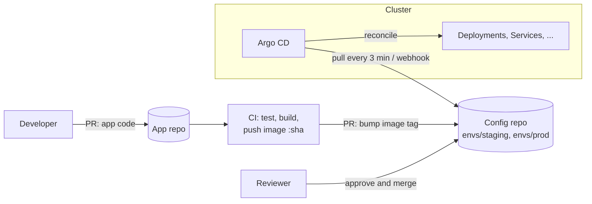

# GitOps with Argo CD

In a classic pipeline, CI builds an image and then *pushes* it into the cluster with `kubectl apply` or `helm upgrade`. That works until someone runs a manual `kubectl edit` at 2 a.m. and nobody can say what is actually running. **GitOps** flips the direction. Git holds the desired state of every environment, and an agent inside the cluster continuously *pulls* that state and makes the cluster match it.

## 1. The four GitOps principles

1. **Declarative:** the whole system is described as data (Kubernetes YAML, Helm values, Kustomize overlays).
2. **Versioned and immutable:** that description lives in Git, so every change has an author, a review and a revert.
3. **Pulled automatically:** an agent in the cluster fetches the desired state, so CI never needs cluster credentials.
4. **Continuously reconciled:** the agent keeps comparing desired and live state and corrects drift.



## 2. Push vs pull deployment

| | Push (CI runs kubectl/helm) | Pull (GitOps agent) |
|---|---|---|
| Cluster credentials | Stored in CI, which is a big attack surface | Stay inside the cluster |
| Drift | Undetected until something breaks | Detected and optionally auto-corrected |
| Audit trail | CI logs | Git history (who, what, when, why) |
| Rollback | Re-run an old pipeline | `git revert` |
| Multi-cluster | One pipeline step per cluster | Each cluster pulls its own folder |

## 3. Repository layout

Keep application source and deployment configuration in separate repos, or at least in separate folders with separate permissions. A common Kustomize-based layout:

```text
platform-config/
├── apps/
│   └── orders-api/
│       ├── base/
│       │   ├── deployment.yaml
│       │   ├── service.yaml
│       │   └── kustomization.yaml
│       └── overlays/
│           ├── staging/
│           │   ├── kustomization.yaml     # image tag, 1 replica, staging config
│           │   └── patch-resources.yaml
│           └── prod/
│               ├── kustomization.yaml     # image tag, 4 replicas, HPA
│               └── patch-resources.yaml
└── argocd/
    ├── orders-api-staging.yaml
    └── orders-api-prod.yaml
```

```yaml
# apps/orders-api/overlays/prod/kustomization.yaml
apiVersion: kustomize.config.k8s.io/v1beta1
kind: Kustomization
resources: [../../base]
namespace: orders
images:
  - name: ghcr.io/acme/orders-api
    newTag: "9f2c1ab"          # CI opens a PR changing only this line
replicas:
  - name: orders-api
    count: 4
patches:
  - path: patch-resources.yaml
```

Promotion from staging to production becomes a PR that copies a tag from one folder to another. It's reviewable, auditable and trivially revertible.

## 4. The Argo CD Application

An `Application` tells Argo CD *what* to deploy (repo, path, revision), *where* (cluster and namespace), and *how* (sync policy).

```yaml
apiVersion: argoproj.io/v1alpha1
kind: Application
metadata:
  name: orders-api-prod
  namespace: argocd
spec:
  project: default
  source:
    repoURL: https://github.com/acme/platform-config
    targetRevision: main
    path: apps/orders-api/overlays/prod
  destination:
    server: https://kubernetes.default.svc
    namespace: orders
  syncPolicy:
    automated:
      prune: true        # delete resources that were removed from Git
      selfHeal: true     # undo manual changes in the cluster
    syncOptions:
      - CreateNamespace=true
    retry:
      limit: 5
      backoff: { duration: 10s, factor: 2, maxDuration: 3m }
```

- **`prune`** removes resources deleted from Git. Without it, removed objects linger forever.
- **`selfHeal`** reverts manual edits. Someone scales the deployment to 10 with `kubectl`, and Argo sets it back to 4 within minutes. This is drift correction in action.

Argo CD reports two independent statuses. **Sync status** says whether the live state matches Git (*Synced* or *OutOfSync*). **Health status** says whether the resources are actually working (*Healthy*, *Progressing*, *Degraded*). A deployment can be Synced but Degraded, for example when the new image crashes.

## 5. Managing many apps: App of Apps and ApplicationSets

Writing one `Application` per service per environment doesn't scale. An **ApplicationSet** generates them:

```yaml
apiVersion: argoproj.io/v1alpha1
kind: ApplicationSet
metadata:
  name: all-services
  namespace: argocd
spec:
  generators:
    - matrix:
        generators:
          - git:
              repoURL: https://github.com/acme/platform-config
              revision: main
              directories: [{ path: apps/* }]
          - list:
              elements: [{ env: staging }, { env: prod }]
  template:
    metadata:
      name: '{{path.basename}}-{{env}}'
    spec:
      project: default
      source:
        repoURL: https://github.com/acme/platform-config
        targetRevision: main
        path: '{{path}}/overlays/{{env}}'
      destination:
        server: https://kubernetes.default.svc
        namespace: '{{path.basename}}'
      syncPolicy: { automated: { prune: true, selfHeal: true } }
```

Add a folder under `apps/` and Argo CD creates staging and prod applications for it automatically.

## 6. Ordering, hooks and progressive delivery

- **Sync waves** order resources: `argocd.argoproj.io/sync-wave: "-1"` on a ConfigMap or migration Job makes it apply before the Deployment.
- **Hooks** run Jobs at specific phases. `PreSync` is ideal for database migrations, and `PostSync` for smoke tests.
- **Argo Rollouts** replaces a Deployment with canary or blue-green steps, and can analyse Prometheus metrics to automatically abort a bad release.

```yaml
# A PreSync migration job that must succeed before the new version rolls out
apiVersion: batch/v1
kind: Job
metadata:
  name: orders-migrate
  annotations:
    argocd.argoproj.io/hook: PreSync
    argocd.argoproj.io/hook-delete-policy: BeforeHookCreation
spec:
  template:
    spec:
      restartPolicy: Never
      containers:
        - name: migrate
          image: ghcr.io/acme/orders-api:9f2c1ab
          command: ["python", "manage.py", "migrate", "--noinput"]
```

## 7. Secrets in a GitOps world

Plain-text secrets must never go into Git. The common options:

| Option | How it works |
|---|---|
| **External Secrets Operator** | Git holds a reference, and the operator fetches the value from AWS Secrets Manager, Azure Key Vault or Vault. This is the most common choice. |
| **Sealed Secrets** | Encrypt with the cluster's public key. Only the in-cluster controller can decrypt. |
| **SOPS** | Encrypt values in YAML files with KMS or age keys, and decrypt at sync time with a plugin. |

```yaml
apiVersion: external-secrets.io/v1beta1
kind: ExternalSecret
metadata: { name: orders-db, namespace: orders }
spec:
  refreshInterval: 1h
  secretStoreRef: { name: aws-secrets, kind: ClusterSecretStore }
  target: { name: orders-db }
  data:
    - secretKey: DATABASE_URL
      remoteRef: { key: prod/orders/database-url }
```

## 8. Real-world case: the 2 a.m. hotfix that kept coming back

During an incident, an engineer patches a memory limit in production with `kubectl edit`. Ten minutes later the pods are back to the old limit and crash again, because `selfHeal` reverted the change. The team's first reaction is to turn self-heal off, but the right fix is a process: make the change through a fast-track PR to the config repo, which Argo applies in under a minute (with a webhook) and which is recorded. For true emergencies, Argo lets you pause auto-sync on a single application, but the change must still land in Git before auto-sync is turned back on.

## 9. Hands-on exercise

1. Install Argo CD on a local cluster (kind or minikube) with the official manifests.
2. Create a config repo with a base plus staging and prod overlays for a small app.
3. Create an `Application` with automated sync, prune and self-heal.
4. Change the replica count with `kubectl scale` and watch Argo revert it.
5. Bump the image tag in Git and watch the rollout. Then `git revert` and watch the rollback.
6. Add a `PreSync` hook Job and confirm it runs before the Deployment updates.

## 10. Checklist

- [ ] I can explain the four GitOps principles and push vs pull.
- [ ] I can structure a config repo with Kustomize overlays per environment.
- [ ] I can write an Argo CD Application with prune and self-heal, and explain sync vs health status.
- [ ] I can scale to many services with ApplicationSets.
- [ ] I handle migrations with hooks and secrets with External Secrets or Sealed Secrets.

## 11. Interview angle

> **Asked as:** "What is GitOps and why use it over a CI pipeline that runs kubectl?"

Git is the source of truth for desired state, and an in-cluster agent pulls and reconciles it. You get no cluster credentials in CI, automatic drift detection, an audit trail in Git, and rollback with `git revert`.

> **Asked as:** "How do you handle secrets with GitOps?"

Never store plain secrets in Git. Use External Secrets Operator to reference a cloud secret manager, or encrypt with Sealed Secrets or SOPS.
