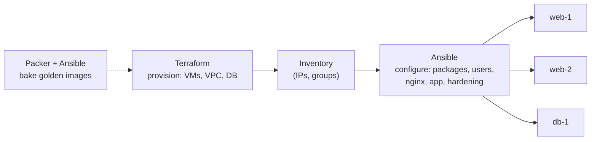

# Configuration Management with Ansible

Terraform creates infrastructure: VMs, networks and databases. Something still has to configure what runs *on* those machines, such as installing packages, writing config files, creating users, hardening SSH and deploying an app to a fleet of servers. Doing that by hand over SSH works for one server and turns into "snowflake servers" at ten. **Ansible** describes the desired configuration in YAML and applies it to any number of machines over plain SSH, with no agent to install.

## 1. Where configuration management fits



| Tool | Model | Typical use today |
|---|---|---|
| **Ansible** | Push over SSH, agentless, YAML | VM fleets, network devices, ad-hoc ops, image baking |
| Chef / Puppet | Agent pulls from a server, Ruby/DSL | Large legacy fleets |
| Salt | Agent plus event bus | Fast remote execution at scale |
| Containers + Kubernetes | Immutable images | Most new application workloads |

Containers have replaced a lot of configuration management for *apps*, but Ansible is still everywhere for VMs, on-prem servers, databases, network gear, and for building the base images containers and VMs start from.

## 2. Core concepts

- **Inventory:** the machines, grouped (`web`, `db`, `staging`).
- **Module:** a unit of work such as `apt`, `copy`, `template`, `service`, `user` or `ufw`. There are thousands.
- **Task:** one module call with arguments.
- **Play:** tasks applied to a group of hosts.
- **Playbook:** a YAML file of plays.
- **Role:** a reusable, structured bundle of tasks, templates, handlers and defaults.
- **Idempotency:** running a playbook twice changes nothing the second time. Modules check the current state first and only act if it differs.

## 3. Inventory

```ini
# inventory/prod.ini
[web]
web-1 ansible_host=10.0.1.11
web-2 ansible_host=10.0.1.12

[db]
db-1 ansible_host=10.0.2.21

[prod:children]
web
db

[prod:vars]
ansible_user=deploy
ansible_ssh_private_key_file=~/.ssh/deploy_ed25519
```

In the cloud, use a **dynamic inventory** plugin (`amazon.aws.aws_ec2`, `azure.azcollection.azure_rm`) that builds groups from instance tags, so new servers are picked up automatically.

```bash
ansible -i inventory/prod.ini web -m ping                 # can I reach them?
ansible -i inventory/prod.ini all -a "uptime"             # ad-hoc command everywhere
ansible -i inventory/prod.ini db -b -m apt -a "name=htop state=present"   # -b = sudo
```

## 4. A real playbook: harden and deploy a web server

```yaml
# site.yml
- name: Configure web servers
  hosts: web
  become: true
  vars:
    app_user: shop
    app_port: 8000
  tasks:
    - name: Install base packages
      ansible.builtin.apt:
        name: [nginx, python3-venv, ufw, fail2ban]
        state: present
        update_cache: true
        cache_valid_time: 3600

    - name: Create the app user
      ansible.builtin.user:
        name: "{{ app_user }}"
        shell: /usr/sbin/nologin
        system: true

    - name: Disable SSH password login
      ansible.builtin.lineinfile:
        path: /etc/ssh/sshd_config
        regexp: '^#?PasswordAuthentication'
        line: 'PasswordAuthentication no'
        validate: 'sshd -t -f %s'          # never write a config that would lock you out
      notify: Restart ssh

    - name: Firewall - allow SSH and HTTP(S) only
      community.general.ufw:
        rule: allow
        port: "{{ item }}"
        proto: tcp
      loop: ["22", "80", "443"]

    - name: Enable firewall (deny everything else)
      community.general.ufw:
        state: enabled
        policy: deny

    - name: Nginx site config
      ansible.builtin.template:
        src: templates/shop.conf.j2
        dest: /etc/nginx/sites-available/shop.conf
        mode: "0644"
      notify: Reload nginx

    - name: Enable site
      ansible.builtin.file:
        src: /etc/nginx/sites-available/shop.conf
        dest: /etc/nginx/sites-enabled/shop.conf
        state: link
      notify: Reload nginx

  handlers:
    - name: Reload nginx
      ansible.builtin.service: { name: nginx, state: reloaded }
    - name: Restart ssh
      ansible.builtin.service: { name: ssh, state: restarted }
```

The template uses Jinja2 and the same variables:

```jinja
# templates/shop.conf.j2
upstream app { server 127.0.0.1:{{ app_port }}; }
server {
    listen 80;
    server_name {{ inventory_hostname }}.example.com;
    location / { proxy_pass http://app; proxy_set_header Host $host; }
}
```

Points worth noticing:

- **Handlers** only run when a task reports *changed*, and only once at the end of the play, even if several tasks notify them. Nginx reloads once, and only when its config actually changed.
- **`validate:`** tests the new file before replacing the old one, which prevents locking yourself out of SSH.
- **`loop`** repeats a task over a list.

Run it safely first:

```bash
ansible-playbook -i inventory/prod.ini site.yml --check --diff   # dry run, show diffs
ansible-playbook -i inventory/prod.ini site.yml --limit web-1    # canary one host
ansible-playbook -i inventory/prod.ini site.yml                  # everyone
```

## 5. Roles: reusable structure

When a playbook grows, split it into roles:

```text
roles/
└── nginx/
    ├── defaults/main.yml      # overridable defaults (lowest precedence)
    ├── tasks/main.yml
    ├── handlers/main.yml
    ├── templates/site.conf.j2
    └── meta/main.yml          # dependencies on other roles
```

```yaml
- hosts: web
  become: true
  roles:
    - common          # users, ssh hardening, time sync
    - nginx
    - { role: app, app_version: "2.4.1" }
```

Reuse community roles and collections from **Ansible Galaxy** (`ansible-galaxy install geerlingguy.postgresql`), pinned to versions in `requirements.yml`.

## 6. Secrets with Ansible Vault

```bash
ansible-vault create group_vars/prod/vault.yml      # encrypted file
ansible-vault edit group_vars/prod/vault.yml
ansible-playbook site.yml --ask-vault-pass          # or --vault-password-file from a secret store
```

```yaml
# group_vars/prod/vars.yml (plain, references the vaulted value)
db_password: "{{ vault_db_password }}"
```

The encrypted file can be committed safely. In CI, supply the vault password from the CI secret store, or skip Vault and look values up at runtime from AWS Secrets Manager or HashiCorp Vault with lookup plugins.

## 7. Rolling updates across a fleet

Updating every server at once means downtime. `serial` updates in batches and stops on failure:

```yaml
- hosts: web
  become: true
  serial: "25%"                 # a quarter of the fleet at a time
  max_fail_percentage: 0        # stop immediately if any host fails
  pre_tasks:
    - name: Take host out of the load balancer
      ansible.builtin.uri:
        url: "https://lb.internal/api/pool/web/{{ inventory_hostname }}/drain"
        method: POST
      delegate_to: localhost
  roles: [app]
  post_tasks:
    - name: Wait until healthy
      ansible.builtin.uri: { url: "http://{{ ansible_host }}:8000/ready", status_code: 200 }
      register: r
      retries: 20
      delay: 3
      until: r.status == 200
    - name: Put host back in the pool
      ansible.builtin.uri:
        url: "https://lb.internal/api/pool/web/{{ inventory_hostname }}/enable"
        method: POST
      delegate_to: localhost
```

## 8. Real-world case: from snowflakes to reproducible servers

A team has six VMs configured by hand over three years. One has a different OpenSSL version, two have stale cron jobs, and nobody knows why `web-4` is faster. They:

1. Write playbooks describing the *intended* state and run them with `--check --diff` to discover the drift.
2. Fix the playbooks until a dry run shows only intended changes, then apply them.
3. Schedule a nightly `--check` run in CI that alerts on drift.
4. Next step: bake the configuration into images with **Packer + Ansible**, so servers are replaced rather than patched (immutable infrastructure).

## 9. Hands-on exercise

1. Start two Ubuntu VMs or containers with SSH (Multipass or Vagrant work well).
2. Write an inventory and confirm `ansible all -m ping` works.
3. Write a playbook that installs Nginx, deploys a templated config and enables UFW. Run it twice and confirm the second run reports `changed=0`.
4. Refactor it into a `common` role and an `nginx` role.
5. Put a fake password in a Vault-encrypted file and use it in a template.

## 10. Checklist

- [ ] I can explain where Ansible fits next to Terraform and containers.
- [ ] I can write inventories, playbooks, templates and handlers.
- [ ] I understand idempotency and always dry-run with `--check --diff`.
- [ ] I can structure roles and pin Galaxy dependencies.
- [ ] I can do rolling updates with `serial` and protect secrets with Vault.

## 11. Interview angle

> **Asked as:** "Terraform vs Ansible?"

Terraform is declarative provisioning with state, used to create and destroy infrastructure. Ansible is procedural-but-idempotent configuration over SSH, without state, used to configure what's on the machines. They are commonly used together.

> **Asked as:** "What does idempotent mean in Ansible?"

Each module checks the current state and only changes what differs, so re-running a playbook converges to the same result and reports zero changes once the hosts are compliant.
