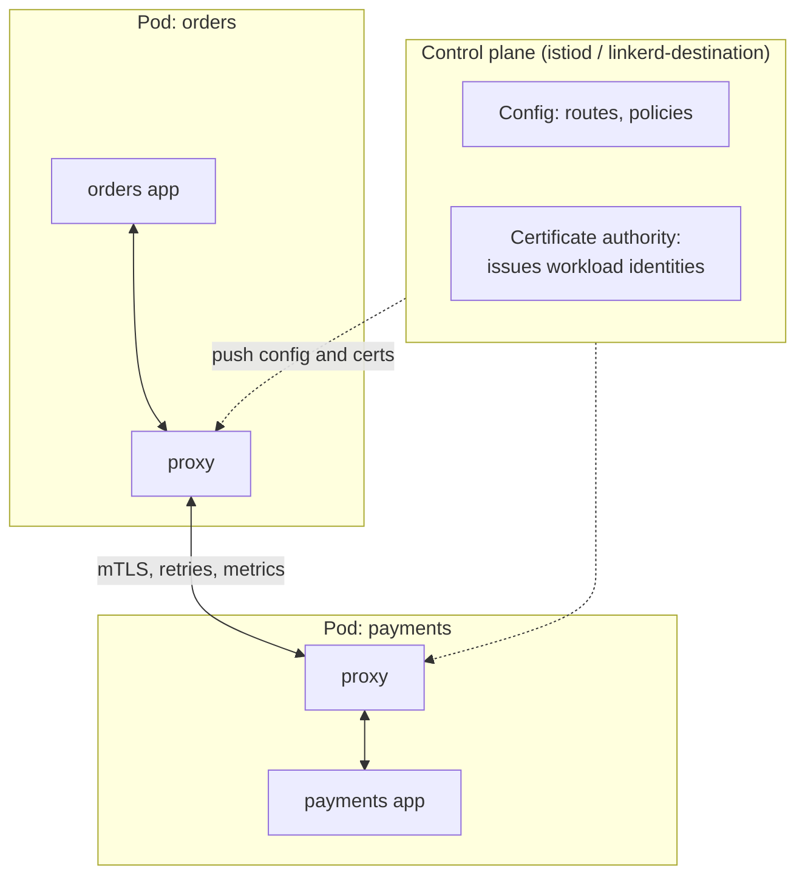

# Service Mesh: Istio, Linkerd and the Sidecar-less Future

Once you have dozens of microservices, every one of them needs the same things: encrypted service-to-service traffic, retries and timeouts, traffic splitting for canaries, and metrics for every call. Building that into each service in each language duplicates work and drifts. A **service mesh** moves these concerns out of application code and into the infrastructure, so every request between services is secured, observed and controlled uniformly.

## 1. The problem a mesh solves

Without a mesh, the `orders` service calling `payments` has to:

- implement TLS and verify the other side's identity,
- add timeouts, retries with backoff and circuit breaking,
- emit request metrics and propagate tracing headers,
- support "send 5% of traffic to payments v2."

Multiply that by 40 services written in Java, Go, Python and Node, and you get 40 slightly different implementations.

## 2. Architecture: data plane and control plane



- The **data plane** is a set of proxies (Envoy for Istio, a Rust micro-proxy for Linkerd) that intercept every inbound and outbound connection.
- The **control plane** configures those proxies and acts as a certificate authority, issuing each workload a short-lived identity certificate.

The application still calls `http://payments:8080` in plain HTTP. The local proxy transparently upgrades the connection to mutual TLS, applies the routing rules and records metrics.

### Sidecar vs ambient mode

Traditional meshes inject a **sidecar** proxy container into every pod. It works, but it costs CPU and memory per pod and complicates pod startup and Jobs. **Istio ambient mode** replaces sidecars with a per-node layer-4 proxy (ztunnel) for mTLS, plus optional per-namespace **waypoint** proxies for layer-7 features. Lower overhead and no pod restarts make it the direction most new installations take.

## 3. Feature 1: zero-trust security with mTLS

Mutual TLS means *both* sides present certificates, so the server knows exactly which workload is calling. On top of that identity you write authorization policies:

```yaml
# Encrypt all traffic in the namespace and reject plain text
apiVersion: security.istio.io/v1
kind: PeerAuthentication
metadata: { name: default, namespace: shop }
spec:
  mtls: { mode: STRICT }
---
# Only the orders service may call payments, and only POST /charges
apiVersion: security.istio.io/v1
kind: AuthorizationPolicy
metadata: { name: payments-allow-orders, namespace: shop }
spec:
  selector: { matchLabels: { app: payments } }
  action: ALLOW
  rules:
    - from:
        - source: { principals: ["cluster.local/ns/shop/sa/orders"] }
      to:
        - operation: { methods: ["POST"], paths: ["/charges"] }
```

Identities come from Kubernetes **service accounts**, not IP addresses, so the rules keep working as pods move and scale.

## 4. Feature 2: traffic management

Canary releases, header-based routing, timeouts and retries are all configuration:

```yaml
apiVersion: networking.istio.io/v1
kind: DestinationRule
metadata: { name: payments, namespace: shop }
spec:
  host: payments
  subsets:
    - { name: v1, labels: { version: v1 } }
    - { name: v2, labels: { version: v2 } }
  trafficPolicy:
    outlierDetection:              # circuit breaking: eject failing pods
      consecutive5xxErrors: 5
      interval: 10s
      baseEjectionTime: 30s
---
apiVersion: networking.istio.io/v1
kind: VirtualService
metadata: { name: payments, namespace: shop }
spec:
  hosts: [payments]
  http:
    - match:
        - headers: { x-beta-user: { exact: "true" } }   # internal testers always get v2
      route:
        - destination: { host: payments, subset: v2 }
    - route:
        - destination: { host: payments, subset: v1 }
          weight: 95
        - destination: { host: payments, subset: v2 }
          weight: 5
      timeout: 2s
      retries:
        attempts: 2
        perTryTimeout: 800ms
        retryOn: "5xx,connect-failure,reset"
```

A warning about **retries**: they multiply load. If each of three layers retries three times, one failing request becomes 27 calls to the bottom service, which is a retry storm. Retry only idempotent operations, set an overall timeout, and let circuit breaking stop the cascade.

The Kubernetes **Gateway API** (`HTTPRoute` with `backendRefs` weights) is becoming the portable standard for the same traffic-splitting rules across meshes and ingress controllers.

## 5. Feature 3: observability for free

Because every request passes through a proxy, the mesh emits **golden signals** (request rate, error rate and latency percentiles) for every service pair without code changes. Typical tooling:

- **Prometheus** scrapes proxy metrics such as `istio_requests_total` and `istio_request_duration_milliseconds`.
- **Grafana** dashboards show per-service and per-route views.
- **Kiali** draws a live service graph with traffic and error rates.
- **Distributed tracing** with Jaeger or Tempo: the proxies create spans, *but your app must forward the trace headers* (`traceparent`) from incoming to outgoing requests, or the trace breaks at each hop. Most OpenTelemetry SDKs handle this automatically.

```promql
# Error rate of calls from orders to payments over 5 minutes
sum(rate(istio_requests_total{source_app="orders",destination_app="payments",response_code=~"5.."}[5m]))
/
sum(rate(istio_requests_total{source_app="orders",destination_app="payments"}[5m]))
```

## 6. Istio vs Linkerd vs no mesh

| | Istio | Linkerd | No mesh (libraries + NetworkPolicy) |
|---|---|---|---|
| Feature set | Broadest (L7 routing, policies, multi-cluster, VMs) | Focused: mTLS, metrics, retries, splits | Whatever you build |
| Complexity | Highest | Low, "just works" | Lowest infrastructure, more app code |
| Resource cost | Moderate (lower in ambient mode) | Very light proxy | None |
| Good fit | Large platforms, strict zero-trust, complex routing | Teams wanting mTLS and visibility with minimal ops | Few services, one language |

**Do you need a mesh?** If you have fewer than about 10 services, mostly in one language, a resilience library (Resilience4j, Polly), OpenTelemetry and Kubernetes NetworkPolicies usually cover it. Adopt a mesh when compliance needs mTLS everywhere, you run many polyglot services, or you need traffic control the platform team can own.

## 7. Real-world case: the canary that caught a bad release

A fintech team deploys `payments v2` with a mesh traffic split of 2%. Within minutes, Grafana shows the v2 p99 latency at 1.8 s against 220 ms for v1, while its error rate is unchanged. A new ORM query is missing an index. Because only 2% of traffic was exposed, the rollback is a one-line YAML change and fewer than a hundred customers saw slow checkouts. Without the mesh, the same release would have gone to 100% of pods in a rolling update.

## 8. Hands-on exercise

1. Install Linkerd (simplest) or Istio in ambient mode on a kind cluster.
2. Deploy two services that call each other. Enable the mesh for the namespace.
3. Verify mTLS (`linkerd viz edges` or `istioctl x describe`).
4. Deploy a v2 of the downstream service and split traffic 90/10, then 50/50.
5. Make v2 return errors 30% of the time and watch the error rate on the dashboard. Add outlier detection and see failing pods ejected.

## 9. Checklist

- [ ] I can explain the data plane and control plane, and sidecar vs ambient mode.
- [ ] I can enforce STRICT mTLS and write identity-based authorization policies.
- [ ] I can configure canary traffic splits, timeouts, retries and circuit breaking, and explain retry storms.
- [ ] I know what observability a mesh gives for free and why apps must propagate trace headers.
- [ ] I can argue when *not* to adopt a mesh.

## 10. Interview angle

> **Asked as:** "What is a service mesh and when would you use one?"

It's infrastructure that handles service-to-service communication through proxies managed by a control plane. It provides mTLS identity, traffic control and uniform telemetry without app changes. It's worth it for many polyglot services or zero-trust requirements, and overkill for a handful of services.

> **Asked as:** "How does mTLS in a mesh work?"

The control plane's certificate authority issues short-lived certificates tied to service-account identities. Proxies on both ends authenticate each other and encrypt traffic, and policies authorise by identity rather than IP.
