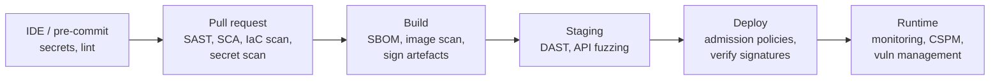

# Shift-Left Security: Building Security into CI/CD

DevSecOps makes security part of how software is built and shipped every day, instead of a gate at the end. The goal isn't to make developers into security experts. It's to give them fast, automated feedback, so a vulnerable dependency, a leaked secret or a misconfigured bucket is caught in the pull request where it costs minutes to fix, not in production where it costs a breach. This guide covers the security checks in a modern pipeline, how to roll them out without drowning teams in noise, and software supply-chain security.

## 1. Where each check belongs



| Check | Finds | Example tools |
|---|---|---|
| **Secret scanning** | API keys, passwords and tokens in code and history | Gitleaks, TruffleHog, GitHub push protection |
| **SAST** (static analysis) | Injection, unsafe deserialisation, weak crypto in your code | Semgrep, CodeQL, SonarQube |
| **SCA** (dependency scanning) | Known CVEs in libraries, licence issues | Dependabot, Renovate, Snyk, OSV-Scanner, Trivy |
| **IaC scanning** | Public buckets, open security groups, unencrypted disks | Checkov, Trivy (config), tfsec rules, KICS |
| **Container image scanning** | Vulnerable OS packages, root user, bloated images | Trivy, Grype, registry scanners |
| **DAST** | Runtime issues: missing headers, XSS, auth flaws | OWASP ZAP, Burp Suite, Nuclei |
| **SBOM + signing** | What's inside each artefact, and proof of where it came from | Syft, CycloneDX, Sigstore Cosign |

## 2. A secure pipeline, concretely

```yaml
# .github/workflows/security.yml
name: security
on: [pull_request]
permissions:
  contents: read
  security-events: write          # upload SARIF results to code scanning
jobs:
  secrets:
    runs-on: ubuntu-latest
    steps:
      - uses: actions/checkout@v6
        with: { fetch-depth: 0 }
      - uses: gitleaks/gitleaks-action@v2          # fails the PR on new secrets
        env: { GITHUB_TOKEN: "${{ secrets.GITHUB_TOKEN }}" }

  sast:
    runs-on: ubuntu-latest
    steps:
      - uses: actions/checkout@v6
      - run: pipx run semgrep scan --config p/owasp-top-ten --config p/secrets --sarif -o semgrep.sarif --error
      - uses: github/codeql-action/upload-sarif@v4
        if: always()
        with: { sarif_file: semgrep.sarif }

  deps-and-iac:
    runs-on: ubuntu-latest
    steps:
      - uses: actions/checkout@v6
      - uses: aquasecurity/trivy-action@0.33.1      # pin third-party actions (ideally by commit SHA)
        with:
          scan-type: fs
          scanners: vuln,misconfig,secret
          severity: HIGH,CRITICAL
          ignore-unfixed: true                     # only fail on issues you can actually fix
          exit-code: "1"
```

Design choices worth copying:

- **Least-privilege workflow tokens** (`permissions:`). A compromised step shouldn't be able to push code or publish packages.
- **Pin third-party actions**, ideally to a full commit SHA, so a hijacked tag can't run malicious code in your pipeline.
- **Fail on new, fixable, high-severity issues only.** Report everything else to the security dashboard without blocking.
- **SARIF output** puts findings inline on the PR where developers already look.

## 3. Rolling it out without alienating developers

Turning on every scanner in blocking mode on day one generates thousands of findings, and teams learn to ignore or bypass them. A rollout that works:

1. **Start in report-only mode.** Measure the baseline and tune out false positives.
2. **Block only new issues** ("no new criticals"), and burn down the existing backlog separately with owners and deadlines.
3. **Make fixes easy:** automated dependency PRs (Renovate or Dependabot) with grouped updates and auto-merge for patch versions that pass tests.
4. **Triage with context.** A critical CVE in a library function you never call, in a container with no network exposure, is less urgent than a medium one on your login endpoint. Reachability analysis and exploitability data (CISA KEV, EPSS) help prioritise.
5. **Security champions:** one interested developer per team who gets extra training, helps triage and spreads practices.
6. **Measure:** mean time to remediate criticals, the percentage of repos with scanning enabled, and the number of open criticals past their SLA.

## 4. Secrets: prevent, detect, rotate

```bash
# Pre-commit hook: catch secrets before they leave the laptop
cat > .pre-commit-config.yaml <<'YAML'
repos:
  - repo: https://github.com/gitleaks/gitleaks
    rev: v8.28.0
    hooks:
      - id: gitleaks
YAML
pre-commit install
```

If a secret is committed, **rotate it immediately**. Removing it from Git history is not enough, because clones, forks, CI logs and caches already have it. Then move secrets out of code entirely: a secrets manager (Vault, AWS Secrets Manager, Azure Key Vault), injected at runtime, and better still **short-lived credentials through OIDC federation**, so CI jobs never hold long-lived cloud keys:

```yaml
permissions: { id-token: write, contents: read }
steps:
  - uses: aws-actions/configure-aws-credentials@v5
    with:
      role-to-assume: arn:aws:iam::123456789012:role/deploy-staging
      aws-region: ap-southeast-1          # temporary credentials, scoped to this repo and branch
```

## 5. Software supply-chain security

OWASP's 2025 Top 10 added **Software Supply Chain Failures** as A03. Attackers increasingly compromise what you *depend on*: typosquatted packages, hijacked maintainer accounts, poisoned build systems.

Defences, in layers:

- **Lockfiles and pinned versions,** installed with `npm ci` or `pip install --require-hashes`, so builds use exactly what was reviewed.
- **Vet new dependencies:** maintenance, popularity, permissions and install scripts. Fewer dependencies mean less risk.
- **Private registry or proxy** with an allow-list and malware scanning for critical environments.
- **SBOM** (software bill of materials) for every build, so when the next big library CVE lands you can answer "are we affected?" in minutes:

```bash
syft ghcr.io/acme/orders:1.8.2 -o cyclonedx-json > sbom.json
grype sbom:sbom.json --fail-on critical
```

- **Signing and provenance:** sign images with Sigstore Cosign (keyless, using the CI's OIDC identity) and generate **SLSA provenance** describing how and where the artefact was built. At deploy time, verify:

```bash
cosign sign --yes ghcr.io/acme/orders@sha256:4f2c...           # in CI, keyless
cosign verify ghcr.io/acme/orders@sha256:4f2c... \
  --certificate-identity-regexp 'https://github.com/acme/orders/.github/workflows/release.yml@refs/tags/.*' \
  --certificate-oidc-issuer https://token.actions.githubusercontent.com
```

A Kubernetes admission policy (Kyverno or Sigstore policy-controller) can refuse any image that isn't signed by your release workflow. The next guide covers this.

## 6. DAST and API security testing

Static tools can't see runtime behaviour. Run **DAST** against a staging deployment on a schedule or before releases:

```bash
docker run --rm -v $(pwd):/zap/wrk ghcr.io/zaproxy/zaproxy:stable zap-api-scan.py \
  -t https://staging.acme.dev/openapi.json -f openapi -r zap-report.html -c zap-rules.conf
```

Feeding the OpenAPI spec lets the scanner exercise every endpoint. Add **authenticated** scans with test users of different roles. Broken access control (OWASP A01) only shows up when user A tries user B's resources, so write explicit authorisation tests for those cases as well.

## 7. Real-world case: from 4,000 findings to a working programme

A fintech enabled SCA and SAST in blocking mode across 60 repositories and got 4,100 findings in a week. Developers started adding `--no-verify` and skip labels. The reset:

- report-only for 4 weeks while rules were tuned, which cut SAST noise by 70%,
- "no new critical or high, fixable" as the only blocking rule,
- Renovate with grouped weekly updates and auto-merge for passing patch updates, which cleared 60% of the dependency backlog in a month,
- KEV and EPSS-based prioritisation for the rest, with 7-day SLAs for exploited-in-the-wild issues,
- a security champion in each squad.

Six months later, criticals open past SLA had gone from 310 to 9, and nobody bypassed the pipeline.

## 8. Hands-on exercise

1. Add Gitleaks, Semgrep and Trivy jobs to a repo's CI with SARIF upload and least-privilege permissions.
2. Commit a fake AWS key on a branch and confirm the PR is blocked. Practise the rotation runbook.
3. Generate an SBOM for a container image and scan it with Grype.
4. Sign an image with Cosign keyless signing in CI, and verify it with identity constraints.
5. Run a ZAP API scan against a local app using its OpenAPI spec.

## 9. Checklist

- [ ] I know where secret scanning, SAST, SCA, IaC scanning, image scanning, DAST, SBOMs and signing fit in a pipeline.
- [ ] I configure least-privilege CI tokens, pinned actions and OIDC credentials instead of stored keys.
- [ ] I roll out scanners report-only first, block only new fixable issues and prioritise by exploitability.
- [ ] I can respond to a leaked secret (rotate first).
- [ ] I can generate SBOMs and sign and verify artefacts with provenance.

## 10. Interview angle

> **Asked as:** "How would you introduce security scanning without slowing developers down?"

Fast checks in PRs and slower ones on a schedule, report-only first to tune, block only new fixable high-severity issues, automate dependency updates, prioritise by reachability and exploitability, put findings inline, appoint champions, and track remediation time.

> **Asked as:** "A developer pushed an AWS key to a public repo. What do you do?"

Revoke and rotate immediately, check CloudTrail for use of the key, contain and investigate any activity, purge it from history and caches, then prevent recurrence with pre-commit and push protection and move to OIDC short-lived credentials.
