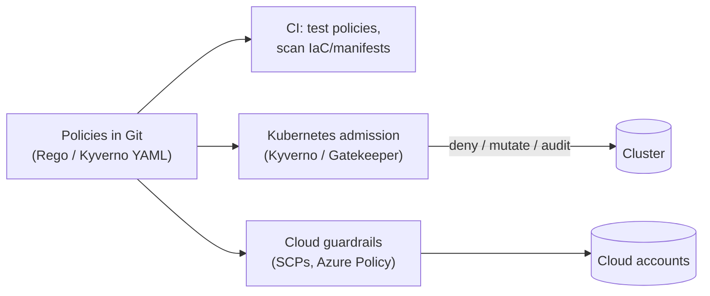
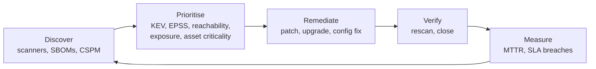

# Policy as Code, Runtime Security and Continuous Compliance

Pipeline scanners catch problems before deployment. But clusters drift, people click in consoles, zero-days appear in code that was clean yesterday, and auditors want evidence, not promises. This guide covers the "right side" of DevSecOps: admission policies that enforce rules automatically, runtime detection, cloud security posture management, and compliance treated as code.

## 1. Policy as code

Rules like "no containers run as root" or "every S3 bucket is encrypted" written in a wiki get ignored. Written as **code**, they are version-controlled, reviewed, tested and enforced automatically, everywhere at once.



### Kubernetes admission control with Kyverno

```yaml
apiVersion: kyverno.io/v1
kind: ClusterPolicy
metadata:
  name: baseline-workload-security
spec:
  validationFailureAction: Enforce        # start with Audit, then Enforce
  background: true
  rules:
    - name: no-root-no-privilege-escalation
      match: { any: [{ resources: { kinds: [Pod] } }] }
      validate:
        message: "Containers must run as non-root without privilege escalation."
        pattern:
          spec:
            securityContext: { runAsNonRoot: true }
            containers:
              - securityContext: { allowPrivilegeEscalation: false }
    - name: require-resource-limits
      match: { any: [{ resources: { kinds: [Pod] } }] }
      validate:
        message: "CPU and memory limits are required."
        pattern:
          spec:
            containers: [{ resources: { limits: { memory: "?*", cpu: "?*" } } }]
---
apiVersion: kyverno.io/v1
kind: ClusterPolicy
metadata:
  name: verify-signed-images
spec:
  validationFailureAction: Enforce
  rules:
    - name: signed-by-release-workflow
      match: { any: [{ resources: { kinds: [Pod] } }] }
      verifyImages:
        - imageReferences: ["ghcr.io/acme/*"]
          attestors:
            - entries:
                - keyless:
                    issuer: https://token.actions.githubusercontent.com
                    subject: "https://github.com/acme/*/.github/workflows/release.yml@refs/tags/*"
```

Kubernetes also ships **Pod Security Admission** (the `baseline` and `restricted` profiles set per namespace) and native **ValidatingAdmissionPolicy** using CEL expressions, which cover many common rules without extra components. Kyverno and OPA Gatekeeper add richer logic, mutation, image verification and reporting.

### OPA / Rego for anything

Open Policy Agent evaluates JSON input against Rego rules. It's useful for Terraform plans, API authorisation and CI decisions:

```rego
package terraform.s3

deny contains msg if {
    some r in input.resource_changes
    r.type == "aws_s3_bucket_public_access_block"
    r.change.after.block_public_acls == false
    msg := sprintf("%s must block public ACLs", [r.address])
}
```

```bash
terraform plan -out tf.plan && terraform show -json tf.plan > plan.json
conftest test plan.json --policy policy/         # fails CI if any deny rule matches
```

### Cloud guardrails

At the organisation level, prevent whole classes of mistakes: AWS **Service Control Policies** (deny disabling CloudTrail, deny regions you don't use, deny public S3 at the account level), **Azure Policy**, and **GCP Organization Policies**. Guardrails beat detection, because the bad state can't exist at all.

## 2. Runtime security

Some threats only appear while software runs: an exploited zero-day spawning a shell in a container, crypto-mining, unexpected outbound connections, privilege escalation.

**Falco** (and commercial equivalents) watches kernel events through eBPF and alerts on suspicious behaviour:

```yaml
- rule: Shell spawned in production container
  desc: An interactive shell started inside a container in a prod namespace
  condition: >
    spawned_process and container and proc.name in (bash, sh, zsh)
    and k8s.ns.name startswith "prod" and proc.tty != 0
  output: "Shell in container (user=%user.name pod=%k8s.pod.name ns=%k8s.ns.name cmd=%proc.cmdline image=%container.image.repository)"
  priority: WARNING
  tags: [container, mitre_execution]
```

Runtime hardening that reduces what an attacker can do after getting in:

- **Read-only root filesystems**, dropped Linux capabilities, seccomp `RuntimeDefault`, non-root users.
- **Minimal images** (distroless, or Chainguard and Wolfi-style images) with no shell or package manager.
- **NetworkPolicies:** default-deny, then explicitly allow the paths each service needs, including **egress**, which stops data exfiltration and command-and-control callbacks.
- **Workload identity** (IRSA, EKS Pod Identity, Azure Workload Identity) so pods get narrowly scoped cloud permissions, not node-wide credentials.

```yaml
apiVersion: networking.k8s.io/v1
kind: NetworkPolicy
metadata: { name: orders-egress, namespace: prod }
spec:
  podSelector: { matchLabels: { app: orders } }
  policyTypes: [Egress]
  egress:
    - to: [{ podSelector: { matchLabels: { app: postgres } } }]
      ports: [{ port: 5432 }]
    - to: [{ namespaceSelector: { matchLabels: { kubernetes.io/metadata.name: kube-system } } }]
      ports: [{ port: 53, protocol: UDP }]
```

## 3. Cloud security posture management (CSPM)

CSPM continuously scans cloud accounts for misconfigurations and risky combinations (a public VM with an admin role and an unpatched critical CVE is a "toxic combination"). Tools include AWS Security Hub, Microsoft Defender for Cloud, Google Security Command Center, and open-source Prowler. Practices:

- Benchmark against **CIS** controls and fix drift **at the source**: change the Terraform, not the console.
- Prioritise by **attack paths** (internet exposure + permissions + vulnerabilities), not raw finding counts.
- Route findings to the owning team automatically, with SLAs.

## 4. Vulnerability management as a process



Typical SLAs: actively exploited (in CISA's Known Exploited Vulnerabilities list) and internet-facing, 7 days or less. Other critical, 15–30 days. High, 30–60 days. Document exceptions with an owner, compensating controls and an expiry date.

## 5. Continuous compliance

Frameworks such as **SOC 2**, **ISO/IEC 27001:2022**, **PCI DSS v4.0.1** and **HIPAA** ask for controls *and evidence*. DevSecOps turns evidence collection into a by-product of the pipeline:

| Control | Evidence generated automatically |
|---|---|
| Changes are reviewed | Branch protection plus PR approvals in Git history |
| Production changes are tested | CI run logs linked to each deployment |
| Vulnerabilities are managed | Scanner reports, SLA dashboards |
| Access is least-privilege and reviewed | IaC-defined IAM, quarterly access review tickets |
| Logs are retained and protected | Log pipeline config, immutable storage settings |

Compliance-automation platforms (Vanta, Drata, Secureframe) pull this evidence from cloud and Git APIs continuously. Compliance is the floor, not the goal: a SOC 2 report doesn't mean you're secure. But automated evidence makes audits cheap and keeps controls actually running.

## 6. Real-world case: the crypto-miner

A team's staging cluster ran an old image with a known remote code execution flaw in a JSON library. An attacker exploited it, started a shell and downloaded a crypto-miner. What caught it was Falco's "shell spawned in container" alert plus a spike in egress traffic to a mining pool. What would have prevented it:

- image scanning with a KEV-based SLA (the CVE had been listed for 3 weeks),
- a distroless image (no shell, no curl),
- default-deny egress NetworkPolicy,
- a Kyverno policy requiring images from the signed release pipeline (the staging image had been built locally).

All four became mandatory baseline policies, applied to staging as well as production.

## 7. Hands-on exercise

1. Install Kyverno on a local kind cluster. Add the baseline policy in Audit mode, review the policy reports, then switch to Enforce and try to deploy a root container.
2. Write a Conftest/Rego policy that rejects Terraform plans with public S3 access and wire it into CI.
3. Run Falco, `kubectl exec` into a pod and watch the alert.
4. Apply a default-deny egress NetworkPolicy and verify a pod can reach only its database and DNS.

## 8. Checklist

- [ ] I can write and roll out admission policies (Audit, then Enforce) with Kyverno, Gatekeeper or native policies.
- [ ] I can test IaC against Rego policies in CI and know organisation-level cloud guardrails.
- [ ] I harden workloads (non-root, read-only, minimal images, NetworkPolicies, workload identity) and run runtime detection.
- [ ] I run vulnerability management as a prioritised, measured process.
- [ ] I automate compliance evidence from pipelines and IaC.

## 9. Interview angle

> **Asked as:** "How do you make sure only trusted images run in production?"

Build in CI, sign keylessly with provenance, verify the signature and identity at admission with Kyverno or policy-controller, restrict registries, scan continuously, and block unsigned or locally built images, including in staging.

> **Asked as:** "Detection or prevention?"

Both, layered. Prevent what you can with guardrails, admission policies and least privilege. Detect what gets through with runtime monitoring and CSPM. And design to limit blast radius with network segmentation and minimal images.
