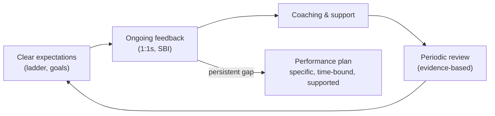

# Engineering Management: Leading People, 1:1s, Feedback and Growth

An engineering manager (EM) is responsible for a team's people, its delivery and its health. The shift from engineer to manager is a change of job, not a promotion: your output becomes the output of your team, and your main tools become conversations, clarity and systems rather than code. This guide covers the people side: one-on-ones, feedback, growth and career development, performance management, hiring and building a healthy team culture.

## 1. What changes when you become a manager

| As an engineer | As a manager |
|---|---|
| Measured by your own output | Measured by your team's outcomes and health |
| Fast feedback loops (tests pass) | Slow feedback loops (months to see the effect of coaching) |
| Deep focus time | Fragmented time, many context switches |
| Solve problems yourself | Help others solve problems, and grow them |
| Technical decisions | People, process, priorities and technical direction |

Common traps for new managers: staying the team's best coder and becoming the bottleneck, avoiding hard conversations, and shielding the team so completely that they lose context. Aim to **stay technical enough** to make good calls and earn trust (reviewing designs, reading code, joining incident reviews) without being on the critical path of delivery.

## 2. One-on-ones

The 1:1 is the most important recurring meeting an EM has: 30–45 minutes, weekly or every two weeks, for each direct report. **It's their meeting, not a status update.**

```text
Shared 1:1 doc (example agenda, added to by both)

Their topics first
  - Feeling stretched between the payments migration and on-call
  - Want feedback on my design doc for retries

Check-in
  - Energy this week (1–5)? What's taking it, what's giving it?

Growth (monthly)
  - Progress on goal: lead the next incident review
  - What would make the next 6 months great for you?

My topics
  - Context: Q1 priorities shifting toward reliability; how does that land for you?
  - Feedback: your design review comments on Rafi's PR (specific example)

Actions
  - [me] Rebalance on-call rotation by Friday
  - [them] Share retry design doc with platform team
```

Useful questions:

- "What's on your mind this week?"
- "What's the most frustrating thing about working here right now?"
- "Is there anything I could do differently to help you?"
- "What are you learning? What would you like to learn next?"
- "On a scale of 1–10, how are you feeling about your work? What would make it a point higher?"

Never cancel 1:1s casually. Rescheduling is fine, but repeated cancellation signals that people aren't a priority. Write down commitments and follow through, because trust is built on small promises kept.

## 3. Feedback that helps

Feedback should be **frequent, specific, timely and about behaviour and impact**, not personality. The **SBI** model (situation, behaviour, impact) keeps it concrete:

> **Situation:** "In yesterday's design review for the dispatch service,"
> **Behaviour:** "you walked through the failure modes and proposed the outbox pattern with a clear diagram,"
> **Impact:** "which helped the team agree in 20 minutes and avoided a risky dual write. That's exactly the kind of technical leadership I'd like to see more of."

> **Situation:** "In this morning's incident channel,"
> **Behaviour:** "you replied 'whoever deployed this didn't test it' before we knew the cause,"
> **Impact:** "which made Nusrat defensive and slowed the investigation. Our blameless approach depends on focusing on systems. Can we talk about how to raise concerns differently?"

Practices:

- **Positive feedback** should be frequent and specific. It tells people what to keep doing.
- **Constructive feedback** should be given privately and soon. Ask for their perspective, then agree on what happens next.
- **Ask for feedback on yourself** regularly ("What's one thing I could do better as your manager?") and act on it visibly.
- **Radical candor:** care personally *and* challenge directly. Avoid "ruinous empathy," where you're too nice to tell people what they need to hear.

## 4. Growth and career development

- **Career ladders** (levels with expectations across technical skill, delivery, collaboration, leadership and impact) make growth transparent and reduce bias. Use them in conversations: "Here's what a senior engineer does, and here's evidence you're already doing some of it."
- **Individual development plans:** 1–3 goals, each tied to real work ("own the design and rollout of the delay-notification service", "mentor the new graduate hire").
- **Stretch assignments** with support. Growth comes mostly from doing, with coaching. Delegate *outcomes*, not just tasks, and match the level of support to the person's experience with the task (situational leadership).
- **Two tracks:** the individual-contributor track (senior → staff → principal) and the management track are parallel, not one above the other. Help people choose based on what energises them.
- **Sponsorship:** advocate for your people's work and promotion in rooms they're not in.

## 5. Performance management

Performance management is mostly continuous, not a yearly event:



- **No surprises:** nothing in a formal review should be news. If it is, the feedback came too late.
- **Write reviews with evidence:** specific examples of impact, mapped to the level expectations, including peer input.
- **Calibration** across managers reduces bias and inconsistency in ratings and promotions.
- **Underperformance:** diagnose the cause first. Is it unclear expectations, skills, motivation, personal circumstances, or a poor fit for the role? Address it early and directly. If a formal improvement plan is needed, make it specific (what good looks like), time-bound, supported (coaching, check-ins) and documented, and work with HR. Sometimes the kindest outcome is helping someone find a better-fitting role.

## 6. Hiring

Hiring decides your team's future more than almost anything else.

- **Define the role from needs:** what will this person do in the first 6–12 months? Which skills are essential and which are learnable?
- **Structured interviews:** the same questions and rubrics for every candidate, with each interviewer assessing specific competencies. This predicts performance much better than unstructured chats and reduces bias.
- **Realistic exercises:** practical, job-relevant tasks (debugging, a small design, pairing on a realistic problem) over puzzles. Respect candidates' time.
- **Independent written feedback before the debrief,** so the loudest voice doesn't anchor everyone.
- **Sell the role honestly,** and give every candidate a good experience, including rejected ones.
- **Onboarding:** a 30/60/90-day plan, a buddy, a first small production change in the first week, and early 1:1s.

```text
Rubric excerpt: "System design (mid-level backend)"
1 – Needs heavy guidance; misses core requirements
2 – Reasonable design for happy path; limited trade-off discussion
3 – Solid design; identifies key bottleneck and data model; discusses 1–2 trade-offs  ← bar
4 – Proactively handles failure modes, consistency, and evolution; clear communication
```

## 7. Team health and culture

- **Psychological safety** (Google's Project Aristotle found it the strongest predictor of team effectiveness) means people can ask questions, admit mistakes and challenge ideas without fear. Managers build it by admitting their own mistakes, thanking people for raising problems, and running blameless incident reviews.
- **Clarity:** everyone knows the team's mission, goals and how their work contributes.
- **Sustainable pace:** watch for burnout signals (cynicism, exhaustion, withdrawal, a spike in errors). Manage on-call load, after-hours messages and deadline pressure deliberately.
- **Recognition:** celebrate outcomes and behaviours publicly and specifically.
- **Inclusion:** rotate the "glue work" (notes, onboarding, coordination) and recognise it in reviews, make sure quieter voices are heard in meetings, and use written proposals so people who think in writing can contribute.

## 8. Real-world case: the silent senior engineer

A new EM inherited a senior engineer, Arif, who had gone quiet. His code was fine, but he had stopped participating in design discussions and turned down a tech-lead opportunity. Weekly 1:1s focused on his topics, and over a few weeks he explained that his last two design proposals had been overruled without explanation by the previous manager, and that he felt his growth had stalled. The EM brought him into the architecture decisions for a new service with an explicit ADR process (so decisions were reasoned and recorded), arranged mentoring from a staff engineer, and set a development goal around technical leadership. Six months later Arif led the service design, ran the design review and was promoted at the next cycle. The team kept a strong engineer who had been quietly preparing to leave.

## 9. Hands-on exercise

1. Write a 1:1 template with your questions for check-in, growth and feedback.
2. Write two pieces of feedback (one positive, one constructive) using SBI about real situations.
3. Draft an individual development plan for yourself or a teammate, with goals tied to real work.
4. Create a structured interview rubric (4 levels) for one competency in your field.
5. Write a 30/60/90-day onboarding plan for a new engineer.

## 10. Checklist

- [ ] I understand how the manager role differs from the engineer role and avoid the common traps.
- [ ] I run regular, report-led 1:1s and follow through on commitments.
- [ ] I give frequent, specific SBI feedback and ask for feedback on myself.
- [ ] I support growth with ladders, development plans, stretch assignments and sponsorship, and handle performance continuously and fairly.
- [ ] I hire with structured, fair processes and build psychological safety, clarity and a sustainable pace.

## 11. Interview angle

> **Asked as:** "How do you handle an underperforming engineer?"

Diagnose the cause through 1:1s (expectations, skills, motivation, circumstances, fit), give specific feedback early with examples, agree on clear expectations and support, and check in frequently. If it doesn't improve, move to a documented, time-bound plan with HR, and stay fair and humane throughout. No surprises.

> **Asked as:** "How do you build a high-performing team?"

Clear mission and goals, psychological safety, the right people (structured hiring), growth for everyone, a sustainable pace, good engineering practices and feedback loops, and a manager who removes obstacles and gives credit to the team.
