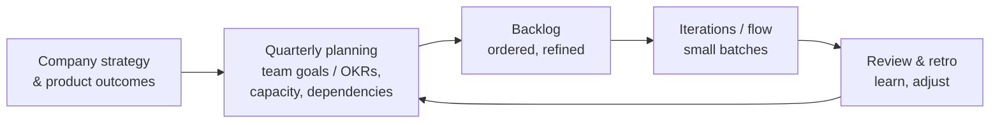

# Engineering Management: Execution, Delivery Metrics and Organisation

Great people still need a system to deliver reliably: clear priorities, sensible planning, a healthy engineering process, metrics that reveal problems without being gamed, good incident handling, and a team structure that matches the work. This guide covers the execution side of engineering management, from planning and estimation to DORA metrics, technical debt, incidents, cross-team work and org design.

## 1. Priorities and planning



### Capacity planning

Plan with realistic capacity, not theoretical capacity:

```text
Team of 6 engineers, 12-week quarter = 72 engineer-weeks
 − holidays & leave (Eid, annual leave)          ~8
 − on-call & interrupts (≈15%)                  ~10
 − hiring, onboarding, meetings                  ~5
 = ~49 engineer-weeks available
   → ~70% committed goals (34), ~20% tech health (10), ~10% buffer (5)
```

Committing 100% of theoretical capacity guarantees missed goals and burnout. Explicit allocations for **technical health** (debt, reliability, upgrades) keep the system sustainable and make the trade-off visible to stakeholders.

### Estimation

Estimates are forecasts with uncertainty, not promises.

- Break work down until items are small (days, not weeks). Uncertainty hides in big items.
- Use **ranges and confidence**: "4–6 weeks, 80% confident; the main risk is the payment provider's sandbox."
- Use **historical throughput** for forecasting: if the team completes 8–12 items per week, a 60-item project probably takes 5–8 weeks. Monte Carlo simulation on past data gives probabilistic dates.
- **Re-forecast as you learn,** and communicate changes early. Bad news delivered early is a gift. Late surprises destroy trust.

## 2. Execution practices that work

- **Small batches and trunk-based development** with feature flags give short feedback loops and less integration pain.
- **WIP limits:** finish before starting. Five half-done projects deliver no value.
- **Definition of done:** tested, reviewed, documented, observable, deployed (and behind a flag if needed).
- **Design docs for significant work:** a short written proposal (context, goals and non-goals, design, alternatives, risks, rollout) reviewed asynchronously. It surfaces problems before code exists and spreads knowledge.
- **Effective meetings:** an agenda, decisions and owners recorded, async updates where possible, and protected focus time (for example meeting-free afternoons).
- **Retrospectives** that produce one or two concrete, owned improvements, followed up next time.

## 3. Measuring delivery: DORA and beyond

The **DORA metrics** (from the DevOps Research and Assessment programme) measure software delivery performance at the team or system level:

| Metric | What it measures | Signals |
|---|---|---|
| **Deployment frequency** | How often you deploy to production | Batch size, automation |
| **Lead time for changes** | Commit to production | Process friction, reviews, CI speed |
| **Change failure rate** | Share of deployments causing failures that need remediation | Quality, testing |
| **Failed deployment recovery time** | How fast you restore service after a failed change | Observability, rollback, incident practice |

DORA's research also tracks **rework rate** and emphasises that speed and stability go *together*. Elite teams are both fast and stable.

```sql
-- Lead time for changes (median hours) per week, from merged PRs to production deploys
SELECT date_trunc('week', d.deployed_at) AS week,
       percentile_cont(0.5) WITHIN GROUP (ORDER BY extract(epoch FROM d.deployed_at - c.committed_at) / 3600) AS median_lead_time_h,
       count(DISTINCT d.id) AS deploys,
       avg((d.caused_incident)::int) AS change_failure_rate
FROM deployments d
JOIN deployment_commits dc ON dc.deployment_id = d.id
JOIN commits c ON c.sha = dc.sha
WHERE d.environment = 'production'
GROUP BY 1 ORDER BY 1;
```

Use metrics for **learning, not judging**:

- Measure **teams and systems, never individuals.** Lines of code, commits per person and story points per developer destroy collaboration and get gamed.
- Pair delivery metrics with **developer experience** (surveys about friction, focus time, tooling: the SPACE and DevEx frameworks) and **outcomes** (customer and business impact).
- Look at trends and ask "why?", which leads to real improvements: faster CI, smaller PRs, better test environments.

## 4. Technical debt and reliability

- Keep a **visible debt register** with the business impact of each item ("adds about 2 days to every payment change", "caused 3 incidents this quarter").
- Reserve **continuous capacity** (15–25%) rather than relying on rare "cleanup sprints."
- Use **SLOs and error budgets** to balance features and reliability. When the budget is spent, reliability work takes priority. That's an agreed rule, not a negotiation every time.
- Tie the case to outcomes leaders care about: lead time, incident cost, onboarding speed, cloud cost.

## 5. Incidents and on-call

Incidents are inevitable. A well-run response and a blameless learning culture make them rarer and shorter.

- **Clear roles during incidents:** an incident commander (coordinates and decides), subject-matter responders, and a communications lead (status page, stakeholders).
- **Severity levels** with response expectations (SEV1: customer-facing outage, page immediately, updates every 30 minutes).
- **Sustainable on-call:** rotations with enough people (6–8 or more), handovers, compensation or time off after heavy shifts, actionable alerts only, and runbooks for common alerts.
- **Blameless post-incident reviews:** a timeline, contributing factors (systemic, not "human error"), what went well, and action items with owners and dates, tracked to completion.

```text
Post-incident review excerpt
Impact: 38 min of failed checkouts for ~22% of users (SEV1), est. ৳4.1 lakh lost GMV
Trigger: config change reduced payment-service connection pool from 50 → 5
Contributing factors:
 - Config changes bypass the canary process (deployed to 100% instantly)
 - No alert on pool saturation; first signal was customer complaints
 - Rollback runbook referenced an outdated dashboard
Actions:
 - [Platform, 2 wks] Config changes go through the same canary pipeline as code
 - [Payments, 1 wk] Alert on connection-pool wait time > 100 ms
 - [Payments, 3 days] Update runbook; quarterly rollback drill
```

## 6. Cross-team work and stakeholders

- **Map dependencies early** in planning, and agree on interfaces (API contracts) and dates with the other teams.
- **Write things down:** decisions, owners, timelines. Ambiguity grows quickly across teams.
- **Manage up:** keep your manager informed of risks early, with options ("We'll miss the date by 2 weeks. Option A: cut X. Option B: add Y from the platform team.").
- **Represent the team's constraints honestly** to product and leadership, including saying no or "not now" with clear reasoning.

## 7. Organisation design

How teams are structured shapes the architecture and the speed of delivery (Conway's law). **Team Topologies** offers a practical vocabulary:

| Team type | Purpose |
|---|---|
| **Stream-aligned** | Owns a flow of value end to end (for example "Ordering" or "Rider experience") |
| **Platform** | Provides self-service internal products (CI/CD, observability, data platform) that reduce load on stream-aligned teams |
| **Enabling** | Helps other teams adopt new capabilities (security, testing practices), temporarily |
| **Complicated subsystem** | Owns deep specialist components (a routing or ETA engine) |

Principles:

- **Teams of 5–9** people with stable membership, clear ownership and minimal hand-offs.
- **Limit cognitive load:** a team shouldn't own more domains or services than it can understand deeply.
- **Interaction modes:** collaboration (temporary, intense), X-as-a-service (clear interfaces), and facilitation.
- **Span of control:** EMs typically manage 5–8 direct reports. More than about 10 makes good 1:1s and coaching hard.

## 8. Real-world case: from quarterly to daily deployments

A 30-engineer organisation deployed once every two weeks in a 4-hour release window. Lead time was about 18 days, the change failure rate about 30%, and releases were dreaded. The EMs looked at the metrics and developer surveys together and found long-lived branches, a 55-minute CI run, manual QA sign-off on every release, and no feature flags. Changes over two quarters:

- trunk-based development with feature flags,
- CI split and parallelised from 55 to 11 minutes, with flaky tests quarantined and fixed,
- automated API and E2E tests on critical paths replacing manual regression, with QA moving to exploratory testing and earlier involvement,
- canary deployments with automatic rollback on error-rate alerts.

Results: deployments several times a day, lead time under one day, change failure rate around 8%, and a sharp rise in developer satisfaction in the next survey. No individual metrics were ever used.

## 9. Hands-on exercise

1. Do a realistic capacity plan for your team for next quarter, including allocations for tech health and buffer.
2. Compute the four DORA metrics for a repository from deployment and commit data (or estimate them), and pick one improvement.
3. Write a one-page design doc template and use it for a real piece of work.
4. Run (or simulate) a blameless post-incident review and write the action items.
5. Draw your organisation as Team Topologies types and identify one cognitive-load or dependency problem.

## 10. Checklist

- [ ] I plan with realistic capacity, explicit tech-health allocation, and estimates given as ranges with confidence.
- [ ] I support execution with small batches, WIP limits, design docs and useful retrospectives.
- [ ] I use DORA and developer-experience metrics for team learning, never for individual judgement.
- [ ] I manage technical debt and reliability with SLOs and error budgets, and run sustainable on-call and blameless reviews.
- [ ] I handle cross-team dependencies and manage up, and I can reason about org design with Team Topologies.

## 11. Interview angle

> **Asked as:** "Your team keeps missing deadlines. What do you do?"

Diagnose with data and conversations: estimation habits, scope churn, hidden work (interrupts, on-call), dependencies, technical debt and process friction. Then fix the system: realistic capacity, smaller batches, forecasts based on throughput, early communication of risks, protected focus time and explicit trade-offs with stakeholders.

> **Asked as:** "How do you measure engineering productivity?"

At the team and system level, with DORA metrics (deployment frequency, lead time, change failure rate, recovery time) plus developer-experience surveys and business outcomes. Use them to find bottlenecks and learn, never to rank individuals.
