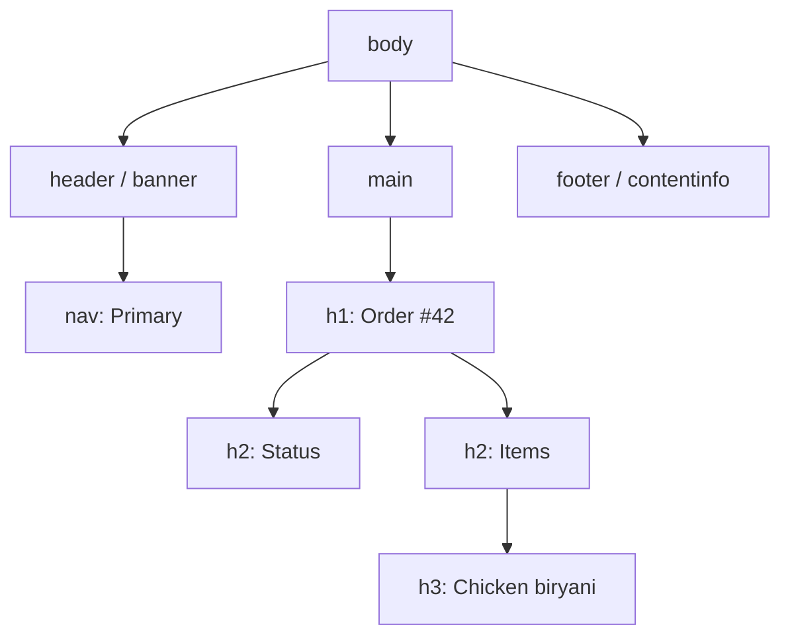

# Semantic HTML, Forms and the Document Outline

HTML is easy to write badly. A page built entirely from `<div>` elements looks fine to a sighted mouse user, but it is invisible to screen readers, hard for search engines to understand, and needs extra JavaScript to do what the browser would have done for free. Semantic HTML means choosing the element that describes *what something is*. It is the cheapest accessibility, SEO and maintainability win in frontend work.

## 1. What "semantic" buys you

Compare two versions of the same button:

```html
<!-- Looks like a button. Isn't one. -->
<div class="btn" onclick="save()">Save</div>

<!-- Is a button. -->
<button type="button" onclick="save()">Save</button>
```

The `<button>` gets all of this with no extra code:

- It is focusable with Tab and activates with Enter and Space.
- Screen readers announce it as "Save, button."
- It supports `disabled` properly, and it is skipped in the tab order when disabled.
- Inside a form, `type="submit"` submits it, and Enter in a text field triggers it.

Recreating that on a `<div>` needs `tabindex="0"`, `role="button"`, key handlers for Enter and Space, and `aria-disabled` handling, and teams usually forget at least one of them.

## 2. The page skeleton

```html
<!doctype html>
<html lang="en">
<head>
  <meta charset="utf-8" />
  <meta name="viewport" content="width=device-width, initial-scale=1" />
  <title>Order #42 · QuickFood</title>
  <meta name="description" content="Track your QuickFood order in real time." />
</head>
<body>
  <a class="skip-link" href="#main">Skip to content</a>
  <header>
    <nav aria-label="Primary">
      <ul>
        <li><a href="/" aria-current="page">Home</a></li>
        <li><a href="/orders">Orders</a></li>
      </ul>
    </nav>
  </header>

  <main id="main">
    <h1>Order #42</h1>
    <article>
      <h2>Status</h2>
      <p>Your rider is 6 minutes away.</p>
    </article>
    <aside aria-label="Help">
      <h2>Need help?</h2>
    </aside>
  </main>

  <footer><small>© 2026 QuickFood</small></footer>
</body>
</html>
```

Each element has a job:

| Element | Meaning | Assistive-tech benefit |
|---|---|---|
| `<header>`, `<footer>` | Page or section banner and info | Landmarks users can jump to |
| `<nav>` | A block of navigation links | "Navigation" landmark; label several with `aria-label` |
| `<main>` | The unique main content, once per page | The target of "skip to main content" |
| `<article>` | Self-contained content (a post, a product card) | Can be read or shared on its own |
| `<section>` | A thematic group, ideally with a heading | Part of the outline |
| `<aside>` | Tangential content | "Complementary" landmark |

Screen-reader users navigate by **landmarks** and **headings** the way sighted users skim. Keep exactly one `<h1>` per page and don't skip levels (h2 → h4) just to get a smaller font. Style with CSS instead.

## 3. The landmark and heading outline



Open the browser's Accessibility panel (Chrome DevTools → Elements → Accessibility tree) and you will see this exact tree. If yours is a flat list of "generic" nodes, the page is unusable without a mouse.

## 4. Links vs buttons

A rule that removes most confusion:

- **A link (`<a href>`) goes somewhere.** It changes the URL, can open in a new tab, and can be bookmarked.
- **A button (`<button>`) does something.** It submits, opens a dialog, toggles or deletes.

`<a href="#" onclick="...">` is a bug, because it pollutes history and breaks middle-click. `<button onclick="location.href=...">` is also a bug, because it can't be opened in a new tab.

## 5. Forms that work for everyone

Forms are where semantic HTML pays off most:

```html
<form action="/checkout" method="post" novalidate>
  <fieldset>
    <legend>Delivery details</legend>

    <label for="name">Full name</label>
    <input id="name" name="name" autocomplete="name" required />

    <label for="phone">Phone</label>
    <input id="phone" name="phone" type="tel" autocomplete="tel" inputmode="tel"
           aria-describedby="phone-hint phone-error" required />
    <p id="phone-hint" class="hint">We'll call if the rider can't find you.</p>
    <p id="phone-error" class="error" role="alert" hidden>Enter a valid phone number.</p>

    <label for="address">Address</label>
    <textarea id="address" name="address" autocomplete="street-address" rows="3" required></textarea>
  </fieldset>

  <fieldset>
    <legend>Payment</legend>
    <label><input type="radio" name="pay" value="cod" checked /> Cash on delivery</label>
    <label><input type="radio" name="pay" value="card" /> Card</label>
  </fieldset>

  <button type="submit">Place order</button>
</form>
```

Why each piece matters:

- **`<label for>`** makes the label clickable, which doubles the tap target, and names the field for screen readers. A placeholder is *not* a label, because it disappears as soon as you type.
- **`type` and `inputmode`** open the right mobile keyboard: number pad for `tel`, `@` key for `email`.
- **`autocomplete`** lets browsers fill name, address and card details. This is one of the biggest real-world conversion boosts for checkout forms.
- **`fieldset` + `legend`** group related controls, so a screen reader announces "Payment, Cash on delivery, radio button, 1 of 2."
- **`aria-describedby`** connects hints and errors to the field, so they are read when the field gets focus.

### Validation that helps instead of punishing

```js
const form = document.querySelector('form');
form.addEventListener('submit', (e) => {
  const phone = form.elements.phone;
  const ok = /^\+?[0-9\s-]{8,15}$/.test(phone.value);
  const error = document.getElementById('phone-error');
  phone.setAttribute('aria-invalid', String(!ok));
  error.hidden = ok;
  if (!ok) {
    e.preventDefault();
    phone.focus();               // move focus to the first problem
  }
});
```

Validate on submit and on blur, not on every keystroke. Show the error next to the field in text, not only as a red border, because colour alone fails for colour-blind users. Always validate again on the server, since client checks are only for convenience.

## 6. Images, media and tables

```html
<!-- Informative image: describe its purpose, not its pixels -->


<!-- Decorative image: empty alt so it's skipped -->


<!-- Responsive, modern formats, no layout shift -->
<picture>
  <source srcset="/img/biryani.avif" type="image/avif" />
  <source srcset="/img/biryani.webp" type="image/webp" />
  
</picture>
```

`width` and `height` let the browser reserve space before the image loads, which prevents layout shift (CLS). Use `loading="lazy"` for images below the fold and never for the hero image.

Tables are for **tabular data**, not layout. Use `<th scope="col">` so screen readers can announce "Price, 250" when moving through cells, and add a `<caption>`.

## 7. Native elements that replace JavaScript

Modern HTML has interactive elements that used to need libraries:

```html
<!-- Accordion with no JavaScript, keyboard accessible -->
<details>
  <summary>Refund policy</summary>
  <p>Full refund if the order is cancelled before the restaurant accepts it.</p>
</details>

<!-- Modal dialog with focus trapping and Esc handling built in -->
<dialog id="confirm">
  <form method="dialog">
    <p>Cancel this order?</p>
    <button value="no">Keep it</button>
    <button value="yes">Cancel order</button>
  </form>
</dialog>
<script>
  document.getElementById('confirm').showModal();
</script>
```

`<dialog>` with `showModal()` traps focus, closes on Esc, renders above everything else and makes the rest of the page inert. That is hundreds of lines of a typical modal library replaced by the platform.

## 8. Real-world case: an accessibility audit of a checkout

A team runs Lighthouse and axe on their checkout and finds four issues:

1. Inputs use placeholders instead of labels. **Fix:** visible `<label>`s.
2. The "Pay" control is a `<div>`, so keyboard users can't pay. **Fix:** `<button type="submit">`.
3. Errors are only shown as red borders. **Fix:** a text error with `aria-describedby` and `aria-invalid`.
4. The coupon modal doesn't trap focus. **Fix:** switch to `<dialog>`.

Completed checkouts went up after the fixes. Autofill and correct mobile keyboards helped *everyone*, not just users with disabilities. That is the usual outcome.

## 9. Hands-on exercise

1. Take any page you've built and open the accessibility tree in DevTools. Count the "generic" nodes.
2. Replace layout `<div>`s with landmarks and fix the heading order.
3. Navigate the whole page with only the keyboard (Tab, Shift+Tab, Enter, Space, Esc). Note every place you get stuck.
4. Rebuild one custom modal as a `<dialog>` and one accordion as `<details>`.
5. Run axe DevTools or Lighthouse and get the accessibility score above 95.

## 10. Checklist

- [ ] I use landmarks, one h1 and a logical heading order.
- [ ] I know when to use a link and when to use a button.
- [ ] My form fields have labels, correct types, `autocomplete` and accessible errors.
- [ ] My images have meaningful or empty `alt` and explicit dimensions.
- [ ] I reach for `<dialog>` and `<details>` before a JavaScript library.

## 11. Interview angle

> **Asked as:** "What is semantic HTML and why does it matter?"

It means choosing elements by meaning. You get keyboard behaviour, screen-reader roles and names, SEO signals and less JavaScript for free. Give the div-versus-button example.

> **Asked as:** "How do you make a form accessible?"

Use labels tied to inputs, fieldsets with legends for groups, correct input types and `autocomplete`, errors in text linked with `aria-describedby`, focus moved to the first error, and server-side validation.
