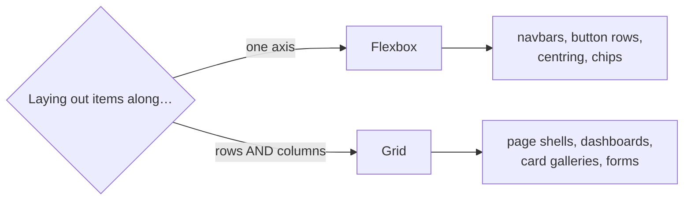

# Modern CSS: Layout, Responsive Design and Architecture

CSS fails in two ways. In small projects it's "I can't centre this." In large projects it's "I changed a margin and broke three pages I've never seen." This guide covers the layout tools that solve the first problem (the box model, Flexbox, Grid, responsive techniques) and the architectural habits that solve the second (scoping, design tokens, utility-first CSS and the cascade layers that tame specificity).

## 1. The box model and the one line you always want

Every element is a box: content, then padding, then border, then margin. By default, `width` applies to the content only, so `width: 300px; padding: 20px` produces a 340 px box. Almost every codebase starts with:

```css
*, *::before, *::after { box-sizing: border-box; }
```

Now `width` includes padding and border, which matches how designers think.

**Margin collapse** surprises everyone once. Vertical margins between adjacent blocks merge into the larger of the two instead of adding together. Margins never collapse inside Flexbox or Grid containers, which is one more reason to lay things out with them and use `gap`.

## 2. Flexbox: one dimension

Use Flexbox when items flow along **one axis**: a navbar, a row of buttons, a card's header, or vertically centring something.

```css
.toolbar {
  display: flex;
  align-items: center;        /* cross axis: vertical centring */
  justify-content: space-between; /* main axis: spread out */
  gap: 12px;                  /* spacing without margins */
  flex-wrap: wrap;            /* wrap on narrow screens instead of overflowing */
}
.toolbar .search { flex: 1 1 240px; }  /* grow, shrink, start at 240px */
.toolbar .actions { margin-left: auto; } /* push to the far end */
```

`flex: 1 1 240px` is shorthand for `flex-grow`, `flex-shrink` and `flex-basis`. Read it as "start at 240 px, take a share of spare space, shrink if needed." One gotcha: flex items have `min-width: auto`, so a long URL or code block can refuse to shrink and overflow the page. Add `min-width: 0` to the item.

## 3. Grid: two dimensions

Use Grid when you control **rows and columns together**: page layouts, dashboards, image galleries and card grids.

```css
/* Responsive card grid with zero media queries */
.cards {
  display: grid;
  grid-template-columns: repeat(auto-fill, minmax(min(100%, 260px), 1fr));
  gap: 16px;
}

/* Named page layout */
.page {
  display: grid;
  grid-template-columns: 240px 1fr;
  grid-template-rows: auto 1fr auto;
  grid-template-areas:
    "side header"
    "side main"
    "side footer";
  min-height: 100dvh;
}
.page > header { grid-area: header; }
.page > aside  { grid-area: side; }
.page > main   { grid-area: main; }

@media (max-width: 768px) {
  .page {
    grid-template-columns: 1fr;
    grid-template-areas: "header" "main" "footer";
  }
  .page > aside { display: none; }   /* becomes a drawer on mobile */
}
```

The `repeat(auto-fill, minmax(min(100%, 260px), 1fr))` line is worth memorising. It packs as many columns of at least 260 px as fit, stretches them to fill the row, and the `min(100%, …)` stops overflow on very small screens.



## 4. Responsive design without a pile of breakpoints

Modern CSS lets components adapt fluidly:

```css
/* Fluid type: 16px on phones, growing to 20px on wide screens */
html { font-size: clamp(1rem, 0.9rem + 0.4vw, 1.25rem); }

/* Fluid spacing */
.section { padding-block: clamp(24px, 5vw, 64px); }

/* Use dynamic viewport units on mobile so browser toolbars don't cut content */
.hero { min-height: 100dvh; }
```

**Container queries** let a component respond to the space *it* has, not the whole viewport. The same product card can then sit in a narrow sidebar or a wide grid:

```css
.card-wrap { container-type: inline-size; }

.product-card { display: grid; gap: 8px; }
@container (min-width: 420px) {
  .product-card { grid-template-columns: 140px 1fr; }  /* image beside text when there's room */
}
```

Design **mobile-first**: write the base styles for small screens, then add `min-width` queries for larger ones. Phones get the least CSS, and the layout grows instead of being squeezed.

## 5. The cascade, specificity and `@layer`

When two rules target the same element, the browser decides by **origin and importance**, then **cascade layer**, then **specificity**, then **source order**. Specificity is scored as (ids, classes/attributes/pseudo-classes, elements):

| Selector | Specificity |
|---|---|
| `button` | 0,0,1 |
| `.btn` | 0,1,0 |
| `.card .btn:hover` | 0,3,0 |
| `#checkout .btn` | 1,1,0 |

Specificity wars, where someone adds an id or `!important` to beat a rule and then someone else does the same, are the main way CSS rots. **Cascade layers** fix this by letting you declare which group of styles wins, regardless of specificity:

```css
@layer reset, base, components, utilities;

@layer reset { *, *::before, *::after { box-sizing: border-box; margin: 0; } }
@layer base { a { color: var(--link); } }
@layer components { .btn { padding: 8px 14px; border-radius: 8px; } }
@layer utilities { .mt-0 { margin-top: 0; } }  /* always beats components, even with lower specificity */
```

Third-party CSS can go in its own low-priority layer, so your component styles override it without heavier selectors.

## 6. Design tokens with custom properties

Hard-coded colours and spacing scattered across 200 files make theming and dark mode painful. Centralise them as **tokens**:

```css
:root {
  --color-bg: #ffffff;
  --color-text: #0f172a;
  --color-accent: #7c3aed;
  --radius: 10px;
  --space-1: 4px; --space-2: 8px; --space-3: 12px; --space-4: 16px;
}
[data-theme="dark"] {
  --color-bg: #0b1020;
  --color-text: #e2e8f0;
}
.btn-primary {
  background: var(--color-accent);
  color: white;
  border-radius: var(--radius);
  padding: var(--space-2) var(--space-4);
}
```

Dark mode becomes a single attribute switch, and a rebrand is a change in one file. Custom properties are live at runtime, so JavaScript can set them (`el.style.setProperty('--progress', '40%')`) to drive animations.

## 7. Architecture options for large codebases

| Approach | Idea | Trade-off |
|---|---|---|
| BEM naming | `.card__title--large`: flat, predictable class names | Verbose, relies on discipline |
| CSS Modules | Class names are scoped per component file at build time | Needs a build step |
| Utility-first (Tailwind) | Compose small single-purpose classes in markup | Busy markup, but very consistent and nothing goes unused |
| CSS-in-JS | Styles written in JS, scoped automatically | Runtime cost for some libraries; zero-runtime ones avoid it |

What they share is **scoping**: a change in one component can't leak into another. Pick one per project and be consistent. A Tailwind example of the same card:

```html
<article class="grid gap-2 rounded-xl border border-slate-200 p-4 @container">
  <h3 class="text-lg font-semibold text-slate-900">Chicken biryani</h3>
  <p class="text-sm text-slate-600">Fragrant basmati, slow-cooked chicken.</p>
  <button class="mt-2 rounded-lg bg-violet-600 px-4 py-2 text-white hover:bg-violet-700">Add · ৳250</button>
</article>
```

## 8. Real-world case: fixing a "sticky footer and overflowing table" layout

A dashboard has three bugs. On short pages the footer floats mid-screen. On phones a wide table pushes the whole page sideways. In the sidebar layout, long email addresses break the grid.

- **Footer:** make the shell a grid with `grid-template-rows: auto 1fr auto; min-height: 100dvh`.
- **Table:** wrap it in `.table-wrap { overflow-x: auto; }` so only the table scrolls.
- **Long text:** add `min-width: 0` on the grid or flex child and `overflow-wrap: anywhere` on the text.

That's three lines of CSS each, and no JavaScript or magic numbers.

## 9. Hands-on exercise

1. Build a page shell with Grid areas (header, sidebar, main, footer) that collapses to one column under 768 px.
2. Make a card grid with the `auto-fill/minmax` pattern and no media queries.
3. Add a container query so the card shows the image beside the text when it is wider than 420 px.
4. Move all colours into tokens and add a dark theme switched by `data-theme`.
5. Wrap your styles in `@layer` and prove a utility class beats a component rule without `!important`.

## 10. Checklist

- [ ] I can choose between Flexbox and Grid and explain why.
- [ ] I can build responsive layouts with `clamp()`, `auto-fill/minmax` and container queries.
- [ ] I understand specificity and use `@layer` instead of `!important`.
- [ ] I keep colours and spacing in design tokens and support dark mode.
- [ ] I can explain BEM, CSS Modules and utility-first CSS and pick one.

## 11. Interview angle

> **Asked as:** "Flexbox or Grid?"

Flexbox for one-dimensional flow where content sizes drive the layout. Grid for two-dimensional layouts where you define the tracks. They combine well: a Grid page shell with Flexbox inside components.

> **Asked as:** "How do you keep CSS maintainable in a large app?"

Scoped styles (CSS Modules, utilities or BEM), design tokens, cascade layers to control precedence, a shared component library, and lint rules such as Stylelint.
