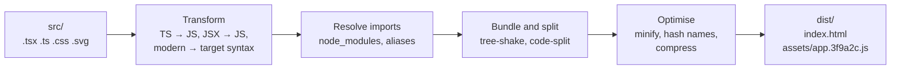

# Build Tools and the Frontend Toolchain

Browsers run HTML, CSS and JavaScript. Modern frontend code is written in TypeScript and JSX, imports packages from npm, and uses syntax older browsers don't understand. The **toolchain** closes that gap: package managers, bundlers, transpilers, linters and formatters. When a build is slow, a bundle is huge, or "it works locally but not in CI," the cause is in this layer.

## 1. What a build actually does



1. **Transform:** compile TypeScript and JSX to plain JavaScript and lower newer syntax for your browser targets.
2. **Resolve:** follow `import` statements into `node_modules` and path aliases.
3. **Bundle:** combine modules into a few files, drop unused exports (**tree-shaking**), and split code into chunks loaded on demand.
4. **Optimise:** minify, add content hashes to filenames (`app.3f9a2c.js`) so they can be cached forever, and generate source maps.

## 2. Package managers and lockfiles

npm, pnpm, Yarn and Bun all install dependencies from `package.json`. The **lockfile** (`package-lock.json`, `pnpm-lock.yaml`) records the *exact* resolved version of every package, including transitive ones.

```json
{
  "dependencies": { "react": "^19.2.0" },
  "devDependencies": { "vite": "^8.1.0", "typescript": "~6.0.2" }
}
```

- `^19.2.0` allows any 19.x version from 19.2.0 up, `~6.0.2` allows 6.0.x only, and an exact version allows just that one.
- **Commit the lockfile**, and use `npm ci` (not `npm install`) in CI. It installs exactly what the lockfile says and fails if the lockfile and `package.json` disagree. This prevents "works on my machine."
- `dependencies` ship with the app, while `devDependencies` are build-time tools. For a frontend bundle this split matters less, but for Node services it keeps production images smaller.
- **pnpm** stores each package version once on disk and links it into projects, so installs are faster and disk use is lower.

## 3. Bundlers and dev servers

| Tool | Notes |
|---|---|
| **Vite** | Default for new SPAs. The dev server serves native ES modules (instant start, fast hot reload) and the production build is fast. |
| **webpack** | The mature, configurable workhorse. Still common in older and enterprise apps. |
| **Turbopack / Rspack** | Rust-based, webpack-compatible, much faster. Used by Next.js and large codebases. |
| **esbuild / Rolldown** | Extremely fast Go/Rust bundlers that sit underneath many tools. |

A minimal Vite config with an alias, a dev proxy for the API and manual chunking:

```ts
// vite.config.ts
import { defineConfig } from 'vite';
import react from '@vitejs/plugin-react';
import path from 'node:path';

export default defineConfig({
  plugins: [react()],
  resolve: { alias: { '@': path.resolve(__dirname, 'src') } },
  server: {
    proxy: { '/api': 'http://localhost:8000' },   // no CORS headaches in development
  },
  build: {
    sourcemap: true,
    rollupOptions: {
      output: { manualChunks: { charts: ['recharts'] } }, // heavy library in its own cached chunk
    },
  },
});
```

The dev proxy is a real productivity win. The frontend calls `/api/orders`, Vite forwards it to the backend, and the browser sees a single origin, exactly as in production behind Nginx.

## 4. Code splitting: ship less JavaScript

The JavaScript a page doesn't need shouldn't be downloaded. Split by **route** and by **heavy feature**:

```tsx
import { lazy, Suspense } from 'react';

const AdminDashboard = lazy(() => import('./pages/AdminDashboard'));   // separate chunk
const MapView = lazy(() => import('./components/MapView'));            // maps are heavy

export function App() {
  return (
    <Suspense fallback={<Spinner />}>
      <Routes>
        <Route path="/admin" element={<AdminDashboard />} />
        <Route path="/track/:id" element={<MapView />} />
      </Routes>
    </Suspense>
  );
}
```

To see what's actually in your bundle, run `npx vite-bundle-visualizer` (or `webpack-bundle-analyzer`). Common findings are an entire icon library pulled in for three icons, `moment.js` with every locale, or a charting library loaded on the login page.

## 5. TypeScript in the pipeline

Bundlers usually *strip* types without checking them, which keeps them fast. Type checking is a separate step:

```json
{
  "scripts": {
    "dev": "vite",
    "typecheck": "tsc --noEmit",
    "build": "tsc -b && vite build",
    "lint": "eslint .",
    "format": "prettier --write ."
  }
}
```

That's why a dev server can run happily with type errors, and why CI must run `tsc` explicitly. Turn on `"strict": true` from day one. Turning it on later in a large codebase is a project in itself.

## 6. Linters and formatters

- A **formatter** (Prettier, Biome) decides *how code looks*: quotes, semicolons, line breaks. Nobody argues about style in code review again.
- A **linter** (ESLint, Oxlint, Biome) finds *probable bugs*: unused variables, missing hook dependencies, `==` vs `===`, unhandled promises, accessibility problems in JSX.

```js
// eslint.config.js (flat config)
import js from '@eslint/js';
import tseslint from 'typescript-eslint';
import reactHooks from 'eslint-plugin-react-hooks';
import jsxA11y from 'eslint-plugin-jsx-a11y';

export default [
  js.configs.recommended,
  ...tseslint.configs.recommended,
  { plugins: { 'react-hooks': reactHooks, 'jsx-a11y': jsxA11y },
    rules: {
      'react-hooks/rules-of-hooks': 'error',
      'react-hooks/exhaustive-deps': 'warn',
      'jsx-a11y/alt-text': 'error',
    } },
];
```

Run them automatically. Use a pre-commit hook on changed files (Husky with lint-staged, or lefthook), and make the same checks a required step in CI.

## 7. Environment variables and builds

Frontend "environment variables" are **baked into the bundle at build time** and are publicly visible to anyone who opens DevTools.

```ts
// Only VITE_-prefixed variables are exposed to client code
const api = import.meta.env.VITE_API_URL;
```

Never put secrets such as API keys with write access, database URLs or private tokens in frontend env vars. If the browser needs to call a paid API, call it through your backend. A related trap is that changing an env var requires a **rebuild and redeploy**, not just a restart.

## 8. Real-world case: a 4 MB bundle and a 9-second load on 3G

An admin-heavy React app loads slowly for customers on phones. The bundle visualiser shows four problems:

1. The admin dashboard, charts and a rich-text editor are all in the main chunk. **Fix:** lazy-load routes, which removed about 1.8 MB from the customer path.
2. A date library ships every locale. **Fix:** switch to `date-fns` with per-function imports.
3. An icon library is imported as `import * as Icons`. **Fix:** use named imports so tree-shaking works.
4. Source maps were deployed publicly and also inflated the CDN cache. **Fix:** upload them to the error tracker only.

The initial JavaScript dropped from 4 MB to 420 KB, and load time on mid-range phones fell below 3 seconds.

## 9. Hands-on exercise

1. Create a Vite + React + TypeScript app and add ESLint, Prettier and a `typecheck` script.
2. Add a pre-commit hook that lints and formats staged files.
3. Add a heavy dependency (a chart library), run the bundle visualiser, then lazy-load it and compare chunk sizes.
4. Configure the dev proxy for `/api` and call a local backend without CORS.
5. Write a GitHub Actions job: `npm ci`, `typecheck`, `lint`, `test`, `build`.

## 10. Checklist

- [ ] I can explain transform, resolve, bundle and optimise, and what content hashing is for.
- [ ] I commit lockfiles and use `npm ci` in CI.
- [ ] I code-split by route and inspect bundles with a visualiser.
- [ ] I run type checking, linting and formatting automatically.
- [ ] I know frontend env vars are public and need a rebuild to change.

## 11. Interview angle

> **Asked as:** "Why is Vite's dev server faster than webpack's?"

It serves source files as native ES modules and transforms them on demand, so there's no up-front bundle. Dependencies are pre-bundled once with a fast native tool, and hot reload updates only the changed module.

> **Asked as:** "How would you reduce bundle size?"

Measure with a visualiser, code-split routes and heavy features, fix imports that block tree-shaking, replace heavy libraries, set modern browser targets, and compress with brotli at the edge.
