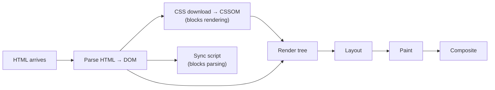

# Web Performance, Core Web Vitals and Progressive Web Apps

Speed is a feature users notice even when they can't name it. Slow pages lose visitors, conversions and search ranking, since Google uses Core Web Vitals as a ranking signal. This guide covers what to measure, the techniques that actually move the numbers, and how Progressive Web Apps (PWAs) make a site installable, offline-capable and app-like.

## 1. The metrics that matter: Core Web Vitals

| Metric | Measures | "Good" threshold | Common culprits |
|---|---|---|---|
| **LCP**, Largest Contentful Paint | When the main content (hero image, headline) appears | ≤ 2.5 s | Slow server, render-blocking CSS/JS, unoptimised hero image |
| **INP**, Interaction to Next Paint | How quickly the page responds to taps, clicks and keys | ≤ 200 ms | Long JavaScript tasks, heavy re-renders, third-party scripts |
| **CLS**, Cumulative Layout Shift | How much the layout jumps while loading | ≤ 0.1 | Images without dimensions, late-loading ads and banners, web-font swaps |

Supporting metrics: **TTFB** (time to first byte, which reflects server and network) and **FCP** (first contentful paint).

There are two kinds of data:

- **Lab data** comes from Lighthouse or WebPageTest: repeatable and good for debugging.
- **Field data (RUM)** comes from real users through the Chrome UX Report or your own `web-vitals` reporting. This is what Google ranks on and what users actually experience.

```js
// Send real-user vitals to your analytics endpoint
import { onLCP, onINP, onCLS } from 'web-vitals';

const send = (metric) =>
  navigator.sendBeacon('/api/vitals', JSON.stringify({ name: metric.name, value: metric.value, page: location.pathname }));

onLCP(send);
onINP(send);
onCLS(send);
```

## 2. The critical rendering path



The browser can't paint until it has the HTML and CSS. Synchronous scripts in `<head>` stop parsing altogether. Most early-loading wins come from getting this path out of the way:

```html
<head>
  <!-- Start fetching critical things early -->
  <link rel="preconnect" href="https://cdn.example.com" />
  <link rel="preload" as="image" href="/img/hero.avif" fetchpriority="high" />
  <link rel="preload" as="font" href="/fonts/inter.woff2" type="font/woff2" crossorigin />

  <!-- Small critical CSS inline, the rest loaded normally -->
  <style>/* above-the-fold styles */</style>
  <link rel="stylesheet" href="/assets/app.css" />

  <!-- Never block parsing with scripts -->
  <script type="module" src="/assets/app.js"></script>   <!-- modules are deferred by default -->
  <script src="https://analytics.example.com/a.js" async></script>
</head>
```

## 3. Fixing LCP

1. **Fast server response.** Cache HTML at a CDN where possible, and use SSR/SSG for content pages instead of rendering everything client-side after a JavaScript download.
2. **Prioritise the hero.** Use `fetchpriority="high"`, never lazy-load it, and serve modern formats (AVIF/WebP) at the right size with `srcset`.
3. **Don't hide content behind JavaScript.** If the headline only appears after React hydrates and fetches data, LCP waits for all of that.

```html

```

## 4. Fixing INP: keep the main thread free

The browser's main thread runs JavaScript, layout and painting. A 300 ms task means any tap during it waits up to 300 ms for a response. Find long tasks in the DevTools Performance panel (the red-flagged blocks), then:

```js
// Break long work into chunks and yield to the browser between them
async function processItems(items) {
  for (let i = 0; i < items.length; i++) {
    heavyWork(items[i]);
    if (i % 50 === 0) await scheduler.yield?.() ?? new Promise((r) => setTimeout(r));
  }
}
```

```tsx
// React: keep typing responsive while a big list filters
const [query, setQuery] = useState('');
const deferred = useDeferredValue(query);
const results = useMemo(() => filterMenu(items, deferred), [items, deferred]);
```

Other big wins:

- Audit third-party scripts (chat widgets, tag managers, A/B tools). They are often the biggest INP offender, so load them later or remove them.
- Virtualise long lists, rendering only the visible rows.
- Move CPU-heavy work (parsing, image processing) to a **Web Worker**.

## 5. Fixing CLS

- Always set `width`/`height` or `aspect-ratio` on images, videos and embeds.
- Reserve space for anything injected later, such as cookie banners, ads and "download our app" bars.
- For fonts, use `font-display: swap` with a fallback whose metrics are adjusted (`size-adjust`) so text doesn't reflow when the web font arrives.
- Animate with `transform` and `opacity` only, never with `top` or `height`, which trigger layout.

## 6. Caching strategy

```text
index.html                 Cache-Control: no-cache          (always revalidate; small)
/assets/app.3f9a2c.js      Cache-Control: public, max-age=31536000, immutable
/api/menu                  Cache-Control: public, max-age=60, stale-while-revalidate=300
/api/me                    Cache-Control: private, no-store
```

Hashed filenames change whenever their content changes, so they can be cached for a year. `index.html` must always be revalidated, because it points at the current hashes. `stale-while-revalidate` returns a cached copy instantly while fetching a fresh one in the background.

## 7. Progressive Web Apps

A PWA is a website with three additions:

1. **HTTPS.**
2. A **web app manifest**, which makes it installable with an icon, name, theme colour and full-screen display.
3. A **service worker**, a script that sits between your page and the network and can cache responses, work offline and receive push notifications.

```json
{
  "name": "QuickFood",
  "short_name": "QuickFood",
  "start_url": "/",
  "display": "standalone",
  "background_color": "#ffffff",
  "theme_color": "#f97316",
  "icons": [
    { "src": "/icons/192.png", "sizes": "192x192", "type": "image/png" },
    { "src": "/icons/512.png", "sizes": "512x512", "type": "image/png", "purpose": "any maskable" }
  ]
}
```

```js
// sw.js: cache the app shell, network-first for API, cache-first for images
const SHELL = 'shell-v3';
self.addEventListener('install', (e) => {
  e.waitUntil(caches.open(SHELL).then((c) => c.addAll(['/', '/offline.html', '/assets/app.css'])));
});

self.addEventListener('fetch', (e) => {
  const url = new URL(e.request.url);
  if (url.pathname.startsWith('/api/')) {
    // Network first, fall back to the last good response when offline
    e.respondWith(
      fetch(e.request)
        .then((res) => { const copy = res.clone(); caches.open('api').then((c) => c.put(e.request, copy)); return res; })
        .catch(() => caches.match(e.request)),
    );
  } else if (e.request.destination === 'image') {
    e.respondWith(caches.match(e.request).then((hit) => hit ?? fetch(e.request)));
  } else if (e.request.mode === 'navigate') {
    e.respondWith(fetch(e.request).catch(() => caches.match('/offline.html')));
  }
});
```

| Strategy | Use for |
|---|---|
| Cache first | Hashed static assets, images, fonts |
| Network first | API data that should be fresh but useful offline |
| Stale-while-revalidate | Menus, avatars, content that can be slightly old |
| Network only | Payments, auth, anything that must never be stale |

In practice, use **Workbox** (or `vite-plugin-pwa`) instead of hand-writing cache-versioning logic. The classic PWA bug is users stuck on an old version because the service worker served stale `index.html`. Handle updates explicitly by showing "A new version is available. Reload?"

## 8. Real-world case: a restaurant menu page

A delivery site's menu page has an LCP of 4.8 s on mid-range Android phones. The fixes:

- The page was client-rendered and waited for JavaScript plus an API call. **Fix:** server-render the menu HTML and cache it at the CDN for 60 s.
- The hero was a 1.2 MB JPEG. **Fix:** a 90 KB AVIF with `srcset` and `fetchpriority="high"`.
- A chat widget loaded 400 KB of JavaScript up front. **Fix:** load it on first interaction.
- A promo banner pushed content down. **Fix:** reserve its height.

LCP dropped to 1.9 s, CLS to 0.02 and INP to 120 ms, and add-to-cart rate improved noticeably.

## 9. Hands-on exercise

1. Run Lighthouse (mobile profile) on a project and record LCP, INP/TBT and CLS.
2. Fix one issue per metric and re-measure.
3. Add `web-vitals` reporting to a logging endpoint and check the numbers after a day.
4. Turn the app into a PWA with `vite-plugin-pwa`. Make it installable and show an offline page.
5. Add an "update available" prompt when a new service worker is waiting.

## 10. Checklist

- [ ] I can define LCP, INP and CLS and name the usual cause of each.
- [ ] I know the difference between lab and field data and collect field data.
- [ ] I can optimise the critical rendering path with preload, preconnect, defer and async.
- [ ] I can set correct Cache-Control headers for HTML, hashed assets and API responses.
- [ ] I can build a PWA with a manifest and a service worker, and handle updates safely.

## 11. Interview angle

> **Asked as:** "A page is slow. Where do you start?"

Measure first with field data and Lighthouse, then identify which metric is bad. LCP means server, render-blocking resources or the hero image. INP means long tasks and third-party scripts. CLS means missing dimensions and injected content. Fix the biggest contributor and measure again.

> **Asked as:** "What is a service worker?"

It's a background script that intercepts network requests for its scope. It enables offline caching, background sync and push notifications, and it needs HTTPS. It's powerful, but versioning and updates must be handled carefully.
