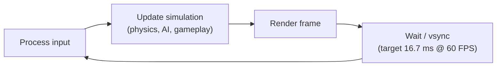
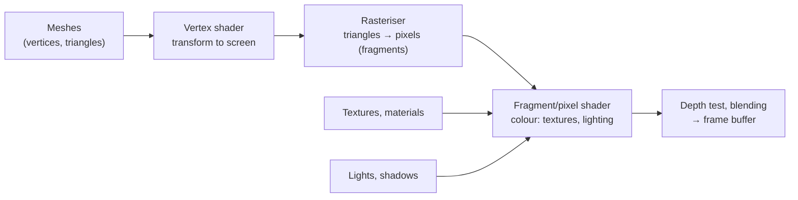

# Game Development Foundations: The Game Loop, Math and Rendering

Games are real-time simulations that must read input, update a world and draw it 60 or more times per second, every second, on hardware ranging from budget phones to high-end PCs. Whether you use **Unity**, **Godot** or **Unreal Engine**, or write your own engine, the same foundations apply. This guide covers the game loop and timing, the vector and matrix math games run on, how rendering works, and how engines organise game objects, with examples in C# (Unity) and GDScript (Godot).

## 1. Choosing an engine

| Engine | Language | Strengths | Typical use |
|---|---|---|---|
| **Unity 6** | C# | Huge ecosystem, strong mobile and cross-platform support, many learning resources | Mobile, indie, 2D/3D, AR/VR |
| **Godot 4** | GDScript (Python-like), C#, C++ | Free and open source (MIT), lightweight, excellent 2D, fast iteration | Indie, 2D, learning, small 3D projects |
| **Unreal Engine 5** | C++, Blueprints (visual) | High-end 3D graphics (Nanite, Lumen), AAA tooling | High-fidelity 3D, console/PC, film |
| Custom or framework (raylib, MonoGame, Bevy) | C, C#, Rust | Full control, deep learning experience | Specialised games, learning engine internals |

Pick based on the game you want to make and the platform. For a first project, a small 2D game in Godot or Unity teaches more than an ambitious 3D one.

## 2. The game loop



### Delta time

Frames take different amounts of time. If you move a character 5 pixels per frame, it runs twice as fast at 120 FPS as at 60. Scale movement by **delta time** (the seconds since the last frame):

```csharp
// Unity (C#)
public class PlayerMovement : MonoBehaviour
{
    [SerializeField] float speed = 5f;                       // units per second, tweakable in the editor

    void Update()
    {
        Vector2 input = new(Input.GetAxisRaw("Horizontal"), Input.GetAxisRaw("Vertical"));
        Vector3 dir = new Vector3(input.x, 0, input.y).normalized;   // normalised: diagonal isn't faster
        transform.position += dir * speed * Time.deltaTime;
    }
}
```

```gdscript
# Godot 4 (GDScript)
extends CharacterBody2D
@export var speed := 220.0

func _physics_process(delta: float) -> void:
    var dir := Input.get_vector("left", "right", "up", "down")   # already normalised
    velocity = dir * speed
    move_and_slide()                                            # applies velocity * delta, handles collisions
```

### Fixed timestep for physics

Physics and networked simulations need a **fixed timestep** (for example 50 or 60 Hz) to be stable and deterministic. Rendering runs as fast as it can and *interpolates* between physics states:

```csharp
const double Dt = 1.0 / 60.0;
double accumulator = 0, previous = Now();
while (running) {
    double now = Now(); accumulator += Math.Min(now - previous, 0.25); previous = now;   // clamp to avoid a "spiral of death"
    ProcessInput();
    while (accumulator >= Dt) { PreviousState = State; State = Simulate(State, Dt); accumulator -= Dt; }
    double alpha = accumulator / Dt;
    Render(Lerp(PreviousState, State, alpha));                                           // smooth visuals at any FPS
}
```

Engines do this for you: Unity's `FixedUpdate` and Godot's `_physics_process` run at a fixed rate, while `Update` and `_process` run every rendered frame.

## 3. The math games run on

### Vectors

A vector represents a position, direction or velocity.

| Operation | Use in games |
|---|---|
| Addition | Move: `position + velocity * dt` |
| Length / magnitude | Distance between objects, speed |
| Normalise | Direction with length 1 (consistent speed) |
| **Dot product** | Is the enemy in front of me? Angle between directions, lighting intensity |
| **Cross product** (3D) | Surface normals, which side something is on, torque |
| Lerp | Smooth movement and animation between values |

```csharp
// Can the guard see the player? (within 60° field of view and 12 m range)
Vector3 toPlayer = player.position - guard.position;
bool inRange = toPlayer.sqrMagnitude < 12f * 12f;                       // compare squared lengths: no square root
bool inFront = Vector3.Dot(guard.forward, toPlayer.normalized) > Mathf.Cos(30f * Mathf.Deg2Rad);
bool canSee = inRange && inFront && !Physics.Linecast(guard.eyes.position, player.position, wallsMask);
```

### Transforms and matrices

Every object has a **transform**: position, rotation and scale, usually relative to its parent (a hierarchy: a sword attached to a hand attached to an arm). Engines combine these into 4×4 matrices: **model** (object to world), **view** (world to camera) and **projection** (camera to screen). You rarely multiply matrices by hand, but understanding *local vs world space* prevents many bugs ("why does my child object fly away when the parent rotates?").

### Rotations and quaternions

Euler angles (pitch, yaw, roll) are intuitive but suffer from **gimbal lock** and interpolate badly. Engines store rotations as **quaternions**, which compose and interpolate smoothly (`Quaternion.Slerp`). Use the engine's helpers (`LookRotation`, `RotateTowards`) rather than editing quaternion components directly.

### Smoothing and easing

```csharp
// Frame-rate-independent smoothing toward a target (camera follow)
float k = 1f - Mathf.Exp(-followSharpness * Time.deltaTime);
cam.position = Vector3.Lerp(cam.position, target.position + offset, k);
```

Easing curves (ease-in, ease-out, elastic) make motion feel natural, and "game feel" depends heavily on them.

## 4. How rendering works



- **Meshes** are made of triangles. **Materials** combine a **shader** (a GPU program) with parameters and **textures**.
- **Draw calls:** each time the CPU asks the GPU to draw something there's overhead. Too many draw calls, not too many triangles, is a common bottleneck on mobile. **Batching**, instancing and texture atlases reduce them.
- **Lighting:** real-time lights are expensive, so **baked lighting** (precomputed lightmaps) is common for static scenes. Physically based rendering (PBR) materials react realistically to light.
- **2D games** render textured quads (sprites). Sprite atlases and sorting layers matter.
- **Render pipelines:** Unity URP (scalable, mobile-friendly) and HDRP (high-end), Godot's Forward+ and Mobile renderers, and Unreal's deferred renderer with Lumen and Nanite.

A simple shader (Godot's shading language) that flashes a sprite white when hit:

```glsl
shader_type canvas_item;
uniform float flash : hint_range(0.0, 1.0) = 0.0;

void fragment() {
    vec4 tex = texture(TEXTURE, UV);
    COLOR = vec4(mix(tex.rgb, vec3(1.0), flash), tex.a);   // blend toward white, keep transparency
}
```

## 5. How engines organise games

- **Unity:** GameObjects with Components (Transform, Renderer, Collider, your MonoBehaviour scripts) in Scenes. **Prefabs** are reusable templates. **ScriptableObjects** hold shared data (weapon stats, level configuration) outside scenes.
- **Godot:** a tree of **nodes** grouped into **scenes**, which can be instanced inside other scenes. **Signals** decouple communication ("health_changed").
- **Entity Component System (ECS):** entities are ids, components are plain data, and systems process all entities with certain components in tight loops. It's very cache-friendly and scales to many objects (Unity DOTS, Bevy, Flecs).

Decoupling with events keeps gameplay code maintainable:

```gdscript
# health.gd
extends Node
signal died
signal health_changed(current: int, max: int)
@export var max_health := 100
var current := max_health

func take_damage(amount: int) -> void:
    current = max(current - amount, 0)
    health_changed.emit(current, max_health)
    if current == 0:
        died.emit()

# The HUD and the enemy each connect to these signals, without knowing about each other.
```

## 6. Input, audio and assets

- **Input:** map *actions* ("jump", "move") to devices (keyboard, gamepad, touch), not hard-coded keys, so players can rebind them and you can support multiple platforms.
- **Audio:** sound effects with variation (random pitch and volume) to avoid repetition, music with crossfades, and audio mixers for categories (music, SFX, voice).
- **Assets:** import settings matter a lot (texture compression format per platform, mesh compression, audio streaming vs in-memory). Use version control with **Git LFS** or Perforce for large binary files.

## 7. Real-world case: "it runs fine on my PC"

An indie team's 2D mobile game ran at 60 FPS on their laptops but at 22 FPS on mid-range Android phones. Profiling with the Unity Profiler and Frame Debugger on a device showed about 900 draw calls (every sprite used a separate texture), real-time 2D lights on every torch, physics `Update` running in `Update` instead of `FixedUpdate` with expensive raycasts, and full-screen particle effects with overdraw. The fixes were sprite atlases (draw calls down to about 60), baked glow sprites instead of real-time lights, physics moved to `FixedUpdate` with fewer raycasts, and lower particle counts and screen coverage on mobile quality settings. It ran at a stable 60 FPS on the target devices and the battery drain halved.

## 8. Hands-on exercise

1. In Godot or Unity, make a top-down character that moves with normalised input and delta time, then confirm the speed is the same at 30 and 144 FPS.
2. Implement a guard field-of-view check with a dot product, range and line-of-sight raycast.
3. Make a camera that follows the player smoothly with frame-rate-independent smoothing.
4. Write a hit-flash shader and trigger it from a damage signal or event.
5. Open the profiler and frame debugger, count the draw calls, and reduce them with an atlas.

## 9. Checklist

- [ ] I can choose an engine for a project and explain the game loop.
- [ ] I use delta time correctly and understand fixed-timestep physics with interpolation.
- [ ] I'm comfortable with vectors, dot and cross products, transforms, local vs world space and quaternions.
- [ ] I understand the rendering pipeline, shaders, draw calls and batching.
- [ ] I organise games with components, nodes, scenes, prefabs and signals or events, and I understand ECS.

## 10. Interview angle

> **Asked as:** "Why multiply movement by delta time?"

Frame durations vary, so per-frame movement makes speed depend on frame rate. Multiplying by delta time makes movement per second consistent. Physics should use a fixed timestep for stability.

> **Asked as:** "How do you check whether an enemy is in front of the player?"

Take the dot product of the player's forward vector and the normalised direction to the enemy. A positive value means in front, and comparing it against the cosine of half the field-of-view angle gives a view cone. Add a distance check and a raycast for line of sight.
