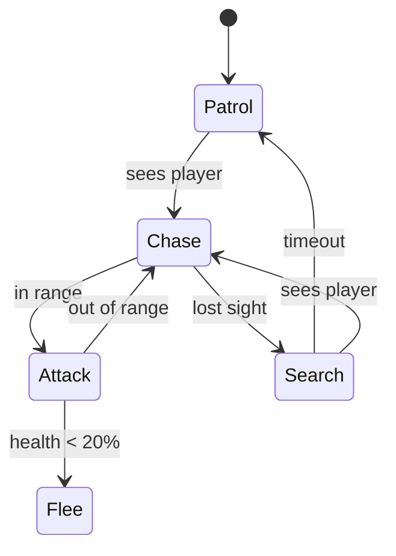

# Gameplay Systems: Physics, AI, Game Design and Optimisation

Once a character moves on screen, the real work begins: collisions that feel right, enemies that behave believably, systems that are fun and tunable, and a game that runs smoothly on the weakest device you support. This guide covers physics and collision, game AI (state machines, behaviour trees, pathfinding), gameplay architecture and game design, plus profiling and shipping.

## 1. Physics and collision

- **Colliders** define shapes for collision (boxes, spheres, capsules, polygons). They're simpler than the visual mesh, which keeps them cheap.
- **Rigidbodies** are simulated by the physics engine (gravity, forces, momentum). **Kinematic** bodies move under script control and push others. **Static** colliders never move.
- **Triggers** detect overlap without a physical response (pickups, damage zones, checkpoints).
- **Layers and collision matrices** decide what collides with what (player bullets ignore the player), which saves both bugs and CPU.
- **Raycasts and shape casts** answer "what's in this direction?" for shooting, ground checks and line of sight.

```csharp
// Unity: reliable ground check + jump with coyote time and jump buffering ("game feel")
public class PlayerJump : MonoBehaviour
{
    [SerializeField] float jumpVelocity = 12f, coyoteTime = 0.1f, bufferTime = 0.12f;
    [SerializeField] LayerMask groundMask;
    Rigidbody2D rb; float lastGrounded = -1f, lastJumpPressed = -1f;

    void Awake() => rb = GetComponent<Rigidbody2D>();

    void Update()
    {
        if (Input.GetButtonDown("Jump")) lastJumpPressed = Time.time;
        bool grounded = Physics2D.BoxCast(transform.position, new Vector2(0.8f, 0.1f), 0, Vector2.down, 0.55f, groundMask);
        if (grounded) lastGrounded = Time.time;

        // Allow a jump shortly after leaving a ledge, or if jump was pressed just before landing
        if (Time.time - lastJumpPressed <= bufferTime && Time.time - lastGrounded <= coyoteTime)
        {
            rb.linearVelocity = new Vector2(rb.linearVelocity.x, jumpVelocity);
            lastJumpPressed = lastGrounded = -1f;
        }
    }
}
```

Small tolerances like **coyote time** and **jump buffering** are invisible to players but make controls feel responsive instead of "unfair."

**Fast objects tunnelling** through thin walls: use continuous collision detection for fast bodies, or raycast bullets instead of simulating them as physical projectiles.

## 2. Game AI

Game AI is about creating *believable, fun* behaviour within a CPU budget, not about being optimal. An enemy that always lands perfect headshots isn't fun.

### Finite state machines



```gdscript
# Godot: simple enemy FSM
enum State { PATROL, CHASE, ATTACK, SEARCH }
var state := State.PATROL

func _physics_process(delta):
    match state:
        State.PATROL:
            follow_waypoints(delta)
            if can_see_player(): change_state(State.CHASE)
        State.CHASE:
            nav_agent.target_position = player.global_position
            move_along_path(delta)
            if in_attack_range(): change_state(State.ATTACK)
            elif not can_see_player(): change_state(State.SEARCH)
        State.ATTACK:
            face(player); try_attack()
            if not in_attack_range(): change_state(State.CHASE)
        State.SEARCH:
            investigate(last_seen_position, delta)
            if can_see_player(): change_state(State.CHASE)
            elif search_timer_expired(): change_state(State.PATROL)

func change_state(s):
    state = s
    $StateLabel.text = State.keys()[s]    # debug overlay: invaluable when tuning AI
```

FSMs are simple and readable for small numbers of states. **Behaviour trees** (selectors, sequences, conditions, actions) scale better for complex AI and are standard in Unreal and many studios. **Utility AI** scores each possible action ("heal: 0.8, attack: 0.6, take cover: 0.7") and picks the best one, which suits more emergent behaviour. **GOAP** (goal-oriented action planning) plans sequences of actions toward a goal.

### Pathfinding

**A\*** finds the shortest path on a graph using cost-so-far plus a heuristic estimate to the goal. Engines provide **navigation meshes** (navmeshes) that describe walkable areas, plus agents that follow paths and avoid each other.

```python
# A* on a grid (illustrative)
import heapq
def astar(grid, start, goal):
    h = lambda p: abs(p[0]-goal[0]) + abs(p[1]-goal[1])           # Manhattan heuristic
    open_ = [(h(start), 0, start)]; came = {}; g = {start: 0}
    while open_:
        _, cost, cur = heapq.heappop(open_)
        if cur == goal:
            path = [cur]
            while cur in came: cur = came[cur]; path.append(cur)
            return path[::-1]
        for dx, dy in ((1,0),(-1,0),(0,1),(0,-1)):
            nxt = (cur[0]+dx, cur[1]+dy)
            if grid.walkable(nxt) and cost + 1 < g.get(nxt, 1e9):
                g[nxt] = cost + 1; came[nxt] = cur
                heapq.heappush(open_, (cost + 1 + h(nxt), cost + 1, nxt))
    return None
```

For crowds, use **flow fields** (one shared path field for many units) and steering behaviours (seek, flee, separation, alignment) for natural movement.

## 3. Gameplay architecture

- **Data-driven design:** weapon stats, enemy waves and item drops live in data (ScriptableObjects, Godot Resources, JSON or spreadsheets), so designers can tune them without code changes.
- **Events and signals** decouple systems (the UI listens for "health_changed", and achievements listen for "enemy_killed").
- **Object pooling:** reuse bullets, particles and enemies instead of creating and destroying them every frame, which avoids garbage-collection spikes:

```csharp
public class BulletPool : MonoBehaviour
{
    [SerializeField] Bullet prefab; readonly Stack<Bullet> pool = new();
    public Bullet Get(Vector3 pos, Quaternion rot)
    {
        var b = pool.Count > 0 ? pool.Pop() : Instantiate(prefab);
        b.transform.SetPositionAndRotation(pos, rot); b.gameObject.SetActive(true); b.Pool = this;
        return b;
    }
    public void Release(Bullet b) { b.gameObject.SetActive(false); pool.Push(b); }
}
```

(Unity also ships `UnityEngine.Pool.ObjectPool<T>`.)

- **Save systems:** serialise game state (not scene objects) to JSON or binary with a version number, so old saves can be migrated.
- **Scene management and loading:** load asynchronously with loading screens, and stream large worlds in chunks.

## 4. Game design essentials

Engineering serves the experience. Core concepts:

- **Core loop:** the repeated cycle of play (explore → fight → loot → upgrade → explore). If the core loop isn't fun in a grey-box prototype, art won't save it.
- **Mechanics, dynamics, aesthetics (MDA):** designers build mechanics (rules), which produce dynamics (behaviour in play), which produce aesthetics (how it feels: challenge, discovery, fellowship).
- **Difficulty and flow:** challenge should match skill as it grows. Teach mechanics through level design, and offer accessibility and difficulty options.
- **Feedback and juice:** hit-stop, screen shake (with an option to disable it), particles, sound and animation make actions feel impactful.
- **Playtesting:** watch people play without helping, just like usability testing. Collect telemetry (where players die, quit or get stuck) for data-driven tuning.
- **Economy and monetisation** (for free-to-play): design fair progression, avoid pay-to-win, and follow platform rules and local laws on loot boxes and protecting minors.

## 5. Profiling and optimisation

**Measure on target hardware.** The editor and a gaming PC lie. Use the Unity Profiler, Godot's profiler and monitors, Unreal Insights, plus platform tools (Android GPU Inspector, Xcode Instruments, PIX, RenderDoc).

| Bottleneck | Symptoms | Typical fixes |
|---|---|---|
| CPU: scripts | High `Update` time | Fewer per-frame searches (cache references), time-slice AI, use events instead of polling, consider jobs or ECS |
| CPU: draw calls | High render-thread time | Batching, atlases, instancing, fewer materials |
| GPU: fill rate and overdraw | Slow with many transparent effects or at high resolution | Fewer and smaller particles, simpler shaders, dynamic resolution |
| GPU: geometry | Many vertices | LODs (levels of detail), occlusion culling, simpler meshes |
| Memory and GC | Spikes and stutters | Pooling, avoid per-frame allocations (string concatenation, LINQ, new arrays) |
| Loading | Long load times | Asset compression settings, async loading, addressables or streaming |

Set **budgets** early: for example 60 FPS on a mid-range 2023 Android phone, under 150 draw calls, under 1.5 GB RAM and a download under 150 MB. Check them in CI with automated performance captures.

## 6. Shipping and live operations

- **Platforms:** each store (Steam, Google Play, App Store, consoles) has certification requirements: performance, crashes, age ratings, privacy and platform features.
- **Builds and CI:** automated builds per platform (GameCI for Unity, Godot export templates in CI), versioning and symbol upload for crash reports.
- **Analytics and crash reporting:** funnel through the tutorial, retention (D1, D7, D30), session length, crashes and ANRs.
- **Live updates:** remote configuration for tuning, content updates through asset bundles or addressables, and seasonal events. Use feature flags to test changes with a subset of players.

## 7. Real-world case: the boss everybody quit on

Telemetry from a mobile action game showed that 41% of players quit permanently at the level 4 boss. Playtest recordings showed why. The boss's charge attack had a 0.2 s wind-up (too short to react on touch controls), the dodge input was buffered for only 1 frame, and the checkpoint was 3 minutes before the boss. The fixes: a 0.5 s telegraphed wind-up with an audio cue, a 120 ms input buffer, a checkpoint at the boss door, and an optional "assist" mode. Quit rate at the boss fell to 9%, D7 retention rose 6 points, and the boss's rating in reviews went from "unfair" to "tough but fair."

## 8. Hands-on exercise

1. Build a platformer character with a ground check, coyote time and jump buffering. Compare how it feels with and without them.
2. Implement an enemy FSM (patrol, chase, attack, search) with navmesh pathfinding and a debug state label.
3. Move weapon stats into data assets and tune them without touching code.
4. Add object pooling for projectiles and compare GC allocations in the profiler.
5. Run a 3-person playtest, note where people struggle, and make one change based on what you observe.

## 9. Checklist

- [ ] I use colliders, rigidbodies, triggers, layers and raycasts correctly, and add game-feel tolerances.
- [ ] I can implement FSMs and understand behaviour trees, utility AI and A*/navmesh pathfinding.
- [ ] I architect gameplay with data-driven design, events, pooling and versioned saves.
- [ ] I understand core loops, MDA, difficulty and flow, juice and playtesting.
- [ ] I profile on target hardware against budgets, fix CPU, GPU, memory and loading bottlenecks, and plan for shipping and live operations.

## 10. Interview angle

> **Asked as:** "Your game stutters every few seconds on mobile. How do you investigate?"

Profile on the device and look for periodic spikes. These are usually garbage-collection pauses from per-frame allocations, asset loading on the main thread, or expensive periodic work. Fix them with pooling, removing allocations from hot paths, async loading and time-slicing, then verify with the profiler.

> **Asked as:** "FSM or behaviour tree for enemy AI?"

An FSM is simple, fast and clear for a handful of states. Behaviour trees scale better to complex, modular behaviours and are easier for designers to edit and reuse. Choose by complexity, and add debug visualisation either way.
