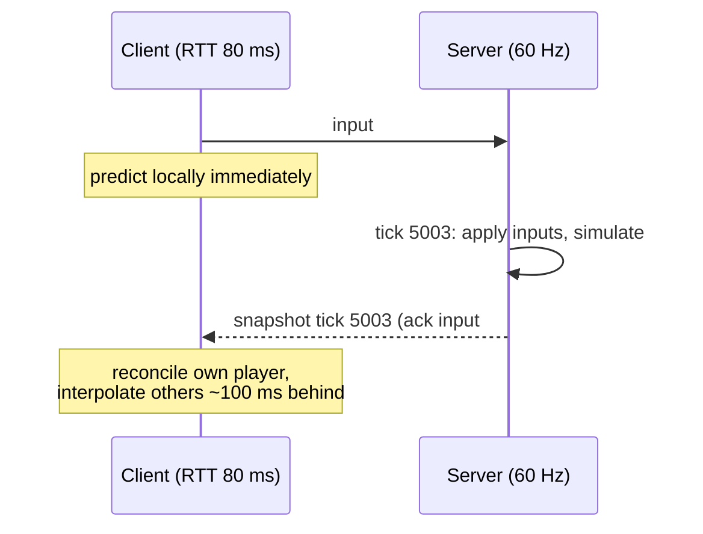

# Multiplayer Networking: Authoritative Servers, Prediction and Lag Compensation

Multiplayer games must make players thousands of kilometres apart, on lossy mobile networks with 50–200 ms of latency, feel like they share one world in real time, while stopping cheaters. Server-side game developers build the netcode and backend that make this work. This guide covers network topologies, why games use UDP, tick rates and state synchronisation, client-side prediction and reconciliation, entity interpolation, and lag compensation.

## 1. Topologies

| Model | How | Pros | Cons | Used in |
|---|---|---|---|---|
| **Client-server, authoritative** | The server simulates the truth, and clients send inputs | Cheat resistance, consistency | Server costs, latency to the server | Most competitive shooters, MOBAs, MMOs |
| Peer-to-peer | Clients exchange data directly | No server cost | NAT traversal, cheating, host advantage | Small co-op, fighting games (with rollback) |
| Listen server | One player hosts | Cheap | Host advantage and cheating, the session ends if the host leaves | Casual co-op |
| **Deterministic lockstep** | Everyone simulates identically from shared inputs | Tiny bandwidth, thousands of units | Requires a bit-exact deterministic simulation, the slowest player sets the pace | RTS games |
| **Rollback netcode** | Predict others' inputs, roll back and resimulate on mismatch | Responsive at moderate latency | Complex, needs a deterministic simulation that can be resimulated | Fighting games |

For most real-time competitive games: **an authoritative dedicated server**. Never trust the client. The client sends *inputs* ("move forward, fire at angle X"), not results ("I'm at position Y, I hit player Z").

## 2. Transport: why UDP

TCP guarantees ordered, reliable delivery. One lost packet blocks everything behind it (**head-of-line blocking**) while it's retransmitted, so a 200 ms stall for a position update that's already stale is worse than just using the next one. Games therefore use **UDP** with their own lightweight reliability layer:

- **Unreliable, sequenced:** state snapshots and movement, where only the newest matters.
- **Reliable, ordered:** chat, purchases, "player joined," "round ended."
- Libraries and frameworks: ENet, GameNetworkingSockets (Valve), Netcode for GameObjects and Unity Transport, Mirror, Photon Fusion, Godot's high-level multiplayer API, Unreal replication. **WebTransport** (over HTTP/3 and QUIC) and WebRTC data channels bring unreliable datagrams to browsers, and WebSockets (TCP) are fine for turn-based or slower-paced web games.

## 3. Tick rate and snapshots

The server simulates at a fixed **tick rate** (for example 30, 60 or 128 Hz) and sends **snapshots** of the relevant state to each client.



Bandwidth control:

- **Delta compression:** send only what changed since the last snapshot the client acknowledged.
- **Quantisation:** positions as 16-bit fixed-point, angles in 8–10 bits, booleans packed into bit fields.
- **Interest management (relevancy):** only send entities near or visible to each player, which is essential for large worlds and battle royales.
- **Priority:** nearby enemies get updated every tick, and distant objects less often.

```csharp
// Quantise a position within a ±1024 m world to 16 bits per axis (≈3 cm precision)
static ushort Q(float v) => (ushort)Mathf.Clamp(Mathf.RoundToInt((v + 1024f) / 2048f * 65535f), 0, 65535);
static float DQ(ushort q) => q / 65535f * 2048f - 1024f;
```

## 4. Client-side prediction and reconciliation

If the client waited for the server before moving, every keypress would feel 80+ ms late. Instead the client **predicts**: it applies its own inputs immediately, using the same movement code as the server. When a snapshot arrives, it **reconciles**:

```csharp
// Client: keep unacknowledged inputs; on server state, rewind to it and replay pending inputs
struct InputCmd { public uint Seq; public Vector2 Move; public bool Jump; public float Dt; }
readonly List<InputCmd> pending = new();

void ClientTick(InputCmd cmd)
{
    cmd.Seq = ++seq;
    pending.Add(cmd);
    Send(cmd);
    state = Simulate(state, cmd);                 // predict immediately
}

void OnServerSnapshot(PlayerState authoritative, uint lastProcessedSeq)
{
    pending.RemoveAll(c => c.Seq <= lastProcessedSeq);
    var corrected = authoritative;
    foreach (var c in pending) corrected = Simulate(corrected, c);   // replay inputs not yet processed
    // Smooth small corrections visually; snap if the error is large (e.g., teleport, knockback)
    state = (corrected.Position - state.Position).sqrMagnitude < 0.25f ? SmoothToward(state, corrected) : corrected;
}
```

Requirements: the movement simulation must be shared (or nearly identical) between client and server and deterministic enough that corrections are rare and small.

## 5. Entity interpolation for other players

You can't predict other players' inputs reliably, so render them slightly **in the past**, interpolating between the two snapshots around `now − interpolationDelay` (typically 2–3 snapshot intervals, roughly 50–100 ms). Movement looks smooth despite jitter and packet loss. When packets are late, **extrapolate** briefly (dead reckoning) and blend back.

```csharp
float renderTime = serverTimeEstimate - interpDelay;
var (a, b) = buffer.Bracket(renderTime);                      // snapshots just before and after
float t = Mathf.InverseLerp(a.Time, b.Time, renderTime);
remote.position = Vector3.Lerp(a.Position, b.Position, t);
remote.rotation = Quaternion.Slerp(a.Rotation, b.Rotation, t);
```

## 6. Lag compensation

Because others are rendered in the past, when a player fires at an enemy on their screen, the enemy has already moved on the server. **Lag compensation** makes "what you see is what you hit" work: the server keeps a short history of hitbox positions and, when a shot arrives, **rewinds** the targets to where the shooter saw them (based on the shooter's latency and interpolation delay), tests the hit, then restores them.

```text
Shot arrives at server tick 5010 from player A (RTT 120 ms, interp 100 ms)
→ rewind other players' hitboxes to ≈ tick 5010 − (60 ms + 100 ms) ≈ tick 5000
→ raycast against rewound hitboxes → hit on B confirmed
→ restore current positions, apply damage
```

The trade-off is "shot around a corner": the victim, already behind cover on their own screen, still gets hit. Games cap the rewind window (for example 200–250 ms) so that very high-ping players don't get unfair advantages.

## 7. Cheating and trust

An authoritative server prevents many cheats (speed hacks, teleporting, infinite ammo), because the server validates inputs and runs the simulation. Remaining threats and defences:

- **Input validation:** clamp movement rates, fire rates and ranges, and reject impossible inputs.
- **Information leaks (wallhacks):** don't send what the player can't see. Interest management doubles as anti-cheat.
- **Aimbots and automation:** behavioural detection (statistical analysis of aim and reaction times), replays and review, and client anti-cheat (with its privacy and compatibility trade-offs).
- **Protocol security:** encrypt and authenticate traffic, use session tokens issued by your backend, and rate-limit to resist DDoS.

## 8. Real-world case: rubber-banding on mobile

A mobile arena game had players complaining about constant "rubber-banding," where characters snapped backwards. The investigation found that the client used `Time.deltaTime`-based movement while the server simulated at a fixed 30 Hz, so their results diverged, and every snapshot forced a large correction. On top of that, snapshots used reliable ordered delivery, so one lost packet on 4G stalled updates for 200–300 ms. The fixes were a shared fixed-step movement function used by both client and server, input sequence numbers with reconciliation and smoothing of small errors, unreliable sequenced snapshots with delta compression, and a 100 ms interpolation buffer for remote players. Corrections over 0.5 m fell from 1 in 3 seconds to about 1 per minute, and the complaints disappeared.

## 9. Hands-on exercise

1. Build a tiny authoritative server (Node.js with UDP or WebSocket, or Godot or Unity netcode) that accepts inputs and broadcasts snapshots at 20 Hz.
2. Add client-side prediction with input sequence numbers and reconciliation. Add 150 ms of artificial latency (`tc netem` on Linux or the library's simulator) and compare the feel with and without prediction.
3. Add a 100 ms interpolation buffer for remote players and simulate 5% packet loss.
4. Implement a simple lag-compensated hitscan with a 1-second hitbox history.

## 10. Checklist

- [ ] I can choose between authoritative client-server, P2P, lockstep and rollback for a game.
- [ ] I understand why games use UDP and how reliable and unreliable channels are combined.
- [ ] I can design tick rates, snapshots, delta compression, quantisation and interest management.
- [ ] I can implement client-side prediction with reconciliation and entity interpolation.
- [ ] I understand lag compensation, its trade-offs, and server-side anti-cheat principles.

## 11. Interview angle

> **Asked as:** "How does client-side prediction work?"

The client applies its own inputs immediately with the shared movement code and keeps unacknowledged inputs. When the authoritative state arrives with the last processed input number, it resets to that state, replays the pending inputs and smooths the difference, so the game feels responsive and stays authoritative.

> **Asked as:** "Why not TCP for real-time games?"

Head-of-line blocking: one lost packet delays all later data until it's retransmitted, but for continuous state the newest update matters more than a late old one. UDP with selective reliability avoids those stalls.
