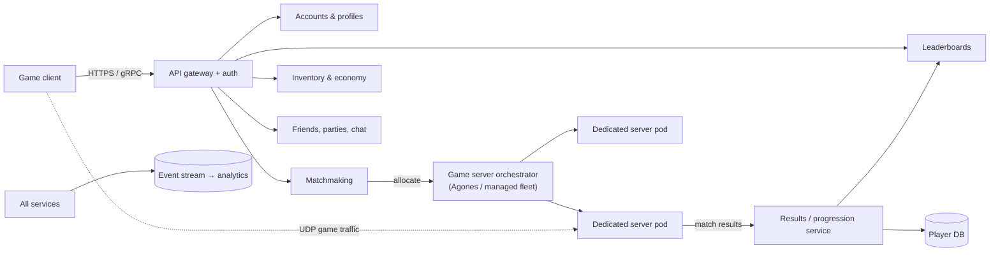
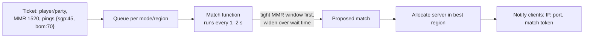

# Game Backend Services: Matchmaking, Sessions, Persistence and Scaling

Behind every multiplayer match is a set of backend services: accounts and authentication, matchmaking, allocating a game server, player data and inventories, leaderboards, chat, purchases and analytics. All of it has to survive launch-day spikes 50 times normal traffic. This guide covers the architecture of a game backend, how each core service works, how to scale and operate dedicated game servers, and the data patterns that keep player progress safe.

## 1. Architecture overview



Two different kinds of workload:

- **Stateless platform services** (accounts, inventory, leaderboards): ordinary web backends, horizontally scaled behind load balancers.
- **Stateful game servers:** each process holds a live match in memory, can't be load-balanced mid-match, and needs low latency to its players, so it's scheduled and scaled very differently.

You can build these yourself, or use managed backends (Nakama, PlayFab, AccelByte, Pragma, Unity Gaming Services, Epic Online Services) and spend your engineering time on what makes your game unique.

## 2. Identity and sessions

- Sign in with platform accounts (Steam, PlayStation, Xbox, Google Play Games, Game Center), plus email or device ID for mobile, with **account linking** so progress follows players across devices.
- The backend issues short-lived **access tokens** (JWT) for API calls, and a **match ticket or token** that the dedicated server validates when the player connects.
- Protect against account takeover with MFA options for valuable accounts and anomaly detection on logins.

## 3. Matchmaking

Matchmaking groups players into fair, fast, low-latency matches.

Inputs: skill rating, region and latency, party size, game mode, platform and input device (controller vs mouse), and sometimes behaviour score.



The core trade-off is **match quality vs wait time**: start with a tight skill window and preferred region, then **relax the constraints** as a ticket waits:

```python
def mmr_window(wait_s: float) -> int:
    return min(50 + int(wait_s * 10), 400)           # ±50 at start, widening to ±400

def can_match(a, b, now):
    window = min(mmr_window(now - a.created), mmr_window(now - b.created))
    region_ok = any(a.pings.get(r, 999) < 80 and b.pings.get(r, 999) < 80 for r in REGIONS)
    return abs(a.mmr - b.mmr) <= window and region_ok and a.mode == b.mode
```

**Skill rating systems:** Elo (simple, two-player), Glicko-2 (adds rating uncertainty, so new players move quickly), TrueSkill and its variants (teams, multiple players). Track uncertainty, and use placement matches for new accounts.

Open-source frameworks like **Open Match** separate the queue, the match functions and server allocation. Managed options include Amazon GameLift FlexMatch and the matchmakers built into game-backend platforms.

## 4. Dedicated server orchestration

Game servers are stateful pods with special needs: a server must not be killed mid-match, it should be placed in a region near its players, and the fleet must scale ahead of demand.

**Agones** (open source, built on Kubernetes) manages game server fleets:

```yaml
apiVersion: agones.dev/v1
kind: Fleet
metadata: { name: arena-sgp }
spec:
  replicas: 20
  template:
    spec:
      ports: [{ name: game, containerPort: 7777, protocol: UDP }]
      health: { initialDelaySeconds: 10, periodSeconds: 5 }
      template:
        spec:
          containers:
            - name: arena
              image: registry.example/arena-server:1.14.2
              resources: { requests: { cpu: "1", memory: 1Gi }, limits: { memory: 1Gi } }
---
apiVersion: autoscaling.agones.dev/v1
kind: FleetAutoscaler
metadata: { name: arena-sgp-autoscaler }
spec:
  fleetName: arena-sgp
  policy:
    type: Buffer
    buffer: { bufferSize: 15%, minReplicas: 10, maxReplicas: 400 }   # keep 15% Ready servers waiting
```

The lifecycle: `Ready` (waiting for a match) → `Allocated` (the matchmaker claimed it, so it's protected from scale-down) → `Shutdown` after the match, and the process exits cleanly. **Never reuse a server process across matches unless it fully resets**, because state leaking between matches causes nasty bugs.

Managed alternatives: Amazon GameLift, Hathora, Edgegap, i3D.net and Unity Multiplay-style hosting. Many studios mix cloud and **bare-metal** capacity, using bare metal for the steady baseline because it's cheaper with better network performance, and cloud for bursts.

**Region strategy:** place fleets near players. For South Asia that often means Singapore, Mumbai and others. Measure real player pings (clients ping region beacons) rather than guessing from geography.

## 5. Player data, inventory and economy

Player progress and purchases are the most sensitive data in a game. Losing them, or duplicating items, destroys trust and the economy.

- **The server is authoritative for everything valuable.** Clients request ("open chest"), and servers decide and record the result.
- **Transactions and idempotency:** granting items and spending currency must be atomic and idempotent, so retries never duplicate rewards.

```sql
-- Atomic purchase: spend gems and grant item exactly once per request id
BEGIN;
INSERT INTO processed_requests (request_id, player_id) VALUES ($1, $2);   -- unique: duplicate retry fails here
UPDATE wallets SET gems = gems - 120 WHERE player_id = $2 AND gems >= 120;
-- check 1 row updated, else ROLLBACK (insufficient funds)
INSERT INTO inventory (player_id, item_id, acquired_via) VALUES ($2, 'skin_tiger', $1);
INSERT INTO ledger (player_id, delta_gems, reason, request_id) VALUES ($2, -120, 'store:skin_tiger', $1);
COMMIT;
```

- **Ledgers:** keep an append-only record of every currency change for audits, support ("I lost my gems") and detecting duplication exploits.
- **Real-money purchases:** validate receipts server-side with the platform stores (Google Play, App Store, Steam), and handle refunds and chargebacks by revoking or flagging.
- **Data model:** a relational database for wallets, inventory and ledgers (with strong consistency), and a document or key-value store for flexible profile and settings data. Cache hot profiles in Redis.

## 6. Leaderboards, social and live operations

- **Leaderboards:** Redis sorted sets give O(log n) score updates and rank queries, and they're the classic implementation:

```python
r.zadd("lb:season7:global", {player_id: score}, gt=True)   # keep only improvements
rank = r.zrevrank("lb:season7:global", player_id)           # 0-based rank
top = r.zrevrange("lb:season7:global", 0, 99, withscores=True)
around_me = r.zrevrange("lb:season7:global", max(rank - 5, 0), rank + 5, withscores=True)
```

Validate scores server-side (they should come from match results, not client claims), shard by region or bracket at very large scale, and persist snapshots at the end of a season.

- **Friends, parties, presence and chat:** WebSocket gateways with pub/sub (Redis, NATS), presence with TTL heartbeats, and moderation (filters, reporting, rate limits).
- **Live operations:** remote configuration, events and battle passes scheduled from a CMS, feature flags, and A/B tests on economy tuning.

## 7. Scaling and operating for launch day

Launches and big events produce extreme spikes, sometimes far above forecasts.

- **Load test the whole flow** with bots: login → matchmaking → allocation → play → results, at 2–3× the forecast peak.
- **Queue logins** gracefully ("You're #4,210 in line, about 3 minutes") instead of letting the auth service and database collapse.
- **Protect dependencies:** rate limits, circuit breakers, and caching of read-heavy data (catalogue, configuration).
- **Pre-warm fleets** and database capacity before announced events, and get cloud quota increases approved weeks in advance.
- **Observability:** matchmaking wait time by region and mode, allocation failures, server tick time and CPU per match, player-reported lag, crash rates, and business KPIs (concurrent users, purchases).
- **DDoS protection** for game servers (UDP-aware mitigation, hiding server IPs behind relays where possible).

## 8. Real-world case: the duplicated legendary skins

A week after launch, the community discovered they could get a legendary skin twice by tapping "Open chest" and immediately losing connection. The client retried the request, and the server granted the item again because the grant wasn't idempotent and the currency deduction ran in a separate, non-atomic call. About 18,000 duplicate grants were made in 3 days. The fix: idempotency keys generated by the client per action, a single database transaction for the deduction plus the grant plus the ledger entry, and a reconciliation job comparing ledgers with inventories. Duplicates were identified from the ledger and handled with an apology bundle rather than mass bans. The incident led to a rule that every economy endpoint must be idempotent and covered by tests that inject retries.

## 9. Hands-on exercise

1. Write a matchmaker that pairs tickets by MMR with a widening window and region ping constraints, and simulate 1,000 players to measure the wait time vs MMR-gap trade-off.
2. Run Agones on a local kind cluster with a simple UDP echo "game server," then allocate and shut down servers through the API.
3. Implement an idempotent purchase endpoint with a ledger, and test it with injected retries and concurrent requests.
4. Build a Redis leaderboard with "top 100" and "around me" queries.
5. Load test login → matchmaking with k6 or Locust and add a login queue when it saturates.

## 10. Checklist

- [ ] I can design a game backend with stateless platform services and stateful dedicated servers.
- [ ] I can design matchmaking with skill ratings, latency-aware regions and constraint relaxation.
- [ ] I understand game-server orchestration (Agones or managed fleets), lifecycle, buffers and region strategy.
- [ ] I keep player data and economies safe with authoritative servers, atomic idempotent transactions, ledgers and receipt validation.
- [ ] I can build leaderboards and social features, and prepare for launch spikes with load tests, queues and observability.

## 11. Interview angle

> **Asked as:** "Design matchmaking for a 5v5 competitive game."

Use tickets with party, MMR and uncertainty, and per-region pings. Queue per mode and region, and run match functions every second or two that balance teams by MMR, starting tight and widening with wait time and respecting party constraints. Allocate a server in the best region through the orchestrator, give out match tokens, and monitor wait time and match quality. Mention rating systems such as Glicko-2 and TrueSkill.

> **Asked as:** "How do you prevent item duplication bugs?"

Make the server authoritative, use idempotency keys per client action, perform the spend, grant and ledger entry in one atomic transaction, use unique constraints on processed requests, run reconciliation jobs between ledgers and inventories, and test retry and concurrency paths explicitly.
