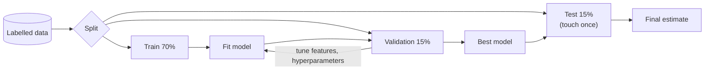

# Machine Learning Fundamentals and Supervised Learning

Machine learning means learning a function from examples instead of writing the rules by hand. Supervised learning, where each training example comes with the right answer, covers most business ML: predicting delivery times, flagging fraud, forecasting demand, scoring churn risk. This guide builds the core ideas (features, loss, generalisation, the bias-variance trade-off) and the workhorse algorithms, with scikit-learn code.

## 1. The setup

- **Features (X):** the inputs, such as distance, hour of day, restaurant prep time, rain.
- **Label (y):** what you predict. Delivery minutes is **regression** (a number). "Will this order be cancelled?" is **classification** (a category).
- **Model:** a function with parameters, f(X; θ) ≈ y.
- **Loss:** how wrong a prediction is. Mean squared error for regression, cross-entropy (log loss) for classification.
- **Training:** adjust θ to minimise the loss on training data, usually with **gradient descent**, repeatedly nudging the parameters in the direction that reduces the loss.



## 2. Generalisation: the whole point

A model that memorises training data is useless. What matters is performance on **new** data.

- **Underfitting (high bias):** too simple to capture the pattern. Bad on train and test.
- **Overfitting (high variance):** fits noise. Great on train, bad on test.
- The **bias-variance trade-off:** more complex models reduce bias but increase variance. **Regularisation** (penalising large weights), more data, simpler features and early stopping all fight overfitting.

**Data leakage** is the most damaging mistake in applied ML. It means information from the future or from the label sneaks into the features. Predicting "will this order be cancelled" using a `refund_issued` column gives 99% accuracy offline and zero value in production. For time-based problems, **split by time** (train on Jan–Aug, validate on September), never randomly.

## 3. The core algorithms

| Algorithm | How it works | Strengths | Watch out |
|---|---|---|---|
| **Linear / logistic regression** | Weighted sum of features (through a sigmoid for classification) | Fast, interpretable, a strong baseline | Needs scaled features and engineered interactions |
| **Decision tree** | Learns if/else splits | Interpretable, handles mixed types | Overfits alone |
| **Random forest** | Many trees on bootstrapped samples, averaged | Robust, little tuning | Larger and slower, less precise than boosting |
| **Gradient boosting** (XGBoost, LightGBM, CatBoost) | Trees added sequentially, each fixing the previous errors | Usually the best for tabular data | Needs tuning, can overfit |
| **k-nearest neighbours** | Predicts from the most similar examples | Simple | Slow at scale, sensitive to scaling |
| **Support vector machines** | Maximum-margin boundary, with kernels | Good on small and medium data | Doesn't scale to huge datasets |

For tabular business data, **gradient-boosted trees** are the default strong choice. Always compare against a simple baseline (predict the mean, or a logistic regression). If a fancy model barely beats it, the complexity isn't worth it.

## 4. A complete regression example: predicting delivery time

```python
import pandas as pd
from sklearn.compose import ColumnTransformer
from sklearn.pipeline import Pipeline
from sklearn.preprocessing import OneHotEncoder, StandardScaler
from sklearn.linear_model import Ridge
from sklearn.metrics import mean_absolute_error
from lightgbm import LGBMRegressor

df = pd.read_parquet("deliveries.parquet").sort_values("placed_at")
features_num = ["distance_km", "prep_minutes_avg", "items", "hour", "rain_mm", "active_riders_nearby"]
features_cat = ["city", "vehicle_type", "weekday"]
X, y = df[features_num + features_cat], df["delivery_minutes"]

# Time-based split: never train on the future
cut = df["placed_at"] < "2026-09-01"
X_tr, X_te, y_tr, y_te = X[cut], X[~cut], y[cut], y[~cut]

pre = ColumnTransformer([
    ("num", StandardScaler(), features_num),
    ("cat", OneHotEncoder(handle_unknown="ignore"), features_cat),
])

baseline = mean_absolute_error(y_te, [y_tr.median()] * len(y_te))
ridge = Pipeline([("pre", pre), ("model", Ridge(alpha=1.0))]).fit(X_tr, y_tr)
gbm = Pipeline([("pre", pre), ("model", LGBMRegressor(n_estimators=600, learning_rate=0.05, num_leaves=31))]).fit(X_tr, y_tr)

print(f"baseline MAE {baseline:.1f} min")
print(f"ridge    MAE {mean_absolute_error(y_te, ridge.predict(X_te)):.1f} min")
print(f"lightgbm MAE {mean_absolute_error(y_te, gbm.predict(X_te)):.1f} min")
```

The **Pipeline** matters. Preprocessing is fitted only on training data and applied identically at prediction time, which prevents leakage and "it worked in the notebook" bugs.

## 5. Classification and probability

Classifiers usually output a **probability**, and you choose a **threshold** based on the business cost of each kind of mistake:

```python
from sklearn.linear_model import LogisticRegression
from sklearn.metrics import classification_report, roc_auc_score

clf = Pipeline([("pre", pre), ("model", LogisticRegression(max_iter=1000, class_weight="balanced"))])
clf.fit(X_tr, cancelled_tr)
proba = clf.predict_proba(X_te)[:, 1]

print("ROC AUC", roc_auc_score(cancelled_te, proba))
# Intervening (calling the customer) is cheap; missing a cancellation is expensive, so use a lower threshold
print(classification_report(cancelled_te, proba > 0.3))
```

For **imbalanced** problems such as fraud (0.5% positives), accuracy is meaningless. A model that always says "not fraud" is 99.5% accurate. Use precision, recall, PR-AUC and class weights, which the next guide covers.

## 6. Hyperparameters and cross-validation

Hyperparameters (tree depth, learning rate, regularisation strength) are chosen on validation data, not training data. **K-fold cross-validation** gives a more reliable estimate on small datasets. For time series, use `TimeSeriesSplit` so every fold trains on the past and validates on the future.

```python
from sklearn.model_selection import RandomizedSearchCV, TimeSeriesSplit

search = RandomizedSearchCV(
    gbm, n_iter=30, cv=TimeSeriesSplit(n_splits=5), scoring="neg_mean_absolute_error",
    param_distributions={"model__num_leaves": [15, 31, 63], "model__learning_rate": [0.02, 0.05, 0.1],
                         "model__min_child_samples": [20, 50, 100]},
)
search.fit(X_tr, y_tr)
print(search.best_params_)
```

## 7. The minimum maths you need

- **Linear algebra:** vectors, dot products and matrix multiplication. A linear model is `X @ w + b`, and embeddings are vectors.
- **Calculus:** derivatives and gradients. Gradient descent updates `w ← w − learning_rate × ∂loss/∂w`.
- **Probability and statistics:** distributions, expectation, conditional probability (Bayes), and why the test-set estimate has uncertainty.

You don't need to derive everything, but you should be able to explain why scaling helps gradient descent converge and why regularisation reduces variance.

## 8. Real-world case: ETA predictions customers trust

A delivery app showed ETAs from a simple distance formula, and customers complained that "10 minutes" routinely meant 25. A LightGBM model using distance, restaurant prep history, time of day, weather and rider supply cut the mean absolute error from 9.4 to 4.1 minutes. Two extra decisions mattered as much as the model. They predicted the **80th percentile** (quantile regression) rather than the mean, because under-promising is better than being late. And they retrained weekly, because restaurant prep times drift.

## 9. Hands-on exercise

1. Take a tabular dataset (house prices, or taxi trips with durations) and create a time-based or random split as appropriate.
2. Build a median baseline, a Ridge pipeline and a LightGBM pipeline, and compare MAE.
3. Introduce a leaky feature on purpose, watch the test score become "too good", then remove it.
4. Tune with cross-validation and report the final test score once.

## 10. Checklist

- [ ] I can explain features, labels, loss, gradient descent and train/validation/test splits.
- [ ] I can diagnose under- and overfitting and apply regularisation.
- [ ] I recognise and prevent data leakage, including time-based splits.
- [ ] I know when to use linear models, random forests and gradient boosting, and I always compare to a baseline.
- [ ] I build scikit-learn Pipelines and tune with appropriate cross-validation.

## 11. Interview angle

> **Asked as:** "Explain the bias-variance trade-off."

Error comes from oversimplifying (bias) and from sensitivity to the particular training sample (variance). More complex models lower bias but raise variance, and regularisation, more data and ensembles manage the balance. Diagnose it by comparing training and validation error.

> **Asked as:** "What's data leakage? Give an example."

It's when features contain information unavailable at prediction time, such as using `refund_issued` to predict cancellation, or random splits on time-series data. It inflates offline metrics and fails in production.
