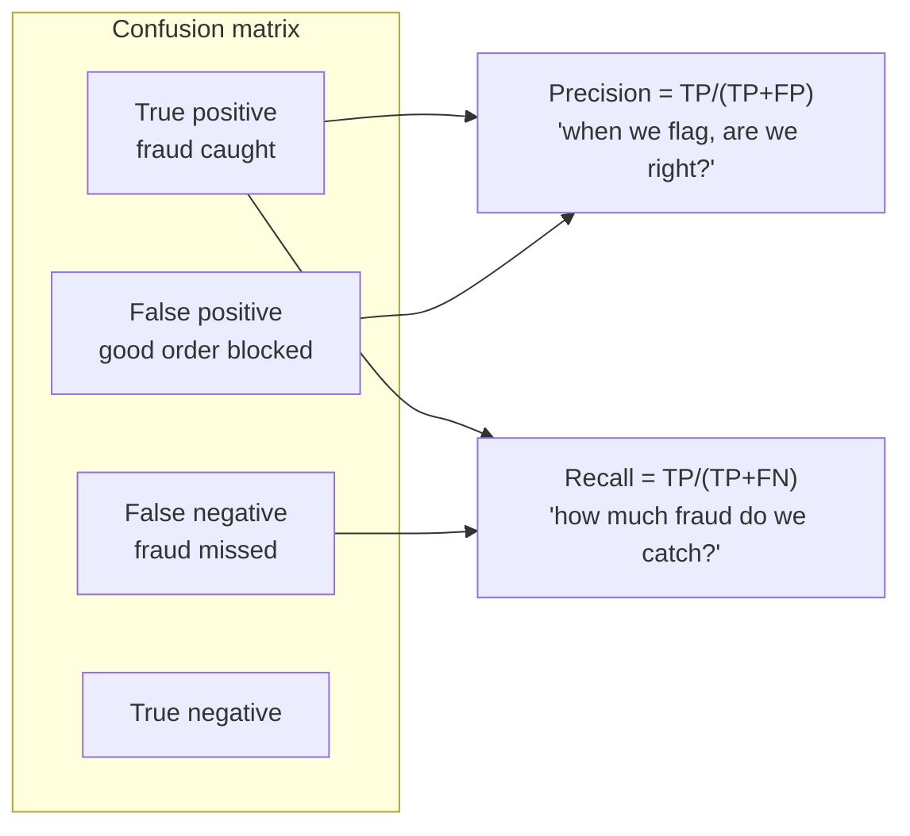

# Unsupervised Learning, Model Evaluation and Feature Engineering

Often there are no labels at all. You want to find natural customer segments, detect unusual transactions, or compress hundreds of features into a few. When there *are* labels, the model is only as good as its features and only as trustworthy as its evaluation. This guide covers clustering, dimensionality reduction and anomaly detection, then the metrics and feature-engineering techniques that decide whether a model succeeds in practice.

## 1. Clustering

### k-means

k-means puts points in k groups by repeatedly assigning each point to the nearest centroid and then moving each centroid to the mean of its points.

```python
from sklearn.preprocessing import StandardScaler
from sklearn.cluster import KMeans
from sklearn.metrics import silhouette_score

feats = customers[["orders_90d", "avg_order_value", "days_since_last", "share_late_night", "coupon_share"]]
Xs = StandardScaler().fit_transform(feats)              # k-means uses distances, so scale first

for k in range(2, 9):
    km = KMeans(n_clusters=k, n_init=10, random_state=42).fit(Xs)
    print(k, round(km.inertia_), round(silhouette_score(Xs, km.labels_), 3))

customers["segment"] = KMeans(n_clusters=4, n_init=10, random_state=42).fit_predict(Xs)
print(customers.groupby("segment")[feats.columns].median())
```

Choose k with the **elbow** in inertia, the **silhouette score**, and above all whether the segments are *useful and explainable* ("late-night students", "weekend families", "coupon hunters", "office lunch regulars").

| Method | Good for | Notes |
|---|---|---|
| k-means | Roughly spherical, similar-size clusters | Fast. You pick k. |
| DBSCAN / HDBSCAN | Arbitrary shapes, labels noise points | No k needed, density-based |
| Hierarchical | Small data, a nested structure (dendrogram) | Interpretable |
| Gaussian mixtures | Soft, probabilistic membership | Elliptical clusters |

### Dimensionality reduction

- **PCA** finds the directions of maximum variance. Use it to compress correlated features, denoise and speed up models.
- **t-SNE and UMAP** produce non-linear 2-D projections for *visualising* structure in embeddings. Don't read distances between far-apart clusters literally.

### Anomaly detection

**Isolation Forest** isolates points with random splits. Anomalies need fewer splits. It's useful for spotting suspicious orders or rider GPS traces:

```python
from sklearn.ensemble import IsolationForest
iso = IsolationForest(contamination=0.01, random_state=0).fit(order_feats)
orders["anomaly"] = iso.predict(order_feats) == -1      # flag for human review
```

## 2. Classification metrics that match the business



| Metric | Use when |
|---|---|
| Accuracy | Balanced classes and equal error costs (rare in practice) |
| **Precision** | False positives are costly (blocking good customers) |
| **Recall** | False negatives are costly (missing fraud or disease) |
| F1 | You need a balance of the two |
| ROC AUC | Ranking quality across thresholds, balanced-ish data |
| **PR AUC** | Imbalanced data. More informative than ROC there. |
| Log loss / Brier score | When the probabilities themselves matter (pricing, risk) |

**Choose the threshold from costs.** If a missed fraud costs ৳2,000 and a manual review costs ৳20, flag anything with a probability above about 1%. Then check that the review team can handle the volume.

**Calibration:** if the model says 0.7, does the event happen about 70% of the time? Boosted trees are often miscalibrated, so fix that with `CalibratedClassifierCV` when probabilities drive decisions.

### Regression metrics

- **MAE:** average absolute error in the original units ("off by 4.1 minutes"). Easy to explain and robust.
- **RMSE:** penalises large errors more heavily. Use it when big misses are much worse.
- **MAPE:** percentage error. It blows up near zero.
- **Quantile (pinball) loss:** use it when you predict percentiles, such as "90% of deliveries arrive within this time."

## 3. Evaluate the way you'll deploy

- **Split like production.** Use time-based splits for anything temporal, and group splits (all orders of a customer in one fold) when entities repeat.
- **Slice the metrics.** Overall MAE can hide terrible performance for one city, new restaurants or rainy evenings. Report per segment, and check fairness across user groups where decisions affect people.
- **Compare against a baseline and the current system**, not just against zero.
- **Error analysis:** read the 50 worst predictions. They usually reveal a missing feature or a data bug faster than any metric.

## 4. Feature engineering

For tabular problems, good features beat fancy models.

| Technique | Example |
|---|---|
| Date and time parts | hour, weekday, is_holiday, minutes until the restaurant closes |
| Aggregations over history | restaurant's median prep time over the last 7 days, customer's order count in 90 days |
| Ratios and differences | price per item, distance ÷ average rider speed in the zone |
| Encoding categories | one-hot (few levels), target encoding (many levels, computed out-of-fold to avoid leakage) |
| Text | TF-IDF, or embeddings from a language model |
| Geospatial | distance, H3 or geohash zone ids, zone demand |
| Missingness flags | `had_coupon_missing` can itself be predictive |

**Point-in-time correctness:** a feature like "restaurant's 7-day median prep time" must be computed using only data available *at the moment of each historical prediction*. Using today's value for last month's orders is leakage. Feature stores (covered in MLOps) exist largely to get this right.

```python
# Rolling, point-in-time-safe feature with pandas (shift excludes the current order)
orders = orders.sort_values("placed_at")
orders["rest_prep_7d"] = (orders.groupby("restaurant_id")
                                .rolling("7D", on="placed_at")["prep_minutes"].median()
                                .groupby(level=0).shift(1)
                                .reset_index(level=0, drop=True))
```

### Interpreting models

- **Permutation importance:** how much the metric drops when a feature is shuffled.
- **SHAP values:** each feature's contribution to an individual prediction ("ETA +6 min because of rain, +4 because the restaurant is slow today"). This is useful for debugging, trust and explaining results to stakeholders.

## 5. Real-world case: a fraud model that looked great

A promo-abuse model scored 0.97 ROC AUC offline, but in production it flagged mostly legitimate new users. The analysis found:

1. Random splits let the same device ids appear in both train and test, so the model memorised devices. **Fix:** group the split by device.
2. A feature, `account_age_days`, was computed at export time, not at order time. **Fix:** point-in-time features.
3. ROC AUC hid poor precision at the operating threshold because only 0.4% of orders were positives. **Fix:** optimise PR AUC and precision at the review team's capacity.

The honest offline score dropped to 0.81 ROC AUC, but production precision tripled.

## 6. Hands-on exercise

1. Segment customers with k-means on scaled RFM features (recency, frequency, monetary). Choose k and name the segments.
2. Train a classifier on an imbalanced dataset and compare accuracy, ROC AUC and PR AUC. Pick a threshold from an assumed cost matrix.
3. Add three engineered, point-in-time-safe features and measure the lift.
4. Explain five individual predictions with SHAP.

## 7. Checklist

- [ ] I can cluster with k-means and DBSCAN, choose k sensibly and interpret the segments.
- [ ] I use PCA and UMAP appropriately and can detect anomalies with Isolation Forest.
- [ ] I choose metrics by business cost, set thresholds deliberately and check calibration.
- [ ] I evaluate with production-like splits, sliced metrics and error analysis.
- [ ] I engineer point-in-time-correct features and explain models with SHAP.

## 8. Interview angle

> **Asked as:** "Your fraud model has 99% accuracy. Is it good?"

Probably not. With 1% fraud, predicting "never fraud" scores 99%. Look at precision and recall at the operating threshold, PR AUC, the cost-based threshold and calibration.

> **Asked as:** "How would you segment our customers?"

Define the purpose, build behavioural features (RFM, preferences), scale them, cluster with k-means or HDBSCAN, choose k by silhouette plus interpretability, profile and name the segments, and validate that they behave differently in an experiment.
