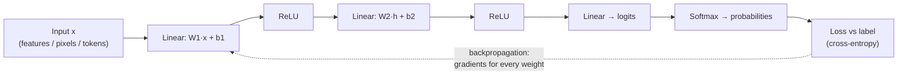

# Deep Learning with PyTorch: Neural Networks, CNNs and Transformers

Deep learning powers image recognition, speech, translation and every modern language model. For tabular business data, gradient-boosted trees often still win, but for images, audio, text and very large datasets neural networks dominate. This guide explains how neural networks learn, walks through a complete PyTorch training loop, and covers the architectures you'll meet (CNNs, transformers) along with fine-tuning pre-trained models.

## 1. A neural network in one picture



- Each **layer** is a matrix multiplication plus a bias, followed by a non-linear **activation** (ReLU, GELU). Without the non-linearities, stacking layers would collapse into a single linear model.
- **Backpropagation** applies the chain rule to compute how much each weight contributed to the loss. PyTorch's **autograd** does this automatically.
- An **optimiser** (SGD, or usually **AdamW**) updates the weights using those gradients.

## 2. A complete training loop

```python
import torch
from torch import nn
from torch.utils.data import DataLoader, TensorDataset

device = "cuda" if torch.cuda.is_available() else "mps" if torch.backends.mps.is_available() else "cpu"

# Data: tensors of features and integer class labels
train_ds = TensorDataset(torch.tensor(X_train, dtype=torch.float32), torch.tensor(y_train))
val_ds   = TensorDataset(torch.tensor(X_val,   dtype=torch.float32), torch.tensor(y_val))
train_dl = DataLoader(train_ds, batch_size=256, shuffle=True)
val_dl   = DataLoader(val_ds, batch_size=1024)

model = nn.Sequential(
    nn.Linear(X_train.shape[1], 128), nn.ReLU(), nn.Dropout(0.2),
    nn.Linear(128, 64), nn.ReLU(),
    nn.Linear(64, n_classes),
).to(device)

opt = torch.optim.AdamW(model.parameters(), lr=1e-3, weight_decay=1e-4)
loss_fn = nn.CrossEntropyLoss()
best, patience = float("inf"), 0

for epoch in range(50):
    model.train()
    for xb, yb in train_dl:
        xb, yb = xb.to(device), yb.to(device)
        opt.zero_grad()                     # 1. clear old gradients
        loss = loss_fn(model(xb), yb)       # 2. forward pass + loss
        loss.backward()                     # 3. backprop
        opt.step()                          # 4. update weights

    model.eval()
    with torch.no_grad():                   # no gradients needed for validation
        val_loss = sum(loss_fn(model(xb.to(device)), yb.to(device)).item() * len(xb) for xb, yb in val_dl) / len(val_ds)
    print(f"epoch {epoch}: val_loss {val_loss:.4f}")

    if val_loss < best - 1e-4:              # early stopping
        best, patience = val_loss, 0
        torch.save(model.state_dict(), "best.pt")
    else:
        patience += 1
        if patience == 5:
            break
```

The four lines inside the batch loop are the heart of all deep learning, from this small model to the largest LLMs. `model.train()` and `model.eval()` matter because layers like Dropout and BatchNorm behave differently during training and inference.

## 3. Making training work

| Problem | Symptom | Remedies |
|---|---|---|
| Overfitting | Train loss falls, validation loss rises | Dropout, weight decay, data augmentation, more data, early stopping |
| Learning rate too high | Loss explodes or oscillates | Lower the LR, use warmup and a scheduler (cosine) |
| Learning rate too low | Painfully slow progress | Raise the LR, use an LR finder |
| Vanishing or exploding gradients | Loss stuck or NaN | Normalisation layers, residual connections, gradient clipping |
| Slow training | Underused GPU | Larger batches, mixed precision (`torch.autocast`), faster data loading |

**Sanity check first:** make sure the model can overfit a single small batch to near-zero loss. If it can't, there's a bug in the data, labels or loss, not a modelling problem.

## 4. Convolutional neural networks (images)

Convolutions slide small learned filters across an image, detecting edges, then textures, then object parts. Weight sharing makes them efficient and translation-aware. In practice you rarely train a CNN from scratch. You **fine-tune a pre-trained model**:

```python
import torchvision
from torchvision import transforms

weights = torchvision.models.ResNet50_Weights.DEFAULT
model = torchvision.models.resnet50(weights=weights)
for p in model.parameters():
    p.requires_grad = False                         # freeze the pre-trained backbone
model.fc = nn.Linear(model.fc.in_features, 3)       # new head: e.g. {good, damaged, wrong_item} food photos

train_tf = transforms.Compose([
    transforms.RandomResizedCrop(224), transforms.RandomHorizontalFlip(),
    transforms.ColorJitter(0.2, 0.2), transforms.ToTensor(),
    transforms.Normalize(weights.transforms().mean, weights.transforms().std),
])
```

**Transfer learning** is why a few thousand labelled images are often enough. The backbone already knows visual features from millions of images, and you only train the final layer (then optionally unfreeze more with a small learning rate).

## 5. Sequences and transformers

Older sequence models (RNNs, LSTMs) processed tokens one at a time, which was slow and forgot long-range context. **Transformers** use **self-attention**: every token looks at every other token and weights how relevant each one is, all in parallel.


- **Encoder** models (BERT-style) are good for classification, embeddings and search.
- **Decoder** models (GPT-style) generate text token by token. All modern LLMs are decoders.
- Attention cost grows with the **square of the sequence length**, which is why context windows are expensive and why techniques like FlashAttention matter.

Fine-tuning a small pre-trained transformer for text classification with Hugging Face:

```python
from transformers import AutoTokenizer, AutoModelForSequenceClassification, TrainingArguments, Trainer
from datasets import load_dataset

name = "distilbert-base-multilingual-cased"          # handles English and Bangla text
tok = AutoTokenizer.from_pretrained(name)
model = AutoModelForSequenceClassification.from_pretrained(name, num_labels=3)

ds = load_dataset("csv", data_files={"train": "reviews_train.csv", "test": "reviews_test.csv"})
ds = ds.map(lambda b: tok(b["text"], truncation=True, max_length=256), batched=True)

args = TrainingArguments("out", learning_rate=2e-5, per_device_train_batch_size=32,
                         num_train_epochs=3, eval_strategy="epoch", save_strategy="epoch",
                         load_best_model_at_end=True)
Trainer(model=model, args=args, train_dataset=ds["train"], eval_dataset=ds["test"], tokenizer=tok).train()
```

For large models, **parameter-efficient fine-tuning** (LoRA and QLoRA) trains small adapter matrices instead of all the weights, which makes fine-tuning possible on a single GPU.

## 6. Fine-tune, prompt or RAG?

| Need | Best first approach |
|---|---|
| The model needs *knowledge* from your documents | RAG |
| A consistent *format or style*, or a narrow task at high volume | Prompting first, then fine-tune a small model |
| A specialised classification or extraction task at scale with labelled data | Fine-tune a small encoder |
| Images or audio specific to your domain | Transfer learning from a pre-trained backbone |

## 7. Real-world case: catching wrong-item complaints from photos

Customers upload photos with complaints. Manual review took 6 minutes per ticket. A ResNet fine-tuned on 4,000 labelled photos (good, spilled, wrong item, missing item) reached 92% accuracy. Data augmentation and class weights were essential, because "missing item" photos were rare. The model auto-approves refunds only on high-confidence "spilled" predictions under ৳500 and routes everything else to humans, sorted by predicted category. Review time fell by 70%, and the confidence threshold keeps the error cost bounded.

## 8. Hands-on exercise

1. Train the MLP above on a tabular dataset and compare it with LightGBM. Expect the trees to win, and explain why.
2. Fine-tune a pre-trained ResNet on a small image dataset (for example 3 classes, 300 images each) with augmentation.
3. Fine-tune DistilBERT on a text classification dataset and report per-class F1.
4. Deliberately overfit one batch, then add dropout and weight decay and observe the validation curve.

## 9. Checklist

- [ ] I can explain layers, activations, loss, backpropagation and optimisers.
- [ ] I can write a PyTorch training loop with validation, checkpointing and early stopping.
- [ ] I can diagnose training problems (learning rate, overfitting, gradients).
- [ ] I can fine-tune pre-trained CNNs and transformers, and I know what LoRA is.
- [ ] I can choose between prompting, RAG and fine-tuning.

## 10. Interview angle

> **Asked as:** "Explain self-attention simply."

Each token builds a query, key and value. Its new representation is a weighted average of all tokens' values, with weights from how well its query matches each key. Every token can draw on relevant context anywhere in the sequence, in parallel.

> **Asked as:** "Why do trees often beat neural nets on tabular data?"

Tabular features are heterogeneous and often irregular, and datasets are moderate in size. Trees handle mixed scales, interactions and missing values natively with little tuning, while neural networks shine with large, homogeneous data such as pixels, audio and text.
