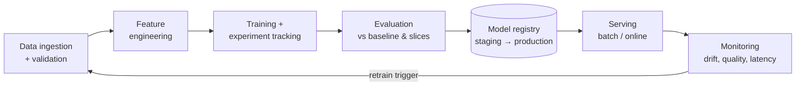

# The ML Lifecycle: Experiment Tracking, Pipelines and Feature Stores

Most machine-learning projects that fail never reach production, or they reach it once and quietly decay. MLOps applies DevOps discipline (version control, automation, testing, monitoring) to the extra moving parts ML adds: data, features, experiments and models. This guide covers the lifecycle, experiment tracking, reproducible training pipelines and feature stores.

## 1. Why ML needs more than DevOps

In normal software, behaviour is defined by **code**. In ML, behaviour is defined by **code + data + hyperparameters + randomness**. Change any of them and the model changes. That's why you need:

- **Versioned data and features**, not just versioned code.
- **Experiment tracking**, so you know which run produced which model and why.
- **Automated pipelines**, so a model can be retrained exactly the same way.
- **Monitoring of predictions and inputs**, because the world drifts even when your code doesn't.



### MLOps maturity, roughly

| Level | Looks like |
|---|---|
| 0: manual | Notebooks, models copied by hand, no monitoring |
| 1: pipeline automation | Reproducible training pipeline, registry, scheduled retraining |
| 2: CI/CD for ML | Pipeline code tested in CI, automated evaluation gates, canary deployments, drift-triggered retraining |

## 2. Experiment tracking with MLflow

Every training run should record its parameters, metrics, code version, data version and artefacts:

```python
import mlflow, mlflow.lightgbm
from sklearn.metrics import mean_absolute_error

mlflow.set_tracking_uri("http://mlflow.internal:5000")
mlflow.set_experiment("delivery-eta")

with mlflow.start_run(run_name="lgbm-weather-features"):
    params = {"num_leaves": 63, "learning_rate": 0.05, "n_estimators": 800}
    mlflow.log_params(params)
    mlflow.set_tags({"git_sha": GIT_SHA, "data_snapshot": "deliveries@2026-10-01", "owner": "eta-team"})

    model = LGBMRegressor(**params).fit(X_tr, y_tr)
    mae = mean_absolute_error(y_te, model.predict(X_te))
    mlflow.log_metric("mae_minutes", mae)
    for city in ["Dhaka", "Chattogram", "Sylhet"]:
        m = X_te["city"] == city
        mlflow.log_metric(f"mae_{city.lower()}", mean_absolute_error(y_te[m], model.predict(X_te[m])))

    mlflow.lightgbm.log_model(model, name="model", registered_model_name="delivery-eta",
                              input_example=X_te.head(5))
```

You can now compare runs side by side, reproduce any of them, and trace a production model back to its exact code and data. Weights & Biases, Neptune and the cloud platforms' built-in trackers (SageMaker, Vertex AI, Azure ML) do the same job.

### The model registry

A registry stores model versions with metadata and **aliases** (such as `champion` and `challenger`) or stages. Deployment code asks for `models:/delivery-eta@champion` rather than a file path, so promotion and rollback become metadata changes with an audit trail.

## 3. Data versioning and validation

- **Data versioning:** use DVC, lakeFS or Delta/Iceberg table time travel to pin the exact snapshot each model was trained on.
- **Data validation** before training catches broken upstream data before it becomes a broken model:

```python
import pandera.pandas as pa

schema = pa.DataFrameSchema({
    "distance_km": pa.Column(float, pa.Check.in_range(0, 50)),
    "prep_minutes_avg": pa.Column(float, pa.Check.ge(0), nullable=True),
    "city": pa.Column(str, pa.Check.isin(["Dhaka", "Chattogram", "Sylhet", "Khulna"])),
    "delivery_minutes": pa.Column(float, pa.Check.in_range(1, 240)),
})
schema.validate(train_df, lazy=True)     # report every violation, fail the pipeline
```

Also check row counts against yesterday, null rates and label distribution. A pipeline that trains happily on a half-empty extract will happily ship a bad model.

## 4. Reproducible training pipelines

Turn the notebook into a pipeline of steps with explicit inputs and outputs. Orchestrators (Airflow, Prefect, Dagster, Kubeflow Pipelines, SageMaker or Vertex Pipelines) run it on a schedule or trigger, retry failed steps and record lineage.

```python
# Prefect flow: each task is retryable and its results are tracked
from prefect import flow, task

@task(retries=2)
def extract(snapshot_date): ...
@task
def validate(df): schema.validate(df, lazy=True); return df
@task
def build_features(df): ...
@task
def train(features, params): ...
@task
def evaluate(model, holdout) -> dict: ...
@task
def register_if_better(model, metrics):
    champion = load_metrics("delivery-eta@champion")
    if metrics["mae"] < champion["mae"] * 0.98 and all_slices_ok(metrics):   # gate: 2% better, no slice regressions
        promote(model, alias="challenger")

@flow(name="eta-weekly-retrain")
def retrain(snapshot_date: str):
    df = validate(extract(snapshot_date))
    feats = build_features(df)
    model = train(feats, PARAMS)
    register_if_better(model, evaluate(model, holdout=feats.holdout))
```

The **evaluation gate** is the key MLOps control. A new model must beat the current one on the overall metric *and* must not regress on important slices (cities, new restaurants, rainy days) before it's eligible for deployment.

## 5. Feature stores

Two problems show up in almost every real ML system:

1. **Training/serving skew.** Features are computed one way in a batch training job (SQL in the warehouse) and differently in the live service (Python in the API). The model sees different inputs in production than it was trained on.
2. **Point-in-time correctness.** Training rows need feature values *as they were* at each historical moment, not today's values.

A **feature store** (Feast, Tecton, Databricks or cloud feature stores) defines each feature once and serves it two ways: an **offline store** for point-in-time-correct training sets, and a low-latency **online store** (Redis, DynamoDB) for serving.

```python
# Feast feature definition (simplified)
restaurant = Entity(name="restaurant", join_keys=["restaurant_id"])

restaurant_stats = FeatureView(
    name="restaurant_prep_stats",
    entities=[restaurant],
    ttl=timedelta(days=2),
    schema=[Field(name="prep_median_7d", dtype=Float32), Field(name="orders_last_hour", dtype=Int64)],
    source=restaurant_stats_source,          # e.g. a table refreshed by a streaming job
)

# Training: point-in-time join against historical order timestamps
training_df = store.get_historical_features(entity_df=orders[["restaurant_id", "event_timestamp"]],
                                            features=["restaurant_prep_stats:prep_median_7d"]).to_df()
# Serving: the same feature, fresh, in milliseconds
online = store.get_online_features(features=["restaurant_prep_stats:prep_median_7d"],
                                   entity_rows=[{"restaurant_id": 17}]).to_dict()
```

You don't always need a feature store. For one or two models with batch predictions, a well-tested SQL feature layer (for example dbt models) is enough. Adopt one when many models share features or need real-time features.

## 6. Real-world case: "the model worked in the notebook"

An ETA model with a 4.1-minute MAE offline performed at 7.8 minutes in production. The cause was skew. Training used `prep_median_7d` computed nightly in SQL over *completed* orders, while the API computed it on the fly over *all* orders, including cancelled ones. Moving the feature into a shared definition served from one online store, and adding a check that logged served features and compared their distribution with the training data, brought production error to 4.3 minutes.

## 7. Hands-on exercise

1. Run MLflow locally (`mlflow server`), and log five runs with different parameters plus per-slice metrics.
2. Register the best model and load it by alias in a separate script.
3. Add a pandera schema check that fails on bad data.
4. Wrap extract → validate → train → evaluate → register in a Prefect or Airflow pipeline with an evaluation gate.

## 8. Checklist

- [ ] I can explain why ML needs data, experiment and model versioning beyond code.
- [ ] I track every run's parameters, metrics, code and data versions, and use a model registry.
- [ ] I validate data before training.
- [ ] I build reproducible pipelines with evaluation gates that include slice checks.
- [ ] I understand training/serving skew, point-in-time correctness and when a feature store helps.

## 9. Interview angle

> **Asked as:** "What is training/serving skew and how do you prevent it?"

It's when features are computed differently in training and in production. Prevent it with one shared feature definition (a feature store or shared library), point-in-time-correct training data, and monitoring that compares served feature distributions with training data.

> **Asked as:** "How would you take a notebook model to production?"

Refactor into a pipeline with data validation, tracked training and an evaluation gate, register the model, serve it behind an API or as a batch job, then monitor inputs, outputs and business metrics with retraining triggers.
