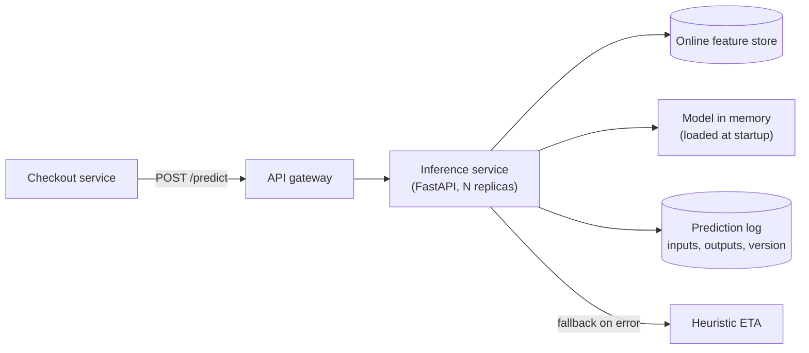
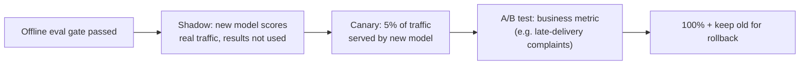

# Model Serving and Deployment

A trained model is a file. A **served** model is a reliable service with latency targets, scaling, versioning, rollback and safe release practices. This guide covers the serving patterns (batch, online, streaming, edge), how to build a production inference API, packaging and optimisation, and how to roll out new models safely with shadow, canary and A/B deployments.

## 1. Choose the serving pattern

| Pattern | How | Latency | Example |
|---|---|---|---|
| **Batch** | Score everything on a schedule and write results to a table | Hours | Nightly churn scores, weekly demand forecasts |
| **Online (request/response)** | API call per prediction | 10–200 ms | ETA at checkout, fraud check at payment |
| **Streaming** | Consume events, score them, publish results | Seconds | Real-time anomaly detection on rider GPS |
| **Edge / on-device** | The model ships in the app or browser | Under 10 ms, works offline | Photo quality check in the rider app |

**Prefer batch when you can.** It's simpler, cheaper and easy to monitor. If predictions can be computed ahead of time (recommendations for every user each night), do that and look them up at request time.

## 2. An online inference service



```python
# FastAPI inference service: typed input, model loaded once, logging, fallback
from fastapi import FastAPI
from pydantic import BaseModel, Field
import mlflow, time, logging

app = FastAPI()
MODEL_URI = "models:/delivery-eta@champion"
model = mlflow.pyfunc.load_model(MODEL_URI)          # load once at startup, not per request
MODEL_VERSION = model.metadata.run_id

class EtaRequest(BaseModel):
    order_id: str
    restaurant_id: int
    distance_km: float = Field(ge=0, le=50)
    items: int = Field(ge=1, le=100)

class EtaResponse(BaseModel):
    eta_minutes: float
    model_version: str
    fallback: bool = False

@app.post("/predict", response_model=EtaResponse)
def predict(req: EtaRequest):
    t0 = time.perf_counter()
    try:
        feats = feature_store.get_online(req.restaurant_id) | req.model_dump()
        eta = float(model.predict(to_frame(feats))[0])
        resp = EtaResponse(eta_minutes=round(eta, 1), model_version=MODEL_VERSION)
    except Exception:
        logging.exception("model failure")
        resp = EtaResponse(eta_minutes=heuristic_eta(req), model_version="heuristic", fallback=True)
    prediction_log.write(order_id=req.order_id, features=feats if 'feats' in locals() else None,
                         output=resp.eta_minutes, version=resp.model_version, ms=(time.perf_counter() - t0) * 1000)
    return resp

@app.get("/ready")
def ready():
    return {"model_version": MODEL_VERSION}
```

Essentials shown here: **validate inputs** with a schema, **load the model once**, return the **model version** with every prediction, **log inputs and outputs** for monitoring and later training data, and have a **fallback** so a model failure degrades gracefully instead of breaking checkout.

## 3. Packaging and infrastructure

- **Container image** with pinned library versions that match training. A different scikit-learn or numpy version can silently change predictions or fail to load the model.
- Deploy on Kubernetes (with an HPA on CPU or requests per second), a serverless container platform, or a managed endpoint (SageMaker, Vertex AI, Azure ML).
- **Model servers** for heavier workloads: NVIDIA Triton, TorchServe, KServe, BentoML and Ray Serve. They add dynamic batching, multi-model hosting and GPU scheduling.
- **LLM serving** has its own specialised engines (vLLM, TGI, SGLang) with continuous batching and paged KV-cache, so many concurrent generations share a GPU efficiently.

```dockerfile
FROM python:3.13-slim
WORKDIR /app
COPY requirements.lock .
RUN pip install --no-cache-dir -r requirements.lock      # exact versions used in training
COPY src/ ./src
ENV MODEL_URI=models:/delivery-eta@champion
USER 1000
CMD ["uvicorn", "src.app:app", "--host", "0.0.0.0", "--port", "8080", "--workers", "2"]
```

## 4. Making inference fast and cheap

| Technique | Effect |
|---|---|
| Export to **ONNX**, run with ONNX Runtime | Often 2–5× faster CPU inference, language-independent |
| **Quantisation** (FP32 → INT8 / FP16) | Smaller, faster models with a small accuracy cost (measure it) |
| **Dynamic batching** | Group concurrent requests to use GPUs efficiently |
| Distillation | Train a small "student" model to mimic a big one |
| Caching | Identical inputs give the stored output |
| Right-sized hardware | Many tabular models need no GPU at all |

Always measure the **p95/p99 latency** at realistic concurrency, not just a single request.

## 5. Releasing a new model safely

A new model that scores better offline can still fail in production because of skew, edge cases or effects on user behaviour. Release it progressively:



1. **Shadow deployment:** both models score every request, but only the old one's answer is used. Compare predictions and latency with zero user risk.
2. **Canary:** route a small slice of traffic to the new model, watch error rates, latency and prediction distributions, and roll back automatically on alerts.
3. **A/B test:** measure the *business* outcome (fewer late-delivery complaints, conversion), not just offline MAE.
4. **Instant rollback:** move the `champion` alias back and reload. Keep the previous version warm.

Kubernetes-native tools (KServe, Argo Rollouts, service mesh traffic splitting) and managed endpoints all support weighted traffic between model versions.

## 6. Batch scoring done right

```python
# Nightly churn scoring: idempotent, partitioned, versioned
def score_partition(run_date):
    model = mlflow.pyfunc.load_model("models:/churn@champion")
    users = read_features(as_of=run_date)                      # point-in-time snapshot
    out = users[["user_id"]].assign(
        churn_risk=model.predict(users),
        model_version=model.metadata.run_id,
        scored_for=run_date,
    )
    write_table("ml.churn_scores", out, partition=run_date, mode="overwrite")   # rerunnable
```

Overwrite a whole partition so reruns are idempotent, record the model version with every row, and validate the output (row count, score distribution) before downstream teams consume it.

## 7. Real-world case: a fraud model that slowed checkout

A new deep fraud model improved recall by 15% offline, but in the canary p99 latency rose from 40 ms to 380 ms, and the payment service's 300 ms timeout started falling back to "allow." The fixes were exporting to ONNX with INT8 quantisation (which measurably cost 0.3% recall), moving heavy aggregate features to precomputed streaming features in the online store, and doubling replicas at peak with an HPA. p99 came down to 55 ms. Without the canary, the fallback would have silently disabled fraud checks for 8% of payments.

## 8. Hands-on exercise

1. Wrap a trained model in FastAPI with input validation, version reporting, logging and a fallback.
2. Containerise it with pinned versions and load-test it with `locust` or `k6` to find p95 at 50 RPS.
3. Export the model to ONNX and compare latency.
4. Implement shadow mode: call both models, return the old one's answer, and log both.

## 9. Checklist

- [ ] I can choose between batch, online, streaming and edge serving, preferring batch when possible.
- [ ] I build inference services with validation, a single model load, version tagging, logging and fallbacks.
- [ ] I pin dependencies to match training and know when to use a dedicated model server.
- [ ] I can speed up inference with ONNX, quantisation, batching and caching, measuring the trade-offs.
- [ ] I release models via shadow, canary and A/B, with instant rollback.

## 10. Interview angle

> **Asked as:** "How would you deploy a new version of a model with minimal risk?"

Pass the offline evaluation gate including slices, run in shadow mode on live traffic, canary to a small percentage with automated rollback on errors, latency or prediction-distribution alerts, A/B test the business metric, then roll out while keeping the old version warm.

> **Asked as:** "Batch or real-time inference?"

Batch if predictions can be precomputed and slight staleness is fine, since it's simpler and cheaper. Use real time when the prediction depends on request-time context, such as checkout contents, a live location or a payment.
