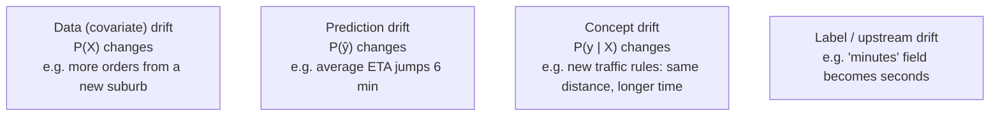

# Monitoring ML in Production: Drift, Retraining and Responsible ML

Software usually breaks loudly with errors and crashes. Models break **silently**. They keep returning confident predictions while the world they learned from moves on. Customer behaviour shifts, a new city launches, an upstream team changes a field's units, a holiday arrives. This guide covers what to monitor, how to detect drift, when and how to retrain, and the governance practices that keep ML fair, explainable and auditable.

## 1. Four layers of monitoring

| Layer | Examples | Why |
|---|---|---|
| **Service health** | Latency p95/p99, error rate, throughput, fallback rate | The service works at all |
| **Data quality** | Nulls, out-of-range values, schema changes, missing features | Broken inputs give broken outputs |
| **Drift** | Input and prediction distributions vs training | The world changed |
| **Model and business quality** | MAE or precision once labels arrive, complaints, revenue impact | The model is still useful |

## 2. Types of drift



- **Data drift** is detectable immediately from inputs, but not every drift hurts accuracy.
- **Concept drift** is the dangerous one, because the relationship itself changed. It's only fully visible once **ground-truth labels** arrive, which can take minutes (actual delivery time), weeks (churn) or months (loan default).
- **Upstream changes** (units, encodings, a renamed category) look like extreme drift and are the most common cause of sudden model failure.

## 3. Measuring drift

Common statistics, compared between a **reference** window (training data or a stable recent period) and the **current** window:

- **PSI (Population Stability Index)** for binned features. Rule of thumb: below 0.1 is stable, 0.1–0.25 is moderate, above 0.25 is significant.
- **Kolmogorov-Smirnov test or Wasserstein distance** for numeric features.
- **Chi-square or Jensen-Shannon divergence** for categorical features.

```python
import numpy as np

def psi(reference, current, bins=10):
    edges = np.unique(np.quantile(reference, np.linspace(0, 1, bins + 1)))
    ref = np.histogram(reference, edges)[0] / len(reference)
    cur = np.histogram(current, edges)[0] / len(current)
    ref, cur = np.clip(ref, 1e-6, None), np.clip(cur, 1e-6, None)
    return float(np.sum((cur - ref) * np.log(cur / ref)))

for feat in ["distance_km", "prep_minutes_avg", "rain_mm"]:
    print(feat, round(psi(train_df[feat], last_7_days[feat]), 3))
```

Libraries like **Evidently**, **NannyML** and **WhyLabs**, plus cloud model monitors, produce these reports and dashboards. With very large samples, statistical tests flag tiny, harmless shifts as "significant," so alert on **effect-size thresholds** and on the features that matter most to the model, not on every p-value.

## 4. Measuring real performance

Join predictions to outcomes as labels arrive:

```sql
-- Daily ETA error by city, once deliveries complete
SELECT date_trunc('day', p.predicted_at) AS day, o.city, p.model_version,
       avg(abs(p.eta_minutes - o.actual_minutes)) AS mae,
       avg((o.actual_minutes > p.eta_minutes + 5)::int) AS late_rate
FROM prediction_log p
JOIN deliveries o USING (order_id)
WHERE p.predicted_at > now() - interval '30 days'
GROUP BY 1, 2, 3
ORDER BY 1, 2;
```

When labels are delayed, use **proxies** (complaint rate, manual-review overturn rate) and estimate performance from drift, while waiting for real labels.

## 5. Retraining strategies

| Strategy | When |
|---|---|
| **Scheduled** (weekly, monthly) | Steady, gradual drift and labels arrive quickly. Simple and predictable. |
| **Triggered** by drift or a performance drop | Irregular changes. Needs reliable monitoring. |
| **Continual / online learning** | Very fast-changing domains (ads, feeds), with strong safeguards |

Retraining is a deployment. It goes through the same pipeline, data validation, evaluation gate and canary as any model change. Watch for **feedback loops**. If a fraud model blocks transactions, you never learn whether they were really fraud, so future training data becomes biased. Keep a small random holdout (or human-reviewed sample) to get unbiased labels.

## 6. Responsible ML

### Fairness

Models can perform worse, or decide unfairly, for some groups even when those attributes aren't features, because of proxies (a postcode can encode ethnicity or income). For decisions that affect people (credit, hiring, pricing, account bans):

- **Measure performance and outcomes per group** (false positive rate by region, approval rates).
- Pick fairness criteria appropriate to the use case, such as equal opportunity (similar true-positive rates) or calibration within groups. Many definitions can't all be satisfied at once, so make the trade-off explicit.
- Mitigate with better data, reweighting, threshold adjustments or constraints, and with human review for borderline cases.

### Explainability and documentation

- **SHAP** explanations for individual decisions, which is important when users can contest outcomes.
- **Model cards:** intended use, training data, evaluation by slice, known limitations, owner and review date.
- **Data lineage and an audit trail:** which data, code and model version produced each decision.

### Privacy and regulation

Minimise and protect personal data in training sets, honour deletion requests (which may mean retraining or using unlearning-friendly designs), and know the rules that apply to you. The EU AI Act categorises AI systems by risk and adds obligations such as risk management, documentation, human oversight and transparency for high-risk uses. Many other jurisdictions have data-protection laws covering automated decisions.

## 7. Real-world case: an ETA model and Ramadan

Every year during Ramadan, delivery patterns shift sharply: orders spike before iftar, restaurants are overloaded and traffic patterns change. In its first year, an ETA model's late rate doubled in the first week, because the training data held only a few weeks of similar conditions and nobody was watching drift. The following year the team:

- added calendar features (days to iftar, Ramadan flag) and kept prior years' Ramadan data in training,
- set PSI alerts on order-hour distribution and prep times,
- monitored MAE daily per city, with an automatic retrain trigger above a threshold,
- added a temporary safety buffer to displayed ETAs while the drift alerts were active.

The late rate stayed within 10% of normal.

## 8. Hands-on exercise

1. Log predictions with timestamps and model version. Simulate a month of data where one feature's distribution shifts in week three.
2. Compute PSI per feature per week and plot it. Set an alert threshold.
3. Join predictions to actual outcomes and plot daily MAE. Notice the lag between drift and performance drop.
4. Generate an Evidently drift report.
5. Write a one-page model card for your model.

## 9. Checklist

- [ ] I monitor service health, data quality, drift and real performance.
- [ ] I can distinguish data, prediction, concept and upstream drift.
- [ ] I compute PSI and KS and alert on effect sizes for important features.
- [ ] I choose scheduled or triggered retraining and treat retraining as a gated deployment.
- [ ] I evaluate fairness by group, document models with model cards and keep an audit trail.

## 10. Interview angle

> **Asked as:** "How do you know when to retrain a model?"

Monitor real performance as labels arrive, with proxies meanwhile, plus input and prediction drift on key features. Retrain on a schedule matched to the drift rate, or on triggers, always through the validation and evaluation gate and a canary.

> **Asked as:** "What's concept drift? Give an example."

It's when the relationship between inputs and the target changes. For example, after new traffic rules the same distance and time of day produce longer deliveries. Input distributions may look unchanged, so you need outcome monitoring to catch it.
