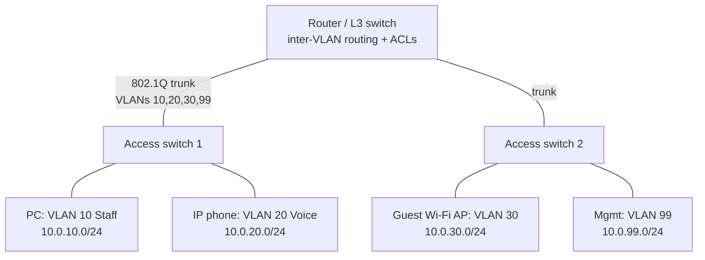

# Switching, Routing and VLANs

Every packet your application sends crosses switches and routers. Network engineers design, build and run that fabric, from the office LAN to data-centre and cloud networks. This guide covers how Layer 2 switching and Layer 3 routing work, how VLANs segment networks, and how routing protocols (static, OSPF, BGP) move traffic between networks, with real configuration examples in Cisco IOS-style syntax, which most vendors resemble.

## 1. The layers network engineers live in

| Layer | Unit | Addressing | Device | Key protocols |
|---|---|---|---|---|
| 1 Physical | Bits | — | Cables, optics, radios | Ethernet PHY, Wi-Fi radio |
| **2 Data link** | Frames | MAC (`3c:22:fb:1a:7e:01`) | **Switch** | Ethernet, 802.1Q VLANs, STP, LACP, ARP |
| **3 Network** | Packets | IP (`10.20.30.40/24`) | **Router**, L3 switch | IPv4/IPv6, ICMP, OSPF, BGP |
| 4 Transport | Segments | Ports | Firewall, load balancer | TCP, UDP |

Subnetting and CIDR are prerequisites. A `/24` holds 256 addresses (254 usable hosts), and `10.20.0.0/16` can be split into 256 `/24`s. See the DevOps networking guide for practice.

## 2. How a switch forwards frames

A switch learns which MAC address lives on which port by reading the **source MAC** of incoming frames, building a **MAC address table**:

1. A frame arrives on port 3 from `aa:aa`. The switch records `aa:aa → port 3`.
2. If the destination MAC is in the table, the switch forwards out that port only.
3. If it's unknown, or broadcast (`ff:ff:ff:ff:ff:ff`), it **floods** out all other ports in the VLAN.

**ARP** bridges L3 to L2. To send to `10.0.10.25` on the same subnet, a host broadcasts "who has 10.0.10.25?" and caches the MAC from the reply. To reach a different subnet, it ARPs for its **default gateway** instead.

## 3. VLANs: one switch, many networks

A **VLAN** splits one physical switch into separate broadcast domains. Typical office design: users, voice, guests, printers, servers and management, each in its own VLAN and subnet, so a compromised guest laptop can't even see the payroll server.



- **Access ports** carry one VLAN (untagged) to end devices.
- **Trunk ports** carry many VLANs between switches and routers, with each frame **tagged** using 802.1Q (a 4-byte header holding a 12-bit VLAN ID, so up to 4094 VLANs).

```text
! Access switch
vlan 10
 name STAFF
vlan 20
 name VOICE
vlan 30
 name GUEST
!
interface GigabitEthernet1/0/5
 description Desk 2.14
 switchport mode access
 switchport access vlan 10
 switchport voice vlan 20
 spanning-tree portfast
 spanning-tree bpduguard enable        ! shut the port if someone plugs in a switch
!
interface TenGigabitEthernet1/1/1
 description Uplink to core
 switchport mode trunk
 switchport trunk allowed vlan 10,20,30,99
 switchport trunk native vlan 999      ! unused native VLAN mitigates VLAN-hopping
```

### Inter-VLAN routing

VLANs are separate networks, so traffic between them must be **routed**, usually on a Layer 3 switch with **SVIs** (switch virtual interfaces), which is where you apply access control:

```text
ip routing
interface Vlan10
 ip address 10.0.10.1 255.255.255.0
 ip helper-address 10.0.99.10          ! forward DHCP broadcasts to the DHCP server
interface Vlan30
 ip address 10.0.30.1 255.255.255.0
 ip access-group GUEST-IN in
!
ip access-list extended GUEST-IN
 deny   ip 10.0.30.0 0.0.0.255 10.0.0.0 0.255.255.255   ! guests can't reach internal networks
 permit ip 10.0.30.0 0.0.0.255 any                       ! internet only
```

## 4. Loops, STP and link aggregation

Redundant links between switches create **loops**. Ethernet frames have no TTL, so a broadcast circulates forever and melts the network in seconds (a broadcast storm). **Spanning Tree Protocol** (modern versions: RSTP 802.1w, MSTP 802.1s) elects a root bridge and blocks redundant ports, unblocking them if the active path fails.

Best practices: set the root bridge deliberately (the core switch), use PortFast plus BPDU Guard on edge ports, and prefer designs that avoid relying on STP for redundancy.

**Link aggregation (LACP, 802.3ad)** bundles several physical links into one logical link for bandwidth and redundancy. STP sees one link, so nothing gets blocked:

```text
interface range TenGigabitEthernet1/1/1 - 2
 channel-group 1 mode active          ! LACP
interface Port-channel1
 switchport mode trunk
```

Data centres have largely replaced STP-based designs with **leaf-spine** fabrics: every leaf connects to every spine, Layer 3 routing runs everywhere with ECMP (equal-cost multipath), and VXLAN/EVPN stretches Layer 2 segments over the routed fabric where needed.

## 5. Routing: how packets cross networks

A router looks up each packet's destination in its **routing table** and picks the **longest prefix match** (the most specific route wins):

```text
Router# show ip route
S*    0.0.0.0/0 [1/0] via 203.0.113.1              ! default route to the ISP
O     10.1.0.0/16 [110/20] via 10.255.0.2           ! learned via OSPF
C     10.0.10.0/24 is directly connected, Vlan10
S     10.50.0.0/24 [1/0] via 10.255.0.6             ! static route
```

A packet to `10.1.4.7` matches both `0.0.0.0/0` and `10.1.0.0/16`, and the `/16` wins. **Administrative distance** (static 1, eBGP 20, OSPF 110…) breaks ties between protocols that offer the same prefix.

### Static routes

Simple and predictable, but they don't adapt to failures. They suit small sites, default routes and stub networks.

### OSPF: interior dynamic routing

OSPF is a **link-state** protocol. Each router floods information about its links, every router builds the same map of the network, and each runs Dijkstra's shortest-path algorithm. It converges quickly after failures and scales with **areas** (area 0 as the backbone).

```text
router ospf 1
 router-id 10.255.0.1
 passive-interface default             ! don't form adjacencies on user VLANs
 no passive-interface TenGigabitEthernet1/1/3
 network 10.0.0.0 0.0.255.255 area 0
 network 10.255.0.0 0.0.0.255 area 0
```

### BGP: the routing protocol of the internet

BGP is a **path-vector** protocol that exchanges routes between **autonomous systems** (ASes): ISPs, cloud providers, large companies. It chooses paths by **policy** (local preference, AS-path length, MED…) rather than pure shortest distance, which lets organisations control how traffic enters and leaves. It's used for multi-homing to two ISPs, cloud interconnects (AWS Direct Connect, Azure ExpressRoute) and inside data-centre fabrics.

```text
router bgp 65010
 bgp router-id 10.255.0.1
 neighbor 203.0.113.1 remote-as 64500          ! ISP A
 neighbor 198.51.100.1 remote-as 64501         ! ISP B
 address-family ipv4
  network 192.0.2.0 mask 255.255.255.0         ! announce our public prefix
  neighbor 203.0.113.1 prefix-list OUR-PREFIXES out   ! never leak other routes
  neighbor 198.51.100.1 prefix-list OUR-PREFIXES out
  neighbor 198.51.100.1 route-map PREPEND out         ! make ISP B the backup path for inbound traffic
```

Real outages have come from BGP mistakes, such as leaking routes or withdrawing your own prefixes, which is why **RPKI** route-origin validation and strict prefix filters are standard practice.

## 6. IPv6 essentials

IPv4 addresses ran out years ago, and IPv6 carries a large and growing share of internet traffic, including much of Bangladesh's mobile traffic. Key differences: 128-bit addresses (`2001:db8:10::25/64`), `/64` per LAN as standard, **SLAAC** (hosts auto-configure addresses from router advertisements) or DHCPv6, no NAT needed (security comes from firewalls), and ARP replaced by **Neighbor Discovery** (ICMPv6, so don't block all ICMPv6). Run dual-stack and apply firewall policy to both protocols, because forgetting IPv6 rules is a classic hole.

## 7. Real-world case: the office that went down at 10 a.m.

Every morning around 10 a.m., a 300-person office lost connectivity for a few minutes. Switch logs showed STP topology changes and MAC flapping. Someone in a meeting room had connected a small unmanaged switch with a cable looped back into a second wall port, which created a loop that STP took time to block, and the BPDUs from the cheap switch confused things further. The fixes were BPDU Guard on every access port (the port shuts down when it hears a switch), storm control limits, a deliberate root bridge on the core, and port security. The next time someone did it, only that one port went down.

## 8. Hands-on exercise

Use a simulator (Cisco Packet Tracer, GNS3, EVE-NG or Containerlab with open-source routers like FRRouting):

1. Build two access switches and one L3 core with VLANs 10, 20 and 30, trunks, and SVIs with DHCP relay.
2. Add an ACL so the guest VLAN reaches only the internet.
3. Add a redundant link, observe STP blocking it, then convert it to an LACP port-channel.
4. Connect three routers with OSPF, break a link and watch convergence with `show ip route`.
5. Peer two "ISP" routers with BGP and announce a prefix with prefix-list filtering.

## 9. Checklist

- [ ] I can explain MAC learning, flooding, ARP and default gateways.
- [ ] I can configure access and trunk ports, VLANs, SVIs and inter-VLAN ACLs.
- [ ] I understand STP, edge-port protections, LACP and leaf-spine designs.
- [ ] I can read a routing table, apply longest-prefix match and administrative distance, and configure static routes and OSPF.
- [ ] I understand BGP's role, policies and safety practices (prefix filters, RPKI), plus IPv6 basics.

## 10. Interview angle

> **Asked as:** "What happens when two hosts on different VLANs communicate?"

The sender sees the destination is off-subnet, ARPs for its default gateway (the SVI) and sends the frame tagged in its VLAN. The L3 switch routes the packet (applying ACLs), ARPs for the destination in the other VLAN, rewrites the L2 header and forwards it.

> **Asked as:** "OSPF vs BGP?"

OSPF is a link-state interior gateway protocol: fast convergence, shortest path inside one organisation. BGP is a path-vector exterior protocol between autonomous systems, choosing routes by policy and scaling to the whole internet. It's also used inside large data-centre fabrics.
