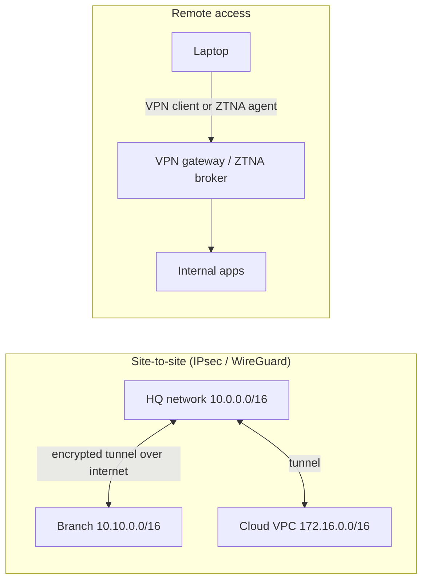

# Network Services, Firewalls, VPNs and Zero Trust

A network that forwards packets is only half the job. Devices need addresses and names, traffic must be filtered, remote users and sites must connect securely, and wireless must be both easy and safe. This guide covers the core network services (DHCP, DNS, NAT, NTP), firewalls and segmentation, VPNs (IPsec and WireGuard), Wi-Fi security, and how zero trust changes network design.

## 1. Core network services

### DHCP: automatic addressing

The **DORA** exchange: the client broadcasts *Discover*, the server *Offers* an address, the client *Requests* it, and the server *Acknowledges* with a lease, gateway, DNS servers and options.

```text
ip dhcp excluded-address 10.0.10.1 10.0.10.20        ! reserve the gateway and static devices
ip dhcp pool STAFF
 network 10.0.10.0 255.255.255.0
 default-router 10.0.10.1
 dns-server 10.0.99.53 10.0.99.54
 lease 0 8                                          ! 8-hour leases
```

DHCP broadcasts don't cross routers, so on routed VLANs use a **relay** (`ip helper-address`). Protect against rogue DHCP servers with **DHCP snooping** on switches, which also enables Dynamic ARP Inspection against ARP spoofing.

### DNS internals for network engineers

Run internal resolvers (redundant pairs), split-horizon zones (internal names resolve privately), and log queries. DNS logs are among the best sources for detecting malware command-and-control. Encrypted DNS (DoH and DoT) from endpoints improves privacy but can bypass corporate filtering, so set policy deliberately.

### NAT

**NAT/PAT** lets many private addresses (RFC 1918: `10/8`, `172.16/12`, `192.168/16`) share public IPs by rewriting addresses and ports. **Port forwarding** (destination NAT) exposes an internal service. **CGNAT** at ISPs means many home users share one public IP, which complicates inbound connections and IP-based blocking.

### NTP

Accurate time underpins TLS certificate validation, Kerberos authentication and log correlation during incidents. Point all devices at internal NTP servers synced to reliable upstream sources.

## 2. Firewalls and segmentation

| Type | Inspects | Example |
|---|---|---|
| Stateless ACL | Individual packets (IP, port) | Router ACLs, cloud network ACLs |
| **Stateful firewall** | Connections, allowing return traffic automatically | iptables/nftables, cloud security groups |
| **Next-generation firewall (NGFW)** | Applications, users, TLS (optionally decrypted), IPS signatures, URL categories | Palo Alto, Fortinet, Check Point, cloud firewalls |
| Web application firewall (WAF) | HTTP requests (SQLi, XSS patterns, bots) | Cloudflare, AWS WAF, ModSecurity |

Design principles:

- **Default deny**, with explicit allows documented with a business reason and an owner.
- **Segment by trust and function:** users, servers, OT/IoT, guests and management. A **DMZ** for internet-facing services, with no direct path from the internet to internal networks.
- **Filter egress too.** Servers rarely need arbitrary internet access, and blocking it stops exfiltration and malware downloads.
- **Review rules regularly.** Firewalls accumulate thousands of stale "temporary" rules.

```bash
# Host firewall with nftables: allow SSH from the management VLAN and HTTPS from anywhere; drop the rest
nft add table inet filter
nft add chain inet filter input '{ type filter hook input priority 0; policy drop; }'
nft add rule inet filter input ct state established,related accept
nft add rule inet filter input iif lo accept
nft add rule inet filter input ip saddr 10.0.99.0/24 tcp dport 22 accept
nft add rule inet filter input tcp dport 443 accept
nft add rule inet filter input icmp type echo-request limit rate 5/second accept
```

## 3. VPNs



### IPsec

The long-standing standard for site-to-site VPNs and cloud VPN gateways. **IKEv2** negotiates keys (use certificate or strong pre-shared-key authentication), then **ESP** encrypts the traffic. Use modern parameters: AES-GCM, SHA-256 or better, Diffie-Hellman groups 19/20 (ECP) or higher, and plan for post-quantum hybrid options as vendors adopt them.

### WireGuard

A modern, minimal VPN protocol in the Linux kernel, with fixed modern crypto (Curve25519, ChaCha20-Poly1305), a small codebase and very simple configuration:

```ini
# /etc/wireguard/wg0.conf on the branch gateway
[Interface]
Address = 10.200.0.2/24
PrivateKey = <branch-private-key>
ListenPort = 51820

[Peer]                                   # HQ
PublicKey = <hq-public-key>
Endpoint = vpn.hq.example:51820
AllowedIPs = 10.0.0.0/16, 10.200.0.1/32  # routes sent through the tunnel (and accepted from this peer)
PersistentKeepalive = 25                 # keeps NAT mappings alive
```

```bash
wg-quick up wg0 && wg show           # handshake time and transfer counters confirm the tunnel works
```

### Remote access: from VPN to ZTNA

Traditional remote-access VPNs put a user's device *on the network*, so a compromised laptop can reach everything that network can. Internet-facing VPN appliances have also been among the most exploited targets of recent years. **Zero Trust Network Access (ZTNA)** instead brokers access per application: the user authenticates with SSO and MFA, device posture is checked, and the user reaches only the specific apps they're authorised for, never the network itself.

## 4. Zero trust architecture

Zero trust (NIST SP 800-207) replaces "inside the firewall is trusted" with:

1. **Verify explicitly:** strong identity (SSO, phishing-resistant MFA), device health and context on every request.
2. **Least-privilege access:** per application, just enough and just in time.
3. **Assume breach:** segment, encrypt internal traffic (mTLS), and monitor everything.

In practice that means an identity provider plus device management feeding a policy engine, ZTNA or identity-aware proxies for apps, **microsegmentation** (host or workload firewalls, Kubernetes NetworkPolicies, cloud security groups referencing other groups), and continuous logging. **SASE** bundles ZTNA, a secure web gateway, CASB and firewall-as-a-service delivered from the cloud for distributed workforces.

## 5. Wireless networking

- **Standards:** Wi-Fi 6/6E (802.11ax) and Wi-Fi 7 (802.11be) bring higher throughput and better performance in dense environments, plus the 6 GHz band with much more clean spectrum.
- **Security:** **WPA3** (SAE replaces the PSK handshake, so offline password guessing doesn't work). For organisations, **WPA3-Enterprise with 802.1X/EAP-TLS** (certificate per device) means no shared passwords. Use a separate SSID or VLAN for guests with client isolation.
- **Design:** survey coverage and capacity, plan channels to avoid co-channel interference, prefer 5/6 GHz for capacity, and set transmit power so clients roam properly.

## 6. Monitoring the network

- **SNMPv3** (authenticated and encrypted) or **streaming telemetry** (gNMI) for interface counters, errors and CPU.
- **Flow data** (NetFlow, IPFIX, sFlow, cloud VPC flow logs): who talks to whom and how much. Essential for capacity planning and security investigations.
- **Syslog** from all devices to a central collector or SIEM.
- Alert on interface errors and discards, link utilisation above 70–80%, BGP and OSPF neighbour changes, and configuration changes.

## 7. Real-world case: from flat network to segmented

A hospital had one flat `/16` network: PCs, servers, medical devices and guest Wi-Fi all reachable from each other. Ransomware entered through one phishing email and spread to 400 machines in two hours. The rebuild:

- VLANs and firewall zones for clinical devices, staff PCs, servers, management and guests, with default-deny between them,
- medical devices allowed to reach only their specific servers,
- the remote-access VPN replaced by ZTNA with device posture checks,
- 802.1X on wired and wireless, so unknown devices land in a quarantine VLAN,
- flow logs and DNS logs to the SIEM, with alerts on SMB traffic between workstations.

A later phishing infection was contained to a single PC.

## 8. Hands-on exercise

1. Set up a DHCP server and relay across two VLANs in a lab and capture DORA in Wireshark.
2. Write an nftables policy for a web server: default drop, SSH from management only, HTTPS from anywhere, restricted egress.
3. Build a WireGuard site-to-site tunnel between two VMs or containers and route a subnet through it.
4. Design a segmentation plan (zones, allowed flows table) for a 200-person company with offices, a small data centre and cloud.

## 9. Checklist

- [ ] I understand DHCP (with relay and snooping), internal DNS, NAT and NTP.
- [ ] I can design default-deny segmentation with stateful firewalls, a DMZ and egress filtering.
- [ ] I can configure site-to-site VPNs with IPsec or WireGuard and explain the move from VPN to ZTNA.
- [ ] I can explain zero trust principles and how microsegmentation, identity and SASE fit together.
- [ ] I know Wi-Fi security (WPA3, 802.1X) and network monitoring (SNMPv3, telemetry, flows, syslog).

## 10. Interview angle

> **Asked as:** "How would you secure remote access for employees?"

Prefer ZTNA: SSO with phishing-resistant MFA, device posture checks and per-application access, with no network-level access. If a VPN remains, patch the gateway aggressively, require MFA, restrict access by group, segment what VPN users can reach and log everything.

> **Asked as:** "Stateless vs stateful firewall?"

Stateless filters evaluate each packet in isolation, so return traffic needs explicit rules. Stateful firewalls track connections and allow replies automatically, which makes policies simpler and safer. NGFWs add application and user awareness and threat prevention.
