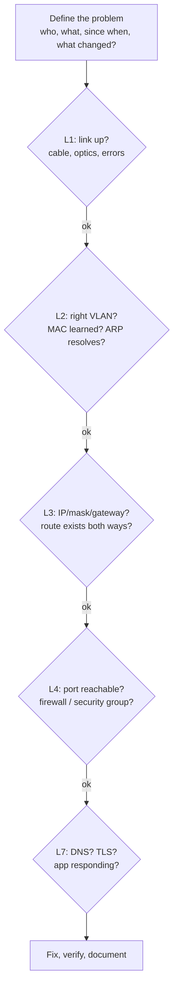

# Network Troubleshooting, Packet Analysis and Automation

"The network is slow" and "I can't connect" are the two messages every network engineer receives daily. Solving them fast takes a systematic method, the right tools and the ability to read packets. At scale, configuring hundreds of devices by hand is slow and error-prone, so modern network teams treat configuration as code. This guide covers the troubleshooting method, the essential commands, Wireshark analysis, and network automation with Python and Ansible.

## 1. A systematic method

Work through the stack instead of guessing:



Questions that solve half of all cases:

- **What changed?** A config push, a firmware update, a new firewall rule, a certificate expiry.
- **Who's affected?** One user (their device), one site (uplink, local switch), everyone (core, DNS, ISP, cloud).
- **Can you reproduce it**, and from where? Test from both sides of the suspected fault.

## 2. Essential commands

```bash
# Addressing and routes (Linux)
ip -br addr                       # interfaces and IPs at a glance
ip route get 10.1.4.7             # which route, interface and source IP would be used
ip neigh                          # ARP / neighbour cache

# Reachability and path
ping -c 4 10.1.4.7
mtr -rwzc 50 api.example.com      # combined traceroute + per-hop loss/latency (see where loss starts)
tracepath -n 10.1.4.7             # also discovers path MTU

# DNS
dig +short api.example.com
dig @10.0.99.53 api.example.com +trace     # follow delegation from the root

# Ports and services
nc -vz 10.1.4.7 5432              # can I open a TCP connection?
ss -tlnp                          # what's listening locally, and which process
curl -v --connect-timeout 5 https://api.example.com/health   # DNS, TCP, TLS and HTTP in one view

# Throughput
iperf3 -s                          # on one host
iperf3 -c 10.1.4.7 -P 4 -t 20      # from the other: real bandwidth between two points
```

On network devices:

```text
show interfaces Gi1/0/5                  ! errors, CRC, drops, duplex/speed mismatches
show mac address-table address 3c22.fb1a.7e01
show vlan brief
show ip route 10.1.4.7
show ip ospf neighbor / show bgp summary
show logging | include changed state
```

Interpreting the results:

- **`ping` works, the app doesn't:** look at L4 and up (firewall port, service down, TLS).
- **Traceroute stops at a hop:** often a firewall, or a missing **return route** (asymmetric routing). Check the path back from the destination too.
- **Loss that starts at one hop and continues to the end** is real. Loss at a single middle hop only is often just ICMP rate-limiting on that router.
- **Large transfers hang, small requests work:** suspect an **MTU** problem (VPN or tunnel overhead combined with blocked ICMP "fragmentation needed"). Test with `ping -M do -s 1472`, then lower the size.

## 3. Packet analysis with tcpdump and Wireshark

When logs and commands disagree, packets tell the truth.

```bash
# Capture on a server: only traffic to/from the DB, full packets, rotate files
sudo tcpdump -i eth0 -nn -s 0 -w /tmp/db.pcap host 10.1.4.7 and port 5432
# Quick look at TCP handshakes and resets
sudo tcpdump -i eth0 -nn 'tcp[tcpflags] & (tcp-syn|tcp-rst) != 0'
```

Useful Wireshark display filters:

| Filter | Finds |
|---|---|
| `tcp.analysis.retransmission` | Packet loss or congestion |
| `tcp.flags.reset == 1` | Connections actively refused or killed (often a firewall or closed port) |
| `tcp.analysis.zero_window` | Receiver overwhelmed (application not reading fast enough) |
| `dns.flags.rcode != 0` | DNS failures (NXDOMAIN, SERVFAIL) |
| `tls.handshake.type == 1` | TLS ClientHello: check SNI, versions offered |
| `tcp.time_delta > 1` | Long gaps, meaning slow server or application |

Reading a failure:

```text
1  0.000  10.0.10.25 → 10.1.4.7   TCP  [SYN]
2  1.003  10.0.10.25 → 10.1.4.7   TCP  [SYN] (retransmission)
3  3.007  10.0.10.25 → 10.1.4.7   TCP  [SYN] (retransmission)
```

SYNs with no reply mean packets are silently **dropped**, by a firewall, a security group or a missing return route. Compare with an immediate `[RST, ACK]`, which means the host is reachable but nothing is listening, or something actively rejected the connection.

Use **Statistics → Conversations** and **I/O Graphs** in Wireshark to find top talkers and throughput collapses.

## 4. Cloud networking troubleshooting

The same layers apply, with different controls:

- **Security groups** (stateful, attached to instances) vs **network ACLs** (stateless, per subnet. Remember the ephemeral return ports).
- **Route tables** per subnet: is there a route to the internet gateway, NAT gateway, peering or transit gateway?
- **VPC flow logs** show `ACCEPT` or `REJECT` per flow, which is the cloud equivalent of a packet capture for "is it the firewall?"
- Built-in tools: AWS **Reachability Analyzer**, Azure **Network Watcher** (IP flow verify, next hop), GCP **Connectivity Tests** analyse configured paths without sending traffic.

## 5. Network automation

Manual CLI changes across hundreds of devices cause inconsistency and outages. Automation brings consistency, speed, review and rollback.

### Python with Netmiko (SSH to devices)

```python
from netmiko import ConnectHandler
from concurrent.futures import ThreadPoolExecutor
import os

devices = [{"device_type": "cisco_ios", "host": h, "username": "netops",
            "password": os.environ["NET_PASS"]} for h in ["10.0.99.11", "10.0.99.12", "10.0.99.13"]]

def audit(dev):
    with ConnectHandler(**dev) as conn:
        out = conn.send_command("show interfaces status", use_textfsm=True)   # parsed into dicts
        err_ports = [p["port"] for p in out if p["status"] == "err-disabled"]
        return dev["host"], err_ports

with ThreadPoolExecutor(max_workers=10) as pool:
    for host, ports in pool.map(audit, devices):
        print(host, ports or "OK")
```

### Ansible for declarative configuration

```yaml
# vlans.yml: ensure the standard VLANs exist on all access switches
- name: Standard VLANs
  hosts: access_switches
  gather_facts: false
  tasks:
    - name: Configure VLANs
      cisco.ios.ios_vlans:
        config:
          - { vlan_id: 10, name: STAFF }
          - { vlan_id: 20, name: VOICE }
          - { vlan_id: 30, name: GUEST }
          - { vlan_id: 99, name: MGMT }
        state: merged
    - name: Save config when changed
      cisco.ios.ios_config:
        save_when: changed
```

```bash
ansible-playbook vlans.yml --check --diff    # dry run: show what would change
ansible-playbook vlans.yml --limit site_dhaka_hq
```

### Toward network-as-code

- **A source of truth:** NetBox (or Nautobot) holds the intended state (sites, devices, IPs, VLANs, circuits), and automation renders configuration from it with Jinja2 templates.
- **Git and CI:** configuration changes go through pull requests, with linting, a **Batfish** analysis (will this change break reachability or create loops?) and a lab test before deployment.
- **Model-driven APIs:** NETCONF/RESTCONF with YANG models and gNMI for structured configuration and streaming telemetry, instead of screen-scraping the CLI.
- **Compliance checks:** compare running configurations against templates nightly and alert on drift.

## 6. Real-world case: "the database is slow from the branch"

Branch users reported that a reporting app timed out, while small pages worked fine. `ping` and `traceroute` looked normal. A packet capture showed large TLS responses stalling after the handshake, with repeated retransmissions of full-size packets. The branch connected over an IPsec tunnel (about 70 bytes of overhead), and a firewall in the path blocked ICMP "fragmentation needed" messages, so path-MTU discovery failed silently. The fix was TCP MSS clamping on the tunnel interfaces (`ip tcp adjust-mss 1360`) and allowing the necessary ICMP. Reports loaded in two seconds. The playbook gained a new line: "small works, big hangs, so test MTU first."

## 7. Hands-on exercise

1. In a lab, break things on purpose (a wrong VLAN, a missing return route, a blocked port, a low MTU on a tunnel) and diagnose each with only the commands above.
2. Capture a TLS connection with tcpdump and identify the handshake, SNI, retransmissions and resets in Wireshark.
3. Write a Netmiko script that collects `show version` and interface errors from three lab devices into a CSV.
4. Create an Ansible playbook for standard VLANs and NTP, run it in `--check --diff` mode, then apply it.
5. Install NetBox in Docker and model one site with devices, VLANs and prefixes.

## 8. Checklist

- [ ] I troubleshoot systematically, layer by layer, starting from "what changed?"
- [ ] I'm fluent with ip, ping, mtr, dig, nc, ss, curl and iperf3, and the device show commands.
- [ ] I can capture and analyse packets to separate drops, resets, loss, MTU and application slowness.
- [ ] I can troubleshoot cloud networks with security groups, NACLs, route tables, flow logs and reachability tools.
- [ ] I can automate network tasks with Python (Netmiko) and Ansible, and I understand source-of-truth-driven network-as-code.

## 9. Interview angle

> **Asked as:** "A user can't reach an internal web app. How do you troubleshoot?"

Scope it (one user or many, what changed), then work up the layers: link and IP config, gateway reachability, DNS resolution, route to the destination *and back*, TCP port reachability (firewall or security group), TLS, the application's health. Use a packet capture to settle any disagreement.

> **Asked as:** "Why automate network configuration?"

Consistency, speed, fewer human errors, peer review through Git, pre-change validation (Batfish, labs), easy rollback, drift detection and audit evidence, all driven from a source of truth.
