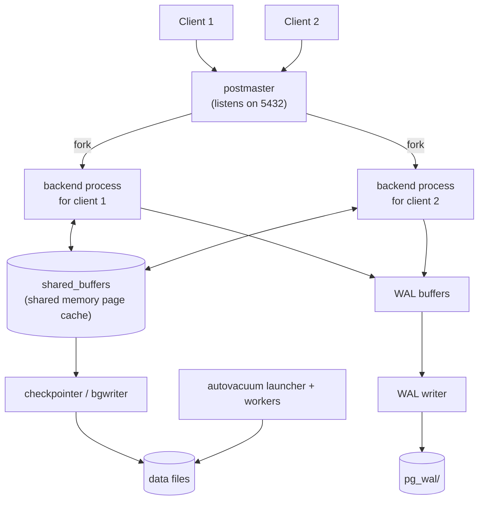

# PostgreSQL Architecture, MVCC and VACUUM

PostgreSQL behaves predictably once you know what it does under the hood. "Why is this table 40 GB when it holds 2 GB of data?", "why did that query suddenly get slow?" and "why are we out of connections?" all come back to a few architectural facts: the process model, how data sits on disk, the write-ahead log, and multi-version concurrency control (MVCC) with VACUUM.

## 1. The process model



- Every client connection is a **separate operating-system process**, forked by the postmaster. Each one uses several MB of memory, so PostgreSQL handles hundreds of connections well, but not thousands.
- That's why production setups use a **connection pooler** (PgBouncer in transaction mode, or the pool built into your driver) so 2,000 app threads share 50 server connections.
- **`shared_buffers`** is PostgreSQL's page cache, typically about 25% of RAM. The OS page cache holds much of the rest.

```sql
SELECT count(*), state FROM pg_stat_activity GROUP BY state;   -- who is connected, doing what
SHOW max_connections;
```

## 2. How data is stored

- Each table and index is a set of files of **8 KB pages**.
- A table is a **heap**, an unordered collection of row versions called **tuples**.
- Each tuple has hidden system columns, including **`xmin`** (the transaction id that created it) and **`xmax`** (the transaction that deleted or replaced it, if any).
- Large values (above about 2 KB) are compressed and moved to a side **TOAST** table automatically.

```sql
SELECT xmin, xmax, ctid, * FROM orders WHERE id = 42;
-- ctid = (page, item) physical location of this row version
```

## 3. The write-ahead log (WAL)

Before a change touches a data page on disk, a record of it is appended to the **WAL**. On commit, PostgreSQL only needs to flush the WAL, which is sequential and fast. Data pages are written later by the checkpointer. After a crash, PostgreSQL replays the WAL from the last checkpoint to reconstruct committed changes. That's the **D** in ACID.

The same WAL stream powers:

- **Streaming replication:** replicas replay the primary's WAL.
- **Point-in-time recovery:** a base backup plus archived WAL lets you restore to any second.
- **Logical decoding and CDC:** tools like Debezium read row changes from the WAL.

## 4. MVCC: readers don't block writers

PostgreSQL never overwrites a row in place. An `UPDATE` writes a **new version** of the row and marks the old version's `xmax`. Each transaction sees a consistent **snapshot**: the versions committed before it started (or before each statement, under Read Committed).

```text
Time  Txn 100 (UPDATE price)            Txn 101 (SELECT)
t1    BEGIN
t2    UPDATE products SET price=300
      WHERE id=7;
      -- old version: xmax=100
      -- new version: xmin=100
t3                                       SELECT price FROM products WHERE id=7;
                                         -- sees 250 (100 hasn't committed)
t4    COMMIT
t5                                       SELECT price ... → 300 (new statement, new snapshot)
```

The result is that **reads never wait for writes, and writes never wait for reads**. Only two writers touching the *same row* wait for each other.

The cost is that **dead tuples accumulate**. Every UPDATE and DELETE leaves an old version behind that no current transaction can see any more.

## 5. VACUUM and autovacuum

`VACUUM` reclaims space from dead tuples so it can be reused, and updates the **visibility map**, which makes index-only scans possible. **Autovacuum** runs it automatically once a table has enough dead tuples. By default that's 20% of the table plus 50 rows.

```sql
-- Which tables have the most dead tuples, and when were they last vacuumed?
SELECT relname, n_live_tup, n_dead_tup,
       round(100.0 * n_dead_tup / nullif(n_live_tup + n_dead_tup, 0), 1) AS dead_pct,
       last_autovacuum, last_autoanalyze
FROM pg_stat_user_tables
ORDER BY n_dead_tup DESC
LIMIT 10;
```

**Bloat** happens when dead tuples pile up faster than vacuum cleans them. Tables and indexes grow, and scans get slower. Common causes:

1. **Long-running transactions.** An open transaction, including one left "idle in transaction" by a buggy app, holds back the cleanup horizon for the *whole database*. Vacuum can't remove anything that transaction might still need to see.
2. **Autovacuum too conservative for hot tables.** 20% of a 500-million-row table is 100 million dead rows before anything happens.
3. **Abandoned replication slots** that keep old WAL and rows around.

```sql
-- Find transactions that are blocking cleanup
SELECT pid, now() - xact_start AS age, state, left(query, 80)
FROM pg_stat_activity
WHERE xact_start IS NOT NULL
ORDER BY xact_start
LIMIT 5;

-- Tune autovacuum for one hot table
ALTER TABLE order_events SET (autovacuum_vacuum_scale_factor = 0.02, autovacuum_vacuum_cost_limit = 2000);

-- Guardrail: kill sessions idle in a transaction for over 5 minutes
ALTER DATABASE shop SET idle_in_transaction_session_timeout = '5min';
```

Plain `VACUUM` makes space reusable but rarely shrinks the files. `VACUUM FULL` rewrites the table smaller but takes an exclusive lock for the duration. Use **`pg_repack`** to rebuild online without long locks.

### Transaction ID wraparound

Transaction ids are 32-bit. To keep the comparison of old and new ids correct, very old tuples must be **frozen** by vacuum. If autovacuum is blocked for months on a busy system, PostgreSQL eventually refuses new writes to protect data. Monitor `age(datfrozenxid)` and never disable autovacuum.

## 6. HOT updates and fillfactor

When an update doesn't change any indexed column and there's free space on the same page, PostgreSQL performs a **HOT (heap-only tuple)** update. No index entries need updating, which is much cheaper. For tables with frequent updates to non-indexed columns, such as an order's `status`, leave free space on each page:

```sql
ALTER TABLE orders SET (fillfactor = 85);   -- keep 15% free for HOT updates
SELECT relname, n_tup_upd, n_tup_hot_upd FROM pg_stat_user_tables WHERE relname = 'orders';
```

Indexing a column you update constantly, such as `last_seen_at`, disables HOT updates for that table. Weigh whether you really need that index.

## 7. Real-world case: a 3 GB table becomes 60 GB

A delivery app updates each active order's rider location every 5 seconds in the `orders` row. Within weeks the table is 20 times its expected size and the dashboard queries slow down. Investigation shows:

- Millions of dead tuples from location updates, and autovacuum never keeping up at the default 20% threshold.
- A reporting job that held a transaction open for 6 hours every night, blocking cleanup.
- An index on `updated_at`, which prevented HOT updates.

Fixes: move live locations to a separate narrow table (or Redis), tune autovacuum per table, add `idle_in_transaction_session_timeout`, drop the unnecessary index, set fillfactor to 80, and rebuild once with `pg_repack`.

## 8. Hands-on exercise

1. Create a table, insert 100,000 rows, then update every row three times. Check `n_dead_tup` and `pg_total_relation_size`.
2. Run `VACUUM (VERBOSE)` and compare. Then run `VACUUM FULL` and compare again.
3. In one session, `BEGIN; SELECT 1;` and leave it open. In another, update rows and vacuum. Notice the dead tuples can't be removed. Commit the first session and vacuum again.
4. Observe `xmin`/`xmax` changing across an update in two concurrent sessions.

## 9. Checklist

- [ ] I can explain the process-per-connection model and why poolers are needed.
- [ ] I understand pages, tuples, `xmin`/`xmax` and TOAST.
- [ ] I can explain the WAL and what it enables (durability, replication, PITR, CDC).
- [ ] I can explain MVCC snapshots and why reads and writes don't block each other.
- [ ] I can diagnose bloat, find blockers of vacuum and tune autovacuum per table.

## 10. Interview angle

> **Asked as:** "How does PostgreSQL implement MVCC, and what's the cost?"

Updates create new row versions tagged with transaction ids, and each transaction reads from a snapshot, so readers and writers don't block each other. The cost is dead tuples that VACUUM must clean. Long transactions block that cleanup and cause bloat.

> **Asked as:** "Why use PgBouncer?"

Each connection is a process with significant memory, so a pooler lets many client connections share a small set of server connections, typically in transaction-pooling mode.
