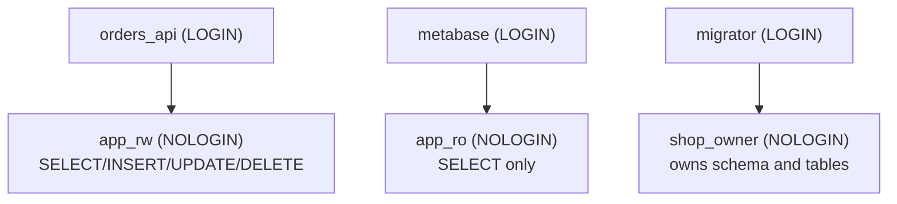

# PostgreSQL Administration: Roles, Security, Backups and Recovery

A database administrator's first job is simple to state: never lose data, and never let the wrong person see it. This guide covers installing and configuring PostgreSQL sensibly, the role and privilege system, network access control, and the backup and recovery strategies you must actually *test*. A backup you've never restored is only a hope.

## 1. Installing and the important config files

As of October 2026, **PostgreSQL 18** is the newest stable major version. PostgreSQL 19 is in release candidates, with GA scheduled for 29 October 2026. Each major version is supported for five years.

```bash
# Ubuntu/Debian: official PGDG repository for current versions
sudo apt install -y postgresql-common && sudo /usr/share/postgresql-common/pgdg/apt.postgresql.org.sh
sudo apt install -y postgresql-18

# Or a disposable local instance
docker run -d --name pg -e POSTGRES_PASSWORD=dev -p 5432:5432 -v pgdata:/var/lib/postgresql/data postgres:17
```

| File | Controls |
|---|---|
| `postgresql.conf` | Memory, WAL, logging, connections, autovacuum |
| `pg_hba.conf` | **Who** may connect, **from where** and **how** they authenticate |
| `postgresql.auto.conf` | Settings written by `ALTER SYSTEM` (don't edit by hand) |

```sql
SHOW config_file;
SHOW hba_file;
ALTER SYSTEM SET log_min_duration_statement = '500ms';   -- log slow queries
SELECT pg_reload_conf();                                   -- most settings apply on reload
SELECT name, setting, pending_restart FROM pg_settings WHERE pending_restart;  -- these need a restart
```

## 2. Roles, privileges and least privilege

PostgreSQL has a single concept, the **role**. A role with `LOGIN` is a user, and a role without it acts as a group.



```sql
-- Group roles
CREATE ROLE shop_owner NOLOGIN;
CREATE ROLE app_rw NOLOGIN;
CREATE ROLE app_ro NOLOGIN;

-- Lock down the default public schema and create an app schema
REVOKE CREATE ON SCHEMA public FROM PUBLIC;
CREATE SCHEMA shop AUTHORIZATION shop_owner;

GRANT USAGE ON SCHEMA shop TO app_rw, app_ro;
GRANT SELECT, INSERT, UPDATE, DELETE ON ALL TABLES IN SCHEMA shop TO app_rw;
GRANT USAGE ON ALL SEQUENCES IN SCHEMA shop TO app_rw;
GRANT SELECT ON ALL TABLES IN SCHEMA shop TO app_ro;

-- Apply the same grants to tables the migrator creates in future
ALTER DEFAULT PRIVILEGES FOR ROLE shop_owner IN SCHEMA shop
  GRANT SELECT, INSERT, UPDATE, DELETE ON TABLES TO app_rw;
ALTER DEFAULT PRIVILEGES FOR ROLE shop_owner IN SCHEMA shop
  GRANT SELECT ON TABLES TO app_ro;

-- Login users inherit from groups
CREATE ROLE orders_api LOGIN PASSWORD 'from-secret-manager' IN ROLE app_rw;
CREATE ROLE metabase  LOGIN PASSWORD 'from-secret-manager' IN ROLE app_ro;
CREATE ROLE migrator  LOGIN PASSWORD 'from-secret-manager' IN ROLE shop_owner;
ALTER ROLE orders_api SET statement_timeout = '5s';    -- per-role guardrail
```

The principles behind this:

- **The application never connects as a superuser or table owner.** A SQL injection in the app then can't `DROP TABLE`.
- **Migrations run as the owner**, separately from runtime traffic.
- **`ALTER DEFAULT PRIVILEGES`** is the step people forget. Without it, every new table is invisible to the app role until someone remembers to grant access.

### Row-Level Security for multi-tenant data

```sql
ALTER TABLE shop.orders ENABLE ROW LEVEL SECURITY;
CREATE POLICY tenant_isolation ON shop.orders
  USING (tenant_id = current_setting('app.tenant_id')::uuid);

-- The app sets the tenant per transaction:
SET LOCAL app.tenant_id = '6f1c...';
SELECT * FROM shop.orders;     -- only this tenant's rows, even if the WHERE clause is forgotten
```

## 3. Network access: pg_hba.conf and TLS

```text
# TYPE   DATABASE  USER        ADDRESS          METHOD
local    all       postgres                     peer
hostssl  shop      orders_api  10.0.1.0/24      scram-sha-256
hostssl  shop      metabase    10.0.5.10/32     scram-sha-256
host     all       all         0.0.0.0/0        reject
```

Rules are matched **top to bottom, first match wins**. Use `hostssl` to require TLS, `scram-sha-256` for passwords (never `md5` or `trust` on a network), and finish with an explicit reject. Never expose port 5432 to the public internet. Keep it on a private network and reach it through a bastion host, a VPN or the cloud provider's private networking.

## 4. Backup strategies

| Method | What it is | Restore to | Use for |
|---|---|---|---|
| `pg_dump` | Logical export of one database | The moment the dump started | Small databases, migrations between versions, copies for dev |
| `pg_basebackup` | Physical copy of the whole cluster | The moment the backup finished | Seeding replicas, base for PITR |
| **Base backup + WAL archiving** | Physical backup plus a continuous WAL stream | **Any second** within retention | Production (point-in-time recovery) |
| Managed snapshots (RDS, Cloud SQL, Azure) | Provider-run PITR | Any second within retention | Most cloud setups |

### Logical backups

```bash
# Custom format: compressed, supports parallel and selective restore
pg_dump -h db.internal -U migrator -Fc -d shop -f shop_$(date +%F).dump

# Restore into a fresh database using 4 parallel jobs
createdb -h localhost shop_restore
pg_restore -h localhost -d shop_restore -j 4 --no-owner shop_2026-10-11.dump

# Just the schema, or just one table
pg_dump -s -d shop > schema.sql
pg_dump -t shop.orders -d shop -Fc -f orders.dump
```

### Point-in-time recovery with pgBackRest

Tools like **pgBackRest** or **WAL-G** handle base backups, WAL archiving to S3 or Azure Blob, retention, encryption and verification:

```ini
# /etc/pgbackrest/pgbackrest.conf
[global]
repo1-type=s3
repo1-s3-bucket=acme-pg-backups
repo1-s3-region=ap-southeast-1
repo1-retention-full=2
repo1-cipher-type=aes-256-cbc
start-fast=y

[shop]
pg1-path=/var/lib/postgresql/18/main
```

```text
# postgresql.conf
archive_mode = on
archive_command = 'pgbackrest --stanza=shop archive-push %p'
```

```bash
pgbackrest --stanza=shop --type=full backup          # weekly full
pgbackrest --stanza=shop --type=diff backup          # daily differential
# Disaster: someone ran DELETE without WHERE at 14:31:55. Restore to just before it.
pgbackrest --stanza=shop --type=time --target="2026-10-11 14:31:00+06" --target-action=promote restore
```

## 5. Test your restores

Define two numbers with the business:

- **RPO (recovery point objective):** how much data you may lose. With WAL archiving it's seconds. With nightly dumps it's up to 24 hours.
- **RTO (recovery time objective):** how long you may be down while restoring.

Then prove you can meet them. Automate a weekly job that restores the latest backup into a scratch instance, runs sanity queries (row counts, latest `created_at`), records the duration and alerts on failure.

## 6. Upgrades

- **Minor versions** (17.2 → 17.3) are bug and security fixes. Just update the packages and restart.
- **Major versions** (16 → 17) change the on-disk format. Options:
  - `pg_upgrade --link`: minutes of downtime, in place.
  - Logical replication to a new-version server, then switch over: near-zero downtime.
  - Dump and restore: simple, with downtime proportional to size.

Always run the upgrade on a restored copy first and test the application against it.

## 7. Real-world case: "we had backups"

A startup ran nightly `pg_dump` to the same VM's disk. The disk failed, and the backups went with it. After rebuilding from a three-day-old copy on a laptop, they moved to pgBackRest with WAL archiving to object storage in another region, encrypted backups with 30-day retention, a weekly automated restore test with alerts, and a documented runbook. Their RPO went from "unknown" to under one minute, and their RTO to 25 minutes, both measured.

## 8. Hands-on exercise

1. Create `app_rw`, `app_ro` and login roles with default privileges. Prove the app role can't `DROP TABLE` or create tables.
2. Enable Row-Level Security on a table and demonstrate tenant isolation with `SET LOCAL`.
3. Take a `pg_dump -Fc`, drop a table, and restore just that table.
4. Bonus: set up pgBackRest (or WAL-G) to MinIO in Docker, delete rows, and restore to a timestamp just before the deletion.

## 9. Checklist

- [ ] I can configure `postgresql.conf` and `pg_hba.conf` and know which changes need a restart.
- [ ] I set up least-privilege roles with default privileges and never run apps as superuser.
- [ ] I can use Row-Level Security for tenant isolation.
- [ ] I can choose between logical backups, physical backups and PITR, and explain RPO and RTO.
- [ ] I regularly test restores and can plan a major-version upgrade.

## 10. Interview angle

> **Asked as:** "How would you back up a production PostgreSQL database?"

Physical base backups plus continuous WAL archiving to off-site, encrypted object storage, using pgBackRest or WAL-G or the managed provider's PITR, with defined RPO and RTO and automated restore tests. Use `pg_dump` for logical copies, not as the main disaster-recovery method.

> **Asked as:** "What privileges should the application's database user have?"

Only DML on its schema, through a group role with default privileges. It should not own tables, have superuser rights or be able to run DDL. Migrations run under a separate owner role.
