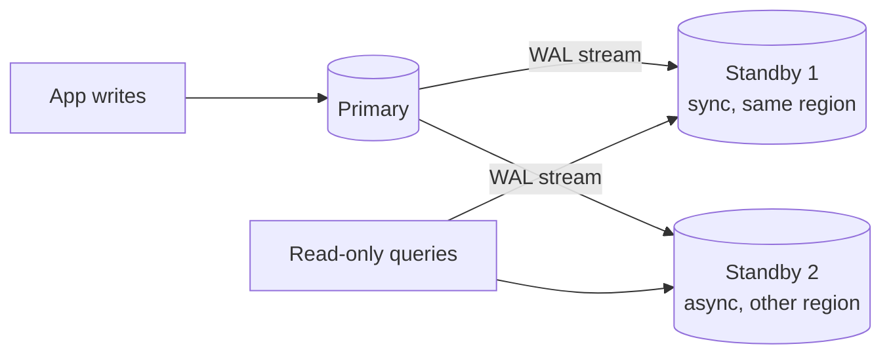
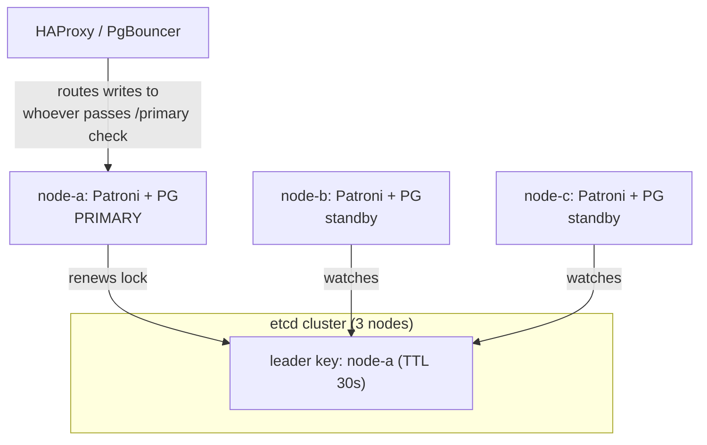

# PostgreSQL Replication, High Availability and Scaling

One PostgreSQL server is a single point of failure. When it dies, your application dies with it. This guide covers how PostgreSQL copies data to other servers (streaming and logical replication), how to fail over automatically without losing data or ending up with two primaries, and how to scale reads and connections as traffic grows.

## 1. Streaming (physical) replication

The primary streams its write-ahead log to one or more **standbys**, which replay it continuously. A standby is a byte-for-byte copy of the whole cluster and can serve read-only queries (a **hot standby**).



Setting up a standby:

```sql
-- On the primary
CREATE ROLE replicator WITH REPLICATION LOGIN PASSWORD 'from-secret-manager';
SELECT pg_create_physical_replication_slot('standby1');
```

```bash
# On the standby host: clone the primary and configure it to follow
pg_basebackup -h primary.internal -U replicator -D /var/lib/postgresql/18/main \
  -X stream -S standby1 -R -P
# -R writes primary_conninfo and creates standby.signal automatically
```

Monitor the lag. It's the first thing to check when "the data on the read replica is old":

```sql
-- On the primary
SELECT client_addr, state, sync_state,
       pg_size_pretty(pg_wal_lsn_diff(pg_current_wal_lsn(), replay_lsn)) AS replay_lag_bytes,
       replay_lag
FROM pg_stat_replication;
```

### Synchronous vs asynchronous

| | Asynchronous (default) | Synchronous |
|---|---|---|
| Commit returns when | WAL is flushed on the primary | WAL is also confirmed by a standby |
| Data loss if the primary dies | Possibly the last few transactions | None (for the synchronous standby) |
| Write latency | Lowest | Plus one network round trip |
| Risk | Lost recent writes on failover | Writes stall if the sync standby is down (unless you configure ANY 1 of several) |

```text
# postgresql.conf on the primary: wait for any one of two nearby standbys
synchronous_standby_names = 'ANY 1 (standby1, standby2)'
synchronous_commit = on
```

A common production design is one synchronous standby in a second availability zone (zero data loss for zone failures) plus an asynchronous standby in another region (disaster recovery).

## 2. Replication slots: useful and dangerous

A **replication slot** makes the primary keep WAL until the slot's consumer has received it, so a standby that disconnects briefly can catch up. But if a consumer disappears for good, the slot keeps *all* WAL forever and the primary's disk fills up.

```sql
SELECT slot_name, active, pg_size_pretty(pg_wal_lsn_diff(pg_current_wal_lsn(), restart_lsn)) AS retained
FROM pg_replication_slots;
-- Safety net (PostgreSQL 13+): cap how much WAL a slot may retain
ALTER SYSTEM SET max_slot_wal_keep_size = '50GB';
```

## 3. Logical replication

Physical replication copies everything at the storage level. **Logical replication** sends row-level changes for chosen tables, which allows:

- replicating a subset of tables,
- replicating between *different major versions* (zero-downtime upgrades),
- feeding a separate analytics database or consolidating several databases into one.

```sql
-- Publisher (source)
ALTER SYSTEM SET wal_level = 'logical';   -- needs a restart
CREATE PUBLICATION shop_pub FOR TABLE shop.orders, shop.order_items;

-- Subscriber (target, schema created beforehand)
CREATE SUBSCRIPTION shop_sub
  CONNECTION 'host=primary.internal dbname=shop user=replicator password=...'
  PUBLICATION shop_pub;
```

Limitations to remember: DDL (schema changes) isn't replicated, sequences aren't synced, and tables need a primary key or replica identity for updates and deletes.

## 4. High availability: automatic failover

A standby alone doesn't give you HA. Something must detect that the primary died, promote the best standby, repoint clients, and make sure the old primary can't come back and accept writes. Two primaries accepting writes at once is **split-brain**, the worst outcome.

**Patroni** is the standard open-source HA manager. Each node runs a Patroni agent, and they agree on a leader through a distributed consensus store (etcd, Consul or ZooKeeper). Only the node holding the leader lock may be primary.



If node-a dies, its lock expires and the healthiest standby with the least lag acquires it and promotes itself. HAProxy health checks against Patroni's REST API (`/primary`, `/replica`) move traffic automatically. If node-a comes back, Patroni sees it is no longer the leader and rejoins it as a standby, using `pg_rewind` if needed.

On managed services (RDS Multi-AZ, Aurora, Cloud SQL HA, Azure Flexible Server zone-redundant HA), the provider does all this. Your application still has to **reconnect and retry** after a failover, which typically takes 20–60 seconds.

## 5. Scaling reads

Send read-only queries that tolerate slightly stale data to replicas:

```python
# Django: a database router that sends reads to the replica
class PrimaryReplicaRouter:
    def db_for_read(self, model, **hints):
        return "replica"
    def db_for_write(self, model, **hints):
        return "default"
    def allow_relation(self, obj1, obj2, **hints):
        return True
```

Watch out for **read-your-writes**. A user updates their address and the next page, served by a lagging replica, shows the old one. Common fixes:

- route the user's reads to the primary for a few seconds after they write (a "sticky primary" flag in the session),
- send reads that must be fresh to the primary,
- wait for the replica to reach the write's LSN (`pg_last_wal_replay_lsn()`) before reading.

## 6. Scaling connections: PgBouncer

```ini
; pgbouncer.ini
[databases]
shop = host=10.0.2.21 port=5432 dbname=shop

[pgbouncer]
listen_port = 6432
pool_mode = transaction        ; a server connection is held only for one transaction
max_client_conn = 5000
default_pool_size = 40
server_reset_query = DISCARD ALL
```

**Transaction pooling** gives the biggest multiplier, but session-level features break across transactions: `SET` without `LOCAL`, advisory session locks, `LISTEN`, and (with older PgBouncer versions) named prepared statements. PgBouncer 1.21+ supports prepared statements in transaction mode, so check your driver settings.

## 7. Scaling writes: partitioning and sharding

Before sharding, try this order: better indexes and queries, a bigger instance, partitioning, archiving old data, and moving hot non-relational data (sessions, live locations) to Redis.

**Declarative partitioning** splits a big table by range, list or hash. Queries that filter on the partition key touch only the relevant partitions, and old partitions can be dropped instantly instead of with a giant `DELETE`:

```sql
CREATE TABLE order_events (
  id bigint GENERATED ALWAYS AS IDENTITY,
  order_id bigint NOT NULL,
  created_at timestamptz NOT NULL,
  payload jsonb,
  PRIMARY KEY (id, created_at)
) PARTITION BY RANGE (created_at);

CREATE TABLE order_events_2026_10 PARTITION OF order_events
  FOR VALUES FROM ('2026-10-01') TO ('2026-11-01');

-- Retention: drop a month in milliseconds (no vacuum storm)
DROP TABLE order_events_2025_10;
```

Automate partition creation with `pg_partman`. When one primary truly can't absorb the write volume, **Citus** distributes tables across nodes by a shard key such as `tenant_id`, while you keep using PostgreSQL SQL.

## 8. Real-world case: a failover that lost orders

An e-commerce site used asynchronous replication and a homemade failover script. The primary's disk failed during a flash sale. The script promoted the replica, which was 4 seconds behind, so about 300 orders were lost. Then the old primary came back after a reboot and accepted writes from a few app servers that still pointed at it: split-brain. The team moved to Patroni with etcd and a synchronous standby (`ANY 1` of two in different zones), routing through HAProxy health checks, plus application retry logic for the 30-second failover window. Their next failure drill lost zero transactions.

## 9. Hands-on exercise

1. With Docker Compose, run a primary and a streaming standby. Insert on the primary, read on the standby, and measure the lag.
2. Stop the primary, promote the standby (`pg_ctl promote` or `SELECT pg_promote()`), and reconnect the app.
3. Set up logical replication of one table to a separate database.
4. Partition an events table by month, insert data across months, and confirm partition pruning with `EXPLAIN`.
5. Bonus: run the Patroni Docker demo and kill the leader.

## 10. Checklist

- [ ] I can set up streaming replication and monitor replication lag.
- [ ] I can explain synchronous vs asynchronous replication and the trade-offs.
- [ ] I know the risk of abandoned replication slots and how to cap it.
- [ ] I can explain automated failover with Patroni and how split-brain is prevented.
- [ ] I can scale reads (replicas and read-your-writes), connections (PgBouncer) and big tables (partitioning).

## 11. Interview angle

> **Asked as:** "How do you make PostgreSQL highly available?"

Use streaming replication to standbys in other zones, at least one synchronous for zero data loss, managed by Patroni with a consensus store so only one primary can exist. Route through HAProxy or PgBouncer health checks, and make the app retry during the failover window. On the cloud, use the managed multi-zone option.

> **Asked as:** "Physical vs logical replication?"

Physical replicates the whole cluster's WAL byte for byte, which is used for HA and read replicas on the same major version. Logical replicates row changes for selected tables, which is used for cross-version upgrades, subsets and feeding other systems.
